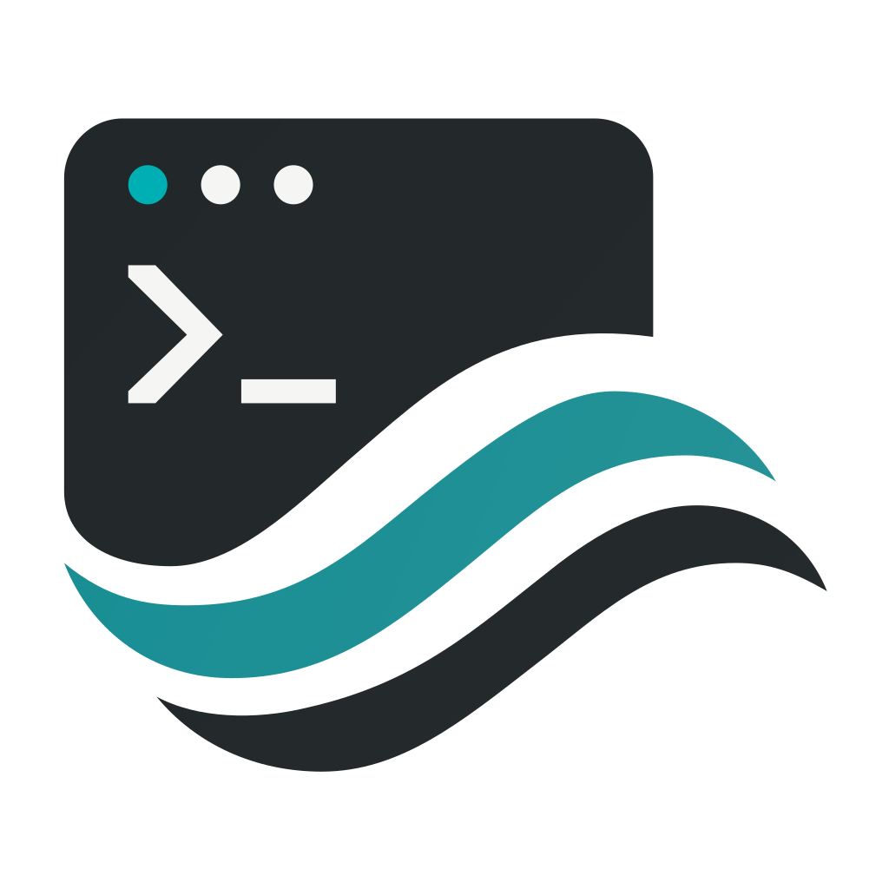
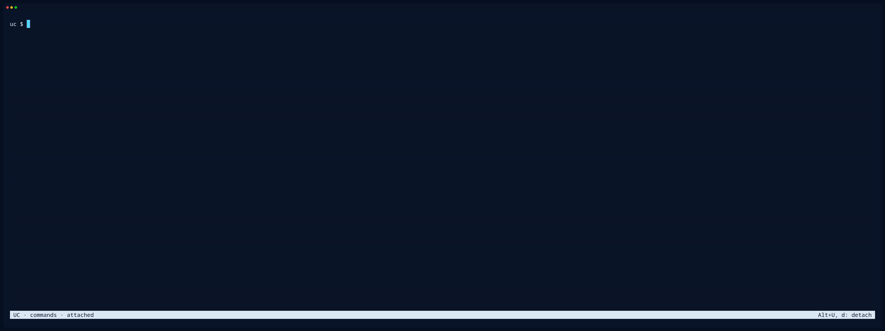
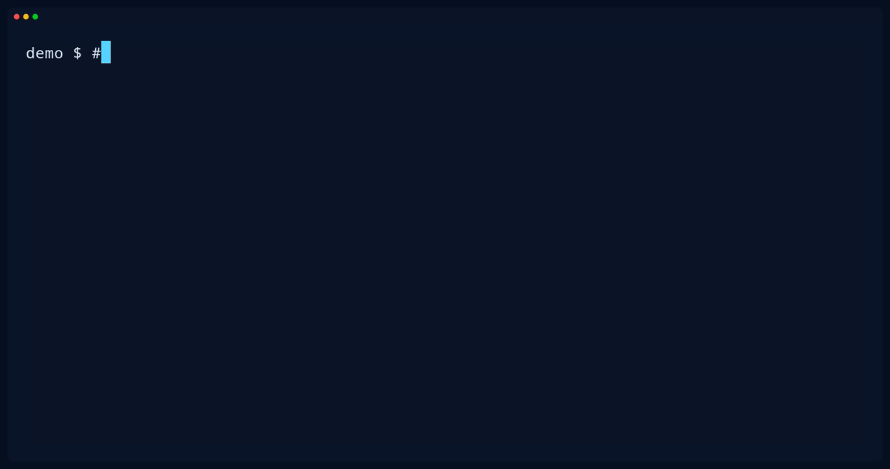
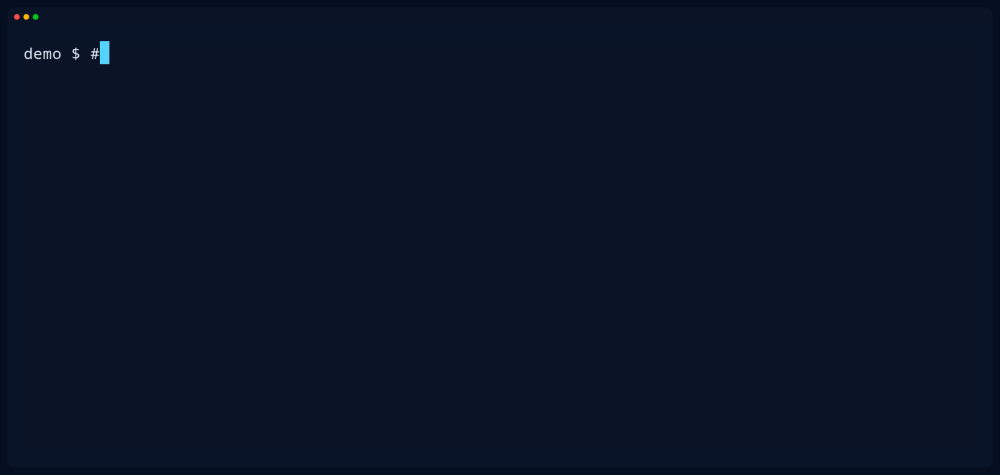
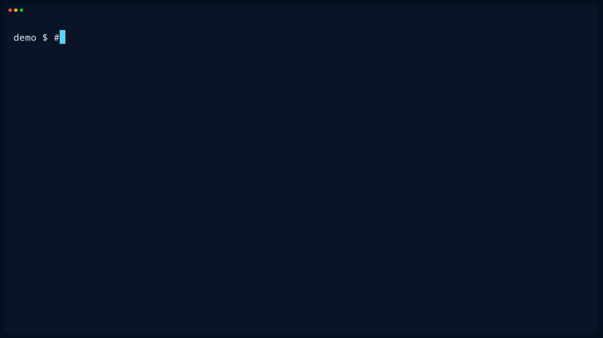
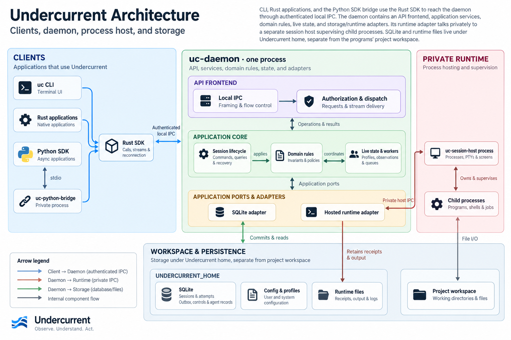

<p align="center">
  
</p>

# Undercurrent

<p align="center">
  <strong>Run. Observe. Control.</strong><br>
  Undercurrent is a programmable process multiplexer for launching, supervising,
  reconnecting to, and interacting with long-running processes.
</p>
<p align="center">
  <a href="https://github.com/Aixand/undercurrent/actions/workflows/platform-contracts.yml">
    
  </a>
  <a href="LICENSE">
    
  </a>
  <a href="rust-toolchain.toml">
    
  </a>
  <a href="docs/sdk/python/quickstart.md">
    
  </a>
</p>

---

[Standalone workflows](docs/getting-started/README.md#choose-a-workflow) ·
[Getting started](docs/getting-started/README.md)

**Contents** · [Demo](#see-it-in-action) · [Capabilities](#what-you-can-do) · [Installation](#installation) ·
[Quick start](#quick-start) · [SDKs](#build-with-undercurrent) ·
[Architecture](#architecture) · [Documentation](#documentation)

## See it in action

See an isolated request error while an npm API stays healthy. Then simulate an
essential dependency failing and recovering: `uc ls` tracks service health,
while `uc logs` keeps the error history.



[Still image](docs/assets/demos/server-health-poster.png) ·
[Server fixture and commands](docs/assets/demos/README.md#check-an-npm-server-and-find-errors) ·
[All recordings](docs/assets/demos/README.md)

<details>
<summary><strong>Keep a process running while you detach and return</strong></summary>

Start a task, detach while it keeps working, and return to the same session.



[Still image](docs/assets/demos/overview-poster.png) · [Try the workflow](#quick-start)

</details>

<details>
<summary><strong>Wait for interaction, then respond</strong></summary>

A sample importer asks for confirmation. An explicit detection profile identifies
the prompt; `uc wait` observes `interaction=requested` before we send the answer.



[Still image](docs/assets/demos/interaction-poster.png) ·
[Profile and recording setup](docs/assets/demos/README.md#wait-for-interaction)

</details>

<details>
<summary><strong>Coordinate parallel jobs and a dependent step</strong></summary>

Run validation and totals in separate sessions. A Python coordinator waits for
both successful exits before launching a report job.



[Still image](docs/assets/demos/orchestration-poster.png) ·
[Coordinator source](docs/assets/demos/fixtures/orchestrate.py) ·
[How it works](docs/assets/demos/README.md#coordinate-jobs)

</details>

## What you can do

- **Run processes and tools.** Launch programs, shells, and terminal-based agents in named sessions.
- **Leave and return.** Detach from a terminal while its session keeps running, then reconnect when you need it.
- **See what is happening.** Inspect process and health states, read retained output, and watch session updates.
- **Know when a process needs input.** Detect profile-recognized input requests and respond with text or keys.
- **Organize your workspace.** Switch between sessions, split terminal panes, and reopen saved groups.
- **Orchestrate from code.** Wait for observed states, validate task results, and coordinate follow-up work with the Rust and Python SDKs.

Connect an assistant with the [local MCP server and skills](docs/agent/mcp.md).

Coming from tmux? [Compare the workflows and capabilities](docs/getting-started/undercurrent-vs-tmux.md).

## Installation

Install from this checkout with the commands below. For supplied artifacts or
published downloads, see [other installation routes](#portable-artifacts-and-published-downloads).

### Local development

To install from this checkout, use **Rust 1.95.0** and your platform's native
compiler/linker. Run from the repository root on Linux/macOS:

```sh
./dev.sh install --prod
```

On **Windows x86_64**, use PowerShell with MSVC build tools:

```powershell
.\dev.ps1 install --prod
```

These development helpers build locally and install the three core executables
and `uc-mcp` into Cargo's `bin` directory by default. Install the Python bridge
separately when using the SDK, following its [quickstart](docs/sdk/python/quickstart.md).
See [development setup](docs/development/setup.md) for local builds and reinstalling.

### Portable artifacts and published downloads

A supplied [portable product artifact](docs/getting-started/product-installer.md#install-without-source-or-language-tools)
includes all five native executables, the Python SDK wheel, reviewed notices,
and its helper interpreter. Use its matching bootstrap and license digest.
No system Python or Rust is required for this route. Maintainers build and
[qualify the artifact](docs/development/installer-validation.md) separately.

Hosted installer availability is not established for this source snapshot.
If a maintainer confirms a published release and working endpoints for your
platform, follow the [download installation guide](docs/getting-started/installation.md#install-a-published-release).

### Initialize your shell

After installing `uc` and adding it to `PATH`, run `uc init` for each shell you
will use in managed sessions. Choose the command for your shell:

| Shell | Setup command |
| --- | --- |
| Bash | `uc init bash` |
| Zsh | `uc init zsh` |
| Fish | `uc init fish` |
| PowerShell | `uc init powershell --profile "$PROFILE"` |

This installs hooks in your shell's startup file so Undercurrent can observe
when the shell is ready for input or running a command and capture its exported
environment for `uc exec`. Open a **new managed shell** after installation;
existing shells keep their previously loaded hooks.

Your prompt stays unchanged by default. Add `--prompt session`, for example
`uc init zsh --prompt session`, to show a label such as `[uc:demo]` in managed
shells. Use `uc init zsh --print` to preview the hooks without editing files.
For custom startup paths, use `--profile /absolute/path/to/startup-file`.
See [shell setup](docs/getting-started/installation.md#initialize-your-shell)
for defaults, updates, and optional completions.

## Quick start

Start with a persistent session, then use the same controls to coordinate
processes and jobs. The [workflow guide](docs/getting-started/README.md#choose-a-workflow)
and [recording fixtures](docs/assets/demos/README.md) provide complete local examples.

### Keep a session running

With `uc` installed and [your shell initialized](#initialize-your-shell), run
these commands from your project directory in an interactive terminal.
Use an unused session name; this example uses `demo`.

1. **Open a managed shell.**

   ```sh
   uc start demo --interactive --attach
   ```

   A shell opens in your project directory. The CLI starts the local daemon
   automatically when needed. Inside the managed shell, run `uc context` to
   see its session identity. If you selected `--prompt session` during setup,
   the prompt also shows a session label.

2. **Detach, inspect, and return.**

   Press **Alt-U**, release it, then press **d**. Your original terminal returns
   while the managed shell keeps running.

   ```sh
   uc inspect demo
   uc logs demo --max-bytes 4096
   uc attach demo
   ```

   Inspection shows the session's state; attaching returns you to its terminal.

3. **Stop and clean up.**

   Detach again, then run:

   ```sh
   uc stop demo
   uc clean demo --yes
   ```

For a walkthrough that runs a command and checks its output, follow
[your first session](docs/getting-started/first-session.md).
If a step fails, use [troubleshooting](docs/guides/troubleshooting.md) before continuing.

### Orchestrate two agents

Use the [orchestration skill](docs/agent/README.md) to assign one agent an
architecture review and another a test review. Each worker runs in its own
Undercurrent session, through the CLI or MCP interface you select.
The parent agent assigns bounded tasks, collects results, and checks the
reported files and changes.

Prepare an installed, authenticated worker CLI and follow the skill's launch,
observation, and cleanup guidance. An available prompt or zero exit code alone
does not establish a completed review. Keep the original session identity when
following up or diagnosing a timeout.

For programming interfaces, start with the [SDK guides](docs/sdk/README.md).
The [workflow index](docs/getting-started/README.md#choose-a-workflow) maps
standalone tasks to their local guides.

## Build with Undercurrent

Use the **blocking Rust SDK** or **async Python SDK** to add session control to
your application. Both connect to an already-running daemon; start it with
`uc daemon start` in the home selected for your integration.

### Rust

With a connected `ProductClient` named `client`, request daemon status:

```rust
use std::time::Duration;
use undercurrent_protocol::{ProductRequest, ProductSuccess};

let timeout = Duration::from_secs(5);
match client.request(ProductRequest::GetDaemonStatus, timeout)? {
    ProductSuccess::GetDaemonStatus(status) => {
        println!("Managed sessions: {}", status.managed_sessions);
    }
    _ => return Err("unexpected daemon status response".into()),
}
```

This is a request excerpt inside a function returning `Result`.
[Connect and query from Rust](docs/sdk/rust/connect-and-query.md) provides dependency
setup and the [complete runnable example](crates/undercurrent-sdk/examples/query_watch.rs).

### Python

After [installing the Python package and matching bridge](docs/sdk/python/quickstart.md),
list sessions in the selected home:

```python
import asyncio
from undercurrent import Client

async def main():
    async with Client() as client:
        for session in await client.list():
            print(session.name, session.lifecycle)

asyncio.run(main())
```

[Explore the SDKs](docs/sdk/README.md) for session creation, input, output streams,
and recovery, or [watch Python control a session](docs/sdk/python/README.md#see-session-control-in-action).
Closing a client leaves its managed sessions running.

## Architecture

Clients connect to a local daemon, which coordinates session state and a separate
private process host. Your programs' workspace stays separate from Undercurrent's
own storage.

[](docs/assets/diagrams/undercurrent-architecture.png)

*Application services apply domain rules and coordinate live state; the private
host supervises execution. Host receipts and daemon execution-output files have
separate owners.*

[View full size](docs/assets/diagrams/undercurrent-architecture.png) ·
[Explore the architecture](docs/architecture/README.md)

## Documentation

| I want to… | Guide |
| --- | --- |
| Follow practical examples and watch demos | [Workflow guide](docs/getting-started/README.md#choose-a-workflow) · [Demos and fixtures](docs/assets/demos/README.md) |
| Orchestrate agents and connect their work | [Getting started with workflows](docs/getting-started/README.md#choose-a-workflow) |
| Teach my coding agent to use `uc` and orchestrate subagents | [Installable agent skills](docs/agent/README.md) |
| Manage programs and shells | [Session workflows](docs/guides/cli/sessions.md) |
| Attach, split panes, and save groups | [Interactive terminals](docs/guides/cli/interactive.md) · [Saved groups](docs/guides/cli/groups.md) |
| Inspect state and output | [Status and output](docs/guides/cli/status-and-output.md) |
| Configure or operate the daemon | [Configuration](docs/guides/configuration/README.md) · [Daemon operation](docs/guides/daemon/README.md) |
| Resolve a problem | [Troubleshooting](docs/guides/troubleshooting.md) |
| Look up a command or contract | [CLI reference](docs/reference/cli-commands.md) · [Compatibility](docs/reference/compatibility.md) |

## AI-assisted development

We use AI tools to generate and revise code and documentation during development
of Undercurrent and review the resulting work. Maintainers remain responsible
for validation and preserving third-party attribution. We do not knowingly
include proprietary code without permission.

We welcome evidence of proprietary code included without permission. If you
identify an affected code block, please follow the
[private reporting instructions](SUPPORT.md#report-code-ownership-or-licensing-concerns).
We investigate credible ownership reports and remove or replace material when
the evidence establishes that we lack distribution rights. AI assistance does
not excuse unauthorized use of someone else's work.

## Issues and pull requests

Bug reports, documentation issues, feature requests, and usage questions are
welcome. We are not accepting pull requests for now because our team lacks the
capacity to review external contributions. See the [participation policy](CONTRIBUTING.md)
and [support guide](SUPPORT.md).

---

[All documentation](docs/README.md) · [Issues and pull requests](CONTRIBUTING.md) · [Support](SUPPORT.md) · [Changelog](CHANGELOG.md) · [Security](SECURITY.md) · [Code of conduct](CODE_OF_CONDUCT.md) · [Apache-2.0 license](LICENSE)
