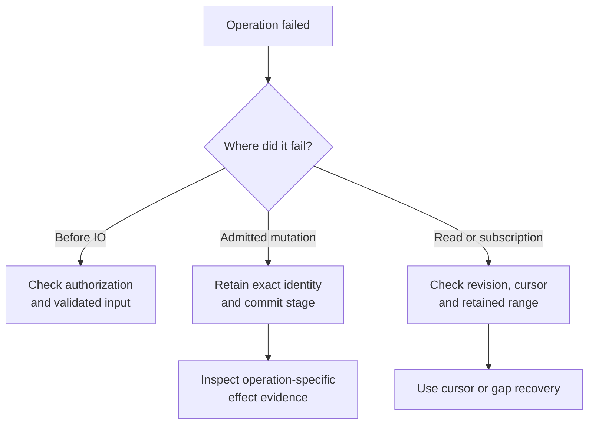
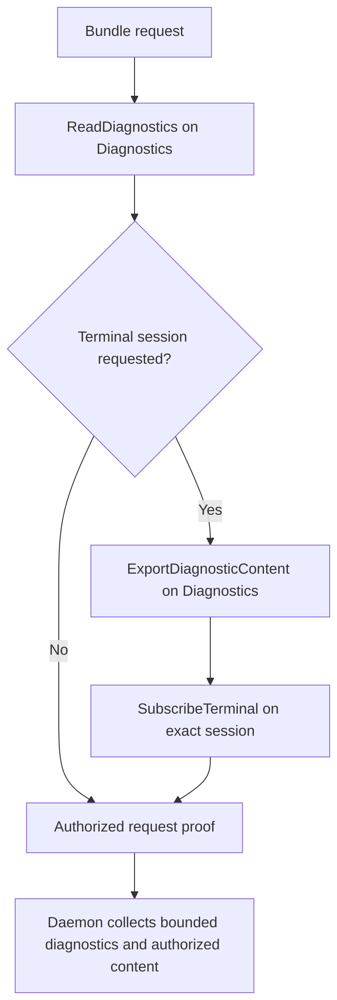

# Diagnose application failures and authorize diagnostic content

Use this explanation to identify where an application operation failed and what
may safely enter diagnostics. It covers the internal application layer: typed
errors and telemetry, effect uncertainty, and permission to include terminal
content in a bundle. For commands to verify a change, use the
[development guide](../development/contributing.md#run-a-focused-verification-loop).

## Diagnose by stage without logging private content

[observability.rs](../../src/observability.rs) owns application operations, span
names, diagnostic field names, event names, metric names, and level policy.
[ports.rs](../../src/ports.rs) owns the `PortOperation`, `PortErrorKind`, and
`AccessAction` registries; [error.rs](../../src/error.rs) owns
`ApplicationErrorCategory`. Their `ALL` arrays
and stable string mappings are the authoritative inventories. Generated Rustdoc
is the symbol lookup, rather than a second hand-maintained list in this guide.

An application operation describes the use case, such as a session mutation.
A port operation identifies a failing boundary, such as committing a session.
Keep both: the same storage failure can arise before a process effect or after
it, with different recovery implications. Qualified names use the
`undercurrent` namespace with operation, span, field, event,
diagnostic, or metric components as defined by the owning enum.

| Record | Content it carries |
| --- | --- |
| Event | `DiagnosticRecord`: typed event, level and time; optional session, application operation/category, and port operation/kind. No arbitrary payload string map. |
| Metric | `MetricObservation`: typed name, numeric value, and optional application operation. |
| Session metric | `SessionMetricObservation`: a metric with an explicit session association. |

Adapters own units, aggregation, bounded retention, and request/connection
correlation. Constructors do not validate every numeric measurement or provide
a tracing backend. Terminal content, argv, environment, and raw exception text
must stay out of these records.

`PortError` carries a typed kind, operation, optional session, and optional
attempt/effect evidence. `InvalidData` maps to InvariantViolation and `Other`
to Internal. Preserve service-specific stages such as commit-after-effect and
directory cleanup even when their presentation categories coincide.

The level policy distinguishes categories intentionally:

| Diagnostic level | Typical categories selected by the policy |
| --- | --- |
| Debug | Invalid arguments, authorization failures, missing resources, preconditions, conflicts, cancellation, and expired cursors. |
| Warn | Capacity/rate limits, timeouts, interruption, unavailable services or replay, and unsupported operations. |
| Error | Protocol failures, invariant violations, and internal errors. |

These levels classify diagnostics, not retry safety or effect certainty. A
timeout can follow an applied mutation. The existence of a registered event also
does not guarantee every path emits it. Inspect actual call sites: repair and
host shutdown, for example, do not take their own `Telemetry` argument, while
attached cancellation uses the stop service's telemetry.

`PortError` Display and Debug redact the concrete source text, but
`std::error::Error::source` still exposes it. A logger that recursively prints
error chains can defeat that boundary. The
[redaction tests](../../tests/ports_and_observability.rs) deliberately retain a
sensitive source while asserting safe outer formatting. Some other types, such
as [agent payload records](execution/agent-channel.md), derive Debug over their content;
there is no crate-wide promise that all Debug implementations are safe.
Secret resolution has a stricter [source-discarding boundary](execution/commands-and-secrets.md).

This decision view identifies the next evidence to inspect after an operation
fails. It does not convert an uncertain mutation into an automatic retry.

*Takeaway: recovery follows the owning operation's evidence, not the transport
error's name.* Use [attempt status](execution/attempts.md#read-attached-status-without-repairing-it),
[runtime controls](execution/runtime-controls.md), [read/watch recovery](sessions/read-models.md),
and [terminal gaps](sessions/terminal-io.md) for the appropriate next step. Preserve exact
identities and digests while investigating response loss.

## Authorize diagnostic content explicitly

[diagnostic_bundle.rs](../../src/diagnostic_bundle.rs) is an authorization service,
not a collector or exporter. The safe request is the default. It requires
`ReadDiagnostics` on `Diagnostics` and requests no terminal content. An explicit
terminal-content request names one session and additionally requires both
`ExportDiagnosticContent` on `Diagnostics` and `SubscribeTerminal` on that exact
session, in that order. A denied later action fails the whole authorization.

The following boundary view shows why general diagnostic access is insufficient
to attach terminal bytes.

*Takeaway: the proof records a successful authorization path; collection remains
an adapter responsibility.* `AuthorizedDiagnosticBundleRequest` has private
fields so workspace adapters cannot construct sensitive permission directly.
It is cloneable and does not implement expiry or policy refresh. Treat it as a
request-scoped composition result, not a new long-lived credential.

The [product bundle adapter](../../../undercurrent-daemon/src/application_adapter/operations.rs)
validates requested terminal read bounds, obtains the proof, performs a bounded
authorized terminal read, and presents the diagnostic page and optional content.
Its terminal read can report retention-gap recovery; a bundle is not evidence
of complete historical output. The separate daemon
[bundle collector](../../../undercurrent-daemon/src/operations.rs) also consumes the
proof and applies its own row/content limits. Those implementations own output
format and capacity enforcement; the application authorization service never
receives the bytes and cannot redact or truncate them itself.

Inline tests in the authorization module prove safe defaults do not require
content-export permission, explicit content does, and session-level denial is
independent from general export permission. Preserve these distinctions when
adding a new sensitive section rather than extending the safe default silently.

[Crate documentation](../README.md)
