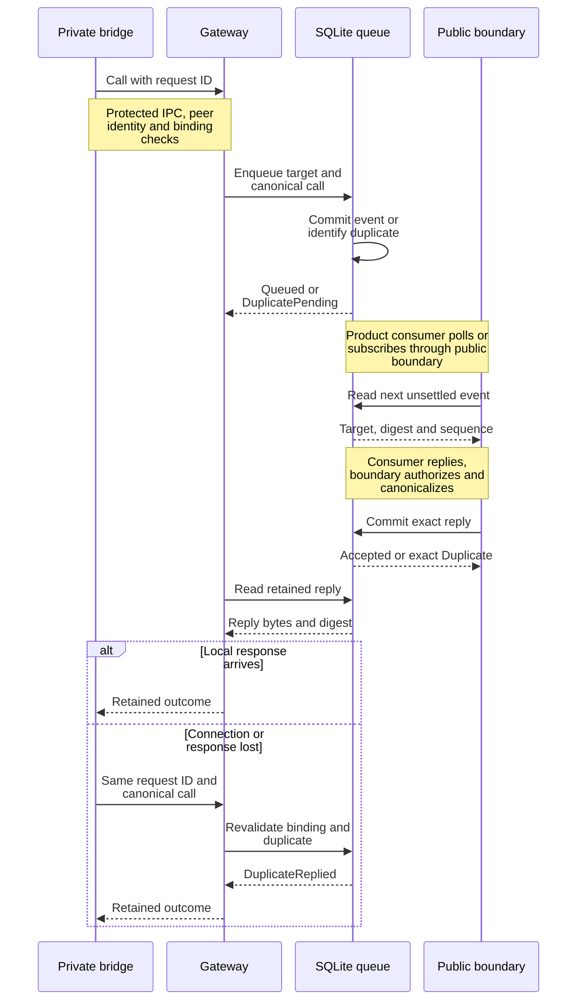

# Trace an agent call through the durable queue

Use this maintainer explanation to investigate an agent call that was queued,
replied to, disconnected, or rejected as stale. It describes the internal
application 0.1.0-beta port in [agent_channel.rs](../../../src/agent_channel.rs), its
[SQLite implementation](../../../../undercurrent-store-sqlite/src/sqlite/database/agent_channel.rs),
and the daemon boundaries that use it. Familiarity with
[attached attempt bindings](attempts.md) is a prerequisite.

The application owns transport-neutral queue records and classifications. It
does not implement the local socket, authenticate descendant processes,
canonicalize protocol JSON, execute tools, or decide a tool call's product-level
result. The [protocol agent definitions](../../../../undercurrent-protocol/src/agent.rs)
own payload schemas, canonicalization, and wire bounds. Application package
version, agent bridge protocol version, and database schema version are separate.

## Keep the private bridge and public consumer separate

The [agent bridge gateway](../../../../undercurrent-daemon/src/agent_bridge_gateway.rs)
accepts protected local connections and resolves the peer PID through the hosted
runtime, including the expected bridge executable. It then resolves one current
durable binding for the session/process. NotFound, expiry, or ambiguity fails
closed. A peer-supplied attempt identity, when present, must agree. Platform
peer-identity support belongs to the daemon/runtime qualification, not this
application port.

The gateway validates a call and derives canonical bytes plus their digest before
admission. The public consumer uses the product request or stream boundary to
read events and submit replies. These are distinct trust paths: a private agent
connection is not the public SDK transport, and a valid digest is not proof of
authorization.

This sequence shows the two durable commits and the reply lifetime across a lost
local response.



*Takeaway: reply persistence is independent of the local connection; replay still
requires a valid current binding.* Notification wakeups reduce waiting but are
not the canonical queue. The gateway registers for reply notification and reads
retained state, rechecks expiry and peer liveness while waiting, and validates
the retained digest/canonical outcome before returning it.

## Understand the target and sequence

`AgentChannelTarget` binds tenant, source product, actor/authority references,
provider identity/generation, session, attempt identity/revision, recovery epoch,
fence, and original request digest. The process identity is present for local
admission and reply; a poll before the event is known can omit it. An event gives
the consumer the concrete process identity needed for an exact reply.

These are public Rust fields, not a validated credential object. Repository
methods do not accept an authorizer. The current SQLite helper checks the
retained attempt/caller binding, current cell fence, and expiry; it is not a
replacement for the gateway's process attestation or the public boundary's
access policy. When adding an entry point, trace both authorization and target
validation. The [finite reply adapter](../../../../undercurrent-daemon/src/application_adapter/finite.rs)
explicitly requires `ReplyAgentEvent` on the session, and the
[stream adapter](../../../../undercurrent-daemon/src/application_adapter/streams.rs)
requires `ReadEvents` on that session. Do not infer equivalent authorization
merely from calling `poll_agent_event` directly.

Sequence numbers are monotonically assigned **within one attempt**. They are
neither global outbox offsets nor proof that a tool action completed. Poll reads
one unreplied event strictly after `after_sequence`, in ascending order. It does
not remove, reserve, or acknowledge the event, so multiple readers can see it.
`None { next_sequence }` indicates the next sequence boundary derived from
retained records, not an event to process. Advancing past an unreplied event can
skip it on later polls; a consumer must couple its own checkpoint with its work
and reply policy.

## Admission, reply, and response loss

| Queue contract | Maintainer implication |
| --- | --- |
| **Enqueue.** Validate bounded request ID and JSON bytes/digest; in one immediate transaction validate target, classify duplicate, enforce capacity, and insert the next sequence. | Do not separate duplicate detection and insertion into racing operations. |
| **Duplicate call.** Same attempt/request ID must match call bytes, digest, and process identity. Return DuplicatePending or DuplicateReplied. | A new request ID for an uncertain earlier call can create a second event. |
| **Capacity.** At most `MAX_UNSETTLED_AGENT_EVENTS_PER_ATTEMPT` (currently 32) unreplied events per attempt. Exact duplicates are classified first. | Capacity is a bound on unsettled calls, not a promise of bounded lifetime storage or an instruction to discard events. |
| **Poll.** Validate current target and expiry in a read transaction, then select the first unreplied sequence after the checkpoint. | Reading is repeatable; it does not confer exclusive processing ownership. |
| **Reply.** Validate JSON/digest, current binding, event identity/sequence, session/process, and original call digest before committing. | A reply must retain all pins from the event it answers. |
| **Duplicate reply.** Same reply bytes and digest return Duplicate; a different retained reply returns Conflict. | After response loss, retry the exact reply, not a revised outcome under the same identity. |

The storage adapter checks bounded valid JSON and digest agreement; protocol
canonicalization and schema validation remain boundary responsibilities. The
application records themselves contain public `Vec<u8>` payloads and derive
Debug. Do not send their Debug output to general diagnostics: calls, schemas,
and replies can contain private content. Use typed identities and safe
[telemetry records](../diagnostics.md#diagnose-by-stage-without-logging-private-content).

StaleTarget and BindingExpired are different from RequestConflict/Conflict.
The former indicate lost target authority; the latter indicate reused identity
with different content. NotFound does not authorize creating a replacement
runtime or replying to another attempt. A `PortError` after enqueue or reply may
have crossed a database commit; inspect retained state using the exact identity
before drawing conclusions from the missing response.

## Investigate or extend the queue

For a stuck call, first distinguish gateway peer/binding rejection from a
committed pending event. Check the exact attempt, request ID, call digest,
sequence, expiry, and whether a reply exists. Then inspect the consumer's
checkpoint and the gateway's retained-reply read. A notification failure should
not be treated as lost durable content. Keep investigation payload-free unless
the content is explicitly authorized.

From the repository root, with the pinned Rust toolchain and locked dependencies:

```sh
cargo test --locked -p undercurrent-store-sqlite --test agent_channel
```

Expected result: the [queue tests](../../../../undercurrent-store-sqlite/tests/agent_channel.rs)
pass pending/replied duplicate classification, conflict, database reopen,
fencing, expiry, digest rejection, and unsettled capacity. They use temporary
databases and no real agent processes; temporary directories are test-owned.
Resolve missing toolchain/dependency-cache failures before diagnosing queue
semantics. This storage check does not qualify OS peer authentication or an
end-to-end bridge connection.

A schema change belongs in protocol canonicalization and its boundary tests;
a queue invariant belongs in this port plus storage transaction tests; a peer
identity change belongs in the gateway/runtime. Changing only the application's
record fields cannot establish any of those end-to-end guarantees. Continue with
the [extension checklist](../../development/contributing.md#place-a-change-and-verify-its-boundaries).

[Crate documentation](../../README.md)
