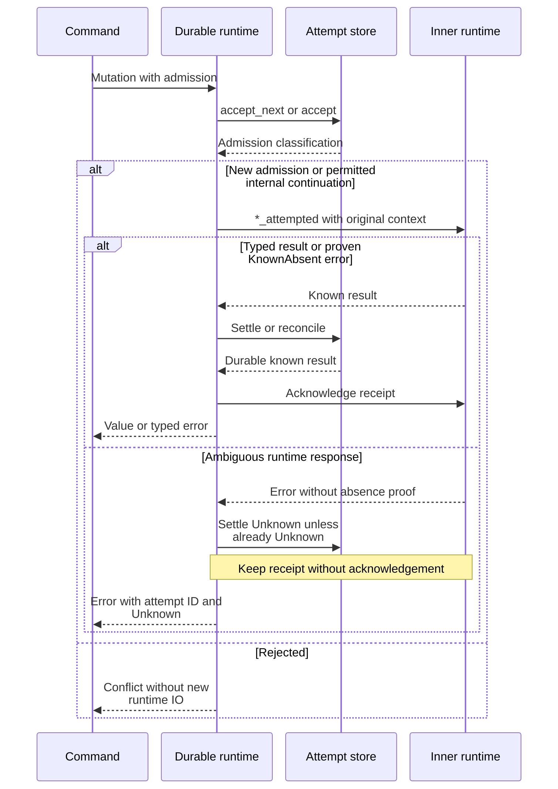

# Track process effects across lost responses

Use this explanation to maintain durable process admission, interpret effect
certainty, and recover retained results. It covers internal application version
0.1.0-beta, chiefly [attempts.rs](../../../src/attempts.rs),
[durable_process.rs](../../../src/durable_process.rs), and
[runtime_attempt_status.rs](../../../src/runtime_attempt_status.rs). These are internal
ports; externally supported operations and request envelopes belong to the
[protocol crate](../../../../undercurrent-protocol/README.md).

An **operation attempt** records one process-affecting action before external IO.
A **fencing token** orders authority within its target scope; it is not a session
revision. A **payload digest** binds an attempt to semantic input without
retaining that input in the attempt identity. A retained result digest identifies
the observed result; it does not contain a terminal transcript or the program's
business result.

## Separate admission, effect, and settlement

The exact state model belongs to
[domain attempt.rs](../../../../undercurrent-domain/src/attempt.rs). `Accepted` says the
product committed intent before invoking an effect. `KnownApplied` requires a
result digest; `KnownAbsent` forbids one. `Unknown` preserves uncertainty.
Compensated is a distinct audited terminal disposition for a superseded
externally dispatched incarnation, not another spelling of KnownAbsent.

This state diagram expands the certainty values inside `Settled`. The prepared
cleanup node is a view of Accepted with compensation intent, not another Rust
enum variant.

```mermaid
stateDiagram-v2
    accTitle: Durable attempt states and evidence-backed resolution
    accDescr: Accepted attempts may settle as applied, absent, or unknown. Only unknown settlement may reconcile to known truth. An accepted dispatched attempt with a newer fence can prepare exact compensation then become compensated; prepared compensation cannot be settled normally.
    state "Accepted without cleanup intent" as Accepted
    state "Settled: Unknown" as Unknown
    state "Settled: KnownApplied" as Applied
    state "Settled: KnownAbsent" as Absent
    state "Accepted with prepared cleanup intent" as Prepared
    state "Compensated" as Compensated
    [*] --> Accepted: Durable acceptance
    Accepted --> Applied: Settle with exact fence and result digest
    Accepted --> Absent: Settle with exact fence and no result digest
    Accepted --> Unknown: Settle uncertain effect
    Unknown --> Applied: Reconcile retained evidence and result digest
    Unknown --> Absent: Reconcile retained absence evidence
    Accepted --> Prepared: Dispatched and strictly newer fence
    Prepared --> Compensated: Matching exact cleanup evidence
    Applied --> [*]
    Absent --> [*]
    Compensated --> [*]
```



*Takeaway: an ambiguous result is retained until evidence resolves it; it is not
a transition back to a new executable attempt.* The final markers denote
terminal attempt dispositions, not deletion of audit records. Exact duplicate
transitions are omitted. Domain settlement duplication compares the complete
settled state, including timestamp; callers must not assume that changing the
settlement timestamp is an exact duplicate. Unknown reconciliation requires a
nondecreasing observation time. Adapter checks add current-fence constraints.

## Admission identity and authority

- **Server fence:** `OperationAttemptAdmission::new`: server-fenced admission. Store atomically allocates the next per-target token through `accept_next`.
- **Caller fence:** `OperationAttemptAdmission::dispatched`: caller supplies a fence and complete immutable dispatch binding. Store uses `accept` and the binding's caller-cell scope.
- **Mutation helper:** `process_mutation_admission` digests mutation kind, target session, and supplied semantic bytes. It preserves an explicit retry ID; otherwise derives an ID from payload digest and formatted admission timestamp. It adds no random nonce, so it does not independently prove uniqueness for equal inputs at equal timestamps.
- **Runtime context:** `ProcessMutationContext` is reconstructed from the admitted record and passed to the runtime; it retains the allocated fence and immutable binding.

Normal semantic equality compares attempt ID, target, kind, payload digest,
optional supplied fence, and dispatch binding; it excludes acceptance time.
Dispatched-start replay deliberately omits target comparison because the
product may allocate that session after boundary admission. The start service
then validates the retained target and result separately.

The current [SQLite implementation](../../../../undercurrent-store-sqlite/src/sqlite/database.rs)
allocates or checks fences inside an immediate transaction. It distinguishes
standalone per-target fences from dispatch caller-cell fences. Same attempt
identity with changed immutable input conflicts; an older fence cannot acquire
new authority. Do not substitute an in-memory counter that resets on daemon
restart.

## The durable process decorator

The daemon [composition root](../../../../undercurrent-daemon/src/composition.rs)
wraps the hosted runtime in `DurableProcessRuntime`, using a tracked durable
attempt store and explicit clock. The decorator owns `Arc` ports; ordinary
command services borrow ports. It does not create its own executor.

For the admitted arm/stop/force/input/resize calls and non-dispatched spawn, the
common order is:



*Takeaway: receipt acknowledgement follows a committed known result; a database
settlement or acknowledgement error can occur after the external effect.* If
settlement fails, the decorator returns that failure before acknowledgement.
The diagram's known-result branch includes a KnownAbsent failure and successful
responses; an adapter error claiming KnownApplied is conservatively treated as
Unknown by `complete` because it is not a reconstructable successful response.

The wrapper's actual admission decisions are important:

| Store classification | Internal server-fenced call | Externally fenced call |
| --- | --- | --- |
| Accepted | Invoke inner attempt-aware method. | Recheck runtime policy after acceptance, then invoke. If expired, settle KnownAbsent before IO. |
| Duplicate Accepted | Continue with original context. | Reject with Unknown; overlapping start must reconcile. |
| AlreadySettled Unknown | Invoke inner attempt-aware method, then reconcile a known retained response. | Reject without new IO. |
| Other settled or Compensated | Reject without new IO. | Reject without new IO. |
| StaleFence or PayloadConflict | Reject without new IO. | Reject without new IO. |

External policy is checked immediately before store admission as well as after
new acceptance. Internal continuation is safe only with a receipt-aware runtime.
The default `ProcessRuntime::*_attempted` methods merely delegate to raw methods;
they are insufficient replay protection. The
[hosted adapter](../../../../undercurrent-runtime/src/process/hosted.rs) probes retained
attempt receipts, reuses an applied spawn result, and rejects unresolved receipts.
Keep that distinction when adding a fake or production adapter.

Plain `spawn`, `arm_exit`, `stop`, `force_stop`, `write_input`, `resize`, and
`close_input` methods on the decorator delegate directly. Use admitted entry
points for coordinated mutation paths. Standard-input closure has a separate
idempotent exact-process contract and is not covered by this decorator's
attempt admission. The trait's default admitted methods reject Unsupported
rather than silently call a raw process method.

A successful termination **response** can itself be `GracefulTimedOut`.
The wrapper records its known result digest, but
[stop orchestration](../sessions/lifecycle.md#stop-retains-intent-before-process-io)
checks the kind and preserves the still-owned process. KnownApplied therefore
describes the specific attempted operation, not necessarily a terminal session.
Likewise a KnownAbsent admission rejection describes refusal of a new invocation,
not proof that an earlier command or a prior attempt never had effects.

### Dispatched spawn is settled by the start service

The decorator leaves a successful externally fenced spawn Accepted. Only
`StartSessionService`, after durable ownership, binding, exit arming, and Running,
can settle the semantic start result. See
[dispatched creation](../sessions/lifecycle.md#dispatched-creation-and-lost-responses)
for response-loss recovery and exact superseding compensation.

After settlement, `StartSessionService` acknowledges the committed attempt through
`DurableProcessRuntime`, which forwards it to the runtime owning the receipt.
An acknowledgement failure returns a persistence error while preserving the live
session. An exact replay checks the Running session, process ownership, and result
digest, then retries acknowledgement without accepting or spawning again. Repeated
acknowledgements must be idempotent, including when the receipt was already released.

The composed receipt regressions in
[command_tests.rs](../../../src/commands/command_tests.rs) check settlement before
acknowledgement, failure with a retained live session, and receipt release on replay.

## Reconcile pending attempts without executing mutations

`ReconcileOperationAttemptsService` scans at most `batch_size * max_batches`
rows per cycle (repeated rows can count again). Both limits must be nonzero.
`OperationAttemptScan` also supports exact `(attempt ID, fence)` exclusions:
their count cannot exceed the result limit, duplicates are rejected, and excluded
rows must not consume the returned bound. The daemon's
[tracked store](../../../../undercurrent-daemon/src/attempt_tracking.rs) merges proof
of live in-process attempts into these exclusions so recovery does not treat
currently executing work as abandoned debt.

The application rejects oversized batches or rows outside Accepted/Settled
Unknown. The handling is deliberately different by state:

| Pending record | Observation and resolution |
| --- | --- |
| Non-shutdown Accepted | Ask only for trusted exact compensation evidence. No evidence leaves it unresolved; the service does not call generic effect observation for this branch. Matching attempt/fence proof permits durable compensation, then cleanup-receipt acknowledgement. |
| Settled Unknown | Ask the effect observer. Unknown remains unresolved. Known evidence commits `reconcile` before acknowledging the retained observation. |
| Shutdown Accepted or Unknown | Ask the observer to durably cancel an uncommitted shutdown preparation. Only confirmed cancellation permits KnownAbsent settlement/reconciliation followed by the distinct cancellation acknowledgement, which must not retire the host. |

A store rejection of resolution is `ReconciliationRejected`; adapter failures
return `Port`. No-progress batches end the cycle rather than spin. Reaching the
batch-count bound leaves `complete` false even if the last batch resolved; a
later empty read establishes completion. `unresolved` retains unique IDs
encountered in that cycle. This conservative report is distinct from an exact
store count of unresolved attempts and from
[session-scan readiness](../recovery/startup.md).

Do not replace missing compensation evidence, a missing receipt, a network
error, or a daemon epoch change with KnownAbsent. A record can stay unresolved
and require explicit evidence-backed repair. The service itself never resends
the original process mutation.

## Read attached status without repairing it

`GetRuntimeAttemptStatusService` requires exact attempt ID, caller request
digest, and credential-free actor references. Actor principal, optional tenant,
and authority strings are each 1–128 bytes and restricted to ASCII letters,
digits, `.`, `_`, `-`, `:`, and `/`. Authentication supplies these values outside
the service.

Authorization runs **before** any existence read. Denial returns PermissionDenied
without asking the repository whether the attempt exists. The repository then
must validate provenance before loading its target and return a coherent,
read-only attempt/session snapshot.

The SQLite adapter currently checks Spawn kind, dispatch binding, retained
request digest, presence of runtime policy, and matching requested digest; it
loads the target session in the same deferred transaction. It checks policy
presence, not current expiry, so retained status remains useful after the
execution window. Missing target session is inconsistent state, even for a
non-applied attempt projection.

- **Unknown:** Accepted or settled-Unknown effect; no success/absence inference.
- **KnownAbsent:** Retained evidence of absence, distinct from a missing attempt.
- **KnownApplied:** Exact result digest and minimal current durable session lifecycle/revisions/timestamp. The session may have evolved since start; this is not start-result replay.
- **Compensated:** Distinct cleanup audit; `certainty()` returns `None`.
- **NotFound:** No retained attempt; does not mean KnownAbsent.
- **Provenance failure:** `UnverifiableProvenance` maps to FailedPrecondition; do not fall back to a digestless lookup.
- **Inconsistent state:** `InconsistentState` maps to Internal error; investigate store/target consistency.

Status has no runtime observation or repair ports and performs no mutation.
It returns safe binding digests and identity, not launch/environment/input
content. An expired policy is not an automatic instruction to rerun a mutation.

## Verification and extension points

Run the maintained fake-port scenarios from the repository root, with Rust
1.95.0 and locked dependencies available:

```sh
cargo test --locked -p undercurrent-application --test durable_process_attempts
cargo test --locked -p undercurrent-application --test runtime_attempt_status
```

Expected result: both suites pass without a daemon or real processes. No
application state needs cleanup; only ordinary Cargo artifacts remain. A missing
toolchain/cache is a setup failure. These commands are useful maintainer checks,
not evidence that OS receipt persistence or SQLite crash recovery was exercised.

[Durable attempt tests](../../../tests/durable_process_attempts.rs) cover applied,
absent, and response-loss outcomes; preserved fences; concurrent allocation;
policy expiry before and during acceptance; shutdown cancellation; and
acknowledgement after reconciliation. The scripted runtime returns configured
responses, so its response-loss test proves application reconciliation, not the
host's own deduplication implementation.
[Status tests](../../../tests/runtime_attempt_status.rs) prove authorization-before-read,
exact digest forwarding, missing-versus-absent distinction, and preservation of
all strict states. The [start tests](../../../src/commands/command_tests.rs) cover the
higher-level dispatch lifecycle.

When adding a mutation, identify its semantic digest, authority scope, effect
boundary, typed result digest, known-absence proof, and retained-receipt lifetime.
Decide whether it uses the admitted process wrapper or a specialized service.
Exercise both response loss and settlement loss. Update the owning domain and
protocol contracts as needed; never invent a general automatic retry rule from
an error category. Return to the [crate guide](../../../README.md) for navigation.

[Crate documentation](../../README.md)
