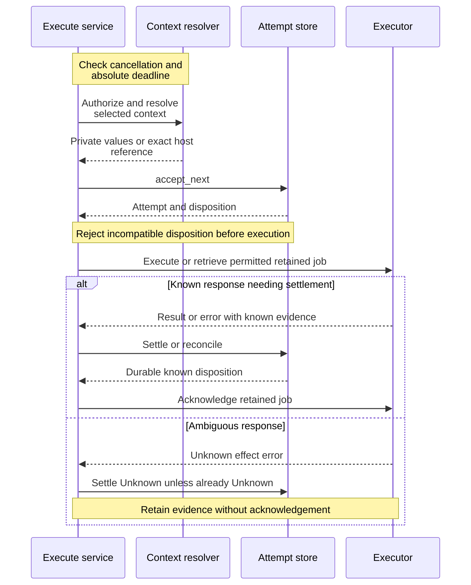

# Execute a bounded command in a session context

Use this explanation to maintain one-shot execution without exposing a session's
private environment or confusing cancellation with absence of effects. It covers
internal application version 0.1.0-beta: [execute.rs](../../../src/execute.rs),
[execution_context.rs](../../../src/execution_context.rs), and [secrets.rs](../../../src/secrets.rs).
For external client setup, use the [Rust SDK](../../../../undercurrent-sdk/README.md) or
[Python package](../../../../../python/README.md). Application ports do not expose
process handles to consumers.

One-shot execution is a separately supervised command using a chosen session's
execution context. It is not terminal input and does not mean the managed
session process itself executed the command. The daemon's
[request boundary](../../../../undercurrent-daemon/src/boundary.rs) validates command
and output limits, requires an attempt identity or idempotency key, and derives
the semantic request digest. The application then uses the
[attempt model](attempts.md) to retain effect certainty.

## Resolve only the requested context

`ResolveExecutionContextService` authorizes `ExecuteInSessionContext` on the
session before repository reads or resolver IO. Denial reveals neither session
existence nor environment-file content. It loads the durable launch specification
and resolves the independently selected directory/environment modes:

- **`dir_launch = true`:** Resolve the saved launch directory through the adapter.
- **`dir_launch = false`:** Use a prepared effective-profile directory retained only for the current process incarnation. Missing or stale evidence returns `LiveDirectoryUnavailable`; no silent launch-directory fallback.
- **`env_launch = true`:** Resolve launch environment settings, including adapter-owned environment-file semantics.
- **`env_launch = false`:** Resolve directory without exporting environment values to the application; require a shell-environment capture timestamp for the current process, then pass that process identity as a host-private environment reference. Missing capture returns `LiveEnvironmentUnavailable`.
- **Convenience call:** `resolve(session_id)` uses launch directory and launch environment; it does not request live observations.

The live environment choice clears the in-memory environment map through
`ResolvedExecutionContext::with_live_environment`. Its Debug output exposes
only environment count/byte count and whether a directory is set, not names,
values, or paths. The value remains private even though an authorized adapter
can access its fields. Do not put it in general session details or telemetry.

Choosing a launch fallback is an explicit caller decision: the two Unavailable
errors name directory and environment separately. For live mode, investigate
current process identity, prepared directory evidence, and shell capture before
assuming the launch configuration is equivalent. This service takes no mutation
lease across context resolution and command execution; the runtime must validate
exact references at its boundary rather than treating the resolved context as a
transactional lock on a live shell.

## Execute, settle, then release the retained job

This sequence shows application ordering and the significant failure branch.
The executor participant is the composed runtime port, not a second application
service.



*Takeaway: a timeout, cancellation, output-store failure, or lost response can
occur after execution began; the typed certainty and retained attempt matter.*
For a previously KnownApplied attempt, a successful executor response must match
the durable result digest before acknowledgement; a mismatch is
`AttemptRejected`. An executor error on this replay path is returned as
`Execution` without settlement or acknowledgement. Neither path rewrites the
retained result.

The application checks cancellation and `now >= deadline` **before** context
resolution. It forwards the absolute deadline and `OperationCancellation` to the
executor after durable admission; it does not impose another timer of its own
around every await. The current
[hosted command adapter](../../../../undercurrent-runtime/src/process/session_command.rs)
checks again before host admission, sends at most one cancellation request when
cancelled or expired while polling, and waits for typed host status. A failed
cancellation send is not proof that the command stopped. This is command-job
cancellation, separate from subscription closure and attached runtime-attempt
cancellation of a managed session.

| Prior durable attempt | Application execution mode |
| --- | --- |
| Accepted or Duplicate Accepted | Call executor with original admitted context, then settle. Exact job replay/deduplication is an executor obligation. |
| Settled Unknown | Call executor for retained truth and reconcile if known; another Unknown leaves the existing uncertainty. |
| Settled KnownApplied with digest | Retrieve result and compare digest; never replace it with a changed result. |
| KnownAbsent, Compensated, stale fence, conflicting semantics, or malformed applied record | Reject rather than execute. |

`ExecuteInSessionPortError` carries a separate certainty and optional result
digest. Unlike the generic durable process wrapper, this service preserves a
KnownApplied **error** with a digest. For example, the hosted adapter reports
cancelled, deadline-exceeded, or output-limit terminal jobs as KnownApplied
errors: execution occurred, even though the requested normal completion did not.
Unknown transport/host responses remain Unknown. Store rejection of settlement
becomes a typed conflict; an acknowledgement error is a Settlement error even
though the attempt may already be committed. Do not automatically resubmit the
command with a new identity.

## Bound output at both the response and execution boundary

`ExecutionOutputLimits` requires nonzero inline and total byte limits, with
inline representable and no larger than total. The service passes limits to the
executor; it does not itself collect output or enforce OS termination. The
hosted adapter also checks total output against its private transport bound.

`ExecutionOutput` can represent:

- Inline bytes with `OutputChunkIntegrity`, including source byte count and
  digest evidence. Debug prints size and integrity rather than bytes.
- An immutable content reference with URI, complete digest, and size. Its
  constructor checks a nonempty URI of at most 2048 bytes with no control
  characters; it does not contact a content store or prove immutability itself.
- A logical stream ID and available/next offsets. This is a representable port
  result, not proof that every concrete executor returns streaming output.

The current hosted adapter chooses inline output up to the inline limit and
otherwise stores bytes through `ImmutableExecutionOutputStore`; it does not
construct the Stream variant in its output mapper. Large-output persistence can
fail after the command completed, producing KnownApplied with a result digest.
The application acknowledges known settlement only after the store accepts it.
Reference URIs and stream IDs are visible in their Debug forms, so adapters must
not embed credentials or private content in these identifiers.

## Resolve secrets at the spawn edge

Launch secret configuration contains opaque handles, not resolved bytes.
`SecretResolver` produces `EphemeralSecret` only when the runtime resolves the
child overlay. The default `UnavailableSecretResolver` rejects Unsupported;
a missing credential adapter is not permission to launch with empty secrets.

`resolve_secret_environment` checks entry capacity before resolving any handle,
then resolves sequentially. It rejects empty or NUL-containing material as
InvalidData. The byte bound counts each environment name plus resolved value
and uses checked addition; overflow or excess returns CapacityExceeded. A
resolver failure preserves its kind but discards its entire source chain and
replaces it with a safe local error, preventing even a leaky adapter error from
revealing material or handles.

The resulting map exposes values only to an explicit adapter callback/iterator.
Debug shows counts. Each secret fills its owned byte vector with zero on drop;
this does not prove erasure of copies made by the resolver, child launch, OS, or
an `expose` callback, nor does it establish hardened memory zeroization. Keep
resolved material out of durable aggregates, prepared summaries, and diagnostics.

## Verify changes and diagnose failures

From the repository root, with pinned Rust 1.95.0 and locked dependencies:

```sh
cargo test --locked -p undercurrent-application --test session_detail execution_
cargo test --locked -p undercurrent-application --test secret_resolution
cargo test --locked -p undercurrent-application --lib execute::tests
```

Expected result: selected fake-port tests pass without daemon setup or real
processes. They create no persistent application state requiring cleanup. Fix
toolchain/dependency-cache setup failures before interpreting assertions. These
checks do not qualify native execution, cancellation latency, or host restart.

[Context tests](../../../tests/session_detail.rs) check authorization before lookup and
resolution, live/launch choices, stale incarnation rejection, and redacted
Debug. [Secret tests](../../../tests/secret_resolution.rs) cover valid material, NUL,
capacity, and complete redaction of a deliberately leaky source chain. The
[execute module test](../../../src/execute.rs) checks acknowledgement only after an
accepted durable settlement. Native execution and retained-job restart evidence
lives with the [host execution registry](../../../../undercurrent-runtime/src/process/execute_host.rs).

For diagnosis, distinguish Context errors (before attempt acceptance),
AttemptPersistence/AttemptRejected, Execution with explicit certainty, and
Settlement after an effect. Inspect the stable attempt ID and its digest rather
than printing command/environment/output payloads. For unknown outcomes use
[attempt reconciliation](attempts.md#reconcile-pending-attempts-without-executing-mutations),
and return to the [crate guide](../../../README.md) for other application tasks.

[Crate documentation](../../README.md)
