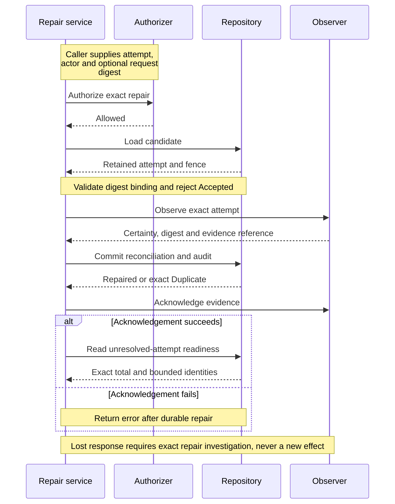
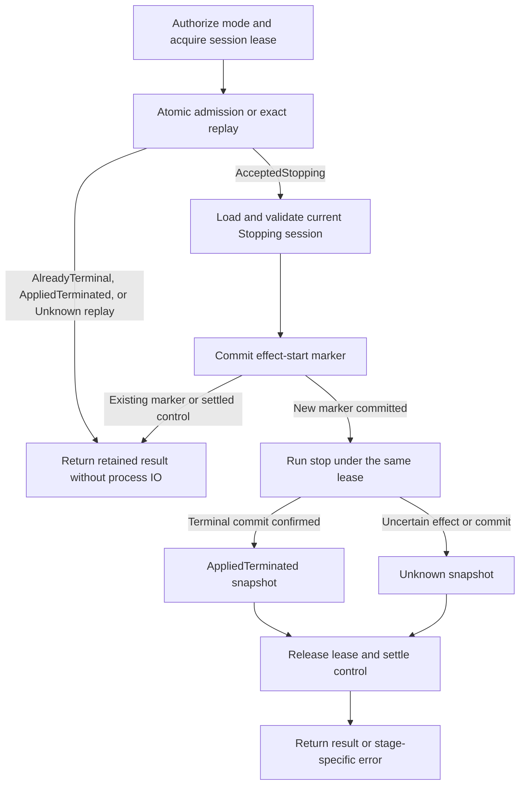
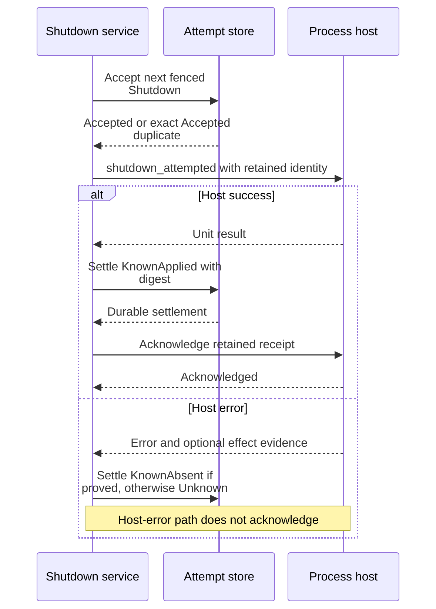

# Repair effects, cancel an attached runtime, and shut down the host

Use this maintainer explanation to change a control operation without confusing
its durable decision with the process effect. It covers internal application
package 0.1.0-beta. Read [attempt identities and fences](attempts.md) and
[session stop ordering](../sessions/lifecycle.md#stop-retains-intent-before-process-io)
first. The owning contracts are [repair_attempt.rs](../../../src/repair_attempt.rs),
[runtime_cancellation.rs](../../../src/runtime_cancellation.rs), and
[shutdown_process_host.rs](../../../src/shutdown_process_host.rs).

These operations solve different problems:

| Operation | Durable authority | Process action |
| --- | --- | --- |
| [Repair an Unknown attempt](#repair-an-unknown-attempt-from-evidence) | Exact retained runtime evidence plus an authorized audit record | Observe and acknowledge evidence; does not repeat the original effect. |
| [Cancel an attached runtime](#bind-cancellation-to-the-intended-runtime) | A distinct control bound to the exact successful start attempt, session revisions, and actor | One stop path after a durable effect marker. |
| [Shut down the process host](#shut-down-a-host-without-discarding-the-receipt-too-early) | A Shutdown attempt with a server-derived payload and fence | Request retained shutdown, settle it, then acknowledge the host receipt. |

Transport-request cancellation, subscription cancellation, and cooperative
[bounded execution cancellation](commands-and-secrets.md) have other lifetimes.
Dropping a request does not constitute any of these durable controls.

## Repair an Unknown attempt from evidence

`RepairOperationAttemptService` authorizes before reading the attempt, so denial
does not reveal whether an identity exists. `OperationAttemptRepairActor` carries bounded,
credential-free references supplied by trusted composition. Valid string shape
is not authentication. An attached attempt requires its exact retained request
digest; a standalone attempt requires the unattached command shape. An Accepted
attempt is not repairable through this path.

The caller supplies the attempt, actor, and (for an attached attempt) request
digest. The runtime observer supplies the evidence reference and terminal
evidence for the exact attempt and fence.
KnownAbsent must have no result digest; KnownApplied must have one; Unknown is
not repair evidence. The repository receives the actor, evidence reference,
certainty, digest, and timestamp together.

This sequence shows the commit boundary that makes repair response loss safe to
investigate.



*Takeaway: acknowledging evidence is downstream of the product commit.* The
[SQLite transaction](../../../../undercurrent-store-sqlite/src/sqlite/database.rs)
checks the fence, distinguishes an exact audit duplicate from conflicting
evidence, reconciles Unknown, and inserts the audit in one immediate transaction.
Its narrowly defined KnownAbsent shutdown-cancellation exception is explained
in [attempt reconciliation](attempts.md); it does not authorize generic
stale-fence repair.

`PayloadConflict` means the retained effect disagrees; `EvidenceConflict` means
the audit identity disagrees. `NotUnknown` is distinct from either. The observer
is still consulted for a terminal attempt so an exact already-repaired replay
can be checked. Do not turn these outcomes into an unconditional overwrite.

An acknowledgement failure occurs after repair; a readiness-read failure occurs
after repair and acknowledgement. Neither implies rollback. An exact retry can
recognize the repair, subject to the observer's idempotent evidence contract.
Changing the actor or substituting different observed evidence cannot bypass an
existing audit conflict.

`OperationAttemptReadinessService` reads an exact unresolved total and a bounded,
strictly ordered, unique identity sample. Its limit must be nonzero; truncation
means the sample is incomplete. Complete means the total is zero. This service
does not authorize callers, observe processes, or repair attempts. The daemon's
tracked store can exclude attempts with valid live ownership proofs; see
[readiness and live work](attempts.md). Session startup readiness is a
separate [reconciliation result](../recovery/startup.md).

## Bind cancellation to the intended runtime

`CancelRuntimeAttemptCommand` contains three distinct kinds of identity:

| Identity | Why it is retained |
| --- | --- |
| Authenticated actor and asserted product references | Let the authorizer compare transport authority with the requested tenant, source product, actor context, and authority. Constructors only validate bounded shapes and consistency. |
| Target start attempt | Pin the predecessor request digest, fence, caller-cell identity, session, aggregate revision, lifecycle revision, and provider identity/generation. A replacement runtime must not inherit an old cancellation. |
| New control | Retain a different control ID, command digest, complete request fingerprint, scoped idempotency key, mode, reason, target-only flag, and admission deadline. Reusing an identity with different semantics is a conflict. |

The [protocol cancellation contract](../../../../undercurrent-protocol/src/runtime_cancellation.rs)
owns wire fields and digest rules. The application constructors own their domain
validation, including nonzero revisions, lifecycle revision no greater than
aggregate revision, and matching actor/control context. Do not rebuild these
rules as a looser adapter check.

The service authorizes the requested Graceful or Force mode before acquiring a
session mutation lease or accessing the store. It samples the clock **after**
acquiring the lease. Time spent waiting therefore counts against a new admission
deadline. The repository looks for an exact retained replay before checking that
deadline, so a previously accepted control remains queryable/replayable after
expiry.

In the [SQLite admission transaction](../../../../undercurrent-store-sqlite/src/sqlite/database/runtime_cancellation.rs),
the predecessor must be the current fenced Spawn attempt settled KnownApplied,
with the matching dispatch binding. The session must match both requested
revisions. An already-terminal session produces AlreadyTerminal with no process
IO. Otherwise, the transition to Stopping, its outbox event, and AcceptedStopping
control are committed together. This atomic boundary prevents an admitted stop
from losing its durable intent.

## Mark the effect before entering stop mechanics

This workflow separates pre-effect retry from an effect whose outcome is unknown.
The internal marked state is presented externally as Unknown; it is not another
public cancellation state.



*Takeaway: an exact AcceptedStopping retry can continue before the marker; after
the marker it cannot blindly redrive process control.* The application constructs
the stop future but does not poll it until marking succeeds. If the marker commits
and its response is lost, the outcome is conservatively Unknown even if no signal
was sent. This deliberately trades automatic progress for protection against
repeating an ambiguous effect.

Stop reuses the retained session lease and verifies ownership as described in
the [stop walkthrough](../sessions/lifecycle.md#stop-retains-intent-before-process-io).
The current session may have advanced non-lifecycle metadata since admission,
but must still be Stopping with revisions no lower than the admitted snapshot.
Terminal stop results, including directory-cleanup errors carrying a committed
terminal session, become AppliedTerminated. Other errors produce Unknown using
a fresh durable snapshot when available, or the admitted snapshot otherwise.
The lease is released before queued-restart cleanup and cancellation settlement.
A settlement failure after termination does not imply the process is alive.

`RuntimeCancellationMode::Graceful` selects `StopMode::GracefulOnly`. The stop
service commits `no_escalation` before process IO, including when the session is
already Stopping. The native runtime may wait for cooperative termination but
cannot force after timeout. A separate authorized Force control selects
`StopMode::Force`. [ADR 0003](../../../../../docs/architecture/decisions/0003-runtime-cancellation-graceful-authority.md)
records the accepted policy.

Recovery uses the retained control mode if a crash precedes the no-escalation
configuration commit. Unknown effects are preserved. An independently admitted
Force recovery instruction can override an existing no-escalation flag; the flag
alone never grants recovery permission to repeat or escalate a graceful attempt.

The store validates state/lifecycle consistency and prevents retained snapshot
revision regressions. A session transaction that commits a terminal lifecycle
also settles accepted or internally marked controls atomically. Consequently,
a later explicit settlement can be an exact duplicate even with a later
observation timestamp. A stored Unknown result is not a directive to retry a
mutation. `GetRuntimeCancellationStatusService` authorizes first and reads the
exact control/target binding without process observation or repair.

On restart, the store atomically claims still-unmarked AcceptedStopping controls
before returning a Resume instruction. Any retained Unknown or marked control
instead yields PreserveUnknown. A second restart therefore cannot claim the same
uncertain effect again. See [startup recovery](../recovery/startup.md) for how that
instruction affects a Stopping session and readiness.

## Shut down a host without discarding the receipt too early

`ShutdownProcessHostService` runs behind trusted daemon composition; it has no
independent user authorizer. It derives the attempt kind, empty session target,
and payload digest from the domain tag and drain timeout. The timeout binds
request semantics; the daemon lifecycle applies the drain policy. The service
does not pass that timeout to the host operation. Supplying an attempt ID keeps
identity stable; the fallback ID derives from payload and timestamp, not a nonce.

The following sequence makes the retained host receipt's lifetime explicit.



*Takeaway: successful return requires both durable settlement and receipt
acknowledgement.* The host may finish its retained shutdown lifecycle during
acknowledgement. Accepted duplicates call `shutdown_attempted` with the same
identity, relying on host receipt replay. Already-settled KnownApplied duplicates
validate the expected unit digest and only acknowledge. Unknown blocks execution;
KnownAbsent remains a terminal result for that identity. A genuinely new action
requires its own admission, rather than rewriting an old attempt.

If settlement fails after the host acted, retain the host and its receipt for
reconciliation. If acknowledgement fails after settlement, an exact retry can
take the acknowledgement-only path. Do not replace the host or issue a fresh
shutdown merely because the response was lost. Errors preserve both the primary
host failure and any secondary settlement failure.

## Verify a control change

Run these from the repository root with the pinned Rust toolchain and locked
dependencies available. These focused application tests use fake ports and need
no daemon or managed process:

```sh
cargo test --locked -p undercurrent-application --test repair_attempt
cargo test --locked -p undercurrent-application --lib runtime_cancellation
cargo test --locked -p undercurrent-application --lib shutdown_process_host
```

Expected result: authorization-first, exact-binding, ordering, stale-fence,
deadline, marker-before-effect, and response-loss cases pass. The source tests
are in [repair_attempt.rs](../../../tests/repair_attempt.rs) and the two control modules.
No runtime state requires cleanup. For a storage change, also use
`cargo test --locked -p undercurrent-store-sqlite --test runtime_cancellation`:
its [temporary-database tests](../../../../undercurrent-store-sqlite/tests/runtime_cancellation.rs)
cover reopen, terminal commit settlement, revision monotonicity, and prevention
of in-flight force redrive. Temporary directories are test-owned.

Before changing retry behavior, reproduce failure at each boundary: admission,
marker, effect, terminal commit, settlement, acknowledgement, and readiness read.
Assert both which durable records remain and which process calls were absent.
Toolchain/cache failures are setup failures; an Unknown result is a semantic
outcome requiring evidence, not permission to weaken the test. Continue with
[maintainer diagnostics and verification](../../development/contributing.md).

[Crate documentation](../../README.md)
