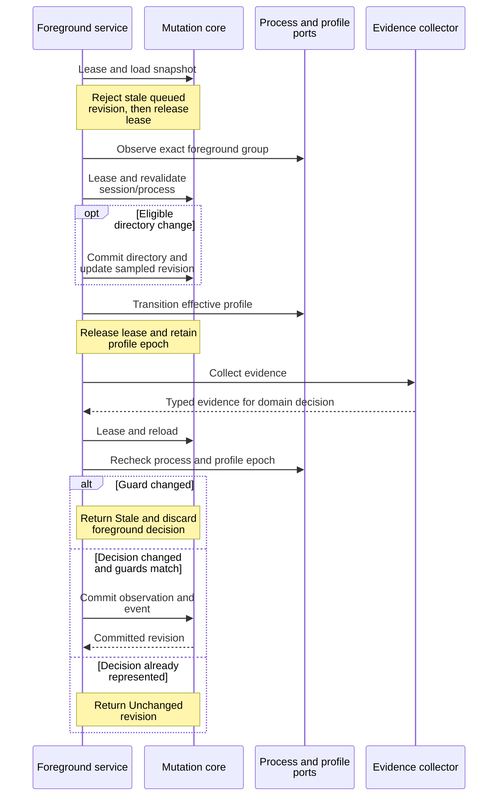

# Trace observations without blocking session mutations

This explanation helps maintainers change foreground detection or health work
without committing evidence for a replaced process. It covers internal application
services, which trusted background workers compose; they are not public SDK
entry points. [Profile matching](profiles.md) explains selection and rule
evaluation; [outbox dispatch](../recovery/events-and-outbox.md) explains plan activation.

## Sample, collect, revalidate

[`ObserveForegroundService` and `ObserveHealthService`](../../../src/observation.rs)
operate on one session. They start no timers and perform no global session scan.
Both load a snapshot under a mutation lease, release it before expensive adapter
IO, and acquire a fresh lease to compare and commit. This lets stop, input, and
metadata mutations proceed during collection. The cost is that otherwise useful
evidence can become stale and be discarded.

This sequence shows the extra foreground-context phase and its distinct commits.



*Takeaway: no lease spans process collection. A foreground cycle can update
prepared context or a durable restoration directory before its final evidence
decision is committed or rejected.*

Queued expected-revision mismatch returns Stale before process lookup. Disabled
detection, absent health rules, or a non-Running lifecycle returns a typed Skip.
Missing/mismatched live binding also skips; an exact binding must match the
durable process ID and start time. Revision changes during collection return
`SessionChanged`; binding changes return `ProcessChanged`. Foreground additionally
compares the sampled effective-profile epoch and returns `ProfileChanged` if it
has changed. These are expected concurrent outcomes, not persistence failures.

Foreground evidence feeds the pure domain `ForegroundDecisionPolicy`. Updating
the aggregate can emit a compact-state change or evidence-only event, or no
change. Health runs configured rules through `HealthCheckExecutor`, counts
passed/failed results for telemetry, and asks `HealthObservation::evaluate` to
validate and aggregate them. Partial evidence can yield Unknown as a successful
observation. Neither service equates uncertainty with a crashed process, health
with foreground activity, or observed readiness with an application result.

## Effective profile and process facts

[`process_observation.rs`](../../../src/process_observation.rs) is the adapter-neutral
fact boundary. Constructors accept **already bounded** data; the adapter must
enforce process/member/argument limits and produce PID-reuse-safe incarnation
identities. Group completeness and each member's environment-name completeness
are separate. A complete process list does not prove every environment-variable
name was collected. Names support matching; values are not part of these facts.

Foreground, exact managed root, and managed-tree TCP listener observations are
also separate. Each distinguishes Present, Absent, Unavailable, and Truncated.
A background descendant's listener does not assert foreground membership.
Only positive Present evidence contributes a listener-based server role.

Foreground process observation failure is diagnosed, then treated as unavailable
context rather than immediately aborting all foreground evidence collection.
Fixed binding retains the configured base profile. Adaptive binding uses:

| Process context | Effective selection |
| --- | --- |
| Cooperative shell Ready | Base profile with cooperative-shell origin. |
| Complete foreground group | Group-wide profile matching and explicit ambiguity handling. |
| Truncated group | Unclassified / IncompleteEvidence. |
| Unavailable observation | Unclassified / Unavailable. |

Server role can come from a selected Server archetype, positive listener evidence,
or both. Listener attribution prefers foreground ownership, then managed root,
then managed tree.
A listener alone can mark a server role without selecting a server profile.
Current directory, selection provenance, matching evidence, and epoch belong to
the prepared effective context. An eligible group-created session can separately
retain its restoration directory in the durable aggregate. A base profile is
not rewritten to follow every foreground program.

The prepared profile transition runs after revision/process revalidation under
a fresh lease. Adaptive sessions with no exact-process effective snapshot return
`MissingEffectiveProfile`; they do not silently fall back to launch selection.
See [read-model ownership](../sessions/read-models.md) for how the hub preserves valid
context and notifies watchers.

## Schedule independent cadences

[`scheduling.rs`](../../../src/scheduling.rs) defines one job key per session and kind:
Foreground or Health. Each carries its source revision and `not_before` time.
A newer revision can replace work; at one revision an earlier deadline wins.
An older revision cannot postpone or replace newer work. A complete
`SessionObservationPlan` adds/removes both kinds atomically through the scheduler
port. The runtime's [bounded queue](../../../../undercurrent-runtime/src/observations.rs)
checks projected capacity before applying a plan and records plan revisions to
reject stale reinsertion even after a due job has been claimed.

Outbox changes activate/reconcile plans; observation-result events leave the
independent cadences intact. The queue can wake active foreground work from
payload-free runtime notifications. The dispatch worker claims a bounded due
batch, removes those jobs, and executes them sequentially through
`ObservationServiceRouter`. It relies on the due-source contract for bounds and
ordering; unlike outbox dispatch, it does not separately validate the returned
batch size or deadlines.

| Outcome | Dispatcher action |
| --- | --- |
| Committed or Unchanged | Reschedule that kind from completion-time clock plus its normal interval, with returned revision. |
| Stale | Retry after retry interval using current revision. |
| MissingProcessBinding skip | Retry after retry interval using prior job revision. |
| Other skip, including MissingEffectiveProfile | Deactivate this claimed job. |
| NotFound error | Cancel remaining session jobs and deactivate. |
| Other execution error | Record a safe issue and attempt retry using prior revision. |
| Reschedule failure | Record an issue; there is no retained in-flight claim automatically returned to the queue. |

Intervals and batch size must be nonzero; retained issue count may be zero while
aggregate `issue_count` still records failures. One job failure does not abort
other jobs. Only claim failure is fatal to the complete dispatch call. `Ok(report)`
can contain execution or scheduling failures; inspect counters and retained
issues. Newer or earlier queued work can supersede a reschedule normally.

The queue is in memory. Startup and plan-invalidating outbox work can reconstruct
desired schedules. A failed reschedule or deactivated missing-profile job does
not itself guarantee another cycle; investigate plan activation and prepared
context instead of assuming the timer will always heal it.

## Investigate or extend an observer

For stale results, compare sampled/current revision, exact process identity, and
effective-profile epoch. Frequent metadata changes can legitimately invalidate
collection because the guard uses the full session revision. For absent work,
inspect detection/health configuration, Running state, directory binding, queue
pressure, and dispatch issues. Metrics separate scheduling lag, foreground
process-observation time, detection time/evidence age, and health execution/result
counts. Do not diagnose private screen text by logging collector payloads.

Add evidence collection in an adapter, selection/decision rules in the owning
domain/profile layer, and orchestration here. Preserve both pre-collection and
pre-commit guards. New scheduling policies must test stale reinsertion, capacity
atomicity, skipped-job behavior, and preservation of independent cadences.

With the pinned toolchain, run from the workspace root:

```sh
cargo test --locked -p undercurrent-application --test observation_services --test observation_dispatch
```

Expected result: fake-port tests pass without real processes, daemon setup, or
persistent state; no runtime cleanup is required.
[Service tests](../../../tests/observation_services.rs)
check lease release during IO, stale rejection before expensive work, uncertainty,
adaptive selection, listener ownership, and retained directory.
[Dispatch tests](../../../tests/observation_dispatch.rs) cover outcome routing, isolated
failures, bounded issues, and a 300-session backlog. Continue with
[profile evaluation](profiles.md) when a selected classifier seems wrong.

[Crate documentation](../../README.md)
