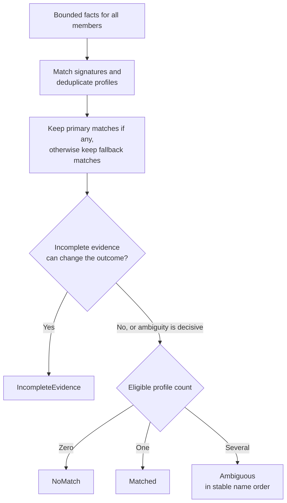

# Investigate profile selection and rule evaluation

Use this maintainer reference to locate a profile mismatch, lint failure, or
unexpected rule winner. Application [profiles.rs](../../../src/profiles.rs) owns the
selection/evaluation workflow. Domain profile types own structural bounds and
matching values; `DetectionProfileCatalog` supplies definitions after override
resolution, and `ProfilePatternEngine` owns expression syntax and execution
limits. The application does not load files, inspect the daemon environment, or
start sessions to test a profile.

## Choose the correct boundary

- **Service:** `DetectionProfileService` authorizes `ReadDetectionProfiles` on Configuration before list, inspect, match, lint, lint-all, or standalone test. Validates nonzero profile/sample limits.
- **Selector:** `DetectionProfileSelector` is the internal bounded matching helper used by already-authorized creation and trusted observation. It does not authorize.
- **Rule evaluator:** `ProfileRuleEvaluator` evaluates one supplied active definition against already bounded private sample views. It neither authorizes nor reads the catalog.
- **Linter:** `lint_detection_profile` checks all configured expressions and reports warnings/errors without starting a session.

List returns source-tagged summaries (BuiltIn or User); inspect returns a shared
immutable full definition. The catalog contract supplies bounded, name-ordered
results; the services pass limits to that port rather than loading unbounded
definitions and truncating afterward. Adding a direct external use of an internal
helper requires an authorization boundary first.

## Match a command or complete foreground group

A profile has alternative command signatures. Each signature keeps binary,
argument, and required environment-name dimensions together, avoiding accidental
cross-pairs between alternatives. Configured command dimensions must agree:
binary matching uses the domain basename rules; argument expressions inspect
the supplied arguments joined with spaces; required names come from supplied
facts. This is matching text, not shell parsing or an environment-value lookup.
Within argument expressions, any match suffices. Disabled or nonselectable
profiles are ignored by automatic selection.

This diagram shows how group-wide matching preserves ambiguity and incomplete
evidence rather than arbitrarily choosing a first profile.



*Takeaway: fallback priority is resolved once across the entire foreground group.
A runtime wrapper cannot hide a conflicting application match.*

Repeated signatures/members matching one profile collapse to one candidate.
The retained reason ranks BinaryAndArguments above Binary above Arguments.
Matching evidence records profile, fallback flag, and matching process incarnations
in deterministic order, including matches excluded from final selection by
fallback priority.

Member-local incomplete environment names preserve usable executable/argument
facts. If required names are absent from a complete set, the signature fails
early. If the set is incomplete and command dimensions match, the missing names
make it a possible hidden match. A possible primary match can invalidate an
apparent fallback winner or fallback ambiguity. A decisive primary ambiguity
remains ambiguous; an incomplete fallback cannot displace a known primary match.
Whole-group Truncated/Unavailable is handled before selection by the
[foreground observer](observations.md).

Standalone match uses explicit complete targets and returns Matched, NoMatch,
or Ambiguous as successful outcomes. A pattern failure while evaluating an active
profile is `InvalidActiveProfile` / InvariantViolation, carrying profile name,
exact flattened expression location, syntax/resource kind, and optional byte
offset. It is not silently treated as NoMatch.

## Lint and test rules

Lint visits all signature arguments, foreground include/exclude patterns, and
background include/exclude/name patterns in stable order. Syntax/resource-limit
failures are report entries with Error severity; Disabled, NotAutomaticallySelectable,
and ArgumentsWithoutBinary are nonblocking warnings. `is_valid` means no Error
entries. A successful lint operation can therefore report an invalid profile;
callers must inspect the report. Lint-all performs one authorization and bounded
catalog read before producing per-profile reports.

Standalone tests consume `ProfileSampleView` values already extracted for exact
regions. A rule with no matching region produces SampleUnavailable, never a
fallback to unrelated full-screen text. For each foreground rule/sample pair:

1. Evaluate exclusions first; the first matching exclusion vetoes it.
2. Check structural prompt traits.
3. Match any include expression, or accept a traits-only rule with no includes.
4. Select at most one winner for each independent foreground axis.

Expression matching tries the sample's last line, then the full region text.
Declaration order wins between rules on one axis; confidence breaks a tie only
within the same rule, and the first equally ranked sample remains selected.
There is no global highest-confidence winner across all rules/axes.

Background evaluations apply exclusions, require an include match, then evaluate
name-pattern indices for a matched rule. The standalone report records decisions
and indices; it does not create WorkContext items. `select_foreground` shares
foreground semantics without evaluating unrelated background expressions.

Reports retain rule/sample indices, claims, dispositions, and confidence rather
than private sample text. Pattern error messages retain safe kind/location rather
than raw expressions or supplied command arguments. Do not add payload text to
metrics, diagnostics, or error formatting while debugging a failed classifier.

## Verify a profile change

From the workspace root, with the pinned Rust toolchain:

```sh
cargo test --locked -p undercurrent-application --test detection_profiles --test observation_services
```

Expected result: the maintained fake-engine/fake-catalog examples pass with no
daemon, terminal process, filesystem profile changes, or persistent state to
clean up. The
[profile tests](../../../tests/detection_profiles.rs) demonstrate complete targets,
conjunctive signatures, fallback selection, typed lint issues, region samples,
rule winners, and 300-profile bounds. These application fixtures use a fake
pattern engine; concrete expression syntax also needs the owning adapter tests.

When changing selection, test member order, repeated matches, application versus
fallback conflicts, incomplete environment names, and fixed/adaptive binding.
When adding a rule field, update domain validation, profile loading/schema,
lint location, evaluator semantics, and runtime sample extraction together.
Use [observation tests](../../../tests/observation_services.rs) to verify the resulting
effective selection stays tied to the current process and profile epoch.

[Crate documentation](../../README.md)
