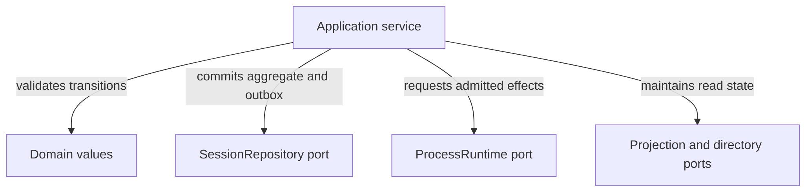

# Find the owner of an application change

Use this explanation to place a maintainer change in the correct layer and
identify the state, ports, and tests it affects. It describes
`undercurrent-application` package 0.1.0-beta in this workspace, not a separately
supported public library. Start with the [crate guide](../../README.md) for reading
paths and the [source root](../../src/lib.rs) for generated API entry points.

The application decides **when** to invoke a domain transition, persist its
result, publish an event, or ask infrastructure to act. It also owns prepared
read models and bounded in-memory subscription/output mechanisms. The domain
owns pure validity rules. Runtime, persistence, authorization, and presentation
adapters supply concrete capabilities. A `pub` type here is available to those
workspace adapters; it is not automatically an external SDK guarantee.

## Dependency direction is not a process diagram

Application depends only on domain and defines the ports implemented by runtime
and persistence adapters. The shared [dependency map](../../../../docs/architecture/dependencies.md#dependency-direction)
and [architecture policy](../../../../tests/architecture/allowed-graph.json)
own the workspace view and allowed edges. Concrete IO and executor dependencies
must stay outside this crate.

Application-defined `PortFuture` is a boxed, `Send` future with an explicit
borrowed lifetime. Traits are object-safe where they cross composition boundaries,
and generally `Send + Sync`; callers can supply an executor without importing
one into application policy.

## Runtime processes and state ownership

Application services run inside the daemon. The shared
[process and state map](../../../../docs/architecture/README.md) owns the
system view; daemon [composition](../../../undercurrent-daemon/docs/internals/composition.md)
selects concrete adapters. Here, the important boundary is which contracts a
service can use without knowing those adapters.

*Each service owns the ordering of calls across these ports; the ports do not
make the entire workflow atomic.* Follow [session lifecycle](sessions/lifecycle.md)
for mutation ordering, [prepared reads](sessions/read-models.md) for process-local views,
and [attempts](execution/attempts.md) for durable effect evidence.

## Port contracts versus the current composition

Contracts express requirements for implementers; they are not evidence that
every concrete adapter persists every value. Two distinctions matter when
reading these interfaces:

- `RestartScheduler` accepts rebuildable, process-local work. The caller commits
  scheduled intent in the session aggregate before enqueueing; mandatory startup
  reconciliation reconstructs that intent before readiness. This contract was
  adopted on 2026-10-05 to make the durability owner explicit. Queue acceptance
  and its diagnostic events do not prove independent persistent queue storage.
  Capacity failure leaves durable intent available for startup reconstruction;
  revision checks and serialized session mutation suppress duplicate effects.
- `InputDeliveryStore` persists reservations and outcomes in the daemon's
  [SQLite adapter](../../../undercurrent-store-sqlite/docs/reference/storage-format.md#semantic-input-delivery-retention).
  Reserve commits before terminal IO. Replay after restart returns the same
  delivered timestamp or preserves uncertainty; it does not authorize another
  write. Runtime attempt receipts remain a separate mechanism and identity.

Likewise, the [durable process decorator](execution/attempts.md#the-durable-process-decorator)
coordinates admitted methods, not every raw call. Its
[receipt-forwarding ordering](execution/attempts.md#dispatched-spawn-is-settled-by-the-start-service)
requires investigation at the composition boundary. These are current evidence
and limitations, not changes to the intended contracts.

## Start a source investigation by task

This is a code-navigation map, not a replacement for generated symbol reference.
Each group names the modules that collaborate on one reader task.

| Maintainer task | Owning application sources | Explanation |
| --- | --- | --- |
| Change creation or lifecycle | [commands/mod.rs](../../src/commands/mod.rs), [mutation](../../src/commands/mutation.rs), [activation](../../src/commands/activation.rs), [start](../../src/commands/start.rs), [stop](../../src/commands/stop.rs), [restart](../../src/commands/restart.rs) | [Commit and compensation walkthrough](sessions/lifecycle.md). |
| Handle exits and automatic restart | [process_exit](../../src/commands/process_exit.rs), [scheduled_restart](../../src/commands/scheduled_restart.rs) | [Restart triggers and guards](sessions/lifecycle.md#explicit-restart-and-automatic-restart-have-different-triggers). |
| Recover session ownership at startup | [startup_reconciliation](../../src/commands/startup_reconciliation.rs) | [Recovery decisions and readiness](recovery/startup.md). |
| Change metadata and WorkContext | [management](../../src/commands/management.rs) | [Durable metadata boundary](sessions/lifecycle.md#metadata-and-workcontext-use-the-same-durable-boundary). |
| Change process-attempt authority or recovery | [attempts](../../src/attempts.rs), [durable_process](../../src/durable_process.rs), [runtime_attempt_status](../../src/runtime_attempt_status.rs), [repair_attempt](../../src/repair_attempt.rs), [runtime_cancellation](../../src/runtime_cancellation.rs), [shutdown_process_host](../../src/shutdown_process_host.rs) | [Admission, settlement, and status](execution/attempts.md); [repair, cancellation, and shutdown](execution/runtime-controls.md). |
| Change terminal behavior | [commands/terminal](../../src/commands/terminal.rs), [terminal_output](../../src/terminal_output.rs), [terminal_screen](../../src/terminal_screen.rs) | [Input, retained output, and screen contracts](sessions/terminal-io.md). |
| Change reads and selective subscriptions | [read_model](../../src/read_model.rs), [queries](../../src/queries.rs), [detail](../../src/detail.rs), [watch](../../src/watch.rs), [subscriptions](../../src/subscriptions.rs) | [Projection, authorization, and watch behavior](sessions/read-models.md). |
| Change events or scheduled observations | [outbox](../../src/outbox.rs), [outbox_dispatch](../../src/outbox_dispatch.rs), [event_feed](../../src/event_feed.rs), [observation](../../src/observation.rs), [scheduling](../../src/scheduling.rs) | [Durable event publication](recovery/events-and-outbox.md) and [observation jobs](observation/observations.md) have different boundaries. |
| Change detection profiles and process evidence | [profiles](../../src/profiles.rs), [process_observation](../../src/process_observation.rs) | [Selection and rules](observation/profiles.md), [process facts and stale evidence](observation/observations.md). |
| Change private execution context or agent calls | [execution_context](../../src/execution_context.rs), [execute](../../src/execute.rs), [secrets](../../src/secrets.rs), [agent_channel](../../src/agent_channel.rs) | [Execution and secrets](execution/commands-and-secrets.md); [durable agent queue](execution/agent-channel.md). |
| Change diagnostics and presentation failures | [error](../../src/error.rs), [observability](../../src/observability.rs), [diagnostic_bundle](../../src/diagnostic_bundle.rs), [ports](../../src/ports.rs) | [Typed diagnostics and content authorization](diagnostics.md). |

## Error and authorization boundaries

Use [typed diagnostics](diagnostics.md#diagnose-by-stage-without-logging-private-content)
for error categories, operation registries, safe formatting, and effect-stage
investigation. An operation name does not establish retry safety.

Authorization is intentionally not uniform at every function. Mutation services
such as start rely on the daemon's already-authorized boundary; read and control
services may take their own authorization ports. `AccessResource` identifies a
resource, not a credential. Verify the actual service/caller pair when adding an
entry point. Avoid exposing existence through a repository read before an
authorization-first service grants access.

Telemetry is an injected port whose implementations must not panic. Its typed
records and privacy rules are explained in [diagnostics](diagnostics.md).

## Build and support scope

The package inherits Rust edition 2024 and minimum Rust 1.95 from the workspace;
[rust-toolchain.toml](../../../../rust-toolchain.toml) pins 1.95.0. It declares no
package features and no adapter dependencies. The application layer itself does
not establish OS support for spawning, terminal inspection, or private IPC;
consult the owning runtime/daemon qualification before claiming support for a
platform. Its version is not a wire version or durable schema generation.

Application futures also do not make the public Rust SDK asynchronous. The
[Rust client](../../../undercurrent-sdk/src/client.rs) exposes blocking connection,
request, and receive methods, while the
[Python client](../../../../python/src/undercurrent/client.py) exposes async methods
through its bridge. Consumer examples belong with those SDKs; maintainers here
can use the existing fake-port tests without starting a daemon.

The [project validation runner](../../../../scripts/validate.py)
owns integrated architecture, test, and warning-denied Rustdoc stages. Its
Rustdoc command covers the workspace; use it in the integrating validation
context rather than interpreting a focused crate test as a full architecture or
platform qualification. See [lifecycle verification](sessions/lifecycle.md#investigate-or-extend-a-command)
and [attempt verification](execution/attempts.md#verification-and-extension-points)
for focused starting commands.

[Crate documentation](../README.md)
