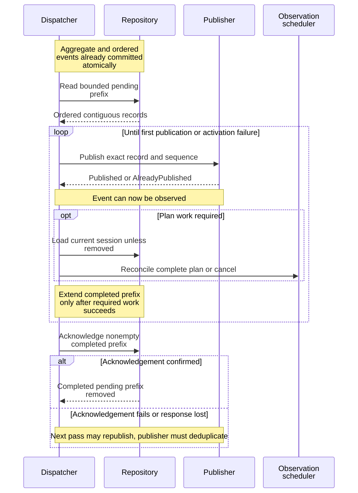

# Trace a committed change into the event feed

This explanation helps maintainers investigate a committed session change that
has not reached an event subscriber or observation scheduler. It describes the
internal application layer at this checkout; public transport encoding belongs
to the protocol and daemon adapters. Start with [session mutations](../sessions/lifecycle.md)
for the durable write and [architecture](../ownership.md) for ownership.

## Commit, publish, activate, acknowledge

The repository writes the aggregate and its ordered domain events in the same
transaction. Each [outbox record](../../../src/outbox.rs) has a nonzero,
repository-local `OutboxSequence`, a typed event, and an optional event-time
session snapshot. Current records capture that snapshot in the transaction;
legacy records can lack it. A sequence is neither a session revision nor a
process identity. Its checked successor can be exhausted.

This diagram shows when a committed event becomes externally visible and when
its pending source can be removed.



*Takeaway: visibility, observation scheduling, and removal from the pending
outbox are separate steps. Publication does not imply scheduling succeeded.*

[`DispatchOutboxService`](../../../src/outbox_dispatch.rs) accepts nonzero batch size,
foreground delay, and health delay. Before publication it rejects an oversized,
reordered, duplicate, or non-contiguous pending batch. The first retained pending
sequence need not be one because earlier work may already be acknowledged.

For each record it publishes first. Publisher idempotence is an adapter contract:
the same sequence and exact typed event can return `AlreadyPublished`; a changed
payload under that sequence is not a harmless duplicate. The service then:

| Event or current state | Observation action |
| --- | --- |
| `SessionRemoved` | Cancel the session's observations without loading a session. |
| Event does not invalidate the plan | Preserve existing cadence; do not load the repository. |
| Plan-invalidating event, session now absent | Cancel observations. |
| Current durable revision is behind the event | Fail with an invariant violation and leave this record pending. |
| Current session exists | Atomically reconcile its complete foreground/health plan. |

The authoritative invalidation list is
[`DomainEventKind::invalidates_observation_plan`](../../../../undercurrent-domain/src/event.rs).
Observation results do not reset their own cadence. Plans use the **current
aggregate**, not the historical event snapshot: Running plus enabled detection
gets foreground work; Running plus nonempty health rules gets health work.
Deadlines are the event timestamp plus the respective configured delay, using
saturating addition. A backlogged event can therefore schedule already-due work.

A record becomes `processed` only after its required activation succeeds. On
failure the dispatcher stops and attempts to acknowledge the completed prefix.
The error retains the failing sequence/stage, partial counters, and any secondary
acknowledgement failure. Publication counters can exceed processed counters.
Do not infer a rollback from an error returned after publication.

Acknowledgement is itself validated: `Acknowledged` must report the exact
requested boundary and processed count; `AlreadyAcknowledged` must cover at
least that boundary. A future unknown boundary or inconsistent result is an
adapter error. The ports in [ports.rs](../../../src/ports.rs) own these contracts;
the service does not combine publication and acknowledgement into a transaction.

## Read and resume retained events

[`ReadSessionEventsService`](../../../src/event_feed.rs) completes authorization before
journal access. An empty session filter requires collection-level `ReadEvents`;
explicit session IDs are authorized individually before any read. Empty session
and kind sets mean all entries in that dimension. Nonzero configured limits
bound filter sizes and returned page size.

| Start mode | Meaning |
| --- | --- |
| `Earliest` | Read from the oldest matching retained event. |
| `Tail` | Read recent matching retained events up to the page limit. |
| `Live` | Establish the current head without replay records. |
| `Resume { after }` | Read strictly after a global sequence checkpoint. |

The shared `validate_session_event_batch` boundary checks size, strict ordering,
filter membership, start mode, continuation, and gap shape. Selective event
records need **not** be contiguous: unrelated events can occupy intervening
global sequences. With `has_more`, the checkpoint must equal the last returned
record. At the end of a read it can advance beyond that record, so a selective
reader does not repeatedly scan unrelated events. A resume checkpoint cannot
move backward, including an empty read.

A resume gap identifies `missing_from = after + 1`, an inclusive missing end,
and its immediate successor `first_available`. It is explicit evidence that
the retained feed cannot reconstruct that interval. Other start modes do not
carry a resume gap. The runtime's
[bounded journal](../../../../undercurrent-runtime/src/events.rs) owns retention and
live subscription mechanics; this service neither stores client checkpoints nor
reconnects a transport. Durable outbox acceptance does not promise an unlimited
retained replay history.

For a view of current sessions, rebuild from a fresh
[prepared query](../sessions/read-models.md) after a gap. That repairs current display state;
it cannot recover missing historical events. Persist/use a checkpoint only after
applying the associated batch. Reopening a read with that checkpoint concerns
event consumption, not retry permission for the original mutation.

## Diagnose and extend dispatch

Use the error's typed stage and partial report to distinguish journal publication,
session load, revision validation, plan activation, and acknowledgement. Inspect
`OutboxDispatchFailed`, per-record lag metrics, pending depth in the owning
adapter, and the event sequence. A repository-behind-event failure requires
investigating repository/outbox consistency; repeatedly dropping that record
would hide a broken transaction boundary. After a publication or acknowledgement
response loss, recover through the existing idempotent dispatcher contract.

When adding an event kind, update the domain registry and decide explicitly
whether it invalidates observation scheduling. When changing an event payload,
check repository snapshot creation, publisher equality/deduplication, retained
filtering, and public protocol conversion. Do not replace complete plan
reconciliation with independent enqueues that can partially succeed.

The maintained examples are
[outbox dispatch tests](../../../tests/outbox_dispatch.rs) and
[event read tests](../../../tests/event_feed.rs). They cover a 300-record backlog with
bounded pages, publication-prefix failures, invalid acknowledgement, repository
revision mismatch, authorization before journal access, and resume checkpoints.
From the workspace root, with the pinned Rust toolchain available:

```sh
cargo test --locked -p undercurrent-application --test outbox_dispatch --test event_feed
```

Expected result: the selected in-memory tests pass without a daemon or persistent
runtime state; no process cleanup is needed.
Continue with [read models](../sessions/read-models.md) for coalesced current-state watches.

[Crate documentation](../../README.md)
