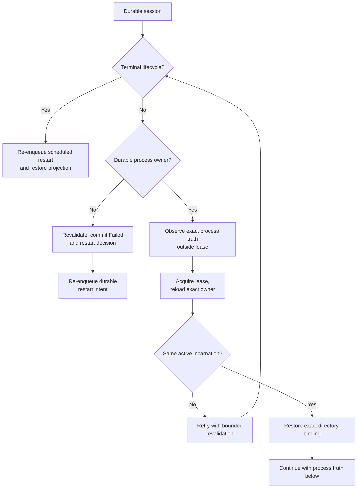
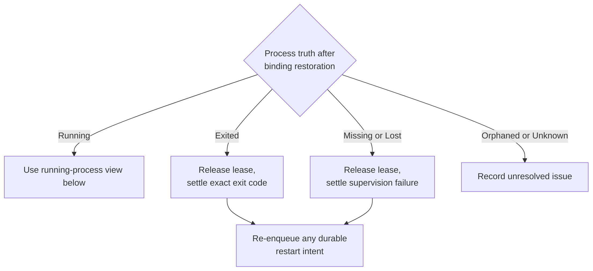
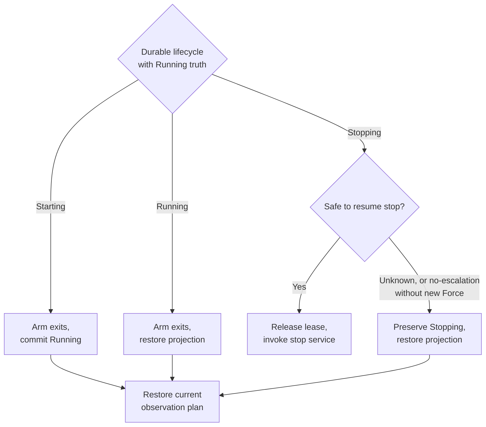

# Reconcile durable sessions with process truth

Use this explanation when diagnosing daemon startup or changing recovery logic.
It describes the internal application service in
[startup_reconciliation.rs](../../../src/commands/startup_reconciliation.rs), with
caller wiring in [daemon background work](../../../../undercurrent-daemon/src/background.rs).
Read [session lifecycle](../sessions/lifecycle.md) first for the distinction between
a session revision, exact process incarnation, and session mutation lease.

Startup reconciliation rebuilds process bindings, projections, observation
schedules, and queued restart work from durable sessions and runtime evidence.
It does not infer liveness from PID alone, synthesize a successful business
result, or unconditionally restart processes. The runtime adapter owns how it
observes an incarnation; the service owns what to do with that evidence.

## A complete scan is bounded in memory

`StartupReconciliationLimits` requires a nonzero page size. The retained-issue
limit can be zero for count-only diagnostics. `SessionRecoverySource` returns
complete aggregates in stable-ID order after an exclusive cursor. The service
validates that each page:

- Contains at most the requested number of sessions.
- Has strictly increasing IDs, all after the supplied cursor.
- Has no continuation cursor on an empty page.
- Uses the last returned ID as its continuation cursor when another page exists.

A source failure or malformed page aborts with an incomplete `partial_report`.
An individual session failure increments `unresolved`, retains an issue up to
the configured limit, and allows later sessions to continue. Therefore a short
or empty `issues` vector does not establish success: use the counters and
`scan_completed`.

`StartupReconciliationReport::ready()` is exactly `scan_completed && unresolved
== 0`. It is this service's readiness result, not a blanket promise that every
operation-attempt or cancellation outcome is known. The daemon also owns a
separate attempt-readiness gate. In particular, preserved Unknown cancellation
effects can coexist with a ready session scan so status reconciliation remains
possible.

## Observe first, then revalidate under the lease

Process-truth observation occurs before taking the session mutation lease.
After acquisition, the service reloads durable state and checks that the same
incarnation is still owned. If lifecycle is now terminal or identity changed,
it retries against the new aggregate, for at most three revalidation iterations.
A conflicting directory binding is retained and reported; recovery must not
remove a replacement merely to make the scan pass.

The diagram summarizes the decisions for one session. Exact binding restoration
is attempted before the process-truth branch; it checks both process ID and
start time and tolerates a bind error only if re-reading finds that exact owner.



*Ownership: observe outside the lease, then revalidate before restoring an exact binding.*



*Process truth: unknown evidence remains unresolved, while known termination can produce durable restart intent.*



*Running truth: preserved no-escalation or Unknown cancellation does not authorize repeated termination.*

*Takeaway: runtime evidence is revalidated against durable ownership before it
can change a session; uncertainty is either explicitly preserved or reported.*
Errors at any step can produce a per-session issue. The diagram omits those
repeated error edges. It describes application decisions, not OS guarantees.

| Current evidence | Recovery action and limit |
| --- | --- |
| Already terminal | Re-enqueue scheduled intent, then restore projection; no OS lookup. Unlike ordinary post-commit projection maintenance, projection failure here is unresolved startup work. |
| Active without durable owner | Under lease, recheck absence; commit Failed plus `SupervisionFailed` restart disposition in one transaction. Release lease before scheduling. No speculative spawn. |
| Starting with Running truth | Restore exact binding, arm exit publication, commit Running, and rebuild observations. |
| Running with Running truth | Restore binding, arm exits, restore projection and observations without an unnecessary durable lifecycle change. |
| Stopping with no-escalation policy | Preserve the live process and Stopping; restore projection and current observation plan. A graceful-only timeout is not permission to signal again or escalate. A separately accepted Force control can authorize recovery. |
| Stopping with resumable cancellation | Claim the durable cancellation recovery instruction at the process boundary. Use Force for an independently accepted Force control; resume Graceful with GracefulOnly. Release the lease before stop. |
| Stopping from standalone command | A `None` cancellation instruction selects graceful stop; only when no-escalation is false. |
| Stopping with `PreserveUnknown` | Do not repeat process IO. Count `stopping_unknown_preserved`, not `unresolved`, while leaving status queryable. |
| Exited | Invoke exact process-exit settlement with its observed code and timestamp after lease release. |
| Missing or Lost | Invoke exit settlement with `SupervisionFailed`; this is not a fabricated exit code. |
| Orphaned or Unknown | Record `UnresolvedProcessTruth`; do not guess a terminal result or spawn a replacement. |

Observation reconstruction uses a complete `SessionObservationPlan` at the
current session revision: foreground work is due now only when Running and
detection is enabled, and health work only when Running with nonempty rules.
For preserved Stopping, both deadlines are absent. The scheduler port must apply
the plan atomically and protect newer revisions from older plans.

The cancellation-source contract is especially important: claiming a resumable
control must atomically mark it in flight before process IO. After a crash in
that window, the next claim must preserve Unknown rather than repeat termination.
The application enum still includes `RuntimeCancellationEffectUnknown` as a
failure classification, but the current `PreserveUnknown` branch is a resolved
scan action. Do not turn that enum entry into a claim that all Unknown
cancellations close session-scan readiness.

## Diagnose the stalled stage

Inspect the report's `scan_completed`, `examined`, `unresolved`, action counters,
and retained `(session_id, stage, failure)` issues. Diagnostics deliberately
carry stable operation/kind/category values, not terminal or environment payloads.
The service emits scan start/completion/failure, batch loaded, and per-session
success/failure events; metrics include examined count, unresolved count, and
operation duration.

| Symptom | Inspect next | Appropriate recovery direction |
| --- | --- | --- |
| Incomplete scan | `RecoverySource` or `InvalidBatch`, including `partial_report` | Repair the source/storage failure or ordered-page implementation before retrying the scan. Do not open readiness from a partial scan. |
| Binding conflict | Durable ID/start time and current directory entry | Establish which incarnation actually owns the session; preserve a replacement until reconciled. |
| Process truth unavailable | Runtime observer and private host connection | Restore observation capability. A transport failure alone is insufficient evidence to kill or restart. |
| Repeated state change | `RevalidateState`, mutation ordering, concurrent actor | Find the actor changing the aggregate; retain bounded revalidation rather than introducing an unbounded startup loop. |
| Enqueue/projection/plan failure | Stable port operation and adapter capacity/error | Repair the adapter, then rebuild from durable state. Do not treat projection state as more authoritative than a committed session. |
| Ready scan with preserved Stopping | No-escalation flag and cancellation status | Reconcile the exact cancellation or make an explicit authorized stop decision. Readiness does not prove termination. |

For a repeatable maintainer exercise, use the existing fake-runtime tests from
the repository root, with Rust 1.95.0 and locked dependencies available:

```sh
cargo test --locked -p undercurrent-application --lib startup_reconciliation
cargo test --locked -p undercurrent-application --lib second_startup_never_redrives_a_previously_claimed_force_cancellation
```

Expected result: selected tests pass. No daemon, private process host, or real
managed process is required, and no application state needs cleanup. A missing
toolchain or dependency cache must be fixed before evaluating test outcomes.
The [command fixtures](../../../src/commands/command_tests.rs) cover mixed sessions,
300 terminal sessions in ten pages of 32, capped retained issues, fatal source
failure, malformed empty continuation, force preservation, and no repeated
Unknown cancellation effect. The module's own tests cover limit validation and
readiness predicates. These tests do not establish OS observation correctness;
that evidence belongs to the runtime adapter and end-to-end recovery checks.

Return to [session lifecycle](../sessions/lifecycle.md) for commit ordering or the
[crate guide](../../../README.md) for the other application boundaries.

[Crate documentation](../../README.md)
