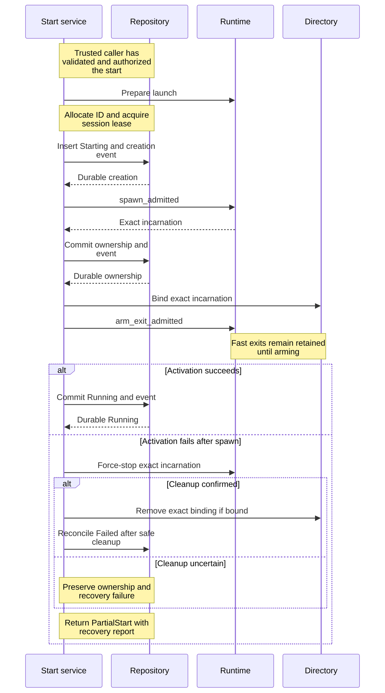
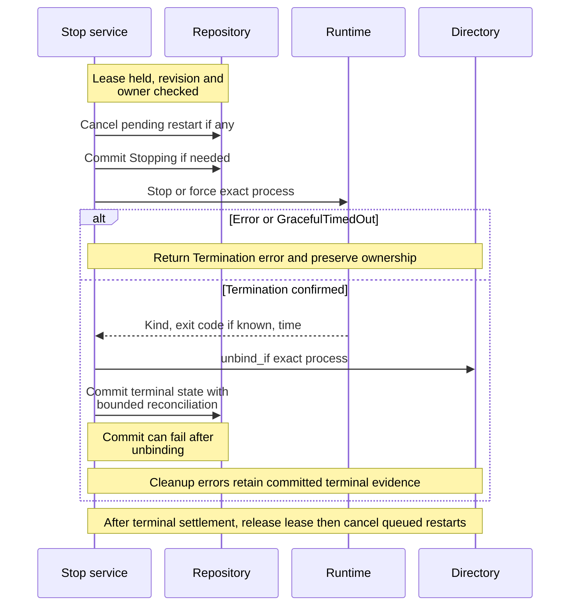
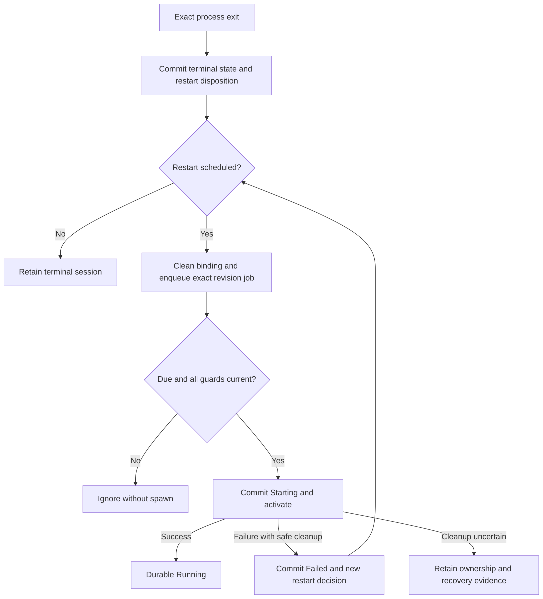

# Follow a session from creation through restart

Use this explanation to change session commands without losing durable process
ownership or confusing a successful side effect with a successful commit. It
covers the internal application crate at package version 0.1.0-beta. External clients
use the [Rust SDK](../../../../undercurrent-sdk/README.md) or
[Python package](../../../../../python/README.md); these services are daemon wiring
interfaces, not a supported consumer SDK.

A **session** is a durable aggregate with a stable ID and revision. A **process
incarnation** is one runtime instance, identified by an opaque ID and its start
time. A session can outlive many incarnations. A **mutation lease** serializes
work for one session; it is separate from the repository's optimistic revision
check. The domain owns exact transition rules in
[lifecycle.rs](../../../../undercurrent-domain/src/lifecycle.rs) and
[session.rs](../../../../undercurrent-domain/src/session.rs).

## The common mutation boundary

[MutationCore](../../../src/commands/mutation.rs) acquires a
`SessionMutationCoordinator` lease, then loads the aggregate. Callers retain the
lease across relevant awaits. `begin_at_revision` checks the caller's optional
revision only after acquisition and load, before command mutation or process
IO. Currently stop and terminal input use this precondition; do not infer that
all commands accept it.

A repository commit atomically writes the changed aggregate and ordered outbox
events at an expected prior revision. Several domain changes can be committed
in one repository transaction. Projection updates happen afterward and are best
effort: their failure is diagnosed without changing durable success into an
error. The outbox's later publication is a separate boundary. A successful
command does not establish that every subscriber has observed its result.

The [ports](../../../src/ports.rs) require session-local ordering, cancellation while
waiting for a lease, and release on guard drop. They forbid holding a global
registry lock for the lifetime of a session lease. This preserves independence
between sessions while the repository revision check catches mutations that
escaped local ordering. This crate supplies async orchestration, not a thread
pool or executor. Adapters enforce process deadlines; ordinary command futures
do not all share a universal cancellation token.

Application timestamps are clamped to the aggregate's `updated_at` through
`not_before`, so a clock correction does not create a backwards mutation time.
Observed process start times remain separate evidence.

## Creation has several commit points

The daemon's [finite request adapter](../../../../undercurrent-daemon/src/application_adapter/finite.rs)
converts and authorizes a start, selects or validates its profile, then invokes
[StartSessionService](../../../src/commands/start.rs). The command service itself has
no authorization port. Calling it directly requires a trusted, already
authorized boundary.

The following sequence shows a standalone start. `ProcessRuntime` denotes the
composed durable wrapper and runtime adapter; the process effects do not belong
to the session repository transaction.



*Takeaway: durable creation, process ownership, and Running are distinct commits;
process activation is not one atomic database-and-OS operation.* Projection
maintenance follows successful durable changes but is omitted from the diagram
for readability. Initial insertion can fail or conflict before spawn. A spawn
port failure attempts Failed settlement and returns both the primary failure
and any settlement failure; it does not by itself prove no process effect.

[activate_process](../../../src/commands/activation.rs) is shared by start and
both restart paths. Exit arming follows directory binding so a fast exit can
be attributed to its owner. Launch preparation belongs to the start service,
before insertion: the runtime resolves executable/path bindings and returns an
executable resolution receipt. Sealed and native execution details belong to
the runtime adapter.

Running records the managed process lifecycle. It does not establish completion
of the program's application-level work.

`ProcessActivationFailure` retains the failed stage, last known durable
aggregate, optional spawned process, and whether binding occurred. Compensation
forces only that incarnation and removes only its matching binding. An uncertain
force-stop preserves the binding. Failed unbinding or a replacement binding
prevents failed-state settlement. Ordinary start reconciliation reloads and
retries optimistic Failed commits at most three times; it never repeats spawn.
Inspect `StartRecoveryReport::completed` and `cleanup_required_process`, not
only the outer error category.

## Dispatched creation and lost responses

An externally dispatched start carries `OperationAttemptAdmission` and requires
an attached `OperationAttemptStore`. Before preparing or allocating a new
session, start checks an existing attempt for matching immutable dispatch
semantics. A matching KnownApplied settlement can reconstruct success only from
a Running session, its exact bound process, and matching result digest. Accepted
or Unknown attempts require reconciliation; KnownAbsent and Compensated
attempts conflict. Missing or inconsistent result evidence is not permission to
spawn again.

For a new dispatch, the runtime policy must be present and current both before
preparation and immediately before session insertion. Exact successful replay is
checked first and can therefore succeed after policy expiry. The durable runtime
performs its own admission checks at the process boundary.

After activation, start settles the dispatch as KnownApplied with the process
result digest. It reloads attempt state after a settlement error or rejection.
If the matching settlement and exact live activation are found, it recovers the
result without cleanup or another spawn. If settlement remains ambiguous,
`DispatchSettlementUnknown` retains the live session and process. If receipt
acknowledgement fails after confirmed settlement, `DispatchPersistence` also
preserves the process, allowing a later exact replay.

A confirmed higher caller fence is a different branch: cleanup requires exact
session revision, Running lifecycle, process identity, and directory binding.
Start durably prepares compensation evidence before forcing that process,
settles Failed against the activated revision, then records terminal
compensation and acknowledges the receipt. If any part remains incomplete, the
error retains exact cleanup evidence. This avoids destroying a replacement or
mistaking a lost response for supersession.

## Stop retains intent before process IO

[StopSessionService](../../../src/commands/stop.rs) checks the revision precondition
under its lease, commits cancellation of any pending automatic restart, and
returns `AlreadyTerminal` when applicable. For an active session it requires a
binding that matches durable process ID **and start time**.

An unconditional force request observing Stopping may admit force against that
exact incarnation before acquiring the lease. It then waits for ownership and
checks that no replacement binding appeared before settlement. This lets force
interrupt an existing grace period. Revision-conditional requests retain the
fully serialized path below. Concurrent force does not discard the original
stop receipt; [completed-stop settlement](../../../../undercurrent-store-sqlite/docs/internals/transactions/attempts.md#attempt-lifecycle)
retains its exact applied evidence.

The serialized stop sequence makes the failure windows explicit:



*Takeaway: a stop error may occur after the process stopped; inspect the typed
stage and durable state before deciding what recovery is needed.* In particular,
exact unbinding is attempted **before** terminal settlement. Repeated commit
failure can leave durable Stopping with no directory binding.

| Mode or outcome | Application behavior |
| --- | --- |
| `Graceful` | Uses configured stop signal/deadline and escalation policy. |
| `Force` | Calls the immediate forced-termination port. |
| `GracefulOnly` | Persists the no-escalation constraint in session configuration before Stopping; the domain clears it when the next incarnation enters Starting. |
| `GracefulTimedOut` | Returns a Timeout error, retains ownership, and does not call terminal settlement. |
| Confirmed exit code | Settles `Exited(code)`. |
| Confirmed termination without portable code | Settles `Stopped`. |
| Terminal commit failure | Reloads and retries up to three attempts, preserving primary and final errors. |
| Directory cleanup failure or replacement | Returns `DirectoryCleanup` or `DirectoryChanged` with the committed terminal session and termination evidence. |

Queued restart cleanup runs after lease release for successful terminal results
and the two post-settlement directory errors. Cleanup failure is diagnostic and
does not undo durable restart cancellation. Repeating stop on the terminal
session can retry that queue cleanup without process IO.

## Explicit restart and automatic restart have different triggers

[RestartSessionService](../../../src/commands/restart.rs) composes the command's selected stop mode, then
reacquires the lease for activation. It checks equality with the stopped
revision and requires both terminal lifecycle and an empty process-directory
slot. The daemon's immediate shutdown checks cancellation at this boundary,
after completing stop receipts and before replacement activation.
An intervening mutation yields `ChangedAfterStop` without a new spawn;
it does not undo that mutation. The service commits Starting and uses the shared
activation sequence, preserving session ID and configuration. A failed explicit
restart attempts Failed settlement after safe compensation but does not run
automatic restart policy on its own.

[ObserveProcessExitService](../../../src/commands/process_exit.rs) handles armed
runtime exit notifications. It ignores absent bindings or an old incarnation's
exit. For an active session, the current binding must also match durable
ownership. It commits terminal lifecycle **and** the domain restart decision in
one transaction with ordered events, then removes the exact binding, releases
the lease, and enqueues delayed work. A repeated notification while a matching
binding remains and durable terminal state already exists performs cleanup and
can re-enqueue persisted restart intent. Once the binding is gone, a duplicate
notification returns `BindingMissing`; it is not a general scheduling repair.

The [daemon background worker](../../../../undercurrent-daemon/src/background.rs)
retains a failed exit observation for retry. If enqueue failed after unbinding,
the next duplicate may be ignored; durable scheduled intent remains available
to startup reconciliation. Do not claim that notification retry alone repairs
every enqueue failure.

The automatic restart path is shown separately from creation:



*Takeaway: a queued restart is a revision-checked proposal to act; the session's
durable disposition remains authoritative.* The policy algorithm, attempt
limits, backoff, and reset rules belong to
[domain restart policy](../../../../undercurrent-domain/src/restart.rs).

[RunScheduledRestartService](../../../src/commands/scheduled_restart.rs) checks, in
order: deadline, session revision, exact scheduled attempt and deadline, terminal
lifecycle, and absence of an existing binding. Ignored work performs no spawn.
A failed automatic activation, once safely compensated, commits Failed and a
`SupervisionFailed` restart decision together, then enqueues any next bounded
attempt after lease release. A queue adapter must deduplicate accepted jobs;
workers must still revalidate every guard. The daemon requeues errored jobs,
which can subsequently be stale and ignored. Do not replace these guards with
unconditional process retry.

## Metadata and WorkContext use the same durable boundary

[management.rs](../../../src/commands/management.rs) contains the simpler mutations:

- **Rename:** Stable ID, process ownership, ID-based relationships, and subscriptions survive. Same name is a no-op; repository uniqueness conflicts identify the existing owner.
- **Remove session:** Domain permits only terminal sessions. Repository deletion and the revisioned removal event are atomic; projection removal is best effort. `RemovalConfirmation` records evidence supplied by the presentation boundary; the service does not prompt or authenticate. A missing session is a typed NotFound, not a successful repeated deletion.
- **Upsert WorkContext item:** A WorkContext upsert is idempotent by owner/item key and complete declaration. Full content stays in detail state; summaries carry counts. Foreground and lifecycle do not change.
- **Remove WorkContext item:** An absent WorkContext key is a no-op; successful change updates durable state and its event.
- **Expire WorkContext:** For WorkContext expiry, the caller chooses one session; eligible active declarations become explicitly Expired in one batch. This is not a global scan or deletion of expired declarations.

## Investigate or extend a command

Start with the owning command, the domain method it calls, and the port contract.
Add new pure decisions to the domain and new adapter capabilities as application
ports; wire them in the daemon. Preserve meaningful typed failures after effects,
including the exact process and durable state needed for reconciliation. Never
reduce a partial success to a bare retryable infrastructure error.

The maintained examples for these commands are the deterministic tests in
[command_tests.rs](../../../src/commands/command_tests.rs). They use in-memory
repositories and a fake runtime, so their shell command fixture is never launched.
Useful regression cases include:

- `start_commits_running_session_binds_process_and_projects_summary` checks the
  creation/ownership/lifecycle event order and Running revision 3 in its fixture.
- `dispatched_start_recovers_response_loss_after_settlement_commit_without_cleanup_or_respawn`
  checks recovery after a commit whose response was lost.
- `higher_dispatch_survives_exact_low_fence_compensation_without_orphan_process`
  checks that superseded cleanup preserves the higher dispatch.
- `uncertain_termination_preserves_process_ownership_and_nonterminal_state` and
  `terminal_settlement_retains_primary_and_final_reconciliation_failures` check
  opposite sides of the termination boundary.
- `explicit_restart_rejects_intervening_mutation_after_stop`,
  `stale_old_process_exit_cannot_unbind_or_terminate_replacement`, and
  `stale_restart_job_performs_no_process_io` exercise stale-work guards.
- `rename_preserves_identity_active_subscription_and_work_context_session_targets`
  and `work_context_expiry_is_session_local_batched_and_idempotent` cover metadata.

For focused maintainer verification, from the repository root with the pinned
Rust 1.95.0 toolchain and locked dependencies available:

```sh
cargo test --locked -p undercurrent-application --lib commands::command_tests
```

Expected result: the selected tests pass without a daemon or real managed
processes. Cargo may need its dependency cache populated; an offline resolution
failure is a setup failure, not a command assertion. There is no daemon or
persistent application state to clean up; Cargo keeps its normal build artifacts.
These fakes verify orchestration, not OS termination or SQLite crash durability.
Continue with [startup recovery](../recovery/startup.md) for process truth after a
restart, or return to the [crate guide](../../../README.md).

[Crate documentation](../../README.md)
