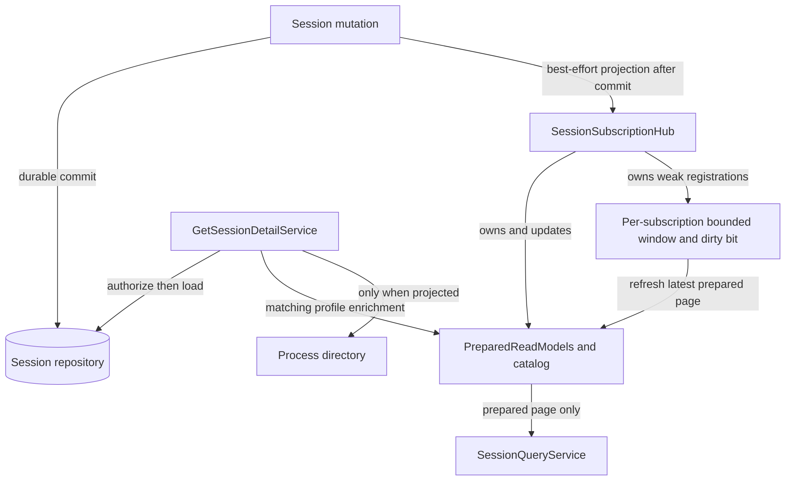

# Understand list queries, watches, and private detail

Use this explanation to change session presentation without introducing process
or repository IO into list queries. These are internal Rust application types;
outer adapters authorize and encode list/watch requests. The separately
authorized detail service loads durable state. See [architecture](../ownership.md)
for the supported SDK boundary.

## Separate durable state from prepared views

[`PreparedSessionCatalog`](../../../src/read_model.rs) holds session summaries and
secondary indexes under an `RwLock`. Its catalog revision starts at zero and
advances once for each changed upsert/removal. Identical upserts and removal of
absent IDs are no-ops. A catalog revision describes prepared view changes; it is
not a durable session revision. In particular, an effective-profile update can
advance the catalog without changing the persisted session.

This diagram distinguishes durable ownership from rebuildable presentation and
per-subscriber state.



*Takeaway: a successful mutation can precede its visible projection. List/watch
reads do not synchronously repair projections or ask a process for fresh state.*

Mutation projection failures are diagnosed after the durable commit; see
[session lifecycle](lifecycle.md). Startup reprojects durable records.
The catalog is rebuildable, not an independent authority for mutation guards.
Callers must supply valid domain summaries, including unique session names;
the catalog's exact-name index is a single name-to-ID mapping, not a name
uniqueness enforcement service.

## Query cost, projections, and cursor expiry

Filters intersect maintained candidate sets for IDs, exact name, lifecycle,
execution, interaction, health, profile, labels, and active work. Multiple selected
values within a set-valued dimension are unioned; dimensions are intersected.
Name substring matching and final domain-filter checks run over candidates.
Sorts use the domain sort field with stable ID as the tie-breaker, reversing the
complete ordering for descending queries.

An unfiltered sort-index scan seeks past the cursor and stops after enough
matches to fill a page plus evidence of another match. A filtered candidate
scan can examine and sort **all candidates**, even for a small returned page.
Name substring filtering can also scan many index entries. Bounded output does
not promise constant-time queries or page-sized intermediate work. Exact total
is opt-in and can count the full matching set; `QueryCost.index_entries_examined`
measures page extraction, not every allocation or total-count operation.

`SessionSummaryView` always excludes command arguments, environment values,
metadata, complete health evidence, WorkContext items, screen contents, and raw
output. Only `WithLabels` adds labels. At this implementation, `Compact` and
`Operational` carry the same underlying non-label fields but retain distinct
projection tags; do not assume the operational tag causes fresh runtime IO.

A `SessionPageCursor` binds the full query, catalog revision, and last session
ID. It is an internal value; the adapter must expose an opaque validated handle.
Any catalog change expires an old cursor, even outside that page. Changing the
query also rejects reuse. This favors consistency over maintaining old snapshots.
On `CursorExpired` or a query mismatch, discard the old pagination sequence and
start again without a cursor. Do not splice a new first page into an old snapshot
while claiming it represents one revision.

[`SessionQueryService`](../../../src/queries.rs) adds duration, rows, index entries,
catalog revision, projection, and cursor-expiry telemetry. Its constructor has
only a clock, prepared catalog, and telemetry: no authorization, repository,
process, terminal, health, or detector port. Authorization of public list/watch
requests belongs to the outer application adapter.

## Apply a coalesced watch correctly

[`SessionQueryWatch`](../../../src/watch.rs) retains the first bounded page of one
query, its revision, optional total, and cost. Refresh compares the previous page
to the newest page. It does not replay every intermediate mutation.

| Batch member | Consumer meaning |
| --- | --- |
| `Added` | The ID entered this page; use its supplied current summary. |
| `Updated` | The projected summary of an existing page member changed. |
| `Removed` | The ID left this page; the last known entity revision is retained, but no summary is sent. This does not prove session deletion. |
| `order` | Replace the visible ordering with these authoritative IDs. |
| `total` | Exact count only if requested; it can change without a page delta. |
| `from_revision`, `to_revision` | Revisions of the compared prepared windows, not a complete log of intervening changes. |

A refresh with no visible membership, content, order, or requested-total change
returns `None` but still advances the local watch revision. Use the initial
snapshot followed by returned batches as replaceable view state. Use
[retained events](../recovery/events-and-outbox.md) when historical transitions matter.

[`SessionSubscriptionHub`](../../../src/subscriptions.rs) adds bounded ownership and
notifications. A projection gate serializes initial snapshot plus registration
with projection updates, closing the initial-subscription race. Updates notify
subscriptions whose old/new filter matches or whose current page contains the
ID. Each slow consumer holds one dirty bit and one page, not an unbounded queue.
An optional payload-free outer wake fires on clean-to-dirty transitions.

The consumer can call `try_recv`, blocking `recv`, or blocking `recv_timeout`.
Waiting retains no hub or catalog lock; a timed receive uses elapsed monotonic
time, and zero timeout is a nonblocking attempt. A failed refresh restores the
dirty bit for a later retry. `snapshot()` returns the last delivered window,
not an automatically refreshed dirty page. `close()` and drop clear the logical
subscription, wake waiters, and release its registration without closing peers.
The hub prunes dead weak registrations and reports live/dirty capacity pressure.

All projection mutations used with a hub must enter through the hub. Calling
`hub.catalog().upsert(...)` bypasses notification. The hub also serializes
effective-profile transitions and preserves matching runtime profile context
across durable upserts; replacement process/configuration invalidates that
context. The bare catalog's separate get/transition/upsert calls are not a
replacement for that hub-level serialization.

## Load private detail deliberately

[`GetSessionDetailService`](../../../src/detail.rs) first authorizes
`ReadSessionDetail`, and independently checks `ReadWorkContext`,
`ExplainForeground`, or `ReadHealth` for the corresponding optional sections.
All checks finish before repository or directory access. A denial therefore
does not reveal whether the session exists.

`OVERVIEW` loads the durable summary without allocating optional sections or
looking up a process. Explicit projection can add launch configuration,
WorkContext declarations, process binding, foreground rationale, and health
results. Process detail is included only if the directory binding matches the
durable process identity and start time. Prepared effective-profile context is
retained only for a matching incarnation/configuration; durable fields remain
authoritative. These sequential reads are not one repository/runtime transaction.

Configuration includes authorized command arguments and private metadata, but
environment detail contains only deterministic deduplicated variable names,
environment-file reference, and binding—not explicit or resolved secret values.
Payload-bearing types redact their debug representation. Do not log private
accessors merely because the containing request was authorized. Execution that
needs private values uses the separate
[execution-context boundary](../execution/commands-and-secrets.md).

## Verify a change

From the workspace root with the pinned toolchain, use the existing in-memory
fixtures as complete examples:

```sh
cargo test --locked -p undercurrent-application --test prepared_catalog --test query_services --test subscription_hub --test session_detail
```

Expected result: selected tests pass without a daemon or persistent state; no
process cleanup is needed.
The [catalog tests](../../../tests/prepared_catalog.rs) exercise pagination, concurrent
writers, index replacement, cursor expiry, and coalescing;
[hub tests](../../../tests/subscription_hub.rs) exercise selective wake, capacity,
timeout, drop, and profile preservation;
[query tests](../../../tests/query_services.rs) enforce the prepared-only boundary and
cost metrics; [detail tests](../../../tests/session_detail.rs) check authorization order,
projection limits, incarnation matching, and redaction.

When adding a summary field, update domain summary construction, view projection,
filter/sort indexes as appropriate, delta equality, and public conversion. Test
both entry into and removal from a watched page. When a finite list looks stale,
investigate projection diagnostics and startup reconstruction before adding
runtime IO to the query path.

[Crate documentation](../../README.md)
