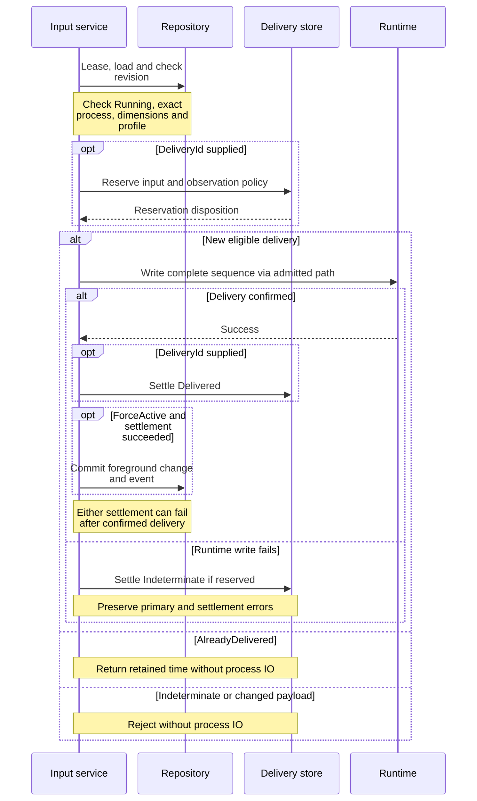
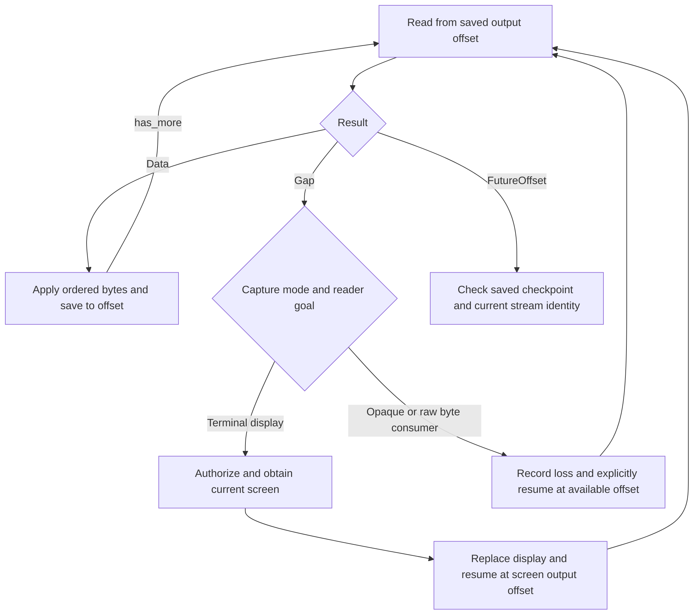

# Follow input delivery and recover terminal output

This explanation is for maintainers changing terminal commands, output retention,
or screen adapters. It covers internal application orchestration at this checkout;
the daemon owns public request authorization/encoding for mutations and logical
stream transport. Read [session lifecycle](lifecycle.md) for mutation
leases and [operation attempts](../execution/attempts.md) for admitted runtime IO.

## Input ordering and partial success

[`commands/terminal.rs`](../../../src/commands/terminal.rs) runs input, resize, and stdin
closure under the session mutation lease. All require Running and an exact
directory binding matching the durable process ID and start time. Input's
optional expected revision is checked before reservation or IO. Mouse coordinates
are revalidated against the dimensions loaded under that lease.

Input pacing comes from the selected profile. Foreground-adaptive sessions consult
the exact process's effective profile; fixed sessions use the configured profile.
No selected profile means immediate delivery. A selected profile absent from the
active catalog is a precondition failure, before a delivery reservation is made.
The runtime receives the entire typed sequence and delivery policy; application
code does not split an atomic sequence around its trailing-submit delay.

This sequence shows why a command error alone cannot justify writing the same
input again. Foreground commit requires `ForceActive` and success at every
prior step.



*Takeaway: semantic duplicate suppression protects an accepted delivery; neither
a write error nor a later settlement failure proves the process saw no input.*

### What a delivery ID protects

The optional `DeliveryId` reservation compares both typed input and observation
policy. `AlreadyDelivered` replays the retained timestamp with
`deduplicated = true` and no foreground revision. `Indeterminate` suppresses a
second write; payload reuse returns a conflict. Preconditions are evaluated
before reservation lookup, so replay is still subject to current lifecycle,
revision, ownership, dimension, and profile checks.

### Errors after confirmed delivery

After a confirmed write, `DeliveredSettlement` and
`DeliveredForegroundSettlement` explicitly return `delivery_was_confirmed() =
true`. The latter can occur after the delivery record was already settled. A
deduplicated retry does not repair the missing foreground commit. `ForceActive`
commits affirmative, certain input-delivery evidence for Active execution and
clears interaction state while retaining the constraint; Preserve leaves the
observation unchanged. This is evidence that input was delivered, not proof of
an application-level result or completed command.

### Limits of duplicate suppression

The daemon's semantic reservations survive restart in the session SQLite database.
Unsettled records remain indeterminate even if the crash happened before the
write; this conservative choice prevents repeating an effect whose timing is
unknown. Records never expire or evict and are removed only with terminal session
deletion. At capacity, new delivery IDs fail before IO; retained IDs still resolve.
See [storage and upgrade policy](../../../../undercurrent-store-sqlite/docs/reference/storage-format.md#semantic-input-delivery-retention).

The separate internal `WriteInput` attempt receives a fresh identity from an
injected source before delivery reservation. The daemon uses operating-system
randomness, so clock resolution does not collapse distinct intentional writes.
Identity allocation failure occurs before reservation or PTY IO.

Its versioned semantic digest includes session/process identity, optional delivery
ID, each typed input item with explicit boundaries, and effective text/pacing
policy. Private content is hashed locally; only the digest enters the attempt
record. An identical intentional write has the same semantic digest but a new
attempt ID. Delivery-ID replay still returns the retained result before admission
and never writes again; ambiguous delivery suppresses retry.

A fresh internal identity is not permission to retry an ambiguous mutation.
Preserve its original delivery identity and investigate the result. The fixed-clock
composed regression covers different same-sized input and intentional identical
writes; separate tests cover types, item boundaries, and effective policy.

## Resize and close stdin

A resize to the current durable dimensions is a no-op after the Running check,
without process IO. A changed size is validated in the in-memory aggregate,
applied to the exact live process through an admitted resize, and then committed
with the durable event. A failed durable commit attempts an admitted rollback
to the prior live dimensions while retaining the lease. The error preserves
both the commit failure and optional rollback failure. This is compensation,
not atomicity across PTY and repository. A response-lost commit or failed rollback
requires checking both current durable dimensions and runtime state.

`CloseStandardInputService` calls the runtime's typed `close_input` operation
after ownership checks. It confirms closure after previously accepted input and
returns whether input was already closed. EOF is not an input byte or named key.
The service does not commit a new session lifecycle or infer process exit. This
path passes through `DurableProcessRuntime` without creating a generic admitted
attempt; its idempotence belongs to the exact-process closure contract.

## Byte offsets, retention, and memory ownership

[`TerminalOutputStore`](../../../src/terminal_output.rs) is an in-memory, bounded raw
byte store. Its limits cover sessions, subscriptions, per-session/global retained
bytes, chunk size, append size, and replay size; all must be nonzero, and one
chunk must fit both retention budgets. It is not a filesystem log or proof that
every process byte survived a connection failure.

Appends allocate monotonically increasing session byte offsets under the store
write lock. Empty append is a no-op. Bytes split into reference-counted chunks;
oldest whole chunks are evicted first for the session budget, then globally by
append order. Eviction never rebases subsequent offsets. Chunk granularity can
evict more than the exact excess, and append work can temporarily exceed the
retained budget before eviction completes.

`begin_session` binds capture mode and an absolute starting checkpoint. Reopening
requires the exact current mode and offset. `append_at_checkpoint` compares the
parser's checkpoint and appends under one lock, rejecting bypassing writers.
`establish_retention_gap` models remote loss by discarding the old suffix and
advancing to a boundary **newer than the current end**; equal or older boundaries
do nothing. An implicit first append uses Terminal capture mode at offset zero;
opaque/remote producers should establish their mode/checkpoint explicitly.

| Read position | Result |
| --- | --- |
| Before earliest retained byte | Explicit `Gap`, with requested/available/end offsets and recovery hint. |
| At or inside the retained suffix | Up to the requested byte limit as ordered slices; `to` is exclusive and `has_more` identifies remaining retained data. |
| At current end | Empty Data, not an end-of-process signal. |
| Beyond current end | Typed `FutureOffset`. |
| Unknown output record at offset zero | Empty Data; the store does not establish durable session existence. |

`OutputSlice` retains an `Arc` plus a byte range. Slice digest covers returned
bytes; retained-chunk digest covers the entire backing chunk. Replay integrity
describes the delivered page and source bytes remaining at extraction time;
`truncated` can mean pagination, independently of an explicit earlier gap.
The hidden terminal-stream types intentionally avoid digest computation while
preserving offsets, bytes, gaps, and accounting.

Eviction or `remove_session` does not free allocations still referenced by a
consumer. Outer stream/mailbox budgets must bound outstanding slices and release
them promptly. Session removal deletes offset state and closes/wakes registered
subscriptions, but existing slices remain valid. Global status and ordered
status pages expose only counters; top producers scan the bounded registry and
sort by retained bytes with ID tie-breaking. These are operational snapshots,
not a consistent multi-page historical snapshot.

## Subscribe and recover a screen

Subscription opening holds one store lock for initial replay and registration.
The handle owns a checkpoint and dirty bit, not a byte queue. Selected-session
appends mark it dirty and invoke a payload-free wake after releasing the store
lock. A slow consumer eventually receives a gap. A data receive advances to
`to`; a gap receive advances to `available_from`, keeping dirty state if data
remains. Drain `has_more` work without waiting for another clean-to-dirty wake.
Serialize receives for one logical handle: extraction releases the subscription
mutex while reading the store, so this API is not a multi-consumer delivery queue.
Close/drop releases registration; transport reconnection is an outer concern.

`ReadTerminalOutputService` authorizes `SubscribeTerminal` before retention
access and never reads the PTY. `ReadTerminalScreenService` separately authorizes
`ReadScreen`, obtains a parser-consistent snapshot, and optionally asks the screen
port to compute a diff. A snapshot is a complete ANSI **rendering**, with geometry,
cursor, alternate-screen flag, and the exclusive raw-output offset it covers;
it is not the original raw bytes. Constructors validate geometry/monotonicity;
the concrete screen adapter owns byte bounds and parser coherence.

This decision flow explains recovery without silently treating a retained suffix
as a complete terminal history.



*Takeaway: a screen repairs visible state, while a raw-output gap remains lost
history. Another gap can occur if retention advances during recovery.*

The caller-supplied recovery hint does not itself take a snapshot. Opaque capture
has no screen; Unsupported from the screen port maps to
`UnavailableForCaptureMode`. The runtime
[screen adapter](../../../../undercurrent-runtime/src/terminal_screen.rs) holds a
session lock across checkpointed retention then parser advancement. Its diff
falls back to a complete snapshot for geometry/alternate-screen incompatibility
or an oversized diff, and rejects a future baseline. Public opaque checkpoint
validation belongs to outer adapters; application snapshot values do not contain
a session identity or authenticate their origin.

## Run an in-memory retention example

The maintained [output_gap example](../../../examples/output_gap.rs) demonstrates a
consumer explicitly accepting a lost prefix and draining the retained suffix
in bounded pages. It uses only application/domain types and synthetic ASCII
bytes. It starts no daemon or managed process and needs no credentials.

From the repository root, with the pinned Rust toolchain and locked dependencies:

```sh
cargo run --locked -p undercurrent-application --example output_gap
```

Expected application stdout:

```text
gap: requested=0, available=4, end=12
data: 4..8 = efgh
data: 8..12 = ijkl
```

The example appends twelve bytes into an eight-byte budget with four-byte chunks,
so the first chunk is evicted. It resumes from `available_from`, then advances
by each page's `to` checkpoint. The recovery hint alone does not advance a reader.
A raw-history consumer could stop instead of accepting loss; an opaque capture
cannot recover through a terminal screen.

The example removes its output record and releases all memory on exit. Only
normal Cargo build artifacts remain. Resolve unavailable toolchains or locked
dependencies before assessing the example. If modifying the limits, keep every
limit nonzero, fit a chunk in both byte budgets, and keep the requested replay
size within `replay_bytes`. Data decoding here is valid because the producer is
fixed ASCII; real opaque output may not be UTF-8 and should remain bytes. Use
the [output tests](../../../tests/terminal_output.rs) for concurrent subscription and
eviction cases rather than extending this example into a process harness.

## Verification and extension points

From the workspace root with the pinned Rust toolchain:

```sh
cargo test --locked -p undercurrent-application --test terminal_output --test terminal_screen
cargo test --locked -p undercurrent-application --lib commands::command_tests
```

Expected result: in-memory/fake-port tests pass with no daemon or persistent
runtime state; no managed-process cleanup is required.
[Output tests](../../../tests/terminal_output.rs)
exercise checkpoint comparisons, chunk/page digests, global eviction, absolute
offsets, subscription gaps, and reference lifetimes.
[Screen tests](../../../tests/terminal_screen.rs) cover geometry, denied access before
adapter IO, opaque-mode failures, diffs, and redaction.
[Command tests](../../../src/commands/command_tests.rs) cover resize rollback, closure,
semantic input replay, ambiguous writes, confirmed-delivery errors, profile
pacing, mouse validation, and expected-revision guards.

When adding input types, update the domain size/geometry validation and runtime
encoding, and test non-interleaving with resize/stop. When changing output
ingestion, retain the parser/store checkpoint comparison and check remote-gap
handling. For memory regressions, compare retained-store pressure with outstanding
stream references; increasing the store limit cannot bound an unbounded mailbox.

[Crate documentation](../../README.md)
