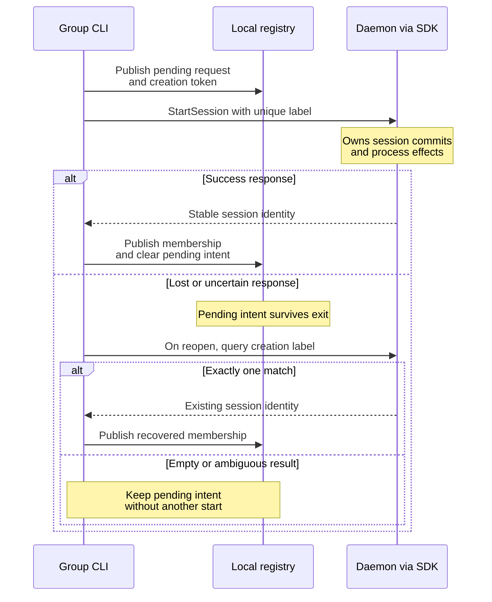

# Follow saved-group recovery

Use this explanation when changing registry updates, shell creation, or group
reconnection. Groups combine local metadata with daemon-owned sessions, so a
single transaction cannot cover both. User commands and restoration decisions
live in the [saved-group guide](../../../../docs/guides/cli/groups.md).

## Publish intent before starting a shell

The [service](../../src/group/service.rs) saves the complete pending request and
a unique creation token before sending `StartSession`. This sequence shows the
two publications and the response-loss branch.

*Pending intent is recovery evidence, not a queue to replay.* Reconciliation
queries the exact creation label with a two-item bound. One match can be adopted;
multiple matches or a continuation cursor are ambiguous. An empty result leaves
intent pending. Only an explicit server `known_absent` rejection clears a failed
creation immediately. Registry failure after a successful start leaves the
process running, so adapters must retain recoverable evidence where possible.

[Restoration](../../src/group/restoration.rs) and
[headless starts](../../src/group/api.rs) use these same publication rules.
The user guide owns [restoration classification](../../../../docs/guides/cli/groups.md#understand-restoration-and-pending-operations)
and [resumable deletion](../../../../docs/guides/cli/groups.md#delete-a-group-or-stop-its-members).
An empty query, closed stream, missing removal event, or expired response is
insufficient evidence to retry an uncertain mutation automatically.

## Validate and publish the registry

[store.rs](../../src/group/store.rs) owns schema and publication. The current
`0.1.0-beta` registry stores endpoint namespaces hashed from endpoint identity,
groups, ordered members, stable restoration slots, selection, and pending
creation/deletion. The session database is separate. Readers require the exact
current registry version; no historical registry is read or converted.

| Bound or invariant | Enforced before publication |
| --- | --- |
| Registry size | 4 MiB |
| Endpoint namespaces | At most 64 |
| Groups | At most 128 per namespace |
| Members | At most 300 per group and 4,096 overall |
| Membership | A session cannot belong to two groups in one namespace |
| Selection | The selected key must identify a member or stable restoration slot |

An update takes the nonblocking registry lock, validates the entire replacement,
then writes and syncs a private temporary file before atomic publication. Unix
also syncs the parent directory; Windows uses its private-file replacement
helper. Malformed and newer schemas are rejected, preserving the file for
investigation.

## Keep view lifetime separate from mutation lifetime

The [workspace loop](../../src/group/workspace.rs) holds a group-specific view
lock for the interaction. A separate bounded worker channel admits one creation
at a time. Detachment can begin while that scoped worker finishes a bounded
request; detachment is not mutation cancellation.

Only the selected member owns an output subscription. Membership watches use
bounded query chunks. Switching constructs the replacement subscription before
dropping the previous one. Metadata changes and daemon epochs are observed
periodically. Reconnection can replace the screen and lose local history;
persistent-group epoch recovery additionally reconciles pending work and
restores eligible recipes. It does not continuously recreate every exited shell.

## Keep headless and terminal adapters consistent

[`GroupClient`](../../src/group/api.rs) is an internal headless adapter to this
local service. It uses the same endpoint namespace, locks, and limits.

| Operation | Local guarantee |
| --- | --- |
| Reads | Do not restore shells or claim the interactive view lock |
| `create` | Creates an empty group without starting a process |
| `assign` | Checks expected source membership under the registry lock; rejects moving a saved recipe into a nonpersistent group |
| `start`, `restore` | Can create processes using the same pending-intent rules as the terminal UI |

It does not define a remote group API or a supported consumer Rust SDK.

## Verify recovery changes

Start with service tests `pending_creation_survives_reopen_and_never_blindly_retries`
and `persistent_creation_is_registered_before_spawn_and_deletion_never_forgets_unknown_work`.
Store tests cover cross-group membership, invalid metadata, and exclusive locks.
The [group conformance scenario](../../../../tests/conformance/groups_test.py)
checks that retired `state/tui` data does not replace the current registry.
Restoration tests cover intentional closure and missing
removal evidence. The [Linux group persistence scenario](../../../../tests/e2e/cli/group-persistence.py)
exercises real daemon failure and resumable deletion with isolated state; see
[verification prerequisites](../development/contributing.md).

[CLI maintainer index](../README.md) · [Source map](code-map.md)
