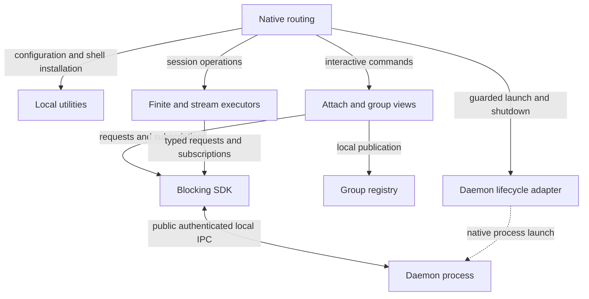

# Preserve ownership boundaries

Use this page to decide whether a change belongs in the CLI. The CLI translates
user intent into typed requests and renders results. Session behavior and
durable session state belong to the daemon. The shared
[process model](../../../../docs/architecture/README.md#process-boundaries)
and [dependency map](../../../../docs/architecture/dependencies.md) own the
system diagrams.

## Keep local work at its owning boundary

This view shows routing within `uc`, with the daemon as an external boundary.
It explains why a local file update, a product request, and a process launch
need different adapters.

*The registry is local CLI metadata. Updating it and changing a daemon session
are separate operations, so group recovery must preserve evidence between them.*

| Responsibility | CLI owner | Boundary to preserve |
| --- | --- | --- |
| Arguments, limits, output modes | [Native routing](../../src/native.rs), [preparation](../../src/preparation.rs) | Validate local input and construct typed DTOs; runtime preflight stays in the daemon |
| Configuration | [Runtime configuration](../../src/runtime_config.rs) | Consume the shared configuration loader and reuse one resolved snapshot |
| Terminal and subscriptions | [Attach](terminal-and-streams.md), [stream dispatch](../../src/stream_dispatch.rs) | Cancelling a view does not stop the managed process |
| Shell installation and inherited context | [Local routing](../../src/local.rs), [shell hooks](../../../../docs/guides/cli/shell-integration.md) | Installation remains local; optional context lookup never auto-starts |
| Saved groups | [Group service and registry](groups-and-recovery.md) | Publish pending intent before process creation; reconcile uncertain effects |
| Daemon launch and reset | [Lifecycle guide](../../../../docs/guides/daemon/cli-lifecycle.md) | Keep native process launch guarded and separate from ordinary SDK requests |

## Use the supported public surface

The CLI does not embed application services, open SQLite to implement a command,
or expose private session-host IPC as a consumer transport. Its first-party
dependencies are configuration, protocol, SDK, and Windows platform primitives
on Windows. [Cargo.toml](../../Cargo.toml),
[allowed-graph.json](../../../../tests/architecture/allowed-graph.json), and
[dependency boundary tests](../../tests/dependency_boundary.rs) define and check
that boundary.

Rust `pub` here supports binary orchestration, injection, tests, and internal
reuse. The supported external Rust libraries are `aixand-undercurrent-protocol` and
`aixand-undercurrent`. The CLI's exported `GroupClient` is a
[headless local adapter](groups-and-recovery.md#keep-headless-and-terminal-adapters-consistent),
not a remote group service or an additional supported SDK.

[CLI maintainer index](../README.md) · [Source map](code-map.md) · [Development and verification](../development/contributing.md)
