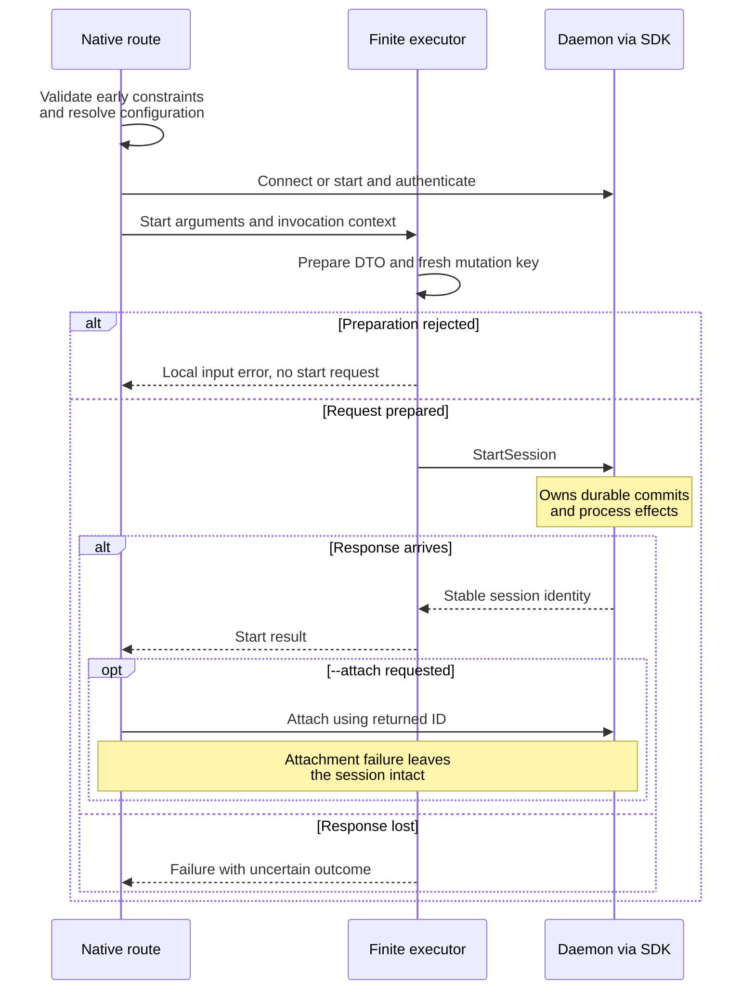

# Follow a session start

Use this explanation when changing CLI start validation, request preparation,
or `start --attach`. The daemon's durable commits, spawn, and compensation are
covered once in the shared [start walkthrough](../../../../docs/architecture/flows.md#start-a-session).
This page follows the CLI's ordering around that boundary.

## Know which validation happens before connection

[`main`](../../src/main.rs) calls `run_native_cli_process` in
[native.rs](../../src/native.rs). Clap failures become safe usage errors without
echoing raw arguments. Native routing rejects an interactive start combined
with an explicit command, checks output and terminal constraints, resolves
configuration, and derives execution limits.

The resolved configuration snapshot is reused for connection and limits, so a
file change during the invocation cannot split those decisions. The registry
allows start to [launch an absent daemon](../../../../docs/guides/daemon/cli-lifecycle.md#start-and-verify-readiness).
Most DTO preparation happens **after connection**: malformed start input can
therefore fail after daemon IO or automatic startup.

The sequence shows where local failure stops submission and where a lost reply
leaves effects uncertain.

*Preparation can prevent a start request. Once submitted, a CLI failure cannot
be treated as rollback of daemon state or process effects.*

## Preserve launch intent and returned identity

[Preparation](../../src/preparation.rs) translates cwd and environment-file
paths, ordered program arguments, policies, profiles, labels, and terminal
geometry into protocol DTOs. The daemon remains responsible for executable,
platform, environment, permission, and product-invariant checks.

`start --attach` uses the returned session ID without another mutable-name
lookup. A successful start does not promise the child is still running when
its response arrives. A later terminal setup or attachment failure leaves the
session intact; inspect it before deciding on another action.

The ordinary [mutation source](../../src/executor.rs) generates UUID-based keys
with PID, command, and sequence identity. A new `uc` invocation creates a new
operation. Follow [failure reconciliation](../../../../docs/reference/cli-output.md#reconcile-a-failed-mutation-before-repeating-it)
instead of treating the next invocation as an exact retry.

## Verify an affected path

| Change | Evidence to inspect |
| --- | --- |
| Paths, command ordering, profiles, policy defaults | [Path and private-value tests](../../src/preparation.rs) |
| Before-connect rejection and startup policy | [Native routing tests](../../src/native.rs), [automatic startup tests](../../tests/automatic_daemon_startup.rs) |
| Mutation identity | [Fresh mutation-key tests](../../src/executor.rs) |
| Start followed by attach | Native route and [attach tests](../../src/attach.rs), including stream cleanup on setup failure |
| Daemon activation failure and exact-process compensation | [Shared start walkthrough and its owning tests](../../../../docs/architecture/flows.md#start-a-session) |

[CLI maintainer index](../README.md) · [Source map](code-map.md) · [Development and verification](../development/contributing.md)
