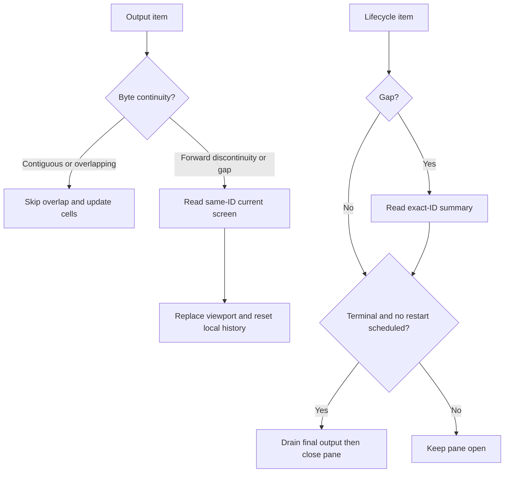

# Follow terminal output and recovery

Use this explanation to change attach rendering or subscription handling without
losing input order, session identity, or cleanup. The
[logs seed-to-stream sequence](../../../../docs/reference/cli-output.md#read-retained-output-without-assuming-complete-history)
owns `logs --follow`: it resolves a name once, prints one finite page, and opens
a stream at that page's `next_offset` for the same ID. Seed records and live
records differ; byte offsets must not be relabeled as stream sequences.

## Activate both attach streams under one deadline

[Attach activation](../../src/attach.rs) shares a monotonic deadline across
name lookup, resize, terminal output subscription, and lifecycle subscription.
If the lifecycle subscription fails, it cancels the already-open output stream.
`start --attach` can enter with a known ID and skip name lookup. Each direct pane
owns its output and lifecycle streams; a [group view](groups-and-recovery.md#keep-view-lifetime-separate-from-mutation-lifetime)
uses a selected output stream and membership watches instead.

## Recover the view from the right evidence

This diagram focuses on the two attach streams and their recovery inputs.

*A screen repairs the current view and restores bounded available normal-screen
history; it does not recover missing raw output. A
lifecycle observation decides whether the pane can close, not whether all
application work succeeded.* Recovery reads can fail and end the view. Opaque
capture lacks a screen projection, so screen recovery is unavailable there.

## Preserve input order and renderer boundaries

| Mechanism | Invariant and reason |
| --- | --- |
| [Pane event loop](../../src/attach/workspace.rs) | Bound turns of output and local input so output cannot indefinitely starve keystrokes |
| Input batching in [attach.rs](../../src/attach.rs) | Enforce item/byte bounds and flush before resize or focus changes |
| [Cell renderer](../../src/group/renderer.rs) | Interpret child escapes internally and emit a bounded viewport/status frame |
| Cursor and terminal modes | Answer additional terminal queries using live cursor/geometry; primary attributes, status, and ordinary cursor reports are answered once by the runtime; handle application cursor, bracketed paste, and child mouse modes |
| [Copy selection](../../src/group/renderer/selection.rs) | Only explicit copies emit outer clipboard OSC 52; frozen views survive output checkpoints and remain open after copying |
| Checkpoints and layout | Reset local history and mark it partial; reserve one status row and restore the focused pane's cursor after background output |

Snapshots include the child's input modes so late attachments preserve mouse,
paste, and cursor-key behavior. Ordinary mouse drags enter frozen selection
only when the application does not own the mouse, or local history is already
being browsed. Copy-mode wheel input moves the viewport while live output keeps
updating the separate parser; Escape returns to that live state.

The user-facing key bindings, read-only behavior, pane limits, and detach matcher
are in [attachment tasks](../../../../docs/guides/cli/interactive.md).
The [source map](code-map.md) locates the layout, picker, shortcut, and native
terminal adapters without repeating their inventories here.

## Keep watch, wait, and cancellation distinct

**[Top](../../src/top.rs)** uses the server's bounded query window and explicit
order array. A gap clears stale rows; only a replacement snapshot makes the
view authoritative again. Never infer membership by sorting accumulated updates.

**[Wait](../../src/streams.rs)** returns the first matching summary. Its deadline
includes waiting and an exact-ID read on a gap; there is no stability or debounce
guarantee.

**[Stream dispatch](../../src/stream_dispatch.rs)** writes each item before
receiving the next. Writer failure cancels the logical subscription.

[Signal guards](../../src/signals.rs) cancel logical subscriptions and wake
blocking readers; finishing a guard joins its worker. This does not cancel a
managed runtime attempt. Terminal guards attempt mode, cursor, and alternate
screen restoration on normal and error paths. Stream handles cancel on teardown.
Cleanup errors must neither invent application success nor erase a primary failure.

Logical close normally preserves peer subscriptions. The production adapter
inherits the Rust SDK's [close-pressure exception](../../../../docs/sdk/rust/streams-and-recovery.md#close-pressure-can-affect-peers):
failure to queue `CloseStream` can close the shared physical connection. Peer
work then follows normal failure/recovery; managed runtime processes keep running.

## Verify a terminal change

Attach tests cover two-stream activation, scheduled restart, input ordering,
read-only history, failed picker switching, and cleanup on writer or stream
failure. Renderer and selection tests exercise bounded history and escape
confinement. [POSIX attach modes](../../../../tests/e2e/cli/attach-modes.py),
[picker scenarios](../../../../tests/e2e/cli/attach-picker.py),
[scrolling and late-attach modes](../../../../tests/e2e/cli/attach-scrolling.py), and
[native Windows smoke](../../../../tests/e2e/platform/windows-attach-smoke.py) supply
separate runtime evidence. Use the prerequisites and isolated setup in the
[verification guide](../development/contributing.md).

[CLI maintainer index](../README.md) · [Source map](code-map.md)

After a final lifecycle observation, attach drains output without replying to
terminal queries or forwarding more input. A rejected input can also end
forwarding when an exact session lookup confirms final exit or removal; a running
session retains the error, and attach never retries the failed input.
