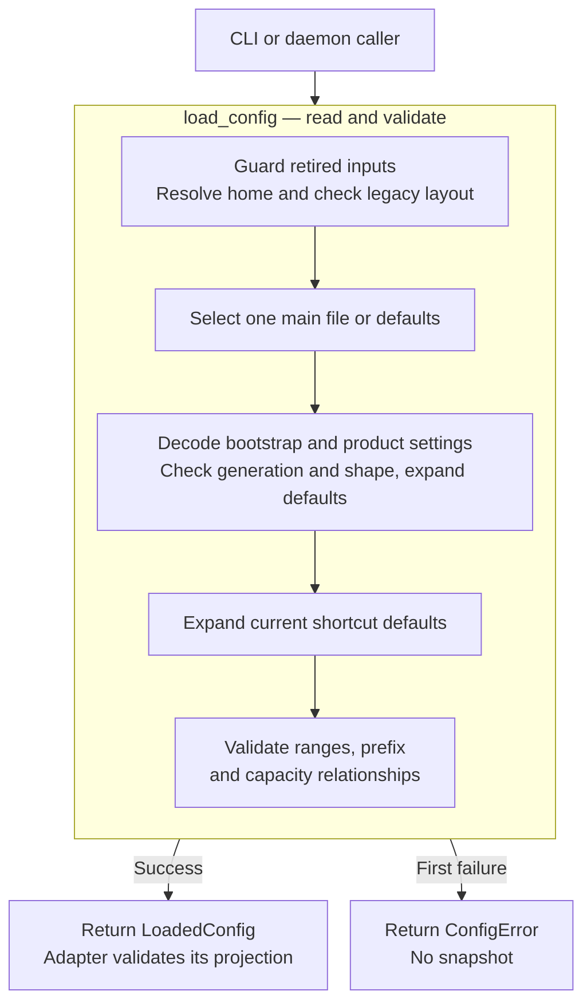

# Trace a configuration load

Follow a document from discovery to a validated in-memory snapshot, and locate
the boundary between shared validation and component configuration. This is a
maintainer explanation for the current 0.1.0-beta workspace and configuration
configuration release 0.1.0-beta. For commands, use the [inspection guide](../../../../docs/guides/configuration/diagnose.md).

## Ownership and dependencies

The [architecture policy](../../../../tests/architecture/allowed-graph.json)
assigns this crate the `shared_configuration` role with no internal
dependencies. Keeping component constructors outside it lets the CLI reject
daemon-invalid settings offline without depending on daemon implementation
crates. The [manifest](../../Cargo.toml) depends on Serde, JSON, TOML,
`granit-parser`, and `serde-saphyr`; `tempfile` is a development dependency.

For the compile-time dependency view, see the [workspace code map](../../../../docs/architecture/dependencies.md).
The local flow below follows the loader's work before the adapters receive a snapshot.

The public re-exports in [lib.rs](../../src/lib.rs) expose document, load, and path
types. `validate` remains private. Serde decoding a public settings struct, or
constructing one directly, does **not** run the complete shared validator.
`load_config` is the validated file-loading entry point. Even a returned
`LoadedConfig` has public mutable fields; its validation describes the state
at return time, not a type-enforced invariant after caller mutation.

## Discovery is selection, not merging

[load_config](../../src/load.rs) makes these decisions in order:

1. Reject the four [retired environment inputs](../../../../docs/reference/configuration-fields.md#retired-inputs)
   if present in the actual process, including empty values. Also reject a
   supplied `ConfigDiscovery.undercurrent_config_env`.
2. If `explicit_path` is present, read that file directly. This internal route
   skips home resolution, legacy-layout checks, and the three-name ambiguity
   scan. It still passes through parsing and shared
   validation. A relative explicit path is interpreted by filesystem calls
   relative to the current working directory.
3. Otherwise resolve the home and run [legacy-layout detection](paths.md#legacy-layout-detection).
4. Probe `config.yaml`, `config.yml`, and `config.toml` with `symlink_metadata`.
   No entry means defaults; one entry means read it; two or more entries mean
   `Ambiguous`. Probe order is not a format-preference order. A directory or
   dangling symlink counts as an entry; a metadata error other than `NotFound`
   fails the load.

Files are never layered. An invalid selected file does not fall back to another
format or to defaults. Files such as `config.yaml.bak` are not candidates.
`ConfigSource` records defaults, the explicit path, or the home-selected path;
its `Environment` variant is retained but is not returned by this loader.

`ConfigDiscovery::from_path_env` avoids environment capture when building the
discovery input, but the retired-variable guard still reads the process
environment on every load. Tests and embedding callers cannot use this builder
to bypass that guard. `from_process_env` captures home inputs and the retired
`UNDERCURRENT_CONFIG` value; it does not make that variable supported again.

## Parsing and validation order

The normal home-discovery path passes through the following stages. Any
failure stops the load immediately; subsequent stages do not run.

*The loader returns an owned snapshot only after shared validation. It writes
no state and opens no database or connection; adapters still enforce their
own contracts.*

### Read a bounded document

[read_bounded](../../src/load.rs) follows filesystem metadata to require a regular
file, opens it, and reads at most the byte limit plus one into a UTF-8 string.
An over-limit valid UTF-8 string is rejected; malformed UTF-8 is an IO error.
The extension selects the parser, not content sniffing. See the
[format limits](../../../../docs/reference/configuration-fields.md#formats-and-parser-budgets).

### Separate bootstrap and product settings

`finish_config` requires a mapping. It rejects retired path keys, removes
`schema_version`, `default_profile`, and `telemetry` into `BootstrapConfig`,
and checks the generation. It then rejects unknown root settings, checks
nested names and types against serialized product defaults, and deserializes
with defaults. Unknown user-controlled keys and parser snippets are not echoed
in the safe error text. Nested errors name the known parent or field.

### Resolve the prefix

Only the main configuration document supplies shortcut preferences. Omitted
fields use current Rust defaults. Separate `shortcuts.toml` files are not read.
The loader performs no migrations or fallback to other document versions.

### Validate the expanded settings

Finally [validate.rs](../../src/validate.rs) checks default-expanded numeric
ranges from the embedded schema, shortcut syntax, scrollback multiplication,
and all [capacity relationships](../../../../docs/reference/configuration-fields.md#relationships-between-settings).
This is not a general JSON Schema evaluator. Field types and names come from
the Rust document; schema generation is checked in the loader; shortcut syntax
has its own check. A schema-only validation cannot replace this pipeline.
The loader returns the first encountered error, not an aggregate of every
invalid setting. Do not build callers around a particular first error when
several rules fail.

The embedded schema and its local references are treated as checked developer
inputs: malformed embedded JSON or a missing referenced definition reaches an
`expect` panic. That is a source/packaging defect, not an error recovery path
for a user's document. Keep schema validity in maintainer verification.

## Applying a snapshot

[load_cli_config](../../../undercurrent-cli/src/runtime_config.rs) keeps the shared
settings and redacted report, derives home paths, validates the local endpoint,
and copies command/resource limits. [CLI context](../../../undercurrent-cli/src/context.rs)
applies the saved command deadline only when `--timeout` was not explicit;
[command routing](../../../undercurrent-cli/src/native.rs) applies page/log defaults
only when the corresponding option was absent. `config show` and
`config validate` use the [local command handler](../../../undercurrent-cli/src/local.rs)
without a daemon request.

[load_daemon_config](../../../undercurrent-daemon/src/config.rs) projects settings
into SQLite, process, terminal, worker, service, transport, and client types.
Their constructors still validate their own contracts. The adapter also
checks path shape, distinctness, and platform endpoint constraints that this
shared crate cannot establish. It returns component settings; construction of
those settings is not creation of a session, execution of a process, or a
successful daemon startup.

`LoadedConfig::runtime_config<T>` serializes only `settings` and deserializes
it into `T`. Bootstrap fields are excluded. It adds no IO and does not rerun
shared validation. A failed projection becomes `Invalid` at `configuration`
with a fixed rule, without exposing Serde's source values.

## Client configuration boundary

The `client` section describes settings for the daemon's
[client projection](../../../undercurrent-daemon/src/config_client.rs), including
private session-host dial limits. It is not a promise that all clients read
this file. The native CLI's [client factory](../../../undercurrent-cli/src/client.rs)
uses the SDK's compiled [standard profile](../../../undercurrent-sdk/src/profile.rs)
for its connection; it does read selected document limits such as bulk
parallelism. Accordingly the report labels `cli_connection_profile` as
`compiled_standard`.

The supported Rust SDK has its own [local connection API](../../../undercurrent-sdk/src/local.rs)
and synchronous request/wait operations in [product.rs](../../../undercurrent-sdk/src/product.rs).
Python exposes an [async Client](../../../../python/src/undercurrent/client.py)
through a private bridge. Neither language should import this internal crate
as a supported configuration API. A setting for reconnect attempts or replay
retention does not establish an operation-specific mutation retry guarantee.

## Lifetimes, concurrency, and side effects

Loading is synchronous and performs blocking file IO. It starts no workers,
timers, watchers, or network operations, and exposes no cancellation token or
loading deadline. Fields named `timeout`, `workers`, `retention`, or `shutdown`
are data for other components; they do not control the loading operation.
Files close when local handles leave scope. Returned structs own their values;
there is no live link to the source document.

Loads share no crate-owned cache or lock. Separate calls can observe different
environment values or filesystem contents. The main file is read
separately, so there is no atomic snapshot across them. Metadata probes and
reads are also separate; symlink following, access control, and concurrent
replacement are not made secure or atomic by this loader. Its size and parser
budgets constrain inputs, not elapsed filesystem time.

A new load can yield a different snapshot, but it has no mutation to
deduplicate. Application timing and the limits of an offline report are
explained in [configuration inspection](../../../../docs/guides/configuration/diagnose.md#check-an-existing-installation-with-the-cli).
Operation effects and retries belong to the [client recovery contract](../../../../docs/sdk/recovery.md).

Continue with [home and legacy paths](paths.md), the
[exact validation reference](../../../../docs/reference/configuration-fields.md), or
[verification and extension guidance](../development/contributing.md).

[Crate documentation](../README.md)
