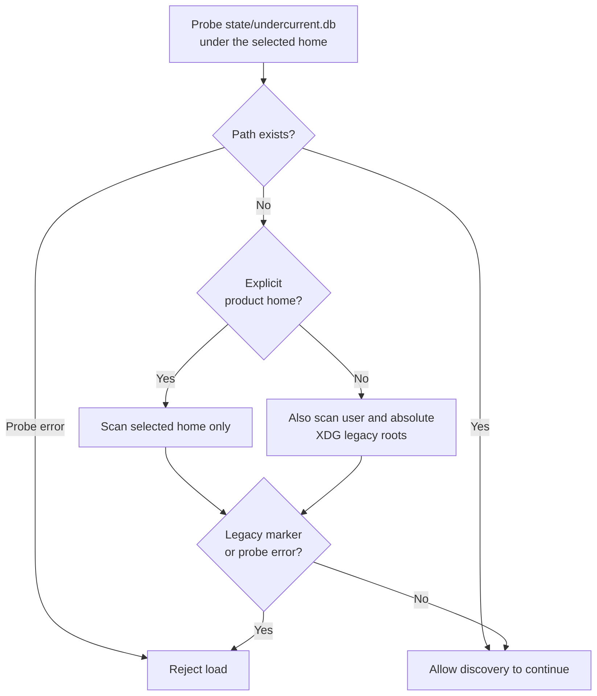

# Understand home selection and legacy-layout rejection

Determine where configuration is discovered and why a load may refuse to
proceed before reading it. This page describes the configuration release 0.1.0-beta policy in
[paths.rs](../../src/paths.rs), not a storage migration procedure. For diagnosing a
failed command, start with [configuration inspection](../../../../docs/guides/configuration/diagnose.md).

## Resolve one absolute home

`UndercurrentPaths::resolve` does no filesystem IO. It chooses a nonempty
absolute `UNDERCURRENT_HOME` override when supplied; otherwise it requires an
absolute native user-home path and appends `.aixand/undercurrent`.
`PathEnvironment::from_process_env` reads `USERPROFILE` on Windows and `HOME`
elsewhere. `Path::is_absolute` applies the native platform's path rules; this
crate does not translate Unix paths into Windows paths.

An invalid override is an error even when a valid user home exists. Missing
user home gives `HomeNotFound`; empty or relative home inputs give
`InvalidEnvironment` naming the relevant variable without its value.
The paths are joined lexically, without canonicalization, existence checks,
permissions checks, directory creation, tilde expansion, or shell expansion.
An absolute path containing `..` is not normalized here.

XDG inputs never choose current storage. Empty XDG environment values are
discarded by environment capture. Absolute XDG roots are used only in the
legacy check, and relative XDG roots are ignored by that check. A custom
`UNDERCURRENT_HOME` needs no user home and excludes external legacy roots.

| Path accessor | Value beneath the selected home | Responsibility |
| --- | --- | --- |
| `config_file()` | `config.yaml` | Preferred default name; actual loader also discovers `.yml` and `.toml` |
| `state_dir()` | `state` | Durable state root; daemon adapter derives `undercurrent.db` |
| `run_dir()` | `run` | Runtime root; adapters derive the lock and local endpoints |
| `logs_dir()` | `logs` | Daemon adapter derives `daemon.jsonl` |
| `cache_dir()` | `cache` | Reserved location; no cache is created here |
| `profiles_dir()` | `profiles` | Editable profiles; this crate does not parse those profiles |

The shared crate owns directory policy; file placement and security enforcement
inside them belong to [daemon configuration](../../../undercurrent-daemon/src/config.rs),
[CLI configuration](../../../undercurrent-cli/src/runtime_config.rs), and the
[local transport](../../../undercurrent-transport-local/src/lib.rs). The public
client endpoint and daemon-private session-host channel remain different
boundaries even when both have path names under `run`.

## Legacy-layout detection

The guard prevents a default-discovered load from silently proceeding with an
apparently empty new installation while recognizable old state remains.
`check_legacy_layout` uses `try_exists`; an access error propagates. The loader
maps both marker detection and any IO error to `ConfigError::LegacyLayout`,
so that variant alone does not prove an old installation exists.

The diagram describes the exact probe policy. It shows no migration or cleanup
side effects.

*Takeaway: a custom home isolates legacy scanning; a path at the current
database location short-circuits it. Neither outcome proves database validity.*

When `home/state/undercurrent.db` exists, the check returns success immediately.
It does not open SQLite, inspect schema versions, or even require that path to
be a regular database file. Treat it as the implementation's initialized-layout
marker, not a health check.

Otherwise the scanned roots are:

| Condition | Roots |
| --- | --- |
| Always | The selected home itself |
| No explicit `undercurrent_home`, and a user home is supplied | `<user-home>/.local/state/undercurrent` and `<user-home>/.config/undercurrent` |
| No explicit `undercurrent_home`, and an XDG root is absolute | `<XDG_STATE_HOME>/undercurrent` and/or `<XDG_CONFIG_HOME>/undercurrent` |

Every scanned root is checked for `undercurrent.db`, `undercurrent.db-wal`,
`undercurrent.db-shm`, `undercurrent.db-journal`, `session-host.sock`,
`session-host.auth`, `session-host.execution-jobs`,
`session-host.attempt-receipts`, `execution-output`, `tui`, and `group`.
Any existing marker is enough. Roots unequal to the selected home are also
checked for `config.yaml`, `config.toml`, `config.yml`, and `shortcuts.toml`.
The selected home's main configuration is a current input. A separate
`shortcuts.toml` file is ignored and is not a legacy-layout marker.

This is a finite marker check, not recursive discovery of every historical
installation. It does not scan another product's home for configuration;
the [loader test](../../src/load.rs) uses `.aixand/other-product` to show that its file is
not discovered. It neither imports old configuration nor deletes state.

On rejection, check access permissions as well as the listed markers. Preserve
the old installation and choose a separate current-release home; no importer or
migration is provided.
Do not create a dummy current database or remove markers to suppress the guard.
The error text names the maintained [home-layout diagnosis](../../../../docs/guides/configuration/diagnose.md#resolve-a-legacy-home-rejection).
It separates access diagnosis, layout compatibility, offline ownership and
verification. This page remains the authoritative explanation of the guard.

## Low-level path helpers are not configuration overrides

`resolve_path_from_base(base, candidate)` returns absolute candidates unchanged
and joins relative ones beneath `base`. It has no IO, normalization, or
containment check; a relative candidate with `..` can escape the base.

`RuntimePathCandidates` is a separate, in-memory precedence helper: explicit,
then configured, then project, then default. It attaches a `RuntimePathSource`
label but performs no validity or existence check. Current
[daemon configuration](../../../undercurrent-daemon/src/config.rs) uses default
home paths plus optional low-level explicit database/lock overrides, validating
them afterward. The presence of `with_config` or `with_project` is not support
for document path fields or project-local config discovery in shipped binaries.

See [path unit tests](../../src/paths.rs) for default/custom homes, XDG behavior,
non-disclosing invalid-path errors, legacy/default/custom/initialized cases,
and lexical path joining. See [maintainer verification](../development/contributing.md#verification)
for commands and limitations.

[Crate documentation](../README.md)
