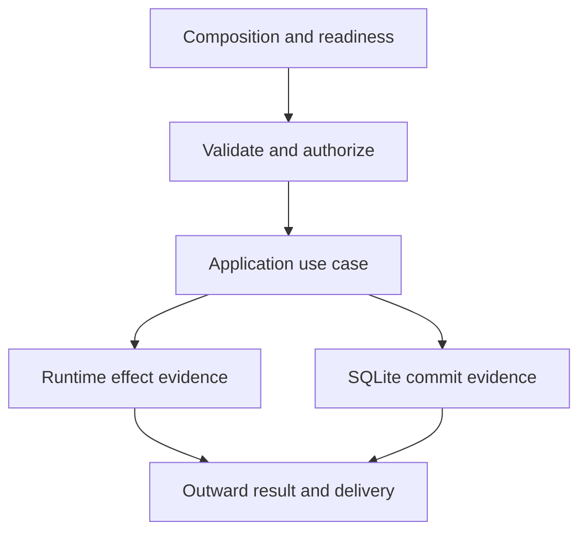

# undercurrent-daemon maintainer documentation

Choose the mechanism or contract you need to investigate below. The
[crate overview](../README.md) describes its scope and starting checks.
For operator tasks, use the [shared daemon guides](../../../docs/guides/daemon/README.md).

## Package and reader scope

The daemon composes application services with runtime, SQLite, and transport
adapters. The public client channel and private session-host channel have
separate contracts under the [system process boundaries](../../../docs/architecture/README.md#process-boundaries).
Workflow scheduling and interpretation of workload results belong to
callers. The internal library's `pub` items support composition. The
[architecture policy](../../../tests/architecture/allowed-graph.json) limits
supported external Rust libraries to the SDK and protocol.

Start with [composition](../src/composition.rs), [configuration](../src/config.rs),
and [product adapters](../src/application_adapter/mod.rs). Focused evidence
includes [startup recovery](../tests/startup_recovery.rs),
[hosted-process recovery](../tests/hosted_process_recovery.rs), and
[product dispatch](../tests/product_dispatch.rs). The package version is
`0.1.0-beta`. Configuration, product schema, and wire versions have separate
contracts. For client recovery, see [lost responses](../../../docs/sdk/recovery.md).

## Developer reading path

Trace a request from the [composition owners](internals/composition.md) through
[admission and translation](internals/requests/request-flow.md), then inspect
[effect settlement](internals/requests/effects-and-recovery.md). For native process
and PTY behavior, follow the Runtime owner rather than adding it to dispatch.

[Choose focused checks](development/contributing.md#run-the-relevant-checks) for
the boundary you changed. A reachable listener, a durable commit and successful
response delivery establish different facts.

## Internals

- [Understand daemon composition and ownership](internals/composition.md).
- [Read output and recover subscriptions](internals/output-and-streams.md).
- [Extend diagnostic collection and telemetry](internals/diagnostics.md).

### Service lifecycle and background work

- [Trace startup, recovery, and shutdown](internals/lifecycle/startup-and-shutdown.md).
- [Understand background work and wake ordering](internals/lifecycle/background-work.md).

### Requests and effect evidence

- [Follow a request from admission to a durable result](internals/requests/request-flow.md).
- [Reconcile uncertain mutation outcomes](internals/requests/effects-and-recovery.md).
- [Trace an attached agent call and durable reply](internals/requests/agent-channel.md).

### Configuration and profile activation

- [Configure daemon resource bounds](internals/configuration/resource-bounds.md).
- [Understand atomic profile activation](internals/configuration/profile-reload.md).

## Development

- [Navigate, change, and verify the daemon](development/contributing.md).

[System architecture](../../../docs/architecture/README.md) · [Workspace code map](../../../docs/architecture/dependencies.md) · [Product documentation](../../../docs/README.md)
