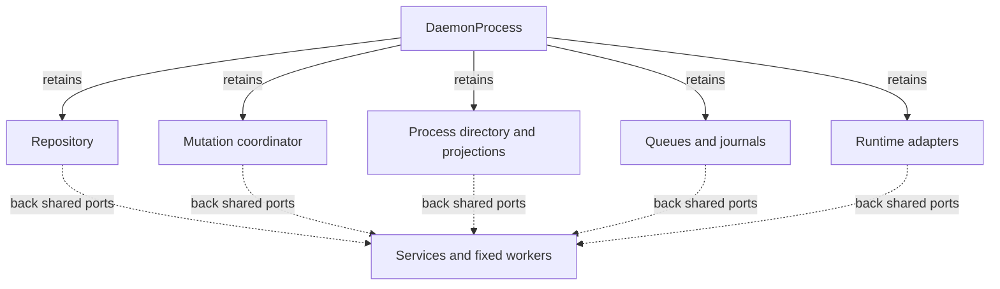

# Understand daemon composition and ownership

Maintainers use this page to locate the component that owns a behavior before
changing it. It describes the current `undercurrent-daemon` 0.1.0-beta composition.
For commands, start with [operating the daemon](../../../../docs/guides/daemon/operations.md).

## Public and private boundaries

The [project architecture](../../../../docs/architecture/README.md) owns the
public/private process topology and state-persistence map. The daemon's local
responsibility is composing application ports once and sharing their concrete
owners. The [architecture policy](../../../../tests/architecture/allowed-graph.json)
classifies this as `external_daemon_composition`; daemon library exports serve
composition/tests, not a supported client API.

*Composition must give the read and write sides of a capability the same owner.*
The instance lock and strong/weak reference rules below determine how those
owners are released. For process termination and daemon replacement, follow
[lifecycle](lifecycle/startup-and-shutdown.md), not the dependency graph.

## Dependency direction

The [workspace dependency map](../../../../docs/architecture/dependencies.md#manifest-map)
owns the first-party edges; [Cargo.toml](../../Cargo.toml) owns exact dependencies.
Domain and application must not acquire dependencies on concrete adapters through
composition. The SDK dependency supplies validated client settings, not an
external daemon-library API. The daemon reaches macOS primitives through runtime;
its Windows platform dependency is direct.

## Composition entry points and lifetime

[main.rs](../../src/main.rs) accepts help, version, or an environment-backed run.
It loads configuration, secures the runtime directories, installs logging and
signals, then calls `DaemonProcess::compose_with_log_pressure`.
[composition.rs](../../src/composition.rs) holds the strong resource owners;
[composition/lifecycle.rs](../../src/composition/lifecycle.rs) runs and tears them
down. The instance lock is declared last so ownership is released only after
runtime resources drop. The lock's existence is not proof of process liveness:
an OS advisory lock owns the installation.

Composition creates one repository, mutation coordinator, process directory,
projection hub, restart queue, observation queue, input-delivery store, event
journal, profile catalog, and set of runtime adapters, then shares them through
application-owned trait ports. For example, `DaemonRestartPorts` exposes the
write and claim sides of the *same* queue. Creating separate instances would
accept restart scheduling without making those jobs visible to the worker.

The listener and dispatcher have weak backreferences from status and diagnostics.
[runtime_status.rs](../../src/runtime_status.rs) permits one listener attachment;
even a dropped listener cannot be replaced in the same status object. This
prevents ownership cycles from holding an old process epoch or socket alive.
Status counts prepared sessions and preparing plus active streams without
enumerating the session catalog. Its counters are sampled from separate owners,
so it is not a transactional snapshot across all subsystems.

[session_host_main.rs](../../src/session_host_main.rs) dispatches private host,
execution-supervisor, and shell-environment capture modes to the runtime.
`--help` and `--version` do not consume bootstrap input. Normal no-argument
execution expects private bootstrap data on stdin; it is not an operator
startup command. The helper is resolved beside the current daemon executable,
with a parent-profile fallback for development/test executables.

## Extension boundaries

| Change | Owner and reason |
| --- | --- |
| A product field, operation, stream, or typed error | Change the protocol contract and application semantics first, then translate and present it here. Do not make wire DTOs domain values. |
| A new OS process capability | Implement application/runtime ports in the runtime; wire it in composition. Keep UCHS private. |
| A durable invariant | Put the contract in application/domain and atomic persistence in SQLite. Composition cannot make a sequence of independent calls atomic. |
| A configuration setting | Define and validate it in shared configuration, project it through daemon settings, and check cross-component relationships before IO. |
| A background service | Use a bounded application operation and one explicit worker specification; provide interruption for blocking sources. |
| A deployment credential or semantic cancellation policy | Inject `SecretResolver` or `RuntimeCancellationAuthorizer` at daemon composition. The ordinary binary has unavailable secrets and a fail-closed semantic cancellation authorizer. |

The existing [development fixture](../../examples/development_daemon.rs)
and [integration fixture](../../examples/integration_daemon.rs) illustrate
special composition seams. They are integration fixtures with deployment-specific
inputs, not general consumer examples or a production authority implementation.

Follow [startup and shutdown ordering](lifecycle/startup-and-shutdown.md),
[configuration relationships](configuration/resource-bounds.md), and
[background execution](lifecycle/background-work.md) before modifying composition.
Tests in [architecture_contract.rs](../../tests/architecture_contract.rs) check
placement, and [composition.rs](../../src/composition.rs) includes ownership,
epoch-rotation, private-directory, and coupled-state checks.

[Crate entry point](../../README.md)

[Crate documentation](../README.md)
