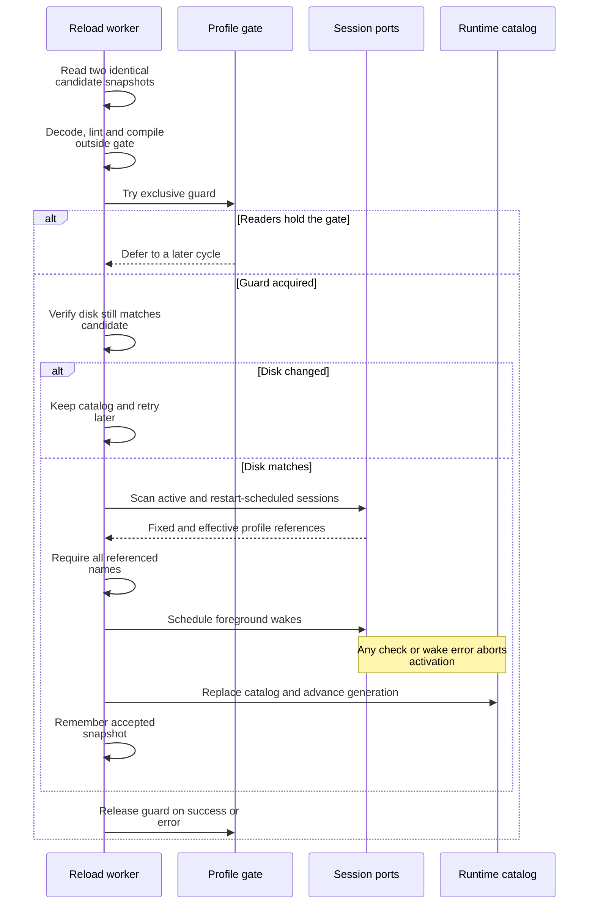

# Understand atomic profile activation

This explanation connects profile files, the runtime catalog, and live session
observations for maintainers. Operator steps are in [edit a profile](../../../../../docs/guides/configuration/profiles.md).
The daemon owns file discovery and activation coordination; the domain owns
definition validity, the application owns lint/match/evaluation, and the runtime
owns the in-memory catalog and compiled pattern adapter.

## Snapshot and activation protocol

[profile_files.rs](../../../src/profile_files.rs) seeds missing embedded filenames using
temporary files, file sync, and non-clobber persistence. It never overwrites an
existing definition. Startup takes two snapshots and rejects a change between
them, decodes/lints all definitions, and replaces the catalog before readiness.
An invalid file remains on disk for repair; it is not silently dropped.

Live reload keeps the last accepted catalog. This sequence shows what “atomic”
means here: catalog replacement is atomic, while file edits and wake scheduling
are separate operations.

*Observation and restart readers cannot run through the activation window.* A
failed scan or wake aborts activation; previously scheduled wakes may still run
against the retained catalog after the gate releases. This is not a transaction
that rolls back external wake calls or filesystem edits.

The worker parses and compiles before trying the write gate, so invalid candidates
do not block normal operations for that expensive work. It uses `try_write`,
not an unbounded wait behind a request. A second disk read under the gate rejects
changes that happened during validation. The session scan is bounded by configured
maximum sessions and batch size and requires an advancing cursor.

Active sessions and terminal sessions with scheduled restart both retain their
fixed profile reference. An adaptive session's effective profile is checked using
its exact current process identity, independently of its base profile. Removal
is allowed only if all such referenced names remain in the merged built-in/user
catalog. Existing names may be redefined; “referenced” does not freeze a profile's
contents.

The ordinary finite executor holds a shared read guard, except for shutdown,
which must be able to join workers without holding their activation gate.
Restart and observation cycles also hold shared guards. After successful checks,
reload schedules foreground wakes while readers remain excluded, then replaces
the catalog. A subsequent observation can sample the new generation consistently.

## Contracts and ownership

| Source | Responsibility and extension point |
| --- | --- |
| [profile_yaml.rs](../../../src/profile_yaml.rs) | Bounded strict YAML event scan, typed deserialization, and domain construction. Add fields here and in the owning domain contract together. |
| [profile_builtins.rs](../../../src/profile_builtins.rs) and [profiles directory](../../../profiles/) | Current distribution definitions in one YAML source, embedded into the binary and seeded to disk. |
| [application_adapter/profiles.rs](../../../src/application_adapter/profiles.rs) | Authorized profile service calls, bounded pagination, and mapping of finite request errors. |
| [presentation/profile.rs](../../../src/presentation/profile.rs) | Stable source/archetype labels, input-delivery presentation, typed lint locations, and sample-free test reports. Numeric narrowing is checked. |
| [runtime catalog](../../../../undercurrent-runtime/src/profiles.rs) | Merge and atomic replacement. Duplicate names within either source are rejected; one user definition may override a built-in of the same name. |

Profile list continuations store the last name for the logical client and read
the catalog anew on each call. They are not a retained generation-consistent
snapshot. If profiles change between pages, restart listing when you need a
complete view of one stable catalog. Match responses distinguish a unique
selection, no selection, and ambiguity; ambiguity returns candidate names with
no selected name.

Reload error messages are deduplicated until they change or an unchanged/accepted
snapshot clears the error. The worker reports failed cycles while retaining the
last good catalog. Profile-specific startup/reload logs include file/profile
context; do not assume these messages follow the scalar-only application
telemetry contract. Treat installation logs as local operational evidence.

## Verification when extending profiles

The `profile_files` tests cover non-overwriting concurrent seeding, invalid startup
preservation, stable snapshots, partial writes, directory loss, invalid regex,
duplicate names, gate contention, live fixed/adaptive references, restart
backoff references, symlinks, and oversized files. The YAML tests reject unknown
fields, tags, aliases, duplicate keys, invalid booleans, invalid domain combinations,
and excessive input; they check raw/paste and fallback defaults.

The `profile_builtins` tests assert the current fifteen-profile catalog and
exercise Windows command conventions,
exact development-server signatures, pacing, and positive/negative agent screen
fixtures. Add representative rejecting samples as well as accepting samples so
a familiar prompt does not override startup, permission, or busy evidence.

[Background work](../lifecycle/background-work.md) · [Architecture](../composition.md) · [Crate entry point](../../../README.md)

[Crate documentation](../../README.md)
