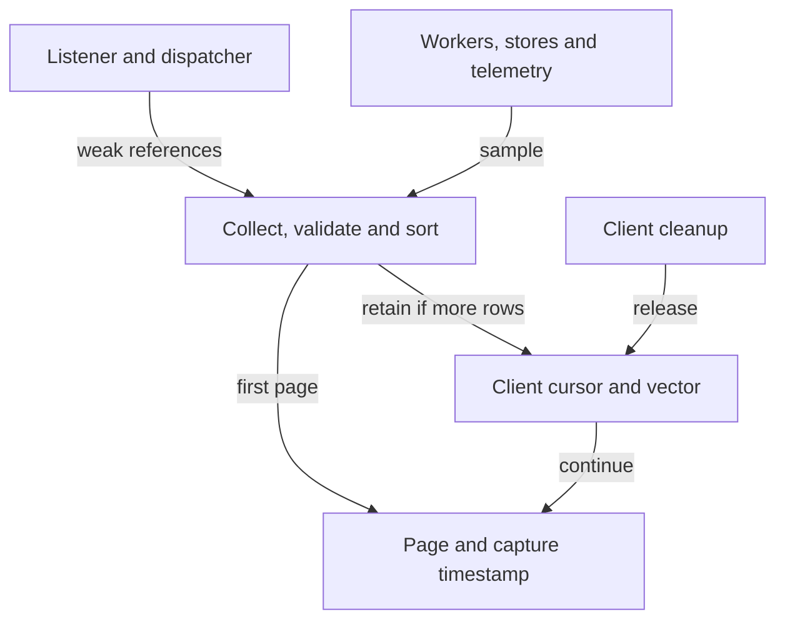

# Extend diagnostic collection and telemetry

Use this explanation to add a bounded diagnostic or interpret how the daemon
collects its evidence. Operator commands, privacy controls, log retention, and
counter meanings belong in [diagnostics and bundles](../../../../docs/guides/daemon/diagnostics.md).

## Source capture and retained pages

The public adapter authorizes diagnostics before collection. For a bundle it
also authorizes optional terminal content, reads one terminal page, then captures
or continues diagnostics. `BoundedDaemonOperations::create_diagnostic_bundle`
is a separate unpaged internal helper; the public path is in
[application_adapter/operations.rs](../../src/application_adapter/operations.rs).

This view distinguishes live sources from the retained page vector.

*A stable continuation preserves the captured vector, while source reads remain
independent observations.* Continuation requires the same client and requested
sections. Source budgets are divided among requested sections,
with at least one row each. The final collector rejects excessive totals and
invalid or duplicate section/identity pairs. See [operations.rs](../../src/operations.rs)
for sorting, cursor ownership, and retention; operator-visible limits are in
[the snapshot guide](../../../../docs/guides/daemon/diagnostics.md#understand-snapshot-and-cursor-limits).

## Add or change a source

[runtime_diagnostics.rs](../../src/runtime_diagnostics.rs) coordinates weak listener/
dispatcher references and selected sources. [streams.rs](../../src/runtime_diagnostics/streams.rs)
owns connection, stream, slow-consumer, and retained-output views;
[services.rs](../../src/runtime_diagnostics/services.rs) owns service, detection,
persistence, and configuration views. Detection rows preserve whether evidence
was selected, ignored, or unavailable so an operator can investigate decisions
without inspecting raw terminal content. Metric rows are bounded and interleaved
across sources so one metric family does not monopolize the remaining budget.
[rows.rs](../../src/runtime_diagnostics/rows.rs) supplies typed constructors; it does
not sanitize an arbitrary new text field for its caller.

When adding a diagnostic, name the source of truth, bound enumeration, declare
whether it is current or retained, and use a stable typed field. Keep high-cardinality
payloads out of metrics. Avoid strong reverse references that keep a listener
alive after teardown. A new section must fit both source and combined row budgets.

Relevant tests are beside [stream diagnostic projection](../../src/runtime_diagnostics/streams.rs)
(current pressure versus historical drops), [service projection](../../src/runtime_diagnostics/services.rs)
(ignored/unavailable detection and safe mutation fields),
[logging](../../src/logging.rs) (payload canaries in subprocess-isolated subscriber
tests), [structured logging](../../src/structured_logging.rs) (rotation, permissions,
redaction, shared drop counters), and
[daemon operations](../../tests/daemon_operations.rs) (snapshot stability, client
ownership, eviction, bounds, and explicit content authorization).

## Emit bounded telemetry

[logging.rs](../../src/logging.rs) defines stable process event names and request/
stream spans. Correlation uses typed epoch, connection, client, request, stream,
trace, parent, and session identities. Startup errors expose a stage and safe
category; private source errors remain available internally through error chains
without being formatted into the public response or routine lifecycle log.
The daemon adapters emit typed categories, sizes, counts, and bounded dimensions
rather than request, environment, terminal, or arbitrary source-error bodies.
This does not make every file shareable without review: profile reload diagnostics
can include profile/file context, and identifiers still describe local activity.

[dispatch_telemetry.rs](../../src/dispatch_telemetry.rs) and
[multiplex_telemetry.rs](../../src/multiplex_telemetry.rs) use bounded enum dimensions,
try-lock collection, finite-number checks, and saturating aggregates. Client IDs
and arbitrary payload strings are not metric labels. Multiplex aggregation releases
its mutex before forwarding to application telemetry. These choices protect hot
paths and memory at the cost of incomplete evidence under pressure.

[Crate documentation](../README.md)
