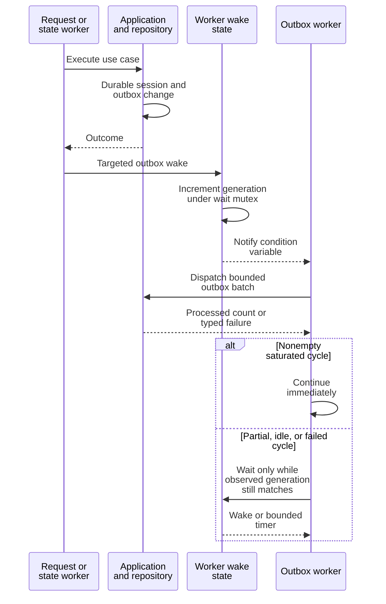

# Understand background work and wake ordering

Maintainers use this page to trace work that continues after a finite request
returns, and to add workers without losing wakes or creating unbounded polling.
The owning code is [background.rs](../../../src/background.rs) and
[workers.rs](../../../src/workers.rs); application services define each operation's
semantics. This is a daemon implementation explanation, not an asynchronous SDK
contract.

## Fixed owners and independent work

After [startup reconciliation](startup-and-shutdown.md#two-kinds-of-readiness), the production
composition starts one named OS thread per worker kind. Shared queues are bounded
and shared through both read and write ports. There is no new background thread
per session. Dispatcher, health-check, process-runtime, and stream-pump execution
are separately owned resources; the six workers below are not the process's
total thread count.

**Attempt reconciliation** (`attempt_reconciliation`) scans bounded durable attempts
through an evidence observer and applies the mutation-readiness result.
Infrastructure failure closes readiness. Unresolved effects are retained rather
than retried as new process actions.

**Outbox** calls `DispatchOutboxService` with repository, publisher, and observation
scheduler. A complete batch schedules an immediate next cycle. Durable outbox
work can outlive the initiating request.

**Restart** claims at most the configured number of due jobs, then executes
revision-checked application restart commands. A failed command is requeued; a
requeue failure is counted and emitted as a typed diagnostic. It holds the profile
read gate for the cycle.

**Observation** dispatches bounded foreground and health jobs through separate
services. It holds the profile read gate and preserves isolated failures and their
categories. These observations describe runtime evidence, not application success.

**Process exit** (`process_exit`) blocks on the exit source, then settles one
observation through the application service. If settlement fails, it retains that
exact observation for the next attempt before receiving another exit. Shutdown
interrupts the source.

**Profile reload** (`profile_reload`) is added when a profile reload adapter is
present; the production composition supplies it with a one-second worker interval.
It validates and activates stable profile snapshots.

The attempt scan's `max_batches` is derived from configured maximum sessions
divided by reconciliation batch size, rounded up. It is a bounded recovery pass,
not a promise to resolve every possible attempt in one cycle. Runtime readiness
requires the pass's explicit completeness evidence.

## Wake and commit boundaries

The diagram shows notification ordering, not an atomic transaction spanning the
worker and the request. An outbox wake is a scheduling hint; the repository owns
the durable work.

*The generation check closes the gap between completing a cycle and entering
its wait. It does not make a failed durable commit successful.* Product adapters
wake outbox/reconciliation through `OutboxDispatchWake`. A nonempty successful
restart, observation, or process-exit cycle also targets the outbox worker.

Only outbox and attempt reconciliation use adaptive empty backoff here:
consecutive successful empty cycles double the base interval to
`max(1 second, configured base)`. Work, a failure, or a targeted wake resets it.
A zero-work cycle cannot be marked saturated, preventing an accidental busy
loop. Other workers use their own configured polling/error intervals, and the
process-exit worker's normal wait is in its event source.

## Cancellation, panic containment, and shutdown

[blocking.rs](../../../src/blocking.rs) polls an application future on the calling
thread and parks until its waker unparks it. It does not create an executor
thread or supply a Tokio reactor. Port futures must wake after completion and
must not assume this helper creates timers or runtime facilities. The composition
and shutdown paths also use it; it is not exclusively a dispatcher mechanism.

[ProductCancellation](../../../src/cancellation.rs) is a separate clonable atomic token
for a connection-epoch request. Its application `cancelled()` future observes
the flag using a 10 ms Tokio timer and therefore needs a suitable async runtime
when polled. Setting this flag requests cooperation; it does not prove that a
process effect was prevented, terminate a runtime attempt, or cancel an unrelated
subscription. Background worker stop state has its own interruption protocol.

`DaemonBackgroundWorkers::shutdown` sets stop once, notifies waits, invokes each
task's interrupt callback, then joins threads. Startup failure after creating
some workers takes the same interrupt/join path. A blocking task that cannot be
interrupted can delay shutdown; the owner cannot manufacture cancellation of
arbitrary adapter IO.

A task error increments failure counters and leaves its worker running after a
bounded wait. A panic is caught, counted as internal failure, and stops only the
affected worker. Other workers continue; this owner does not automatically
restart the panicked thread. Interrupt and join panics are contained as well.
`uc --json debug supervisors` exposes each worker's active/closed state, cycle
count, processed count, and combined error/panic count. An open listener does
not prove that all workers are still healthy.

## Add or debug a worker

Implement the operation in the application layer and supply inward-facing ports.
Keep one cycle bounded; do not scan unrelated sessions on every timer tick. Add
a unique `DaemonWorkerKind`, its central trace-span mapping, and one specification.
Validate nonzero intervals, stack size (at least 64 KiB for this owner), and any
cross-component capacity relationship. Provide an interrupt that wakes external
blocking receives, with a test proving shutdown joins them. Update diagnostics
without logging command, environment, terminal, or arbitrary source-error text.

The [background-worker tests](../../../tests/background_workers.rs) exercise saturation,
lost-wake races, backoff reset, outbox wakes from state work, isolated failures,
panic containment, and interrupt-once shutdown. The
[application-runtime tests](../../../tests/application_runtime.rs) check the composed
services, process-exit retry, diagnostics, and the rule that incomplete recovery
starts no workers. Read the failing worker's application service and port error
category before changing its retry strategy: a scheduled revision-checked
restart job and an ambiguous new external mutation have different contracts.

[Lifecycle](startup-and-shutdown.md) · [Architecture](../composition.md) · [Crate entry point](../../../README.md)

[Crate documentation](../../README.md)
