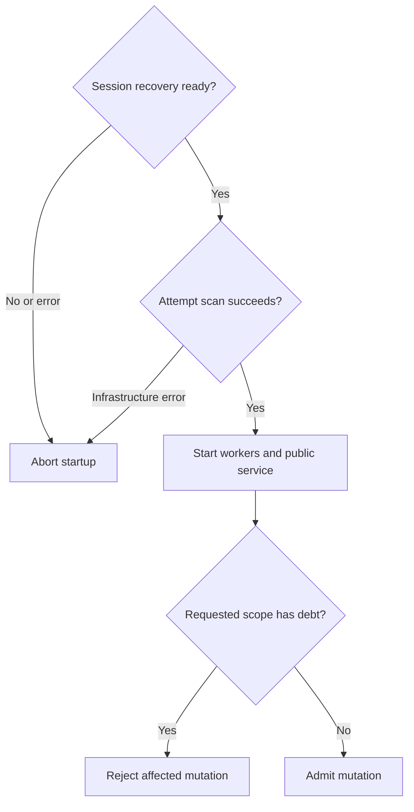
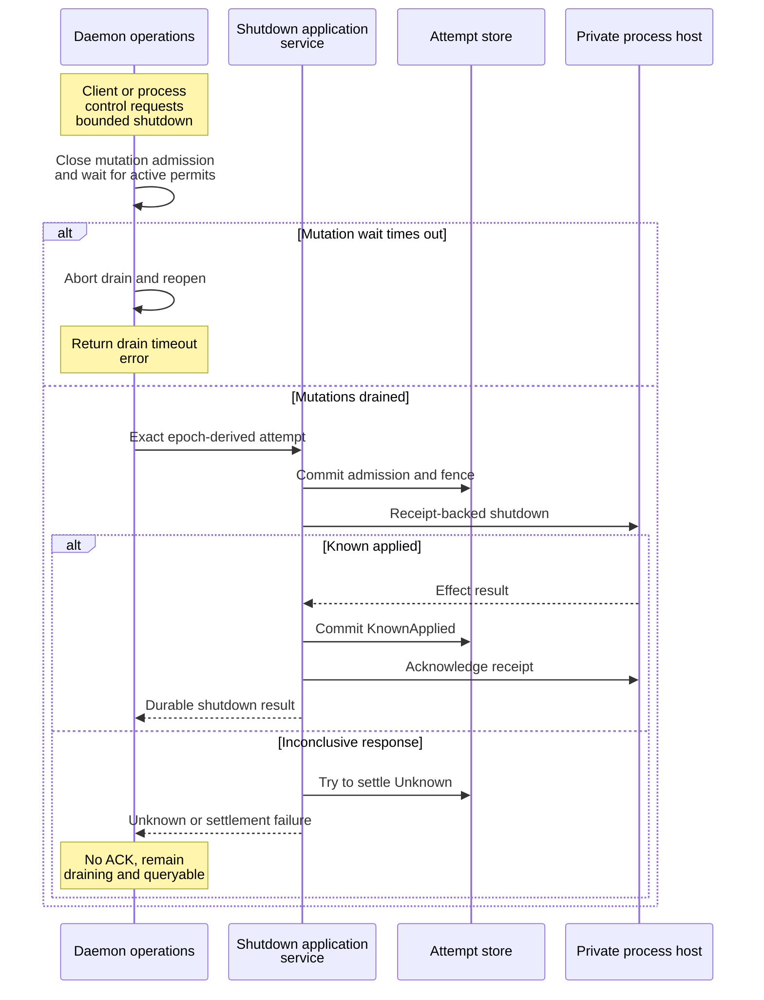
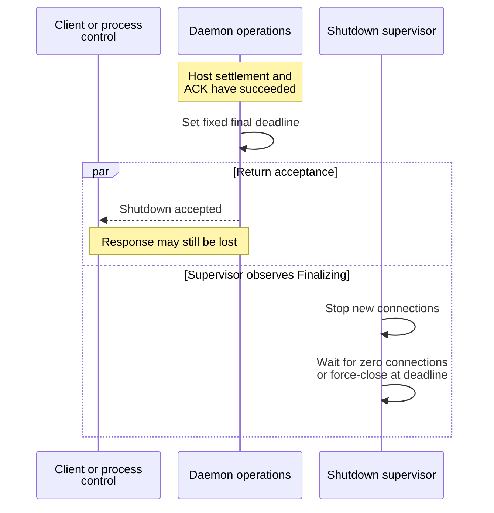
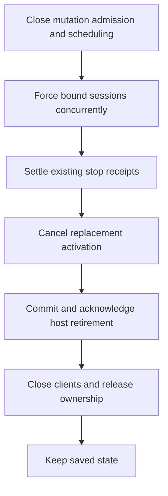

# Trace startup, recovery, and shutdown

This explanation is for maintainers and integrators diagnosing daemon readiness
or a shutdown whose outcome is uncertain. It follows current
[composition](../../../src/composition.rs), [background startup](../../../src/background.rs),
[shutdown operations](../../../src/operations.rs), and
[resource teardown](../../../src/composition/lifecycle.rs). For executable procedures,
use [the operator guide](../../../../../docs/guides/daemon/operations.md).

## Two kinds of readiness

Startup first reconciles durable sessions against process truth and rebuilds
prepared views. Failure to finish that scan or resolve every session prevents
worker startup and public listener binding. This prevents clients from seeing
a partially rebuilt session catalog.

Operation-attempt reconciliation is a separate step. An infrastructure error
aborts startup. A successful bounded report permits workers and the listener to
start even with unresolved attempts. Mutations check the requested session and
host-wide debt; unrelated sessions and queries remain available. An unreadable
store or invalid scan closes admission globally. The aggregate readiness hint
opens only for a complete debt-free report or an exact unresolved count of zero;
it does not replace the per-request check. See
[recovery admission and input retirement](../requests/effects-and-recovery.md#retire-uncertain-input-after-verified-exit).

Composition runs these phases in order. The startup stage enum categorizes
errors; it is not itself an execution trace.

| Phase | Work completed before the next phase |
| --- | --- |
| Bootstrap | Load configuration, secure private paths, install logs and signals. |
| Ownership | Generate a fresh epoch, pin the instance scope, acquire its exclusive OS lock. |
| Persistence and adapters | Verify coupled files, open SQLite, connect or start the host, load profiles, and compose bounded adapters. |
| Recovery gates | Reconcile sessions and then durable attempts as shown below. Recovery may commit corrections. |
| Public service | Start fixed workers; compose pump, executor, dispatcher, and bridge; bind the listener; attach weak status/diagnostic edges; return the owner to main and run the listener. |

Any phase error aborts composition. This diagram focuses on the two recovery
decisions, where unresolved work has different effects on admission.

*Attempt debt limits affected mutation scopes while the listener remains available.* Failed session recovery or attempt
infrastructure errors start no workers and bind no public listener.

*Recovery commits can precede public readiness. They are not rolled back merely
because a later startup stage fails.* The `process_ready` log is emitted after
composition and before entering the listener loop; a successful client handshake
and status request are stronger evidence of reachability.

## Identity and coupled persistence

[composition/identity.rs](../../../src/composition/identity.rs) generates an entropy-backed
process epoch (`e-` plus 16 bytes encoded as hex). The same epoch reaches
handshake, runtime, status, and replay ownership. A new daemon means a new epoch;
old process-local cursors and replay state do not become durable merely because
the underlying sessions survived.

The instance lock is acquired before opening durable state. Its Unix parent and
file are checked through pinned descriptors; Windows uses pinned native paths.
The OS releases advisory ownership after process exit. Explicit unlock before
descriptor close also handles temporary inheritance across a concurrent fork.
The scope path is never opened as a semantic client endpoint.

If the database is absent, `verify_coupled_persistence_state` rejects a live
session host, retained authentication file, SQLite WAL/SHM/journal, nonempty host
receipt/job directories, or execution-output directory. This avoids recreating
empty session truth beside surviving effects. The check does not establish that
an existing database is healthy; schema and repository validation still apply.

## Graceful product shutdown

`DaemonProcessControl::begin_shutdown` and the product shutdown request call
`begin_product_shutdown`. It derives one shutdown attempt ID from the daemon
epoch. The duration belongs to the attempt's semantic payload. It atomically
closes new semantic-mutation admission and waits for already admitted RAII
mutation permits to drop before invoking the application-owned
[ShutdownProcessHostService](../../../../undercurrent-application/src/shutdown_process_host.rs).

This sequence distinguishes a durable effect from delivery of its response.

*Host effect: admission, external shutdown, settlement, and receipt acknowledgment are distinct boundaries.*
A timed-out mutation drain returns `MutationDrainTimedOut` and reopens admission.

*Finalization and response delivery can race. Response loss does not reset the
fixed connection-drain deadline.*

On a lost response, reconnecting cannot tell a caller which boundary was
crossed. Reconcile the retained attempt and process state.

The process-local phase transitions are narrower than “requested means stopped.”

```mermaid
stateDiagram-v2
    accTitle: Product shutdown phase transitions
    accDescr: Running admits mutations. Draining rejects new mutations while preserving query access. Proven no-effect failures reopen Running; unknown effects retain Draining. Success enters Finalizing, then listener teardown. Forced listener closure can reach teardown without proving host shutdown.
    [*] --> Running
    Running --> Draining: validated product shutdown
    Draining --> Running: mutation timeout, missing ports, or classified known-absent failure
    Draining --> Draining: uncertain effect or failed settlement or ACK
    Draining --> Finalizing: durable host settlement and ACK succeed
    Finalizing --> Teardown: zero clients or fixed deadline
    Running --> Teardown: forced listener close or fatal listener failure
    Draining --> Teardown: forced listener close or fatal listener failure
    Teardown --> [*]
```

*Finalizing proves the durable host shutdown path succeeded; forced teardown
does not.* The low-level `DaemonOperationsPort::begin_shutdown` helper can also
signal finalization directly for internal compositions/tests; production control
uses the durable product path. Do not substitute the helper when adding a
user-visible shutdown route.

Failure behavior in [operations.rs](../../../src/operations.rs):

| Result or phase | Admission and recovery consequence |
| --- | --- |
| Active shutdown invocation or Finalizing | Reject another product shutdown. After a failed invocation releases its permit, only the same attempt and drain duration can resume Draining. |
| Mutation-drain timeout or missing ports | Abort drain and reopen admission. |
| Explicit known-absent classification | Reopen admission. An exact terminal KnownAbsent attempt remains terminal; retrying it performs no new host IO. |
| Unknown settlement | Stay Draining. An exact retry reads the durable outcome without redriving the host. |
| Settlement after effect or acknowledgement failure | Stay Draining and preserve uncertainty. |
| Host service succeeds | Set the fixed connection deadline **now**, after mutation draining and host IO. The drain duration is not a total shutdown time limit. |

The supervisor waits on phase changes, stops physical admission only at
finalization, checks aggregate connection pressure, and closes surviving
connections at the fixed deadline. Teardown closes listener, dispatcher,
background workers, bridge gateway, and hosted runtime adapter in that order.
The process releases its instance lock last. Explicit shutdown of the host is
distinct from dropping these daemon-side handles.

## Immediate and reset shutdown policy

`ShutdownDaemonRequest.mode = reset` or `immediate` uses the same receipt, durable settlement,
and host acknowledgement sequence as graceful shutdown. Its separate payload
and epoch-derived identity prevent replaying a graceful attempt as reset.
Omitting the mode retains graceful behavior and its existing serialized shape.
Reset's wait budget is excluded from its durable effect identity, so a timed-out
caller can retry with a longer timeout without redriving a settled host effect.

Both policies close semantic mutation admission and stop background scheduling.
Immediate shutdown forces bound sessions with at most eight concurrent stop
services before retiring the host. Existing graceful stops retain their futures
through durable settlement; explicit restarts finish the stop phase and check
shutdown before activation. This preserves completion receipts in the database
that ordinary daemon stop leaves on disk. Existing unresolved attempts remain
protected and are not overwritten by per-session force during this pass.

The state-preserving path completes session evidence before closing the host:

*Immediate stop skips grace periods while retaining durable completion evidence.*

Reset cancels other dispatcher requests and may abandon stop futures. Suspended session mutations can be abandoned;
that does not prove zero effect. Their durable attempts remain available if reset
fails. The process-exit source remains connected until the host acknowledgement
finishes, because interrupting it also disconnects the host client. Workers are
joined later by the composition owner, never by a dispatcher worker joining itself.
A failed reset keeps mutation admission closed rather than restarting cancelled
background work.

`ServerResponseWrite` tracks the reset response independently of durable effects.
Queueing or selecting the frame is insufficient: physical write confirmation,
abandoning the selected write, or connection closure releases the response gate.
The supervisor closes all clients when that gate finishes, with a 250 ms fallback
bounded by the remaining requested reset window. Other clients cannot extend it.
Only reset deletes files; its CLI requires instance release and an inactive host first.

Host teardown closes spawn admission, waits for its workers, cancels execution
jobs, and signals all retained processes before waiting for process exit and PTY
output completion. Confirmation failures retain the host retirement markers;
removing a socket alone is not evidence that owned writers have stopped.

The Linux integration check is
`python3 tests/e2e/lifecycle/reset-shutdown.py --artifact-dir target/debug`. It uses
isolated homes and covers connected observers, an interrupted restart and owned
child, a concurrent explicit start, response loss, timeout preservation, and the
unchanged graceful stop window.

## Recovery evidence and extension checks

| Evidence | Behavior it investigates |
| --- | --- |
| [startup_recovery.rs](../../../tests/startup_recovery.rs) | Persisted running intent is reconciled before listener use; abandoned shutdowns and prepared cleanup windows recover from durable evidence. |
| [application_runtime.rs](../../../tests/application_runtime.rs) | Fatal or incomplete session recovery starts no workers; an in-flight cancellation remains Unknown without process redrive. |
| [daemon_operations.rs](../../../tests/daemon_operations.rs) | Active mutations drain first; settlement precedes ACK; Unknown retry performs no additional host IO; known-absent shutdown reopens admission. |
| [hosted_process_recovery.rs](../../../tests/hosted_process_recovery.rs) | Real helper reconnect restores live processes/output/screens and observes exits while a daemon is unavailable. |
| [composition.rs unit tests](../../../src/composition.rs) | Exclusive ownership, fresh epochs, private paths, missing-database rejection, and ordered teardown. |

When adding a resource, identify its strong owner and shutdown order; use weak
status edges if a reverse strong reference would make a cycle. When adding a
side effect, define evidence and recovery before changing readiness. Extend
failure-window tests rather than treating a successful startup smoke test as
proof of response-loss safety.

[Architecture](../composition.md) · [Background workers](background-work.md) · [Crate entry point](../../../README.md)

[Crate documentation](../../README.md)
