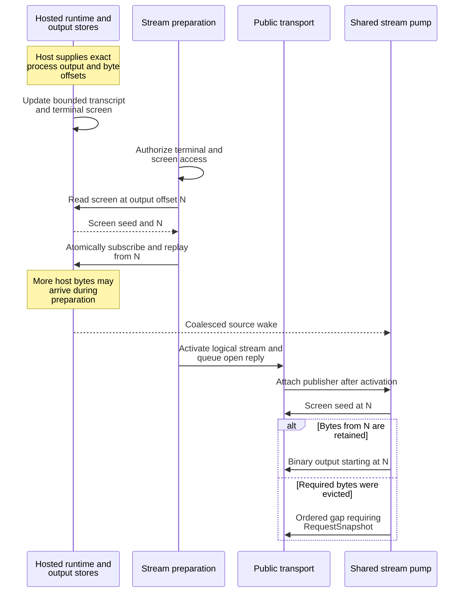
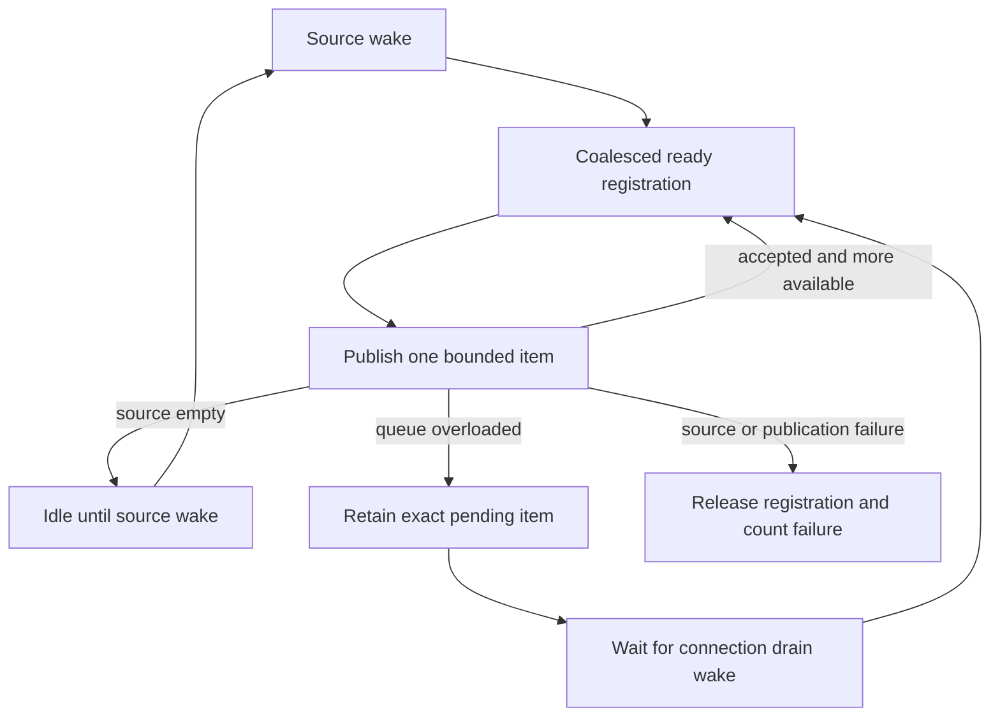

# Trace daemon output and subscription delivery

Use this explanation to investigate daemon stream preparation, backpressure,
checkpoint lifetime, and output storage. Consumer setup and output pagination
belong in the [Rust stream guide](../../../../docs/sdk/rust/streams-and-recovery.md)
and [Python output guide](../../../../docs/sdk/python/streams.md).
The bounded probe below uses Python SDK 0.1 and an existing session.

## Choose the observation you need

| Need | Interface and meaning |
| --- | --- |
| Current bounded session list | `ListSessions`: prepared catalog page with an opaque continuation. It does no per-row process IO. |
| Keep a filtered page current | `SessionWatch`: initial page and coalesced membership/summary deltas, with authoritative order and catalog revisions. It is not an event log. |
| Observe durable session transitions | Finite `ReadSessionEvents` or `SessionEvents` stream: event sequence, session revision, kind, timestamp, and optional event-time observation. |
| Read a retained transcript | Finite `ReadTerminalOutput`: bounded raw bytes with explicit offsets, digest, and retention-gap result. |
| Follow selected terminal output | `TerminalOutput` stream: tagged binary bytes, optionally seeded with a current screen. No JSON/base64 expansion for its raw byte payload. |
| Render a current terminal | `ReadTerminalScreen` and `ReadTerminalScreenDiff`: parser-consistent snapshot or update, with a client-scoped baseline token. This is not complete historical output. |
| Receive attached agent tool calls | `AgentEvents`: exact attempt-bound durable channel. An event is not automatically a completed application result. |

The [protocol DTOs](../../../undercurrent-protocol/src/dto.rs) own these public
shapes. [presentation.rs](../../src/presentation.rs),
[detail.rs](../../src/presentation/detail.rs), and
[feed.rs](../../src/presentation/feed.rs) map application values without IO. The
[event-kind translator](../../src/event_kind.rs) exhaustively maps the domain and
protocol registries; its round-trip test prevents the two lists from drifting.

## Read retained output with the Python client

Use the maintained probe to inspect an **existing stable session ID** without
starting or stopping it. Complete the [Python setup](../../../../docs/sdk/python/quickstart.md),
including its platform, matching bridge, and running-daemon requirements, then
select the affected home below.

### 1. Capture the returned bytes

From the repository root, replace both placeholders. Save raw output to a file
instead of sending terminal control bytes to your display:

```sh
export UNDERCURRENT_HOME=/absolute/path/to/affected-home
python3 crates/undercurrent-daemon/examples/read_retained_output.py \
  'EXISTING_STABLE_SESSION_ID' > ./uc-output.bin
```

### 2. Check the exit status and exclusive offset

The maintained [read_retained_output.py](../../examples/read_retained_output.py)
checks page starts and forward progress and uses SDK digest checks. Each page is at most
4096 bytes and each run at most 1000 pages.

| Exit status and meaning | Next action or limitation |
| --- | --- |
| 0 — Read through the producer head observed by the last page | Stderr reports the exclusive ending offset; it does not prove the process finished. |
| 1 — SDK, timeout, or continuity failure | Treat emitted bytes as partial and inspect the error. |
| 2 — Retention gap | Stderr gives the earliest retained offset; decide whether missing history is acceptable. |
| 3 — Page budget reached | Stderr gives the continuation offset; more producer output may remain. |

If you deliberately accept missing history, rerun with
`--from-offset EARLIEST_AVAILABLE_OFFSET`, replacing the placeholder with the
reported integer and choosing a new output file. Retention can advance again
before that request. For a page-budget stop, the reported exclusive offset is
the continuation for another run. Keep the files and offset records together.
Client context cleanup closes the bridge/connection on every path; remove
`./uc-output.bin` when finished with the captured data.

### 3. Preserve the returned interval

Continue from `page.from_offset + len(page.data)`, the exclusive end of the
returned bytes. Python's `page.next_offset` is the producer head and can be
farther ahead. The [Python interval and gap rules](../../../../docs/sdk/python/streams.md#continue-at-the-end-of-the-returned-bytes)
own this consumer contract and explain how the maintained copier rejects
invalid intervals. This daemon probe checks the returned start and rejects an
empty page with more bytes advertised; it is not the full interval validator.

The owning implementations are [output replay](../../../undercurrent-application/src/terminal_output.rs),
[finite presentation](../../src/presentation/feed.rs), and
[Python read_output](../../../../python/src/undercurrent/client.py).

## Follow terminal bytes across the process boundary

The composed hosted runtime owns the daemon-side bounded output store and screen
parser. It validates exact session/process incarnation before accepting host
frames, orders frames by byte offset, and recovers missing host ranges. Terminal
mode updates the parser and output at a matching checkpoint. Opaque mode retains
bytes without terminal interpretation; requesting its screen fails with
`FailedPrecondition`. The daemon passes those stores to finite reads and selective
subscriptions; it does not read PTYs directly in the product stream pump.

This diagram shows one screen-seeded subscription, including output produced
between its snapshot and activation.



*A screen's output offset determines where raw continuation begins. A gap cannot
be treated as a valid continuation of that screen.* Evidence is in
[hosted runtime ingestion](../../../undercurrent-runtime/src/process/hosted.rs),
[stream preparation](../../src/application_adapter/streams.rs), and the
screen-checkpoint/opaque-mode tests in
[application_executor.rs](../../tests/application_executor.rs).

Terminal initial modes select different source positions:

| Initial mode | Starting point | Recovery after missing bytes |
| --- | --- | --- |
| None | Producer head observed during preparation | Restart from available retained byte offset. |
| Tail | Up to the requested bounded tail before that head | Restart from available retained byte offset. Tail size must fit the configured stream chunk limit. |
| Resume | Supplied byte offset, passed directly as the next byte position | Restart from available retained byte offset. Future offsets are invalid. |
| Screen | Current screen's output offset, preceded by that screen seed | Request a new authoritative screen snapshot. |

Output retention is bounded per session and globally. Source eviction and
transport replay eviction are separate. Reliable scheduling prevents silently
discarding an item merely because its connection queue is full; it does not make
the underlying transcript infinite or guarantee delivery through disconnects.

## Keep checkpoints in their own domains

| Checkpoint | Owner and recovery |
| --- | --- |
| Transport stream sequence | Logical stream scheduling/replay. Resume also depends on server epoch and retained transport state. Do not substitute a byte offset or durable event sequence. |
| Terminal byte offset | Position in the session transcript. A gap reports the earliest available position; choose whether loss is acceptable or rebuild a screen. |
| Durable event sequence | Journal checkpoint. Resume strictly after it. A new event stream without a checkpoint starts live at the journal head; finite reads can begin earliest or tail. |
| Catalog revision / query cursor | Prepared query state. Restart the query when its cursor expires or watch recovery requires it. |
| Screen checkpoint token | Retained screen baseline for the owning client **and session**. Request another snapshot if evicted or released. |

[ProductStreamPolicy](../../src/stream.rs) maps watch state to replaceable State
traffic with RestartQuery recovery. Session and agent events use reliable
Lifecycle traffic with RequestSnapshot recovery. Terminal output uses reliable
Bulk traffic and the mode-specific recovery above. All currently support
transport resume, but the application source still prepares its own snapshot or
checkpoint from the supplied product specification. A transport resume sequence
is not translated into an application byte/event offset.

For session events, preparation atomically obtains the initial bounded batch and
live subscription. Every continuation is validated against its filter,
checkpoint, and page bound. A source gap is published before the surviving
records. Finite event pages preserve explicit missing ranges; streaming gaps use
the transport recovery action. The default finite event request strips
observation payloads unless `include_observation` is set, whereas stream
presentation can carry retained event-time observations.

For watched pages, apply each delta batch with its authoritative order and
revision. Coalescing means intermediate states can be omitted; use durable events
when those transitions matter. A finite query cursor is rejected as a watch
starting point.

## Why one slow stream does not allocate a worker

The daemon uses one named [stream pump](../../src/stream/pump.rs) for all registered
sources. Preparation reserves a bounded slot keyed by logical client and stream
ID before acquiring a source subscription. The reservation releases itself if
preparation fails or is cancelled. Fallible authorization/capacity work precedes
transport activation. Only after activation does the prepared source receive its
publisher, preserving the open-reply ordering.

Each pump turn publishes at most one bounded item. Sources retain an unsent
event, terminal payload, seed, or gap until admission succeeds. The publisher
increments its transport sequence only after scheduler acceptance. Overload
therefore retries the same item and sequence; terminal data is already encoded
and is not copied/re-encoded on each retry.

This flowchart shows why queue-drain notification matters.



*Reliable backpressure parks a registration, not a thread per subscriber.*
Source wakes coalesce; a wake during backpressure is retained. Drain wakes select
waiting streams for that client, with a remembered drain opportunity covering
the race between failed publication and parking. Closing one stream removes its
source; connection closure releases that logical client's sources; pump shutdown
wakes and joins its single worker. Source/presentation/publication failures
increase `failed_streams` and release the daemon source. That local release is
not an application completion result.

## Cursor and screen memory are bounded

[Session/profile cursor stores](../../src/cursor.rs) retain opaque tokens per logical
client. Registering a new cursor evicts the oldest token for that same client
when its count limit is reached; admitting a new client can fail at the separate
client limit. Resolve clones state before query evaluation, so evaluation does
not hold the store lock. Profile continuation is after a name in the **live**
catalog; it does not freeze a profile generation.

[Screen checkpoints](../../src/screen_checkpoint.rs) additionally bind a token to
its session and count logical private screen bytes, even when allocations are
shared. Oldest checkpoints are evicted until both count and byte limits fit. A
single screen larger than the budget fails instead of becoming an unbounded
exception. Resolving a peer client's token appears expired; resolving an owned
token for another session is invalid. Finite screen diffs authorize before
private checkpoint lookup and can return either a diff or replacement snapshot.
Each result registers a new baseline.

Connection closure releases these stores. Tokens are not durable or portable to
another client/daemon lifetime. Treat them as opaque despite their fixed internal
encoding. `CursorExpired` prescribes RestartQuery for pagination and
RequestSnapshot for screens.

## Finite execution output has different storage

`ExecuteInSession` can return inline stdout/stderr or immutable content references.
The daemon's [filesystem output store](../../src/execution_output_store.rs) lives at
`state/execution-output` under the product home, names objects by SHA-256, bounds
each item, and checks the supplied and stored digest/length. It writes a private
temporary file, syncs it, publishes with a no-clobber hard link, removes the
temporary path, then verifies the destination. A racing existing object must
match exactly. Windows uses pinned private paths; Unix creates private directory
and file permissions.

The public reference is `undercurrent-content:sha256:...`, not a filesystem path
or an HTTP download URL. This adapter implements storage, not a public retrieval
RPC or automatic garbage collection. Its per-item limit is not a total disk
retention budget, and syncing the file is not a documented guarantee of directory
entry survival under every power-loss scenario. Keep these artifacts with the
home's recovery evidence; do not confuse them with the bounded live transcript.

## SDK lifetime and verification

Use the [SDK comparison](../../../../docs/sdk/README.md) for blocking Rust calls,
async Python calls, sharing, connection setup, and cleanup. Closing a subscription
releases observation resources; it does not stop a session. Python consumers that
leave an iterator early should follow the
[stream cleanup guide](../../../../docs/sdk/python/streams.md).
Request cancellation, deadlines, and mutation outcomes belong in
[effects and recovery](requests/effects-and-recovery.md).

Focused evidence includes [cursor tests](../../tests/cursor_store.rs),
[screen checkpoint tests](../../tests/screen_checkpoint.rs),
[presentation tests](../../tests/product_presentation.rs),
[host recovery tests](../../tests/hosted_process_recovery.rs), and
[application executor tests](../../tests/application_executor.rs). The latter covers
300 selective watches on one pump, output sent only to selected sessions,
screen/live-offset continuity, opaque capture rejection, and exact retries after
queue drain. When extending a stream, test source eviction, backpressure, close
during preparation, reconnect, and epoch change separately.

[Back to the crate guide](../../README.md)

[Crate documentation](../README.md)
