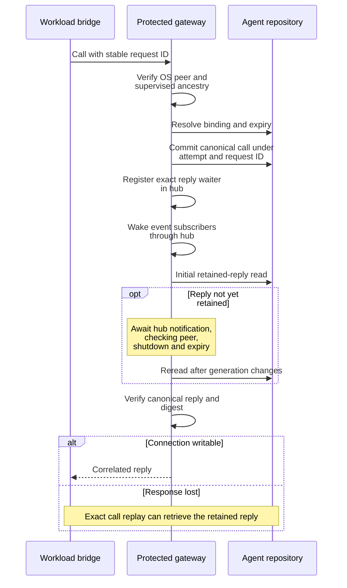
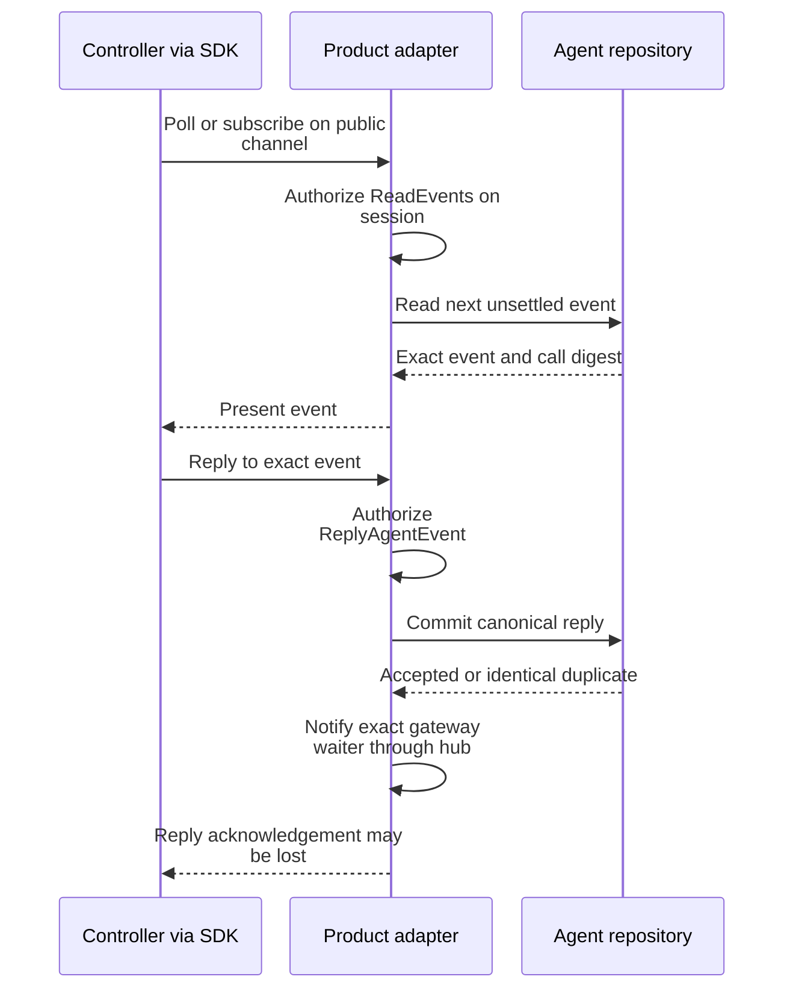

# Trace an attached agent call and durable reply

Use this explanation when integrating an externally dispatched agent workload or
debugging its tool-call channel. This is a contributor/integrator boundary, not
the Python SDK's stdio bridge or the daemon's public Local transport. Ordinary
standalone sessions do not acquire an attached agent binding merely by writing
JSON to stdout.

The daemon starts a protected local gateway during
[composition](../../../src/composition.rs). It expects the matching
`operation-agent-mcp-bridge` executable beside `uc-daemon` (with the platform
executable suffix). Test binaries under `deps` resolve it in the parent build
profile directory. Resolution computes that expected path; it does not install
or validate the bridge executable at daemon startup. Actual peer resolution
checks the executable when the gateway is used. Deployment of that external
bridge belongs to the attached product integration.

## Separate authority and transport boundaries

An external start carries a complete runtime dispatch and agent binding, including
attempt/fence, provider generation, caller request/input digests, result schema,
classification, actor references, recovery epoch, and expiry. The daemon's
[start boundary](../../../src/boundary.rs) checks their consistency and canonical
digests against the launch policy. This is distinct from proving an actor's
product authority. See [request authorization](request-flow.md#validate-before-application-effects).

On the workload side, [the gateway](../../../src/agent_bridge_gateway.rs) derives the
session/process target from the connecting OS process. Linux/macOS check the
local socket peer owner and PID. Windows uses the private named-pipe adapter and
peer process ID. The
[hosted runtime](../../../../undercurrent-runtime/src/process/hosted.rs) verifies the
expected bridge executable and walks a bounded ancestry chain to a current
supervised process incarnation. It rechecks identity to reject PID reuse,
reparenting, or executable changes. The gateway then resolves a current durable
binding and rejects expired, absent, ambiguous, or mismatched attempts. The
bridge request does not choose its own trusted session/process coordinates.

The gateway protocol is length-prefixed JSON with its own version, currently 1;
this is separate from product contract 0.1.0-beta and the public connection's wire
version. [agent.rs](../../../../undercurrent-protocol/src/agent.rs) owns the DTOs and
protocol bounds. `Describe` returns the canonical expected-result schema from
the resolved binding. `Call` carries one bounded typed tool call and a stable
request ID. The gateway checks type-specific bounds; receiving `Submit` is not a
declaration that the surrounding product has accepted a final result.

## Commit before waking readers

This sequence focuses on a new call. Duplicate calls and response loss reuse the
durable event/reply identities described below.

*Persistence precedes wakeup. The initial read after waiter registration closes
the registration race.* The controller supplies the reply through the separate
public path below.

*The public response and private reply delivery can each be lost after commit.*

*Notifications carry no payload and do not constitute the event or reply. The
repository is the source of truth.* The product adapter's notify step occurs in
[finite.rs](../../../src/application_adapter/finite.rs) after repository acceptance or
duplicate classification; the caller does not invoke the hub directly.

The [SQLite agent channel](../../../../undercurrent-store-sqlite/src/sqlite/database/agent_channel.rs)
commits new events and replies in transactions. Event identity is scoped to the
attempt and gateway request ID. Matching pending calls reuse the event; matching
replied calls return the retained reply. Changed canonical bytes/digest or process
identity under that request ID produce conflict. Reply admission checks the
target binding plus event ID, event sequence, process/session identity, and call
digest. An identical canonical reply is a duplicate; a different reply is a
conflict. Reconnection does not justify inventing another request identity.

Public finite polling returns the next **unsettled** event strictly after the
supplied event sequence. It is not an archive of all replied calls. A finite poll
has a protocol-bounded wait of at most 30 seconds, checks request cancellation,
and sleeps in at most 25 ms increments between repository polls. This wait uses
one finite dispatcher worker. Agent streams instead register a notification
before their initial read and use the shared [stream pump](../output-and-streams.md).
They authorize event access, reread canonical records after wakes, and advance
their event checkpoint only after publication is accepted.

Both finite `GetAgentEvent` and `AgentEvents` subscriptions apply `ReadEvents` to
the target session before accessing the repository. Forbidden and unauthenticated
decisions prevent polling or source registration. Repository target/fence/expiry
validation is still required after authorization; supplied binding coordinates do
not establish a caller's permission. `ReplyAgentEvent` independently applies the
`ReplyAgentEvent` action before repository access. The composed
[executor regression](../../../tests/application_executor.rs) checks both read
paths with a recording policy and repository.

## Bounds and wait lifetime

| Resource | Current owning bound or behavior |
| --- | --- |
| Gateway workers | Four fixed workers and a bounded queue of 32 accepted streams. A full queue drops the new accepted stream; it does not create another worker. |
| Socket reads/writes | Five-second IO timeouts, separate from semantic reply waiting. One connection handles one request/response. |
| Reply waiting | Notification-driven repository reread, with peer/shutdown/expiry checks at intervals of at most 250 ms. Waiting can occupy a worker until binding expiry; the IO timeout is not a five-second overall call deadline. |
| Frame | Nonempty, at most 256 KiB; a four-byte big-endian length precedes JSON. |
| Gateway request ID | Nonempty, at most 128 bytes, no control characters. |
| Progress/question text | Nonempty, at most 8 KiB, no NUL. |
| Inline result / choice document | At most 192 KiB; NeedInput also allows at most 128 choices and a 64 KiB answer schema. |
| Unsettled durable events | At most 32 per attempt, owned by the [application channel contract](../../../../undercurrent-application/src/agent_channel.rs). Replied records are different from this unsettled-capacity count. |

Canonical JSON and reply digest are checked before a retained reply is returned.
A notification with no corresponding readable reply is an internal failure,
not an instruction to manufacture an acknowledgement. Liveness checks do not
periodically poll the reply table without a notification: after the initial read,
the hub generation triggers further reads. A lost connection can therefore leave
a committed call or reply that must be recovered by its exact identity.

The [notification hub](../../../src/agent_event_notifications.rs) keeps weak registry
references. Subscription handles retain their own wake/state and unregister on
drop. Notifications collect live callbacks under the registry mutex, then invoke
them after releasing it. Replies are keyed by attempt **and event**, with a
mutex-protected generation and condition variable to avoid missing a wake between
read and wait. The hub does not persist across daemon epochs and is not a second
event store. Current usage is bounded by stream reservations and gateway workers;
the hub does not itself enforce an independent capacity limit.

Gateway teardown sets shutdown, closes its queue, joins the acceptor and workers,
and removes the Unix socket when it is still a socket. Partial worker startup
uses a cleanup guard. The gateway is dropped before the hosted runtime during
[daemon teardown](../lifecycle/startup-and-shutdown.md), so its peer checks do not outlive that runtime.

## Diagnose a stalled call

First distinguish the protected gateway from the public controller connection.
A controller must consume and reply through the public product channel for the
workload's gateway call to finish. General daemon status success does not prove
that controller is consuming agent events.

| Observation | Investigation |
| --- | --- |
| `unauthenticated` | Check matching installed bridge location and supervised ancestry; an arbitrary same-user socket client is insufficient. |
| `stale_attempt`, `binding_expired`, or `ambiguous_binding` | Inspect the exact attempt/fence/provider generation and current binding. Reusing stale coordinates cannot repair them. |
| `request_conflict` | Compare the preserved original canonical call/reply identity. Do not change bytes under an existing request ID. |
| `capacity_exceeded` | Check unsettled events and occupied gateway workers, as well as frame/payload bounds. A retryable classification alone does not authorize a new tool-call identity. |
| Connection closes without a reply | Preserve identity and determine whether a call/reply committed before response loss. The admission queue can also reject a connection before handling it. |
| `unavailable` or `internal` | Preserve durable event state and inspect the repository/runtime boundary; these errors expose safe messages rather than private call payloads. |

Focused evidence includes
[notification tests](../../../src/agent_event_notifications.rs),
[durable channel tests](../../../../undercurrent-store-sqlite/tests/agent_channel.rs),
the ancestry tests beside
[hosted peer resolution](../../../../undercurrent-runtime/src/process/hosted.rs), and
the denied-reply test in [application_executor.rs](../../../tests/application_executor.rs).
Extend those tests when changing target matching, subscription setup, reply
notification, expiry, or deduplication. Gateway end-to-end platform execution is
a separate validation task; source inspection does not establish qualification.

[Back to the crate guide](../../../README.md)

[Crate documentation](../../README.md)
