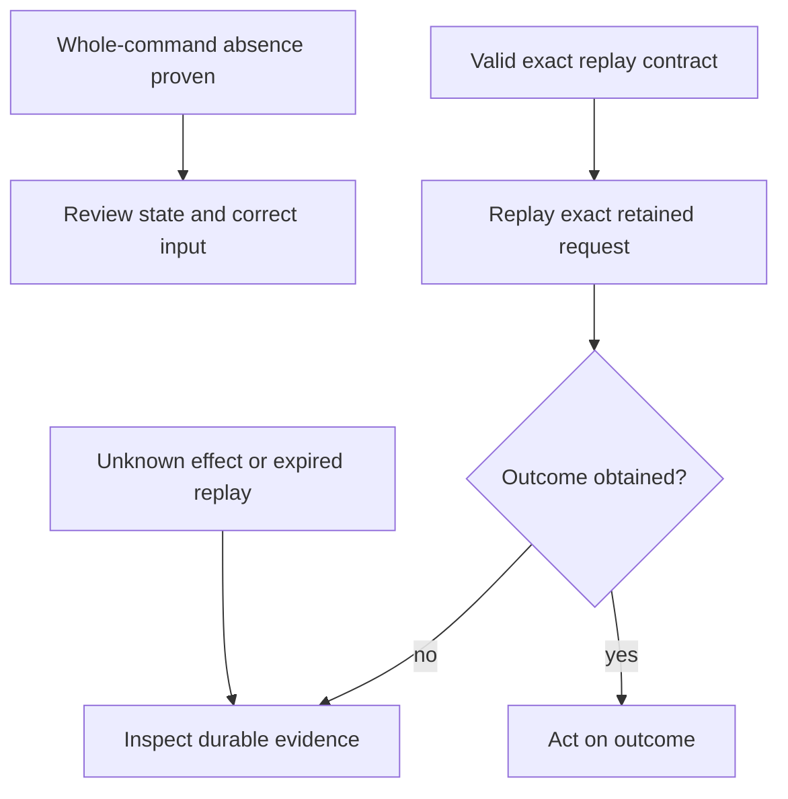
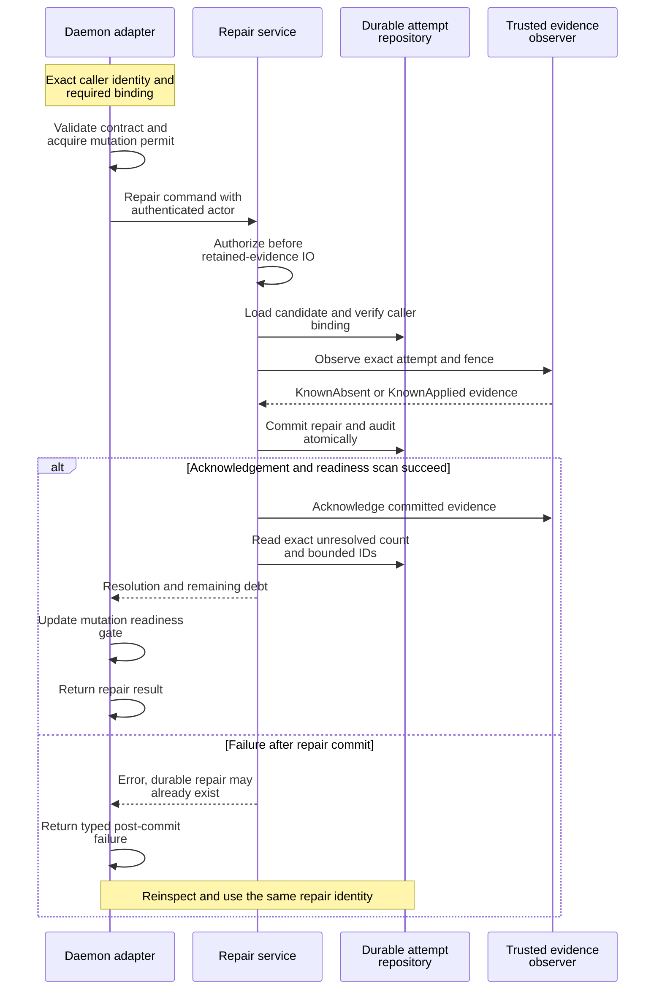

# Reconcile uncertain mutation outcomes

Use this guide when a mutation timed out, its connection was lost, or the daemon
reports unresolved operation attempts. Keep the same Undercurrent home and the
request/attempt identities used by the caller. These instructions target the
current standalone daemon and matching 0.1.0-beta clients. Follow
[start and inspect a daemon](../../../../../docs/guides/daemon/operations.md) first if the endpoint is unavailable.

## Classify the evidence before retrying

A transport failure says that the caller lacks a response. It does not say
whether the daemon accepted the request, committed state, or affected a process.
A typed product error adds evidence, but its category alone still does not prove
absence. The protocol's
[error registry](../../../../undercurrent-protocol/src/registry.rs) and
[error envelope](../../../../undercurrent-protocol/src/dto.rs) own the definitions;
[application error mapping](../../../src/application_adapter/error.rs) explains how
daemon evidence reaches that envelope.

| Evidence | Interpretation and next action |
| --- | --- |
| `effect_certainty: known_absent` for the requested operation/target | The response carries explicit whole-command absence evidence. Correct the rejected request or review the current state before deciding to submit again. |
| Typed rejection without effect certainty | Read the disposition and operation-specific contract. A capacity failure may concern result encoding after execution; it is not automatically an admission refusal. |
| `unknown_inconclusive`, missing response, or connection error after submission | Preserve the original request and identities. Inspect/reconcile its outcome; do not generate a new mutation identity to evade uncertainty. |
| `retryable: true` | The failure class may be transient. This flag does not authorize repeating an ambiguous mutation. Retained response replay or an operation-specific durable retry contract is still required. |
| Cancellation accepted | The request token was signalled. This does not prove the operation had no effect or that a session process terminated. |
| Process exit or Running lifecycle observed | Process/lifecycle evidence. Neither is an application-level workflow result. |

The daemon deliberately promotes only selected evidence to whole-command
absence: explicit authorization refusal, unavailable profile before activation,
revision-precondition rejection, duplicate start name, and a repository-proven
refusal of the initial start insertion. A later port's `KnownAbsent` describes
that port operation, not all earlier effects of the command. In particular,
response encoding/capacity errors and generic persistence failures do not carry
that proof. See [effect-evidence tests](../../../src/application_adapter/error_effect_evidence.rs).

This decision diagram shows the safe next step without treating every error as a
retry instruction.



*Reconnect restores communication; it does not resolve a mutation's outcome.*
Exact replay requires the same bytes, logical client ID, and key within the
[retention contract](#distinguish-three-retry-identities). When inspection
identifies an unresolved attempt, use retained-evidence repair if supported.
Otherwise investigate operation-specific state before submitting a new mutation.
The [request flow](request-flow.md) shows why response loss can follow durable
effects.

## Inspect and repair unresolved attempts

Prerequisites: a matching installed `uc`, an authenticated endpoint for the
affected home, and the exact attempt ID retained by the original caller or
identified through investigation of the durable attempt record. Run these
commands from any directory. They operate on the
selected home; replace `/absolute/path/to/affected-home` and the quoted attempt
ID with your real values.

### 1. Inspect the affected installation

```sh
export UNDERCURRENT_HOME=/absolute/path/to/affected-home
uc --json daemon status
uc --json debug reconciliation
uc --json debug persistence
uc --json debug supervisors
```

Reconciliation includes a bounded sample of **current** blocking attempts, with
each attempt ID, operation, and session target. The separate startup rows remain
historical summaries. Supervisors show ongoing worker activity and failures;
a full sample is not a complete inventory of retained attempts.

### 2. Repair the exact attempt and verify the result

Repair changes durable attempt and audit state. With the original attempt ID,
submit the evidence-based repair and retain its response with incident evidence:

```sh
uc --json debug repair-attempt 'EXACT_ATTEMPT_ID'
```

Expected: the response gives the resolved certainty, a fresh exact unresolved
count, and bounded remaining IDs. Mutation admission checks debt for the requested
session, including host-wide attempts; debt in another session does not block it.
A shutdown drain is a separate admission gate. No new
demonstration processes are created, so no process cleanup is needed.

If repair fails, use the failure boundaries below. An error after commit can
mean the repair already exists; preserve its identity and reinspect rather than
submitting a replacement mutation.

The CLI submits identity-only standalone repair with an explicit null caller
request digest. It accepts no user claim that an effect happened or did not
happen. Attached external dispatches require their matching caller request
digest through the typed protocol/SDK request; the CLI's identity-only request
cannot substitute for that binding. The sources are
[CLI repair execution](../../../../undercurrent-cli/src/executor/operations.rs),
[repair DTO](../../../../undercurrent-protocol/src/repair_attempt.rs), and
[repair service](../../../../undercurrent-application/src/repair_attempt.rs).

The repair sequence makes the durable commit and later failure windows explicit.



*Repair derives certainty from retained trusted evidence, then refreshes
readiness. An error after commit does not restore the old attempt state.* A
currently Accepted attempt is not an Unknown repair candidate. Missing evidence,
stale fences, changed bindings, and conflicting evidence must remain visible
failures. Do not edit SQLite records or delete session-host receipts to force the
gate open. If evidence cannot be recovered, preserve the home and investigate
the responsible runtime/persistence boundary.

The daemon can accept reads while recovery blocks a mutation. Session-scoped
checks cover process, metadata, cleanup, and WorkContext mutations. Uncertain
input alone permits stopping that session, so recovery can verify its exit.
An unreadable store or invalid recovery scan still closes admission globally.
An active product shutdown independently blocks repair through mutation
admission. See [lifecycle and shutdown recovery](../lifecycle/startup-and-shutdown.md).

## Distinguish three retry identities

The daemon has several mechanisms with different scopes. Their names are not
interchangeable.

| Mechanism | Scope and lifetime | Limitation |
| --- | --- | --- |
| Product response retention | Exact encoded request bytes under logical client ID plus idempotency key, in this daemon's memory, until completed-result retention expires | A restart loses this cache. A new client ID, expired result, or changed bytes cannot establish that an earlier effect was absent. |
| Durable operation attempt | Attempt ID, payload/semantic binding, process target, and fencing generation in the durable application store | Reuse must satisfy the operation's exact contract. Unknown or conflicting records require reconciliation rather than an unrelated new effect. |
| Terminal input delivery | Explicit delivery ID and the application's input-delivery contract | This is input-specific and does not make every product mutation durably idempotent. |

For cache-eligible mutations, the dispatcher reserves the maximum response bytes
before execution. A matching pending record returns a retryable
`FailedPrecondition` with a 50 ms hint. Different request bytes under the same key
are rejected. A completed record replays the canonical response without calling
the executor again; this can replay an error as well as a success. Pending
records are not expired silently. Completed records expire after the configured
retention interval; limits reject new reservations rather than evicting pending
work to make space.

The encoded canonical response is stored **before** connection response queueing.
Per-peer projection can omit `disposition` or `effect_certainty` when those
capabilities were not negotiated. Reconnecting with different negotiated
capabilities changes the response shape, not the retained canonical result.
See [dispatch effect projection](../../../src/dispatch_effect_evidence.rs) and the
response-loss tests in [product_dispatch.rs](../../../tests/product_dispatch.rs).

`CancelRuntimeAttempt` bypasses the product response cache so every replay
rechecks semantic authorization, including revocation. Its durable control
record owns deduplication. Repair is also outside ordinary mutation metadata and
uses retained evidence and repair audit semantics. Do not infer a cache key for
either operation from its being classified as a mutation.

## Why an active attempt is not automatically recovery debt

[attempt_tracking.rs](../../../src/attempt_tracking.rs) wraps durable acceptance and
settlement with exact, reference-counted live proof keyed by attempt ID and
fence. A coordination mutex spans the durable acceptance return and live
registration, and also spans settlement and proof removal. Reconciliation and
readiness scans take the same coordination lock. They therefore cannot observe
the commit window as an abandoned attempt while its executing worker is still
being registered.

Live exclusions are passed into the repository scan before its page limit, so a
page full of live work does not conceal older unresolved debt. Oversized or
invalid scan results close admission globally. Unknown certainty invalidates the
aggregate readiness hint; each request checks its own session and host-wide debt.
Admission rechecks under the acceptance coordination lock. Recovery advances a
bounded keyset cursor past Unknown pages and revisits them on subsequent sweeps.
Live proof is process-epoch memory and does not survive daemon restart. Persisted
Accepted attempts from a previous epoch need evidence.

Prepared compensation has an additional exact check: for a dispatched Spawn
attempt, recovery only terminalizes its compensation when the session is at the
expected next revision, Failed, without durable or directory process ownership,
and the exact process incarnation is observed Missing or Exited. A changed
revision, live process, or replacement binding prevents that conclusion.
`Compensated` records cleanup of an effect; it is not a claim that spawn never
happened. The runtime-attempt status DTO preserves this distinct outcome.

## Retire uncertain input after verified exit

A failed input call does not always mean an uncertain effect. When the native
adapter proves that it rejected the write before queue admission, or discarded
an unstarted queued request, the host durably records `KnownAbsent` with the typed
failure. A write or flush failure can follow partial delivery and stays `Unknown`.

For older standalone `Unknown` input, background recovery can remove the admission
block without inventing an outcome. It holds the session mutation lease, verifies
a terminal session with no durable or live-directory process, and asks the host
for retained exit evidence and quiescent input receipts. A live replacement,
running receipt, missing evidence, or supervision failure prevents retirement.
Legacy input receipts identify the session, not necessarily its exact old process;
the proof establishes current quiescence, not which bytes were delivered.

SQLite then atomically records the exact attempt/fence, session revision and
terminal snapshot, host process/exit evidence, and retirement time. The original
attempt remains `Unknown`. The audit excludes it from admission scans, rejects
replay and certainty repair, and survives session deletion. Host receipt release
happens only after this commit; pending acknowledgements survive cleanup and
restart. Partial input may already have affected the exited program's external
state, so retirement never authorizes resending it.

## Attached callers and cancellation

`GetRuntimeAttemptStatus` reads the exact attached attempt using its caller request
digest and authorization. It returns Unknown, KnownAbsent, KnownApplied with a
session snapshot, or Compensated. It performs no process IO and does not redrive
the operation. A KnownApplied replay of dispatched start is stricter than status:
the application reconstructs the exact Running session and process ownership and
checks its result digest, otherwise it requires reconciliation.

`ExecuteInSession` checks cancellation and an absolute deadline before admission,
resolves the authorized execution context, durably admits the attempt, and passes
the exact context to its command executor. Successful settlement precedes
retained-result acknowledgement. Its application service has explicit replay and
Unknown-reconciliation paths; their availability is also subject to the daemon's
readiness gate. Do not extrapolate them to arbitrary session mutations.

Request cancellation signals one request token. Closing a subscription ends
delivery. Runtime-attempt cancellation is a durable, authorized control bound to
the exact attempt, session/lifecycle revisions, provider generation, digest, mode,
deadline, and actor. It can report AcceptedStopping, AppliedTerminated,
AlreadyTerminal, or Unknown. AcceptedStopping does not assert termination. The
standalone authorization policy denies runtime cancellation **and its status
query**; local authentication alone does not provide that product authority.

For maintainers, evidence includes
[live-attempt commit-window tests](../../../src/attempt_tracking.rs),
[repair and status adapter tests](../../../tests/application_executor.rs),
[error mapping tests](../../../src/application_adapter/error.rs), and
[shutdown taxonomy tests](../../../src/application_adapter/operations.rs). Preserve
tests for post-effect settlement failure and response loss when changing any
recovery path.

[Back to the crate guide](../../../README.md)

[Crate documentation](../../README.md)
