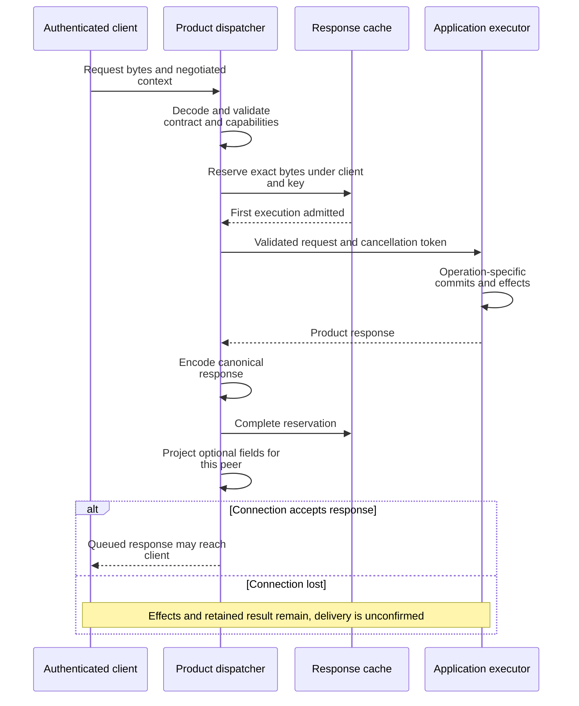

# Follow a request from admission to a durable result

Use this explanation when changing daemon request handling or investigating a
mutation whose response was lost. It describes the current daemon composition
and 0.1.0-beta product contract. Client code should use the supported
[Rust SDK](../../../../undercurrent-sdk/README.md) or
[Python package](../../../../../python/README.md), not the daemon's internal `pub`
interfaces. For operator recovery steps, see [reconcile uncertain effects](effects-and-recovery.md).

## What each boundary owns

The public Local transport authenticates a connection and passes credential-free
identity and negotiated capabilities to the daemon. `AuthenticatedActionDispatcher`
is the entry to the bounded product dispatcher. The transport owns frame and
connection admission; the daemon owns product decoding, application translation,
execution, and presentation. Private session-host IPC is a separate boundary,
shown in [composition and ownership](../composition.md).

This sequence follows a newly admitted, cache-eligible request. Admission
refusals and cache pending/conflict/replay outcomes stop before execution; their
rules are in [response retention](effects-and-recovery.md#distinguish-three-retry-identities).
The diagram isolates the commit-to-response-loss window.

*Response queueing follows execution and cache completion. It is not an
acknowledgement that the caller received the result.* The exact ordering is in
[dispatch.rs](../../../src/dispatch.rs); result retention belongs to the
[transport-core idempotency store](../../../../undercurrent-transport-core/src/engine/idempotency.rs).

## Admission, concurrency, and lifetime

The dispatcher has three bounded lanes: ordinary work uses the configured
worker count, immediate stop/restart uses another pool of that size, and shutdown,
status, session listing, and session detail use two reserved control workers.
Each lane has the configured queue capacity. Pressure reports the combined
worker and queue bounds. Graceful stop waits cannot consume the force or control
pools, and name resolution remains available before a CLI force request.
All lanes use nonblocking admission; a full lane rejects work. The private host
also separates force and short controls from graceful stop and input waits, so
moving a request through the daemon does not merely move it to a blocked host
queue. Each admitted request has a cancellation token registered by
logical client ID and request ID before it reaches the queue.

Cancellation and stream/connection closure bypass that queue. Cancelling a
request sets its cooperative token immediately; it does not wait for a free
worker. Closing a connection cancels that client's requests and releases its
streams and cursor stores. It does not clear retained mutation responses.
Dispatcher shutdown closes admission, cancels tokens, joins workers, and invokes
executor shutdown once. A running operation must cooperate before its worker can
finish; queue bounds do not make every operation preemptible.

The worker checks cancellation before decoding/execution. A token cancelled after
cache reservation but before executor entry causes that reservation to be
abandoned. Once application IO begins, cancellation does not roll it back.
`ExecuteInSession` and agent-event polling explicitly observe the token during
their application path. Ordinary session mutations do not acquire a universal
interruptible transaction merely because the context contains a token.

Most finite execution holds a read lock on the profile-catalog gate. Reload
activation takes its write lock, so profile lookup and mutation cannot race a
catalog replacement. Shutdown deliberately skips this read lock because it may
join background work. The application uses session-local mutation ownership and
repository revisions for session ordering; a shared worker pool is not itself a
global session transaction. See [profile activation](../configuration/profile-reload.md) and
[background workers](../lifecycle/background-work.md).

## Validate before application effects

The [protocol registry](../../../../undercurrent-protocol/src/registry.rs) owns operation
names and mutation classification. The
[contract validator](../../../../undercurrent-protocol/src/compatibility.rs) and
[contract DTOs](../../../../undercurrent-protocol/src/contract.rs) own current metadata.
Do not derive those definitions from the crate's package version.

Before cache lookup, dispatch rejects unsupported negotiated session-revision
preconditions and opaque-capture starts, and validates the current contract for
mutations. Repair carries its own contract descriptor rather than general
mutation metadata. Status request types validate their direct descriptors in the
finite adapter. A structurally decodable request with a retired contract still
fails before its application service runs.

[ProductBoundary](../../../src/boundary.rs) constructs bounded domain inputs without
IO. Domain constructors remain the owners of field invariants. Important
translation rules include:

| Input | Boundary and consequence |
| --- | --- |
| Start command, environment, labels, metadata, health rules | Validated domain values; environment values and secret references must not be logged by callers. Automatic profile matching uses executable/arguments and environment **names**, not values. |
| Externally dispatched start | Requires complete attempt and idempotency identities, canonical payload digest, executable digest, compiled runtime policy, and an environment binding matching the dispatch pin. A pinned executable requires sealed launch. |
| Attached agent binding | Attempt, fence, request/input/schema digests, output classification, provider generation, and expiry must agree with the dispatched runtime policy. This checks binding consistency; it is not authority verification. |
| Execute in session | Uses the supplied attempt ID or falls back to the idempotency key. Recomputes the canonical payload digest and lets durable admission choose the fence. Inline output limits must fit the daemon's total output bound. |
| Terminal input | Validates the entire typed sequence and byte/item bounds. The application revalidates terminal-relative input under the session mutation lease against current dimensions. EOF has its own `CloseStandardInput` operation. |
| Stop | Maps force, graceful-only, or ordinary graceful mode; carries an optional expected session revision. Input also supports a revision precondition. A stale precondition is rejected before process IO. |
| Queries and events | Bounds pages and filters using the owning domain/application constructors. A watch starts from its first bounded page, not a finite query cursor. A durable event resume starts strictly after a positive sequence. |
| WorkContext | Preserves owner-scoped item identity, relationship, target selectors, provenance, timestamps, and metadata. These declarations do not make the daemon a workflow scheduler. |

The application executor then applies two distinct admission controls. The
operation-attempt readiness gate blocks start, stop, restart, rename, remove,
resize, input, stdin closure, execute, and WorkContext upsert/removal while
unresolved attempt debt remains. Queries and repair remain available. Separately,
the daemon's shutdown state rejects new semantic mutation permits, including
repair; shutdown coordinates its own drain. See [lifecycle](../lifecycle/startup-and-shutdown.md).

Authorization is another boundary. The standalone
[authorization adapter](../../../src/authorization.rs) permits general operations,
attempt repair, and attempt status after authenticated Local admission. It does
not implement per-resource tenant policy. Its runtime-cancellation and
cancellation-status decisions are always denied: a transport principal and
caller-provided authority strings cannot establish product-level cancellation
authority. A different composition must supply that authorizer explicitly.

## Trace session creation

The daemon first translates the start request, authorizes it, selects an
unambiguous automatic profile when appropriate, and confirms that its selected
profile is still present under the profile gate. It then invokes
[StartSessionService](../../../../undercurrent-application/src/commands/start.rs).

Continue with the [cross-crate creation sequence](../../../../../docs/architecture/flows.md#start-a-session)
for prepare, Starting commit, admitted spawn, ownership commit, binding, exit
arming, and Running commit. Each repository change commits its own event; the
whole process is not one SQLite/OS transaction. The [application lifecycle guide](../../../../undercurrent-application/docs/internals/sessions/lifecycle.md#creation-has-several-commit-points)
owns activation ordering and exact compensation, including preserving replacement
bindings and unresolved ownership after failed cleanup.

For an externally dispatched start, the start service settles the semantic result
after Running commits. Ambiguous settlement preserves the exact live process;
proven supersession takes the compensation path. After successful settlement,
`StartSessionService` acknowledges the committed attempt through
`DurableProcessRuntime`, which forwards the call to the runtime owning the host
receipt. If acknowledgement fails, the live session is preserved and an exact
replay retries receipt release without spawning again. See the
[settlement and acknowledgement contract](../../../../undercurrent-application/docs/internals/execution/attempts.md#dispatched-spawn-is-settled-by-the-start-service).

Running is a durable lifecycle result, not proof that the child remains alive
when the response arrives or that its application is ready. Response loss does
not undo activation or settlement.

Projection updates are cache maintenance after durable commits. Their failure is
diagnosed without turning an already durable command into a false failure. The
executor wakes outbox dispatch after semantic mutations except access rejection,
including error responses that may follow commits. Unknown responses from gated
mutations also wake attempt reconciliation. See [background work](../lifecycle/background-work.md).

## Where other finite operations go

[finite.rs](../../../src/application_adapter/finite.rs) selects application use cases
and constructs responses. Stop reports whether the session was already terminal;
restart verifies a retained custom profile before stopping/spawning; removal
passes explicit confirmation to the application. Rename, resize, and WorkContext
updates preserve whether a change actually occurred. Input reports its delivery
identity, duplicate status, and foreground revision when available.

Prepared session listing is authorized before cursor lookup. The adapter tests
encoded response size and shortens an oversized page with a continuation after
the last returned row. If a single row cannot fit, it returns a capacity error.
This preserves row continuity rather than silently skipping large rows.
[reads.rs](../../../src/application_adapter/reads.rs) owns detail, private execution
context, terminal reads/screens, and durable event reads; default finite event
reads remove observation detail unless explicitly requested.

Daemon diagnostics and shutdown use
[application_adapter/operations.rs](../../../src/application_adapter/operations.rs).
Diagnostic bundles authorize terminal inclusion separately and return bounded
output only for an explicit target. See [operating tasks](../../../../../docs/guides/daemon/operations.md) and
[shutdown ordering](../lifecycle/startup-and-shutdown.md). Agent requests validate an exact attached
runtime target and use their durable channel repository; an accepted reply wakes
its bridge waiter only after the repository reports acceptance or duplication.

## Change and verify this path

When adding an operation, update the owning protocol contract and registry first,
then the finite dispatch, boundary validation, application service, presentation,
authorization, and applicable readiness/drain classification. Keep side effects
inside the application/runtime contracts. Every new retry path needs evidence
about admission, execution, settlement, and lost responses.

Useful focused evidence is
[product boundary tests](../../../tests/product_boundary.rs),
[dispatcher tests](../../../tests/product_dispatch.rs), and
[application executor tests](../../../tests/application_executor.rs). They cover
malformed bytes before executor access, retired contracts, capability rejection,
response-loss replay, cancellation outside the queue, bounded saturation,
authorization before private access, revision rejection before process IO, and
byte-bounded pagination. The executable test names are the source of truth;
these links identify coverage, not a claim that a test was run for this page.

[Back to the crate guide](../../../README.md)

[Crate documentation](../../README.md)
