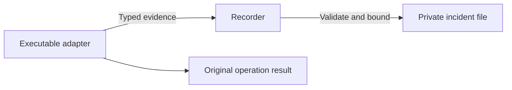

# Maintain executable failure evidence

Use this guide to trace a failure from an executable adapter to private
evidence and choose a focused check for a change. Diagnostics owns validation,
private file publication, and retention. Executable adapters choose what to
capture. The CLI owns support archive selection and live collection through
the SDK.

## Package and reader scope

The recorder serves `uc`, `uc-daemon`, and `uc-session-host`. Its scope is
capture and retention. Daemon connections, application policy, configuration
loading, and workload execution belong to the callers or their other adapters.

## Trace a capture

The executable adapter resolves a home without loading configuration and installs
a `Recorder`. Construction writes no files. This diagram follows the JSON failure
record. Panic backtraces and build identity use separate files.



| Change or investigate | Owning source |
| --- | --- |
| Record validation, typed causes, file publication, or panic capture | [Recorder and failure record](../src/lib.rs) |
| CLI command failure or unsuccessful exit | [CLI incident adapter](../../undercurrent-cli/src/incidents.rs) |
| CLI request failure | The [request adapter](../../undercurrent-cli/src/native.rs) adds operation, elapsed time, up to 128 recent SDK event labels, and the available dropped-event count. |
| Daemon or host process failure | [Process-entry adapter](../../undercurrent-daemon/src/failure_evidence.rs). Build snapshots come from [daemon start](../../undercurrent-daemon/src/main.rs) and the [host and supervisor run paths](../../undercurrent-daemon/src/session_host_main.rs). |

`Recorder::save` records machine categories and typed OS error kinds/codes.
It never serializes arbitrary `Error::Display`, `Error::Debug`, or panic payloads.
Request adapters use a synchronous `IncidentScope` to associate failures with
the caller's support reference. Keep the scope within synchronous execution.
Use the reference only to correlate evidence.

## Artifact limits

| Artifact under the selected home | Bound and meaning |
| --- | --- |
| `logs/incidents/*.json` | Up to 128 retained failure records, each at most 16 KiB. Concurrent writers can briefly exceed the count before pruning. |
| `logs/incidents/*.backtrace` | Up to eight panic backtraces, each at most 64 KiB. Excluded from ordinary support export because they can contain build paths. |
| `logs/build-daemon.json`, `logs/build-session-host.json` | Last started executable's version, optional source revision, platform, PID, and capture time. These are retained evidence, not a probe of the current process. |

Independent files avoid the daemon's lossy logging queue. Unix publication uses
an owner-only temporary file and atomic rename/link; the Windows adapter owns
private access. A full disk, inaccessible home, process kill, or failure in the
capture path can still lose evidence. Synchronizing file contents does not make
the containing directory a durable commit journal. Capture errors never replace
the original operation result.

The panic hook is installed only by executables. It omits the panic payload and
attempts a separate backtrace and failure record; it does not promise crash dumps
for native faults, forced termination, or allocation failure.

## Verify a capture change

From the repository root, with the [pinned toolchain](../../../rust-toolchain.toml)
and locked dependencies available, run the recorder tests:

```sh
cargo test --locked -p undercurrent-diagnostics
```

The [unit tests](../src/lib.rs) check typed causes without source text,
owner-only file mode on Unix, retention and no replacement, invalid categories,
and bounded reads. The panic test uses a subprocess and temporary home to check
that a record is available without a log worker, that it reports a backtrace,
and that stderr omits the panic payload. Expect Cargo to exit zero. If a check
fails, start with its assertion to distinguish record validation from file
publication.

For export or filtering changes, use the [CLI support collection tests](../../undercurrent-cli/tests/support_collection.rs).
They cover invalid configuration, an absent daemon, log redaction, and explicit
opt-in for private backtraces.

[Crate overview](../README.md)
