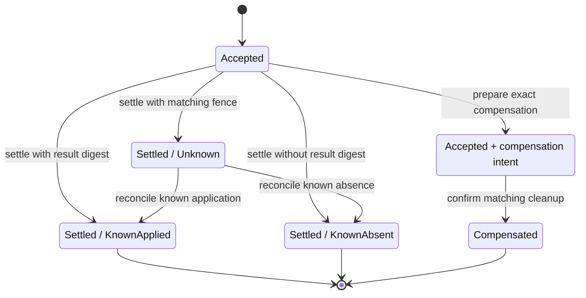
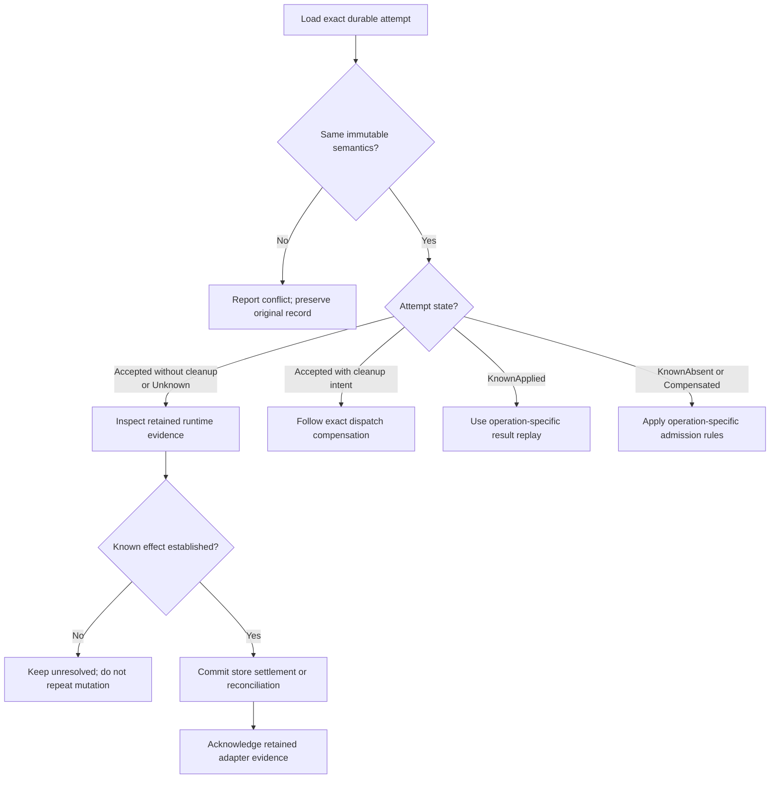

# Preserve effect certainty during retries and recovery

Use this explanation when changing process-affecting operations or diagnosing
an interrupted attempt. It describes the internal model in
[attempt.rs](../../src/attempt.rs) and [agent.rs](../../src/agent.rs), with links to the
application boundaries that establish real effects. Public request shapes and
effect metadata belong to the [protocol contract](../../../undercurrent-protocol/src/contract.rs),
not these Rust structs. [Back to the code map](model.md).

## Acceptance is a record of intent

An `OperationAttempt` binds an ID, optional target session, mutation kind,
nonzero fencing token, semantic payload digest, optional immutable dispatch
binding, and acceptance time. The store must commit acceptance before invoking
the external effect. Constructing `accepted` or `accepted_with_dispatch` only
constructs a value. They do not admit, authenticate, lock, or execute a request.

The mutation-kind registry includes spawn, execute-in-session, exit arming,
graceful stop, force stop, terminal input, resize, and shutdown. Its scope is
effects protected by attempts; it is not the public operation inventory.
`has_same_semantics` compares the ID, target, kind, fence, payload digest, and
entire dispatch binding, excluding acceptance time, current state, and cleanup
intent. A changed policy or caller request digest is therefore a changed attempt.

Attempt and dispatch-cell IDs are 1–128 bytes of ASCII letters, digits, `-`,
`_`, `.`, or `:`. A fence never wraps; advancing `u64::MAX` is rejected.
`PayloadDigest` uses foundation SHA-256 and parses exactly 64 lowercase hex
characters. `of_slices` hashes concatenated slices and currently allocates the
joined bytes. It does not encode slice boundaries: semantic canonicalization
must precede hashing. Daemon-owned derived IDs include the mutation kind and
digest; they are not a replacement for retaining a caller's retry identity.

The state diagram distinguishes uncertainty from an established effect.

*Only evidence can turn an unknown effect into known truth. Preparing cleanup
retains the `Accepted` state but prevents ordinary settlement.* `Accepted` and
unknown settlements return `requires_reconciliation() == true`; a new transport
connection does not change that answer.

## Settlement and compensation guards

Settlement digest rules apply to both `settle` and `reconcile`:

| Certainty | Result digest |
| --- | --- |
| `KnownApplied` | Required |
| `KnownAbsent` | Forbidden |
| `Unknown` | Optional; accepted by `settle`, rejected by `reconcile` |

### Settle an accepted attempt

`settle` requires the accepted fence and a valid digest/certainty combination.
The first settlement requires Accepted state without cleanup intent. An exact
repeat of the entire settled state, **including timestamp**, returns `Duplicate`.

### Reconcile an unknown settlement

`reconcile` requires known certainty and valid digest evidence. It can change
only an Unknown settlement, at a time no earlier than that settlement; it cannot
directly change Accepted. An exact repeat of the resulting settled state,
**including timestamp**, returns `Duplicate`.

### Prepare and confirm compensation

`prepare_compensation` requires Accepted state, the accepted fence, an attached
dispatch, and a strictly higher superseding fence. It retains that newer fence,
exact process identity, session revision, cleanup digest, and preparation time.
The attempt stays Accepted while ordinary settlement is blocked.

A preparation duplicate matches the newer fence, process, revision, and digest;
it ignores the new preparation time. `compensate` requires the original fence,
dispatch, and newer fence/digest matching that stored intent. Only Accepted can
first become Compensated. Compensation duplicates compare the cleanup digest
and superseding fence, ignoring the new compensation time.

These are local checks. The domain does not look up the latest fence for a cell,
validate the supplied cleanup evidence against the OS, or perform deletion.
Initial settlement and compensation do not enforce monotonicity against
`accepted_at`; callers own those clocks and ordering. The store must provide
atomic admission, current-fence enforcement, persistence, and duplicate decisions.
See [OperationAttemptStore](../../../undercurrent-application/src/attempts.rs) and
[SQLite persistence](../../../undercurrent-store-sqlite/src/sqlite/database.rs).

## Diagnose recovery without replaying an unknown effect

The decision tree gives maintainers the next evidence boundary to inspect.

*Use the retained cleanup intent for compensation; ordinary settlement rejects
an Accepted attempt that has one. Reconnection alone cannot resolve an effect.*
There is no blanket retry guarantee even for `KnownAbsent`: for example,
[dispatched start replay](../../../undercurrent-application/src/commands/start.rs)
can reject a known-absent retry and requires exact semantics. The
[attempt recovery service](../../../undercurrent-application/src/attempts.rs)
loads bounded batches, observes retained adapter evidence, commits confirmed
truth, then acknowledges that evidence. Acknowledgement failure does not erase
the durable result. [Repair](../../../undercurrent-application/src/repair_attempt.rs)
and [attempt status](../../../undercurrent-application/src/runtime_attempt_status.rs)
are operation-specific application paths.

Process recovery is related but separate. `ProcessTruth` distinguishes running,
exited with code, known missing, lost ownership without a recoverable result,
orphaned ownership, and unknown truth, each with an observation time.
[Startup reconciliation](../../../undercurrent-application/src/commands/startup_reconciliation.rs)
revalidates the session and exact identity under mutation ownership after
observing. Running truth can finish `Starting` or rebind `Running`; known exit
is handled as an exit, and missing/lost truth as supervision failure. Unknown
and orphaned truth remain unresolved. A live `Stopping` process with a durable
no-escalation constraint is preserved; an uncertain cancellation is not
redriven automatically.

Request cancellation, dropping a subscription, cancelling a pending automatic
restart, and cancelling a runtime attempt are distinct. This crate owns only
restart-disposition cancellation and the attempt/value vocabulary. It owns no
cancellation token or shutdown procedure. Runtime cancellation and shutdown
ordering belong to [runtime_cancellation.rs](../../../undercurrent-application/src/runtime_cancellation.rs)
and [shutdown_process_host.rs](../../../undercurrent-application/src/shutdown_process_host.rs).

Local [attempt and output tests](../../tests/refactoring_contract.rs) prove exact
settlement deduplication and unknown-to-known reconciliation. Wider
[durable runtime tests](../../../undercurrent-application/tests/durable_process_attempts.rs)
cover admitted effects and shutdown recovery; [command tests](../../../undercurrent-application/src/commands/command_tests.rs)
cover superseding-fence compensation and response loss. These are necessary
complements: the domain tests alone cannot prove that a real process was stopped.

## Dispatch policy and agent bindings

### Complete immutable dispatch records

`RuntimeDispatchBinding` retains caller-cell identity, request/launch/environment/
input digests, policy, and optionally an agent binding. Its constructor requires
complete policy and caller-request provenance. Retained-state decoding enforces
the same requirement. No historical missing-provenance constructors remain;
architecture checks prohibit their reintroduction.

`RuntimeDispatchPolicy` preserves these validated fields:

| Field | Domain guarantee and boundary |
| --- | --- |
| Limits | Wall time, stdout bytes, and stderr bytes are positive; optional memory and CPU limits are positive when present. These are retained ceilings, not proof of OS enforcement. |
| Output contract | Schema name is 1–128 safe ASCII bytes, paired with a digest and foundation classification. Inline `Secret` output is rejected; the error points to immutable content-reference transport. No result-schema evaluation occurs here. |
| Telemetry and retention references | Foundation `OpaqueUri` structural checks apply. These values neither fetch a policy nor grant authority. Current construction and retained-state decoding require retention provenance. |
| Callbacks | At most 16, strictly sorted and duplicate-free. The constructor rejects rather than sorting caller input. |
| Expiries | Both are positive Unix milliseconds; `validate_at(t)` requires both strictly later than `t`. Construction alone does not read the clock or check current admission. |

### Callback reference grammar

A callback is a registration reference, for example
`runtime-callback://example/workflow/v0.1.0-beta/terminal`. It is not an endpoint to contact.
The parser in [attempt.rs](../../src/attempt.rs) checks this grammar:

| Part | Accepted form |
| --- | --- |
| Scheme and total size | Literal `runtime-callback://`; complete reference at most 256 bytes |
| Namespace | 1–64 lowercase ASCII letters/digits/hyphens; begins with a letter and ends alphanumeric. Chosen by the caller. |
| Product | 1–64 lowercase ASCII letters, digits, or hyphens; starts with a letter and ends alphanumeric. |
| Version | Literal `0.1.0-beta` |
| ID | 1–128 lowercase ASCII letters, digits, `.`, `_`, or `-`; starts alphanumeric |
| Extra components | No extra path parts, queries, or fragments |

Foundation also applies opaque-reference checks. See the
[dispatch binding tests](../../tests/dispatch_binding.rs) for adversarial cases.

### Agent binding validation

`AgentRuntimeBinding` retains tenant, source product, actor/authority references,
provider identity and generation, attempt identity/revision, recovery epoch,
fence, caller digest, expected-result schema bytes, canonical binding bytes,
and expiry. Context strings must be nonempty, at most 512 bytes, and free of
control characters. Generation, revision, and recovery epoch must be nonzero.
Schema size is 1 byte through 64 KiB; binding size is 1 byte through 128 KiB. These bounds **do not
parse JSON, verify canonicalization, validate the result schema, or check expiry**.
Those are boundary responsibilities. `restore_agent_binding` additionally
requires an attached dispatch with no existing agent, matching attempt/fence,
and the same retained caller request digest. `with_agent` itself just attaches
the supplied value. [Agent-channel application code](../../../undercurrent-application/src/agent_channel.rs)
owns delivery behavior and authorization.

[Crate documentation](../README.md)
