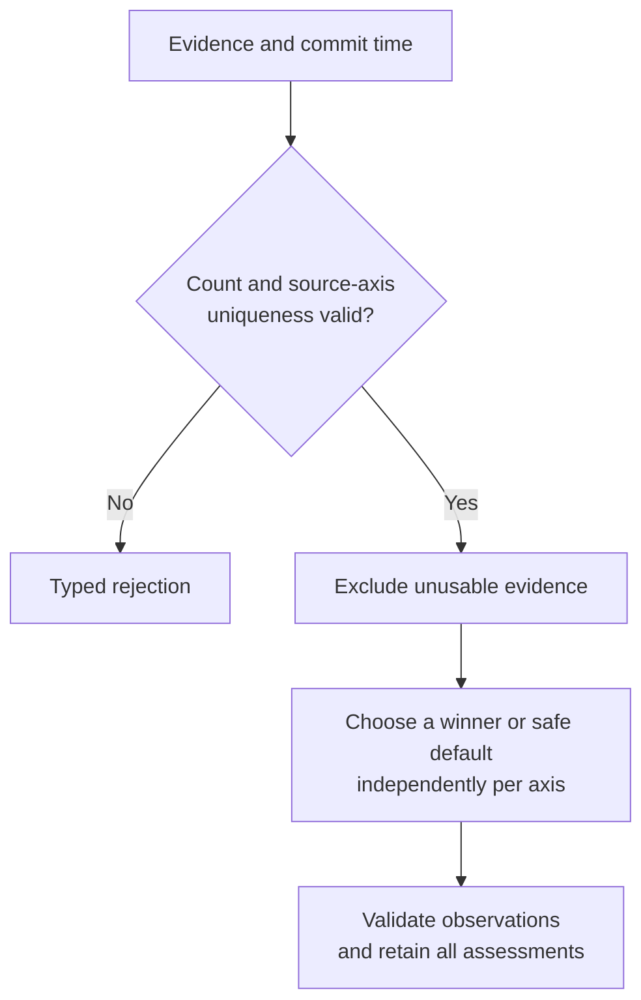
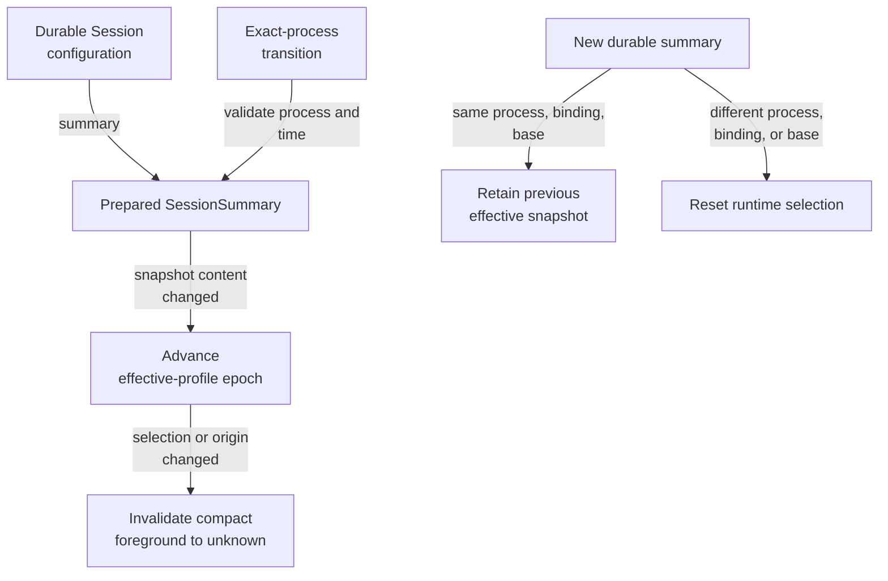

# Explain foreground and health without inventing completion

Use this guide to investigate why a session appears active, ready for input,
constrained, or unhealthy. It covers the internal evidence model and detection
profile schema **3** in this checkout. It does not define caller-owned task
completion. [Lifecycle](session-lifecycle.md) reports supervised process state;
[WorkContext](work-and-queries.md) contains declarations from identified owners.
[Back to the code map](model.md).

## Foreground contains three independent axes

[foreground.rs](../../src/foreground.rs) owns the committed values, and
[foreground_decision.rs](../../src/foreground_decision.rs) selects evidence.

**Execution.** `Active`, `Quiescent`, `Unknown`. Affirmative evidence cannot commit `Unknown`; silence does not by itself establish successful work.

**Interaction.** `None`, `Available`, `Requested`. Available/requested require a modality: text, options, secret, or navigation. None carries neither modality nor semantics. Requested additionally requires affirmative evidence and a profile-owned semantic ID.

**Runtime constraint.** `Clear` or `Present`. Present requires a semantic ID; clear omits it. This axis does not automatically change interaction or execution.

### Provenance and actionability

`ObservationBasis` carries confidence, source, disposition, evidence time, and
commit time. Confidence uses integer basis points from 0 through 10,000 so
comparison and persistence are deterministic. Affirmative and inferred bases
need a source and evidence time no later than commit. An unavailable basis has
no source or evidence time and zero confidence. `ObservationSemanticId` is at
most 128 bytes with at least two dot-separated lowercase ASCII segments; each
starts with a letter and continues with letters, digits, `_`, or `-`. The
domain validates shape, not the meaning of `tool.permission` or `tool.rate_limit`.

`InteractionObservation::is_actionable` checks requested state and affirmative
disposition. It does **not** check a clock, authorization, profile freshness, or
whether a response is correct. Direct observation constructors enforce
provenance consistency but have no maximum evidence-age argument. Freshness is
enforced during policy selection, and consumers must still consider observation
age and exact process/profile context before acting.

## Selection is deterministic within each axis

The flow shows how a bounded collection becomes a decision with retained rationale.

*A strong execution claim does not displace interaction or constraint evidence.*
The policy requires nonzero item and age limits. One source can report on
multiple axes, but only once per axis. Assessment first excludes unavailable,
then future, then evidence older than the maximum age, then below the confidence
floor. Exact age and confidence thresholds are accepted.

Eligible items are ranked within each axis in this order:

1. Priority: cooperative, foreground process, terminal, terminal history,
   process, then inference.
2. Higher confidence within the same priority.
3. Lexicographically smaller source identity for a remaining tie.

Time only gates eligibility. Affirmative disposition has no extra rank over
inferred disposition. Eligible
losers are `LowerPrecedence`. Results retain all items in input order with
selected/ignored assessments; selection is independent of input order.

No usable evidence yields unknown execution, absent interaction, and clear
constraint, with unavailable bases at commit time. The combination constructor
allows different axis commit times. `committed_at()` returns the newest axis
commit, while `evidence_age(now)` returns the oldest selected evidence's age
(the maximum age), or `None`. Future/reversed time saturates age to zero.

### Reconstruct rationale and commit changes

`ForegroundDecision::rehydrate` accepts evidence-free explicit observations.
With detail present it validates unique source-axis pairs, at most one selection
per axis, exact support for each selected observation, and safe defaults for
unselected axes. It does not rerun a current selection policy or impose the
policy's evidence-count/freshness bounds; decoding/admission must enforce their
own bounds. Supplying malformed affirmative `Unknown` execution can pass the
evidence constructor but is rejected if selected into an observation.

Session updates persist compact and detailed state together. A change only to
ignored evidence can produce `ForegroundEvidenceChanged`; changed timing or
basis in the compact observation produces `ForegroundChanged` even when the
coarse execution label stays the same. See [observation contract tests](../../tests/observation_contract.rs)
for axis independence, precedence, stale/future/weak evidence, rehydration, and
detail-only events.

## Profiles describe evidence and input mechanics

[profile.rs](../../src/profile.rs) owns validated profile vocabulary. It does not
load profile files, compile regexes, inspect environment values, extract screen
regions, or choose the active profile from the catalog. The
[application profile service](../../../undercurrent-application/src/profiles.rs)
uses pattern and catalog ports; [daemon profile YAML](../../../undercurrent-daemon/src/profile_yaml.rs)
owns file decoding. The numeric schema constant here is unrelated to Cargo
package version or the [public product contract descriptor](../../../undercurrent-protocol/src/contract.rs).

### Match complete command signatures

Automatic command matching uses alternative **complete signatures**. Within a
signature, any binary pattern may match and any argument pattern may match; if
both dimensions exist, both must match. Required environment names are all-of.
Different signatures cannot donate dimensions to each other. Flattened
`binary()` and `arguments()` views are for presentation, not complete matching.
An empty signature set supports explicit-only profiles; environment names alone
cannot make a signature automatically selectable.

Binary patterns match executable basenames using `*` for zero or more Unicode
scalar values and `?` for exactly one, with dynamic-programming work proportional
to pattern length times input length. Binary patterns reject path separators.
Targets extract basenames using either slash convention and reject an empty
basename. The default `Literal` convention is case-sensitive. Adapter-selected
`Windows` semantics ignore ASCII case for binary and environment names and also
try removing one `.exe`, `.com`, `.cmd`, or `.bat` suffix. Argument matching is
unchanged and is performed against space-joined arguments by the application.
Environment predicates inspect supplied names only; the domain never reads
the current environment. Argument and target diagnostics redact argument values.

The application ignores disabled and unselectable profiles, discards fallback
matches when a primary match exists, and returns ambiguity when multiple
candidates remain. Incomplete environment evidence can keep an apparent match
inconclusive. `matching_fallback` does not affect explicit selection. See
[profile contract tests](../../tests/profile_contract.rs) and
[application detection tests](../../../undercurrent-application/tests/detection_profiles.rs).

### Validate rules and input policy

| Profile rule or input setting | Contract and rationale |
| --- | --- |
| Limits | Every configured limit is nonzero. Final profile construction revalidates nested patterns, rule counts, traits, and pacing under its limits, even if constructed with looser limits earlier. |
| Pattern expressions | Nonempty, bounded, NUL-free text. Syntax compilation and runtime cost limits belong to the pattern adapter. |
| Foreground rules | Require positive patterns or structural traits; excludes alone cannot establish evidence. Include patterns are alternatives, excludes veto, and traits are all-of predicates. The rule retains a typed claim and confidence. |
| Traits and sample views | Prefix/suffix, contains/excludes, and cursor-at-end tests operate on caller-extracted text. Sample text and last line are each bounded separately; the constructor does not prove that the view was extracted from the claimed region. |
| Regions | Bottom rows with an anchor (cursor, near cursor, last, any), or above/below cursor. Enum variants prevent conflicting row modes; row counts and optional column clips are nonzero. Actual extraction is outside domain. |
| Archetypes | Unclassified treats silence conservatively; line-oriented marks kernel foreground meaningful; animated-agent and server treat CPU as ambient. The booleans guide outer evidence adapters. |
| Input delivery | Immediate raw text by default, optionally paste encoding for automatic text and nonzero, whole-millisecond bounded pacing before trailing submit. No sleep or write occurs here. |
| Baseline interaction | Only `Available` is permitted. A baseline cannot assert `Requested`; outer evaluation preserves affirmative matching rules over baseline inference. |
| Background rules | Separate process-group/agent presence or count patterns, exclusions, optional name patterns/label/region. They feed WorkContext evidence and do not override foreground. |
| Screen behavior hints | Alternate-screen normality, silent-until-input, and top/bottom motion exclusions are declarations interpreted by adapters. |

## Base profile and effective profile have different lifetimes

`SessionConfiguration` stores a base profile, its `Explicit` or `LaunchCommand`
origin, and `Fixed` or `ForegroundAdaptive` binding. Initial construction marks
a present profile explicit and defaults to fixed. `select_profile_if_absent`
never overwrites a present profile. Restoration requires origin presence to
agree exactly with base-profile presence.

These are domain-constructor defaults, also used when the protocol omits the
binding mode. The CLI selects foreground adaptation when no profile is supplied
and fixed binding with an explicit profile; [ADR 0002](../../../../docs/architecture/decisions/0002-cli-foreground-default.md)
owns that CLI policy. Python defaults to fixed with explicit adaptive opt-in; see its
[conversion boundary](../../../../python/docs/internals/conversion.md#create-a-session).
Do not infer one entry point's defaults from another.

**Shared policy accepted 2026-10-05:** retain `Fixed` for omitted programmatic
bindings so an upgrade does not silently change profile selection, input pacing,
or observation rules for existing callers. Foreground adaptation is explicit at
these boundaries; saved bindings are authoritative and are not migrated. This is
a current compatibility decision, not a claim about the original historical
motivation (which available history does not establish).

[effective_profile.rs](../../src/effective_profile.rs) describes process-local
selection, evidence, directory, and server-role context. The epoch belongs to a
prepared summary and starts at zero; it is not a durable session revision.

*Runtime evidence cannot silently rewrite the durable launch-selected profile.*
A fixed summary initially exposes its base selection; adaptive summaries begin
without an effective profile. `effective_profile_for(process)` returns `None`
for a mismatched process, otherwise synthesizes epoch zero when needed: fixed
base/no-match or adaptive awaiting-observation. Other unclassified reasons are
no match, ambiguity, incomplete evidence, and unavailable evidence.

### Apply or retain an effective snapshot

`apply_effective_profile` requires the exact summary process and rejects time
earlier than an existing snapshot. Fixed bindings can accept context updates
only with base-profile origin and the same selected profile. A content change
advances the epoch (first stored snapshot is one); identical selection, origin,
directory, server role, and matching evidence return false even if the new
timestamp is later. Selection/origin changes reset compact foreground to
unknown. Context-only changes advance the epoch without that reset. It emits
no durable domain event and does not advance durable `updated_at` or revision.

`retain_effective_profile_from` preserves runtime selection only when process,
binding mode, and base profile all match. Match evidence retains profile names,
fallback flags, and opaque process-incarnation strings. Its constructor and
snapshot builders trust the caller's bounded observation; they impose no vector
or string count limits themselves. Server-role origins distinguish profile,
foreground-group listener, exact managed-root listener, and verified managed-tree
listener evidence, including combined origins. A listener claim is not a health
result or proof that the foreground group owns that listener.

[Subscription-hub tests](../../../undercurrent-application/tests/subscription_hub.rs)
exercise adaptive reindexing and retention across matching process upserts;
[observation-service tests](../../../undercurrent-application/tests/observation_services.rs)
exercise foreground selection and incomplete evidence without durable base-profile
mutation.

## Cooperative shell evidence

[cooperative.rs](../../src/cooperative.rs) owns OSC number `9091`, prefix
`ESC ] 9091 ;`, environment variable `UC_SESSION`, and `ready`/`running` states.
Ready claims quiescent execution and available text input. Running claims active
execution and no interaction modality. Neither claims requested input or a work
result. This is a private, payload-free shell/PTY contract; parsers and runtime
injection live outside domain. Its inline registry test checks the mappings.

## Health is an independent evaluation

[health.rs](../../src/health.rs) declares six rule kinds: local TCP port, HTTP
endpoint, output presence, output rejection, red-cell threshold, and command.
Ports and thresholds must be nonzero. Text is bounded, nonempty, and NUL-free;
HTTP syntax/authorization and regex compilation remain adapter work. Rule sets
preserve the first declaration order after deduplication; admission counts
supplied rules before deduplication and also caps at `u16::MAX`, preventing
duplicate-heavy inputs from bypassing limits.

`HealthCheckResult` retains a zero-based rule index, pass/fail, latency, and
optional bounded detail. Detail is redacted in `Debug`; bounds do not make it
safe to publish. [HealthObservation](../../src/observation.rs) requires unique,
configured indexes and sorts them for stable persistence. Aggregation then follows these rules:

| Configured checks and results | Summary |
| --- | --- |
| Zero checks, zero results | `NoCheck`, without an observation timestamp |
| Any explicit failure, including a partial set | `Unhealthy` |
| Complete all-pass set | `Healthy` |
| Partial all-pass set, including no results for configured checks | `Unknown` |

Summary-only health remains valid without detail. Rehydrating nonempty detail
requires a summary timestamp and recomputes count/status against that summary.
The session additionally checks configured rule count and commit time. Health
updates do not stop a process, schedule restart, clear foreground, or complete
work. Independent scheduling belongs to
[application observation](../../../undercurrent-application/src/observation.rs).

When investigating an unexpected state, inspect the exact process/profile
epoch, selected and ignored evidence, confidence/age gates, then adapter data.
For health, inspect missing indexes and explicit failures before changing
aggregation. Continue with [extension and verification guidance](../development/contributing.md).

[Crate documentation](../README.md)
