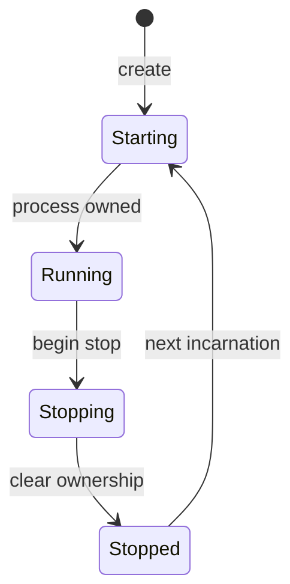

# Follow a session from creation through recovery

Use this explanation to change the session aggregate without confusing a
process incarnation with the durable session that survives it. The contract is
owned by [session.rs](../../src/session.rs), [lifecycle.rs](../../src/lifecycle.rs), and
[restart.rs](../../src/restart.rs). These are internal Rust values; an actual start,
stop, or restart also needs the application and runtime boundaries described
below. [Back to the code map](model.md).

## Session identity outlives process ownership

`Session::create` produces `Starting`, no process owner, revision one, and a
`SessionCreated` change. It does not spawn or persist. Foreground starts unknown,
WorkContext starts empty at revision zero, and restart status starts `Idle`.
Health starts `Unknown` with the configured rule count, or `NoCheck` with no
rules. The caller supplies a nonzero WorkContext limit and the creation time.

`ProcessIdentity` pairs an opaque incarnation ID with the adapter-observed start
time. The ID must identify an incarnation rather than a recyclable PID; the
domain validates its text, not its OS provenance. `record_process_ownership`
accepts ownership only while `Starting`. Repeating the exact identity is a
no-op; replacing it implicitly is rejected. Start time may precede its ownership
commit time, but cannot follow it. Recording ownership advances the session
revision without advancing the lifecycle revision.

The diagram follows an owned process through a normal stop and another start.
The table below includes the exit, failure, and interrupted-start branches.

*Ownership is recorded during Starting and cleared on terminal entry. Starting
again preserves the session identity.* `LifecycleState::can_transition_to`
permits these changed destinations; the aggregate adds the ownership guard:

| Current state | Allowed changed destinations |
| --- | --- |
| Starting | Running, Stopping, Stopped, Exited(code), Failed |
| Running | Stopping, Exited(code), Failed |
| Stopping | Stopped, Exited(code), Failed |
| Stopped | Starting |
| Exited(code) | Starting |
| Failed | Starting, Stopped |

Entering Running or Stopping requires a recorded process owner. The transition
table does not authorize an adapter effect or check a restart deadline.

*`Stopped`, `Exited(code)`, and `Failed` are terminal for the current process,
not final deletion of the session. Each can start a new incarnation.* Entering
a terminal state clears process ownership. Entering `Starting` clears the
restart disposition to `Idle` and resets the previous stop's no-escalation flag.
It does not reset the restart counter. `Running` cannot jump directly to
`Stopped`; the stop path passes through `Stopping`. Exact repeats are no-ops,
including the same exit code; changing `Exited(1)` to `Exited(2)` is rejected.

## Creation crosses several commit boundaries

For the full preparation, spawn, ownership, binding, exit-arming, and Running
sequence, use the [application activation walkthrough](../../../undercurrent-application/docs/internals/sessions/lifecycle.md#creation-has-several-commit-points).
It owns the commit-order diagram, mutation lease and optimistic-revision rules,
outbox/projection ordering, and exact-process compensation failures.

The domain contribution is deliberately smaller: `Session::create` returns the
Starting value, `record_process_ownership` attaches the exact incarnation, and
`transition_lifecycle` permits Running only after ownership exists. Each returns
a separate change for its caller to persist. No domain method makes a process
effect and a database commit atomic.

A lost client response can follow successful activation. The
[dispatched-start recovery explanation](../../../undercurrent-application/docs/internals/sessions/lifecycle.md#dispatched-creation-and-lost-responses)
covers ambiguous final settlement, retaining the live process, and cleanup
under a confirmed superseding fence. Use [attempt recovery](attempts-and-recovery.md#diagnose-recovery-without-replaying-an-unknown-effect)
before deciding whether another mutation is allowed.

## Changes, events, and projections

A real aggregate mutation increments `revision` using checked arithmetic and
requires a commit time at least `updated_at`. Equal times are allowed. Exact
no-ops often return before the clock check; they are not proof that an input
timestamp is current. Only lifecycle transitions advance `lifecycle_revision`.
Neither value is the catalog revision or an effective-profile epoch.

| Mutation | What changes and why |
| --- | --- |
| Rename | Keeps stable ID; repository enforces cross-session name uniqueness. |
| Configuration replacement | Replaces the complete configuration in one in-memory change. A changed health-rule set resets summary and detail to initial health; it does not run probes. |
| Foreground or health update | Keeps lifecycle and WorkContext independent. Detailed updates use evidence-specific events when the full compact observation/summary is equal. Equal coarse status alone is insufficient: timing and basis are part of equality. |
| Summary-only observation update | A changed compact value replaces old detail with an empty rationale/result set so obsolete detail does not appear current. An identical compact value is a no-op. |
| Terminal resize | Revises saved launch dimensions so a later restart uses them. Actual PTY resize is an outer effect. |
| WorkContext upsert, remove, expiry | Advances both affected context and session revisions. Items cannot have update times later than the session commit. |
| Restoration directory | Retains a changed, present directory only when labels contain `uc.group.slot`; uses `ForegroundEvidenceChanged`. Missing observations do not clear it. |
| Removal preparation | Terminal lifecycle only; returns the next revision's `SessionRemoved` event without mutating the aggregate. Repository deletion owns the actual removal. |

[DomainEventKind](../../src/event.rs) is the authoritative registry of 16 event
kinds and stable names. Only creation, configuration, lifecycle, and process
ownership changes invalidate the observation plan immediately. Results and
unrelated changes preserve independently scheduled foreground/health cadences.
Adding an event requires reviewing that decision, not just adding a name.

`summary()` creates an owned compact projection: identities, lifecycle,
foreground, health, work counts, labels, profiles, process/start time, restart
state, and revisions. It omits complete work items, metadata, and launch
configuration. Labels still exist internally even when a public compact DTO
omits them. Effective profile state is rebuildable and is explained in
[the observation guide](observations-and-profiles.md#base-profile-and-effective-profile-have-different-lifetimes).

## Restart intent survives the process

`observe_process_outcome` requires terminal lifecycle and no owner. Its caller
supplies the outcome and uptime; the domain does not derive these from process
exit or verify the outcome matches a recorded exit code. Capture uptime before
clearing ownership: `uptime(now)` returns a value only while `Running` and
saturates reversed timestamps to zero.

| Policy or guard | Deterministic decision |
| --- | --- |
| `Never` | `PolicyDisabled`; preserves the prior attempt counter. |
| `OnFailure` with exit code zero | `SuccessfulExit`; resets the counter to zero. |
| Other eligible outcome reaching nonzero `min_uptime` | Resets the consecutive counter before considering this outcome. Zero disables this reset. |
| Counter at `max_restarts` | `Exhausted`; zero maximum allows no automatic restart. |
| Eligible outcome with capacity | Increments the counter and returns `RestartAfter { attempt, delay }`. |

Backoff uses a multiplier of at least 10,000 basis points (1.0x), with maximum
delay at least the initial delay. Exponential calculation uses saturating,
capped arithmetic and bounded exponentiation work, with millisecond rounding
on the scaling path. A zero initial delay is valid. There is no jitter or timer
in this crate. `RestartStatus::Scheduled` records `not_before` by saturating
timestamp addition. Actual due-time and revision checks belong to
[scheduled restart orchestration](../../../undercurrent-application/src/commands/scheduled_restart.rs).
The lifecycle method alone permits `Starting` before `not_before`, so it is not
a scheduler gate.

The session stores counter and disposition together, including a final
non-restart reason even if the counter did not change. Re-evaluating a failed
outcome can consume another attempt; callers must avoid treating it as an
idempotent replay of an exit notification. `cancel_pending_restart` changes only
`Scheduled` to `NotScheduled(ExplicitStop)`, retaining history. Queue removal
and runtime-attempt cancellation are separate application responsibilities.

## Reconstruct only through validation

Persistence adapters decode leaf values, reconstruct detailed observations and
WorkContext, then call `Session::rehydrate(SessionState)`. It checks:

| Snapshot part | Required agreement |
| --- | --- |
| Revisions | Session and lifecycle revisions are nonzero; lifecycle and WorkContext revisions cannot exceed the session revision. |
| Foreground | Compact observation equals detailed decision; its commit time cannot follow the session commit. |
| Health | Compact summary equals detailed observation; count matches configured rules and observation time cannot follow the session commit. |
| Work and process times | Work-item updates and process start time cannot follow the session commit. |
| Process ownership | Running and Stopping require an owner; terminal states forbid one. Starting may have an owner during activation. |
| Restart disposition | Active lifecycle requires Idle. Scheduled and exhausted counts match the tracker in terminal lifecycle; a scheduled attempt is nonzero. Final NotScheduled dispositions also require terminal lifecycle. |

These checks reject contradictory snapshots. They do not prove every historical
transition occurred or that adapter evidence is truthful. The
[SQLite aggregate codec](../../../undercurrent-store-sqlite/src/sqlite/codec/aggregate.rs)
owns encoding/version compatibility. Recovery must observe the exact process
incarnation rather than inferring OS truth from a valid persisted aggregate.

The [domain contract suite](../../tests/domain_contract.rs) covers lifecycle
guards, revision separation, complete round trips, cross-field corruption,
stale updates, restart bounds and cancellation, group-directory retention, and
removal preparation. Continue with [attempt and process recovery](attempts-and-recovery.md)
or [the in-memory example](../development/contributing.md#run-the-model-without-a-daemon).

[Crate documentation](../README.md)
