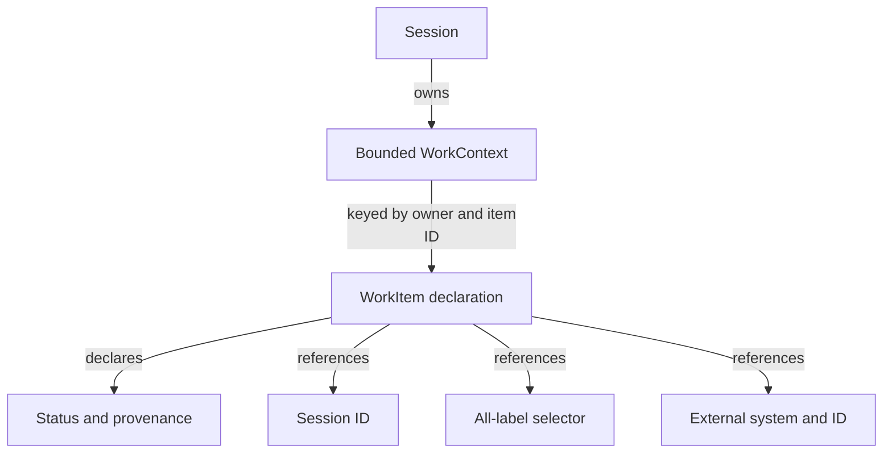

# Keep declared work separate from prepared session queries

Use this explanation when adding work declarations, relationship indexes, or
session filters. [work_context.rs](../../src/work_context.rs) owns declarations;
[query.rs](../../src/query.rs) owns membership specifications; [session.rs](../../src/session.rs)
builds the prepared summary. These internal types do not determine whether an
external orchestrator's task succeeded. [Back to the code map](model.md).

## Declarations are scoped by owner

A `WorkItemKey` is `(WorkOwner, WorkItemId)`. Equal item IDs from different
owners are distinct items. The item records a relationship (`DependsOn`,
`Delegated`, `Spawned`, or `Related`), title, optional description, declared
status, targets, provenance, private metadata, and creation/update/expiry times.
The relation describes an owner's assertion; it does not implement a scheduler
or dependency-resolution engine.

The relationship view shows the boundaries that prevent accidental joins.

*Targets are references, not completion authorities.* Ending a target process,
changing its labels, or removing its session does not resolve the declaration.
An owner must update the exact key. `direct_session_targets()` returns a unique
set of directly referenced session IDs for outer reverse indexes; it neither
resolves label/external targets nor restricts itself to active items.

Item constructors enforce the following boundaries:

- **Title:** Nonempty, no control characters, at most 256 bytes.
- **Description:** Optional, may be empty, no control characters, at most 2,048 bytes.
- **Provenance:** Nonempty, no control characters, at most 512 bytes. Opaque explanatory text, not a verified URI or authority grant.
- **Targets:** At most 64 distinct values after ordered-set deduplication. Label targets must contain at least one label. No target lookup occurs.
- **Times:** Update and optional expiry cannot precede creation. Expiry may precede the latest update; it does not expire an item until the caller runs expiry processing.

Use `new_with_provenance` for explicit external declarations. The older `new`
constructor derives provenance from the owner. Text/provenance can appear in
debug output; only metadata has the private count-only representation. Content
must therefore be suitable for those diagnostic surfaces.

## Active status, expiry, and revision behavior

Running, waiting, blocked, and **delivery failed** are active statuses. Completed,
failed, cancelled, and expired are distinct non-active outcomes. Delivery failure
remains active so an owner can expose a delivery retry; it must not be collapsed
into completed work.

`WorkItem::update_status` rejects backward update time and returns false only
when both status and timestamp match. It does not enforce a terminal-state
transition graph; an owner can replace a status with any other status at an
allowed time. Replacement/upsert is similarly a declaration update, not a
verified workflow transition.

`WorkContext` is a deterministic ordered map with a nonzero maximum item count
and its own checked revision, initially zero. Equal upserts are no-ops. Changed
existing items must not move their update time backward; adding a key at capacity
fails, while replacement can proceed. A missing remove returns
`WorkItemNotFound`. Changed upserts and removals each advance the context revision.

Expiry marks an active item `Expired` only if its expiry is at or before `now`
and `now` is at or after its current update time. It sets update time to `now`,
retains the item, and returns changed keys. One expiry batch advances revision
once, regardless of item count; an empty batch changes nothing. There is no
background timer in the domain. The session wrapper additionally validates
session commit time and advances the aggregate revision without rewriting
foreground.

`WorkContext::rehydrate` rejects zero limits, excess items, duplicate keys,
and a revision lower than the number of retained items. A larger revision is
valid because updates, expiry, and removal consume revisions too. The session
adds its own [cross-field reconstruction checks](session-lifecycle.md#reconstruct-only-through-validation).

## Summaries provide visibility, not an owner result

`WorkSummary` counts items, total explicit targets, active items, and active
targets. A targetless active item counts as one active target unit so it stays
visible. Target counts are summed per item; they are not a global unique target
count. It also includes the context revision and one priority-selected status:

`DeliveryFailed` → `Blocked` → `Waiting` → `Running` → `Failed` → `Cancelled`
→ `Expired` → `Completed`.

The first status present wins; an empty context has no aggregate status. This is
a visibility priority, not a state transition order. A consumer deciding its
own work's outcome must inspect detailed items and match the exact owner and
item ID. Session lifecycle, foreground readiness, and aggregate work counts
cannot replace that check.

The [domain contract tests](../../tests/domain_contract.rs) cover owner collisions,
distinct outcomes, target independence, targetless visibility, priority,
idempotency, stale replacement, batch expiry, provenance, and preservation of
foreground during work updates.

## Query membership without detail hydration

`SessionFilter::matches` reads only a prepared `SessionSummary`. All configured
dimensions are ANDed; omitted dimensions are unrestricted.

| Dimension | Match rule |
| --- | --- |
| IDs, lifecycle kinds, execution, interaction, health | Any member of the configured set. An empty set is unrestricted. |
| Exact name and name substring | Both must match when both are supplied. Substring matching is case-sensitive; the substring is nonempty, control-free, and at most 128 bytes. |
| Labels | Every required key/value pair must match exactly. |
| Profile | Compares `summary.profile()`, which may be runtime-selected for adaptive binding. It need not be the durable base profile. |
| `has_active_work` | Compares active item count with zero. DeliveryFailed qualifies; this does not inspect one owner or resolve targets. |

For example, a filter for `Running` lifecycle and `has_active_work = true`
includes a Running session whose only work item is DeliveryFailed. Requiring a
label the same session lacks excludes it, because dimensions are ANDed.

`SessionQuery` combines that predicate with sort, projection, bounded page size,
and an opt-in exact total. Sort fields are name, lifecycle, execution,
interaction, health, update time, and restart count; direction defaults to
ascending. The specification calls for a session-ID tie-breaker, but this module
does not execute sorting or create cursors. Compact, with-labels, and operational
projections describe outward payload shape, not separate aggregate state.
`PageSize` rejects zero requested/configured size and requests above the configured
maximum.

[Application read-model code](../../../undercurrent-application/src/read_model.rs)
owns indexing and prepared-state updates;
[query services](../../../undercurrent-application/src/queries.rs) own pagination
and cursor consistency. Domain owns no subscription, snapshot lifetime, catalog
lock, reconnect procedure, or stream-resumption protocol. When membership is
unexpected, first compare the prepared summary and exact filter, then inspect
projection refresh and catalog revisions. Continue with
[maintainer verification](../development/contributing.md#choose-regression-evidence-for-the-change).

[Crate documentation](../README.md)
