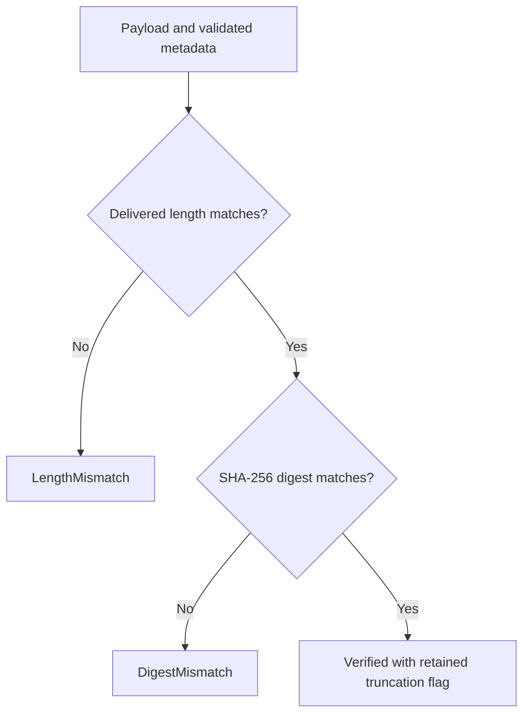

# Validate values at I/O boundaries

Use this reference to identify what a domain value guarantees before a caller
persists it or passes it to an adapter. The sources linked in each section own
the exact constraints. Limits are byte counts unless specified otherwise. These
are internal Rust contracts; platform filesystem, process, and transport checks
are performed outside the crate. [Back to the code map](../internals/model.md).

Jump to [identity and time](#names-time-and-revisions),
[launch preparation](#launch-values-and-preparation),
[environment privacy](#ordinary-environment-and-secret-references),
[labels and diagnostics](#labels-metadata-and-diagnostics),
[terminal input](#terminal-input-and-resize),
[output verification](#output-integrity-does-not-prove-complete-history), or
[typed failures](#typed-rejections-and-outer-failures).

## Names, time, and revisions

### [Identity wrappers](../../src/identity.rs)

Session, process-incarnation, delivery, work-item, work-owner, evidence-source, and profile identifiers are nonempty, at most 256 bytes, and contain no whitespace or control characters. Shape validation does not establish uniqueness or ownership.

### `SessionName`

Nonempty, at most 128 bytes, no control characters, surrounding whitespace, slash/backslash, literal `.`, or leading `..`. Internal spaces are allowed. This is a selector; domain validation is not a complete platform filename check.

### [TimestampMillis](../../src/time.rs)

Signed Unix milliseconds, including pre-epoch values. No clock reads.
`saturating_add` discards sub-milliseconds, adds the complete duration in a wider
integer representation, then saturates the final timestamp at `i64::MAX`.
Negative starting timestamps therefore offset even durations larger than the
signed timestamp range without losing valid range to an intermediate clamp.
Elapsed-time subtraction uses saturating `i64` arithmetic, then returns zero for
reversed/equal time; very wide differences cap at `i64::MAX` milliseconds.

### [Revision](../../src/revision.rs)

`u64`, initial zero, checked increment. Reconstructed numeric values are unrestricted here; the aggregate checks valid nonzero session revisions.

### `CatalogRevision`

Separate wrapper for catalog/query membership, with checked increment. It is not interchangeable with a session revision or profile epoch.

Repeated aggregate no-ops can avoid revision/time validation. A successful
no-op does not refresh a timestamp. See [session mutation rules](../internals/session-lifecycle.md#changes-events-and-projections).

## Launch values and preparation

[execution.rs](../../src/execution.rs) owns `ExecutionLimits`, `CommandSpec`,
environment declarations, paths, launch specification, execution policy, and
session configuration. Every `ExecutionLimits` field must be nonzero. Limits
cover argument count, program/argument bytes, environment entries/bytes,
path bytes, health-rule count, and health-rule text bytes; they are not OS
resource enforcement.

### Commands and executable pins

`CommandSpec::new` checks the command under the supplied `ExecutionLimits`:

| Part | Rule |
| --- | --- |
| Program | Nonempty; NUL is rejected. |
| Arguments | Empty arguments are legal; NUL is rejected. No shell parsing occurs here. |
| Byte total | Sum program and argument bytes without separators, using checked arithmetic. |
| Debug output | Counts and pin flags, without command text. |

Commands default to `LaunchMode::Sealed`. `Native` records the installation path
for adapter revalidation on each launch; sealed execution is intended to reuse
accepted immutable bytes.

`pin_executable` records a resolved program, content
digest, original reference, and receipt digest, rejecting disagreement with an
optional expected content pin. The identity-aware variant also records an opaque
filesystem-object digest. This method checks supplied values; it does not open
the executable or prove that the receipt describes those bytes.

`executable_is_pinned()` means a resolution receipt exists, including for native
mode; it is not proof that future native bytes are immutable.

### Paths and environment identity

`PathReference` checks only nonempty, NUL-free text and a positive byte bound.
It does not normalize, resolve symlinks, constrain traversal, or prove existence.

`ExecutionEnvironmentBinding` records a digest and root reference, with optional
root identity. Working-directory and executable identities are adapter-owned
proof inputs; missing identities on legacy records are insufficient proof for
the spawning adapter.

Changing the environment boundary or resolved paths
clears the prior working-directory identity. Launch preparation must establish
the replacement identity rather than reusing stale evidence.

### Launch configuration and execution policy

`LaunchSpec` combines validated pieces. Construction and builders do not read a
file, resolve a secret, launch a process, or start output capture.

| Concern | Rule |
| --- | --- |
| Capture mode | Defaults to terminal capture. Opaque capture retains bytes without requesting terminal interpretation. |
| Prepared environment replacement | Clears the environment-file reference and rechecks compatibility with secret names. |

The aggregate configuration constructor has no limits argument: construct each
leaf under the authoritative limits before combining it. It does not repeat
every nested bound check under a new configuration budget.

`StopPolicy` requires a nonzero force-after duration and retains portable signal
intent plus a no-escalation flag. Interrupt, terminate, hangup, quit, user1, and
user2 are vocabulary; OS support belongs to the adapter.

`ExecutionPolicy`
combines restart, stop, detection-enabled, and auto-remove declarations. Timers,
escalation, and deletion are application behavior, not side effects of these values.

## Ordinary environment and secret references

`EnvironmentVariables` enforces these independent rules:

| Concern | Rule |
| --- | --- |
| Key order | Deterministic; the last value for a duplicate key wins. |
| Keys | Nonempty, NUL-free, and cannot contain `=`. |
| Values | May be empty; cannot contain NUL. |
| Entry limit | Unique entry count is checked during construction. |
| Byte limit | Final key/value totals are checked with overflow protection. |

[secret.rs](../../src/secret.rs) classifies raw credentials conservatively. It
normalizes names to lowercase ASCII alphanumerics and checks credential markers
such as token, password, secret, and private key. Value checks recognize common
bearer/basic prefixes, token prefixes, and private-key PEM markers. Classified
raw entries are rejected; use opaque secret references. This heuristic is not a
proof that an arbitrary accepted string is non-sensitive.

`SecretReference` checks only nonempty, control-free text up to 512 bytes. It
does not resolve, authenticate, or detect whether someone put a secret into the
handle. The caller must provide a genuine non-secret reference.

`SecretEnvironmentVariables` applies these additional rules:

| Concern | Rule |
| --- | --- |
| Names | Must not overlap with ordinary variable names. Last duplicate name wins. |
| Entry limit | Combined ordinary and secret entry count must fit the supplied budget, including when the secret map is empty. |
| Byte limit | Combined ordinary bytes and secret metadata must fit the budget. Secret metadata counts names and handles, not resolved secret material. |
| Replacement | Attaching or replacing environment declarations rechecks compatibility. |

Compatibility validation rechecks ordinary entry count even with no secret
bindings. Both `LaunchSpec::with_secret_environment` and
`LaunchSpec::with_resolved_environment` reject values built under looser limits
when they exceed the supplied combined budget. Byte bounds are checked separately.

`names()` is the projection for session detail. `iter()` deliberately exposes
values or handles to authorized adapters; authorization is not enforced by the
getter. Debug output contains counts/lengths, not values or handles. See
[environment privacy tests](../../tests/environment_privacy.rs),
[application secret ports](../../../undercurrent-application/src/secrets.rs), and
[launch preparation](../../../undercurrent-application/src/commands/start.rs).

## Labels, metadata, and diagnostics

[attributes.rs](../../src/attributes.rs) uses ordered maps with last-value-wins
duplicates. Both reject control characters in keys and values.

| Rule | Labels | Metadata |
| --- | --- | --- |
| Entry count | At most 64 | At most 64 |
| Keys | Nonempty, at most 64 bytes | Nonempty, at most 64 bytes |
| Values | May be empty, at most 256 bytes | May be empty, at most 4,096 bytes |
| Debug output | Labels are visible | Entry count only |

Labels implement `contains_all` for exact all-of selection.

Redaction is type-specific, not an automatic property of all domain values.
Command text, environment, paths, terminal input, health detail, metadata,
policy URIs, and agent canonical bytes have deliberate diagnostic boundaries.
Identifiers, labels, work titles/provenance, and profile pattern declarations
can appear in debug output. Keep those fields free of private payloads. Avoid
logging entire aggregates merely because some nested types redact themselves.
The [domain contract tests](../../tests/domain_contract.rs) use canaries to check
specific protections, not an arbitrary-content secrecy guarantee.

## Terminal input and resize

[terminal.rs](../../src/terminal.rs) owns terminal dimensions and input vocabulary.

| Value | Rule |
| --- | --- |
| Size | Dimensions and maxima are nonzero; columns/rows fit supplied bounds. |
| Function key | F1–F12. |
| Control chord | ASCII letters, normalized to lowercase. |
| Modified key | Nonrecursive base key plus shift/control/alt. |
| Mouse position | One-based, validated against the supplied terminal size. |
| Mouse action | Buttons include scroll up/down; kinds include press/release/move. |

`InputSequence` requires a nonempty item vector and positive item/byte limits.
It accepts automatic text, literal text, named keys, raw bytes, paste, and mouse
items. The sequence does not reject an empty text item or inspect raw bytes.

Automatic text selects profile encoding; literal text and explicit paste
preserve their requested mechanics. Admission uses the following conservative
byte estimates:

| Input item | Admitted bytes |
| --- | --- |
| Literal text or raw bytes | Payload length |
| Paste or automatic text | Payload length + 12 |
| Key | 16 |
| Mouse event | 18 |

`payload_bytes()` sums these estimates. Actual encoding and delivery belong to
the adapter.

For live delivery and resize, follow the
[application terminal-I/O guide](../../../undercurrent-application/docs/internals/sessions/terminal-io.md).
It owns the mutation lease, Running/exact-process checks, current mouse-size
revalidation, effective-profile input policy, delivery-ID replay and conflict
rules, delivery settlement before foreground commit, and resize compensation.
Its typed errors retain confirmed or indeterminate delivery evidence. The
sequence value itself neither locks a PTY nor guarantees OS write atomicity;
a receipt establishes delivery, without establishing command completion.

## Output integrity does not prove complete history

[output.rs](../../src/output.rs) owns `OutputChunkIntegrity`: the digest and
lengths for one delivered chunk or page. It owns no retention or subscriptions.

| Operation | Validation and result |
| --- | --- |
| `for_payload(bytes, source_bytes)` | Requires source length ≥ delivered length; hashes the delivered bytes and derives the truncation flag. |
| `from_metadata(digest, delivered_bytes, source_bytes, truncated)` | Requires the same length ordering and `truncated == (delivered < source)`. Without bytes, it cannot verify the digest. |
| `verify(bytes)` | Checks delivered length first, then SHA-256 digest. Success retains the metadata's truncation flag. |

This decision flow shows what verification can establish from a supplied payload.

*Verification covers the delivered payload. The truncation flag records whether
the source was longer; verification cannot recover omitted bytes.* For example,
metadata built from `abc` with source length 9 verifies `abc` as truncated,
rejects `ab` by length, and rejects `abd` by digest. The maintained
[model walkthrough](../development/contributing.md#run-the-model-without-a-daemon)
includes this success case; [integrity tests](../../tests/refactoring_contract.rs)
cover tampering and truncation.

For finite replay, the [application output store](../../../undercurrent-application/src/terminal_output.rs)
uses `to - from` as delivered length and `next_offset - from` as source length.
A verified truncated page can have another retained page available. A retention
gap is a separate outcome and has no integrity metadata. Internal terminal-stream
slices intentionally omit retained-chunk digests, so finite-replay metadata
cannot be assumed on every stream frame.

Use the [terminal retention and recovery guide](../../../undercurrent-application/docs/internals/sessions/terminal-io.md#byte-offsets-retention-and-memory-ownership)
for offsets, ordered slices, `has_more`, limits, locks, eviction, subscriptions,
and the choice between resuming at an available offset and replacing a terminal
screen. Reconnection cannot recover evicted bytes. The
[runtime screen store](../../../undercurrent-runtime/src/terminal_screen.rs)
coordinates parsing with output checkpoints; opaque capture avoids terminal
interpretation. These outer behaviors are covered by
[application output tests](../../../undercurrent-application/tests/terminal_output.rs).
The domain owns no raw output buffer, ANSI parser, replay cursor, retention timer,
stream cancellation, or durable output store.

## Typed rejections and outer failures

[error.rs](../../src/error.rs) is the owning domain registry. Match variants or
categories, not formatted strings.

### `InvalidArgument`

Invalid value or combination. Check the named field, supplied bound, timestamp,
and cross-field rule. Correct input rather than repeating it.

### `FailedPrecondition`

Invalid lifecycle transition or lifecycle precondition. Reload authoritative
state and inspect process ownership/transition guards.

### `NotFound`

Missing WorkContext item. Reconcile the exact owner/item key; removal is not an
idempotent absence success.

### `CapacityExceeded`

Collection or byte bound exceeded. Reduce bounded input or review configured
capacity at the owning boundary.

### `InvariantViolation`

Revision exhaustion or corrupt reconstructed state. Preserve evidence,
investigate persisted state/codec, and avoid wrapping or silently repairing fields.

### Interpret failures at the owning boundary

`Conflict` is a registered category but no current `DomainError` variant maps
to it. Repository revision/name conflicts and transport failures have separate
application/protocol types. Attempt validation currently reports invalid-value
errors, including wrong fences; do not infer an outward protocol error solely
from an informal description of a “conflict.”

A domain rejection from a larger
use case can occur after an earlier external effect; inspect the outer error's
effect evidence before retrying. Continue with [attempt recovery](../internals/attempts-and-recovery.md).

[Crate documentation](../README.md)
