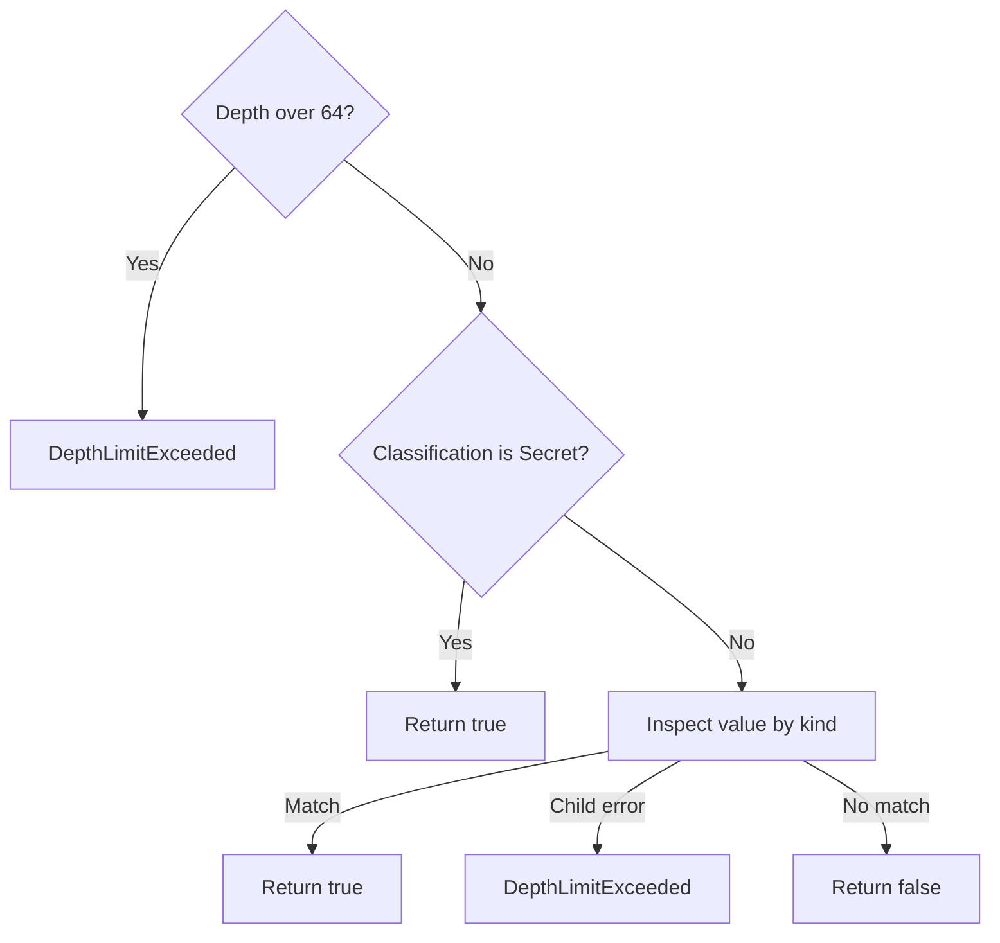

# Decide whether structured data can cross a diagnostic boundary

Foundation 0.1.0-beta supplies classification labels and a conservative detector for
already decoded JSON. This explanation is for maintainers choosing where to
reject data before serialization or persistence. It describes the implemented
policy in [privacy.rs](../../src/privacy.rs); callers still own their disclosure
rules. Return to the [crate README](../../README.md) for reader navigation.

## Use the result at a boundary

`SensitiveMaterialDetector::contains_sensitive_material` borrows a decoded
value and returns a finding. Handle all three outcomes before disclosing data:

| Result and meaning | Boundary decision |
| --- | --- |
| `Ok(true)`: A classification, field-name, or text rule matched. | Reject raw material or use the caller's secret-reference path. |
| `Ok(false)`: No implemented rule matched the traversed value. | Apply the caller's remaining disclosure rules; arbitrary secrets may still be present. |
| `Err(…)`: `DepthLimitExceeded`: inspection reached a value deeper than 64. | Reject or simplify the structure. Never turn an inspection error into `false`. |

[EnvironmentSpecDto](../../../undercurrent-protocol/src/dto.rs) demonstrates
caller enforcement: `raw_environment_contains_sensitive_material` checks credential
names and the private environment text policy. The raw-map serializer rejects
those findings; diagnostic text uses the stricter structured detector.

Persistence also requires the caller's cross-map validation. The shared
[environment contract](../../../../docs/reference/protocol/encoding.md#identity-environment-and-privacy)
explains `validate_for_persistence`, name overlap with secret references, and
why construction, deserialization, or raw-map serialization alone is insufficient.

This keeps responsibility explicit: Foundation returns a finding, protocol
enforces rejection, and the authorized runtime adapter resolves secret
references. Foundation neither retrieves secrets nor rewrites raw variables
into references. If validation fails, use the owning environment contract to
replace raw credentials with references, or reduce unsafe diagnostic content.
Do not log the rejected raw map to explain the failure.

Use structured, non-sensitive error context such as the operation and selected
limit profile. Foundation's errors contain no rejected material, but some
value types derive ordinary `Debug`, and `OpaqueUri::Display` prints the
accepted string. These are not safe logging wrappers or zeroizing containers.

## Classification is metadata

`Classification` orders these exact stored, displayed, and Serde values:

| Value, from least to most sensitive | Policy meaning |
| --- | --- |
| `public` | Intended for unrestricted disclosure. |
| `internal` | Intended for use within the deployment boundary. |
| `confidential` | Disclosure requires a defined business need. |
| `restricted` | Disclosure is tightly limited and audited. |
| `secret` | Raw material must stay out of ordinary diagnostics and serialization. |

`max` returns the more protective of two classifications; ordering and lowercase
serialization are tested in `classification_preserves_stored_values_and_ordering`.
Capitalized values such as `"Restricted"` are rejected. The enum derives its
JSON schema from the same variants.

These labels do not implement access control, encryption, redaction, or an audit
trail. The detector treats `Secret` as immediately sensitive; all other levels
use the same content checks. A `Restricted` label alone neither rejects nor
sanitizes a value. The caller must carry labels and enforce its own boundary
rules. Classification strings are persisted in
[SQLite dispatch records](../../../undercurrent-store-sqlite/src/sqlite/database.rs),
so renaming or reordering variants has compatibility consequences.

## Detection order and bounded depth

`SensitiveMaterialDetector::new()` and `Default` construct the same private
`BTreeSet` of sensitive field names. There is no public policy customization
API. A detector can be reused through `&self`; inspection does not mutate it
or the input value. It returns a boolean or `SensitiveMaterialError`, not a
redacted copy, a classification upgrade, or a path to an offending field.

The diagram shows the guards at each recursive call. Value-specific traversal
is listed below it so the order stays visible.

*Depth is checked before classification at every visited value. A match ends
inspection, so later siblings may remain unvisited.*

| Value kind | Inspection after the guards |
| --- | --- |
| Object | For each entry, check the key first. Only if it does not match, inspect its value at depth + 1. Stop on the first `true` or error. |
| Array | Inspect elements in order at depth + 1. Stop on the first `true` or error. |
| String | Apply [credential-like text rules](#text-policy). |
| Null, boolean, number | Return `false`. |

Objects and arrays return `false` only when every entry or element is clear;
empty containers also return `false` after the guards.

The root has depth 1 and the maximum permitted depth is 64. A sensitive key is
checked before descending into its value, and a true result stops scanning
later siblings. Thus an object with a detected secret can return `true` without
ever visiting a too-deep branch. `Secret` at the root immediately returns true.
Do not use this scanner as a separate proof that the entire tree meets the
depth bound. It has no array-size, object-size, document-size, or aggregate-node
limit: bound input separately if it is untrusted.

The only typed scanner error is `DepthLimitExceeded`, displayed as
`structured redaction depth limit exceeded`. The word “redaction” in that
message is historical terminology; this code does not redact.

## Field-name policy

`is_sensitive_field_name` applies the same policy as object inspection. It
constructs the default field set on each call; reuse a detector when inspecting
multiple complete values.

An empty name, a name over 128 UTF-8 bytes, any non-ASCII name, or a name with
an ASCII control character is treated as sensitive. For remaining names,
normalization removes leading hyphens, then scans characters from left to right:

1. Lowercase ASCII uppercase letters, inserting `_` at transitions from
   lowercase/digits and at acronym boundaries when needed.
2. Replace hyphens, dots, and spaces with `_`, avoiding a second underscore
   when the preceding normalized character already is one. Retain existing
   underscores and other characters.

There is no general punctuation removal or whitespace trimming.

After normalization, these exact default names match:

`access_key`, `api_key`, `authorization`, `bearer`, `client_secret`, `cookie`,
`credential`, `password`, `private_key`, `secret`, `set_cookie`, `token`.

Any normalized name ending in `_token`, `_secret`, `_password`, or `_credential`
also matches. The tests in
[privacy.rs](../../src/privacy.rs) cover these examples:

| Input name | Normalized name | Finding |
| --- | --- | --- |
| `clientSecret`, `client-secret`, `client_secret` | `client_secret` | Default name matches. |
| `APIKey` | `api_key` | Default name matches. |
| `nested.apiToken` | `nested_api_token` | `_token` suffix matches. |
| `publicStatus` | `public_status` | No match. |

A matching field is sensitive even when its value is `null` or an innocuous
string.

## Text policy

`credential_like_text` returns true for text over 8,192 UTF-8 bytes, any non-ASCII
text, or text containing an ASCII control character. This includes newline and
tab, so ordinary multiline or international text can be rejected. Empty and
otherwise unmatched printable ASCII text return false.

Explicit raw environment values use `credential_like_environment_text` instead.
This private persistence boundary permits ordinary Unicode and newline/tab text;
it still rejects NUL, other control characters, credential names, credential
prefixes (also on whitespace-delimited tokens), and the content patterns below.
Secret references remain the required path for credentials. Value-size limits
belong to the owning environment DTO/domain budgets, not diagnostic rendering.
The general structured detector and diagnostic text rules are unchanged; accepted
environment values are still private and must never be copied into diagnostics.

For remaining text the implemented heuristics are:

| Match and case handling | Forms |
| --- | --- |
| Prefix, ASCII case-insensitive | `bearer `, `basic `, `sk-`, `ghp_` |
| Prefix, case-sensitive | `AKIA` |
| Substring, ASCII case-insensitive | `-----begin private key-----`, `-----begin rsa private key-----` |
| Substring, ASCII case-insensitive | `password=`, `access_token=`, `bearer=`, `client_secret=`, `clientsecret=`, `x-amz-signature=` |

There is no decoding, regular-expression credential catalog, entropy analysis,
or secret lookup. Arbitrary tokens without a matching name or text form can
pass. These rules are useful for rejecting known raw-material patterns, not
for certifying arbitrary data for public release.

For changes, preserve stored classification values and check both intended
matches and false positives. See [extension and verification guidance](../development/contributing.md)
and the maintained [in-memory example](../../examples/foundation_values.rs).

[Crate documentation](../README.md)
