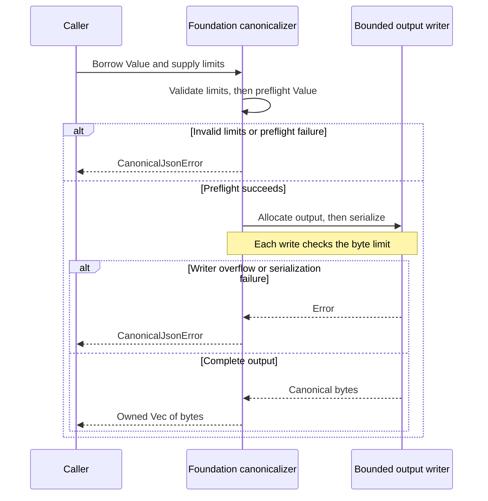

# Check value boundaries and content identity

Use this reference when implementing or debugging a first-party value boundary
in Foundation 0.1.0-beta. The owning contracts are the Rust parsers, canonicalization
implementation, and `JsonSchema` implementations linked below. Product DTOs can
impose narrower rules or a different digest representation. Start with
[ownership and callers](../internals/ownership.md) before changing one of these contracts.

| Look up | Contract |
| --- | --- |
| Decoded string length and Serde behavior | [Bound decoded strings](#bound-decoded-strings) |
| Canonical JSON resource bounds | [Limit profiles](#limit-profiles) and [errors](#canonicalization-errors) |
| Output allocation order | [Preflight and allocation](#preflight-and-allocation) |
| Digest format or mismatch | [Identify and verify bytes](#identify-and-verify-bytes) |
| URI rejection or schema discrepancy | [Parser rules](#parser-rules-and-errors) and [schema checks](#schema-and-parser-checks) |

## Bound decoded strings

[BoundedString](../../src/bounded.rs) is a Serde decoding helper, not a general
string validator. It checks the decoded text supplied by the deserializer.

### Accepted input and errors

| Property | Rule |
| --- | --- |
| Size | Accept when `str::len() <= MAX_BYTES`: count decoded UTF-8 bytes, not characters or JSON-token bytes. |
| Empty text | Accepted, including with `MAX_BYTES = 0`. |
| Oversized text | Returns the deserializer's `invalid_length` error. |
| Wrong type | The visitor requests a string; its default behavior rejects other types. |
| Content | No trimming, normalization, credential scanning, or domain-syntax validation. |

For example, these JSON tokens have different encoded and decoded lengths:

| JSON token | Decoded text | Decoded bytes | Fits `BoundedString<1>`? |
| --- | --- | ---: | --- |
| `"é"` | `é` | 2 | No |
| `"\u0061"` | `a` | 1 | Yes |
| `""` | Empty | 0 | Yes |

### Allocation and ownership

| Input or access path | Behavior |
| --- | --- |
| Borrowed string | Check the bound before copying into an owned `String`. |
| Owned string from the deserializer | Check the bound, then move the string into the wrapper. |
| `as_str` | Borrow the decoded text. |
| `into_string` | Consume the wrapper and transfer the owned string. |

**Bound encoded input before decoding untrusted documents.** The deserializer
may already have allocated or unescaped the string before this visitor runs.
The wrapper does not limit transport buffering or all parser allocations.

### Use before a typed parser

The wrapper has no public arbitrary-string constructor, `Serialize`, or
`JsonSchema` implementation. `Digest` and `OpaqueUri` deserialize through it
before running their own parsers. An oversized serialized scalar can therefore
fail with a Serde length error before a typed parser error is selected.

Evidence: `bounded_string_rejects_plain_and_escaped_oversized_values` and
`public_scalar_deserializers_reject_oversized_strings_before_domain_parsing`
in [bounded.rs](../../src/bounded.rs).

## Canonicalize decoded JSON

[canonicalize_json_value_with_limits](../../src/canonical.rs) accepts a borrowed
`serde_json::Value` and returns owned UTF-8 canonical bytes. It delegates RFC
8785 encoding to `serde_json_canonicalizer`; it is not an input parser. Object
insertion order does not determine output order. The number/Unicode fixture
and golden digest in the owning module pin observable encoding behavior.

The caller must choose the semantic document before canonicalizing. This
function neither removes product metadata nor validates a product schema.
Whitespace, escape spelling, duplicate-key history, and numeric information
already discarded by decoding cannot be recovered from a `Value`. Do not treat
canonicalization as duplicate-key detection or lossless preservation of the
original JSON text.

### Numeric identity

The selected canonicalizer formats numbers through IEEE-754 binary64, including
integer `Value`s retained exactly by decoding:

| Input integer | Canonical number |
| --- | --- |
| `9007199254740992` | `9007199254740992` |
| `9007199254740993` | `9007199254740992` |

Exact integer identity therefore needs an appropriate range or representation in
the owning contract. Existing wire representations must not be changed silently.
The [cancellation pin contract](../../../../docs/reference/protocol/cancellation.md#two-different-digests)
uses versioned decimal-string digest material for exact 0.1.0-beta pins and deadlines,
and rejects all other digest domains. This does not change the generic binary64
canonicalization contract.

### Limit profiles

`Default::default()` equals `CanonicalJsonLimits::DEFAULT`. Every field must be
nonzero and no greater than its `HARD_MAX` counterpart. Smaller and mixed
profiles are permitted; there is no requirement that a string/item limit fit
the document limit. These fields are checked independently.

| Field | `DEFAULT` | `HARD_MAX` |
| --- | ---: | ---: |
| `max_document_bytes` | 1,048,576 | 16,777,216 |
| `max_depth` | 64 | 128 |
| `max_string_bytes` | 262,144 | 1,048,576 |
| `max_array_items` | 65,536 | 131,072 |
| `max_object_entries` | 65,536 | 131,072 |

| Limit | What it measures |
| --- | --- |
| Document | Canonical encoded bytes and visited-value nodes, checked separately against the same limit. |
| Depth | Root-inclusive nesting: even a scalar root has depth 1. |
| String | Decoded UTF-8 bytes of each string value or object key. |
| Array | Elements in each individual array. |
| Object | Entries in each individual object. |

`max_document_bytes` cannot reject an oversized source document *before*
parsing when this function is called: the value already exists. A parser can
reuse the field to bound its input, but Foundation exports no bounded document
parser. The limits' `Display` representation is
`bytes=…, depth=…, string=…, array=…, object=…`, useful for reporting a selected
profile without logging a document.

### Preflight and allocation

The output vector is allocated only after profile validation and preflight
succeed. This sequence shows the two checks around output serialization:

*Preflight avoids allocating the document output for rejected input. The writer
is a second byte-limit check; failures expose no partial output. All work is
in memory and leaves the borrowed input unchanged.*

| Phase | Check or allocation |
| --- | --- |
| `validate` | Reject an invalid profile before traversal. |
| Value traversal | `preflight_value` checks depth, charges one value node, checks the container's local count, then visits children. |
| Writer creation | After preflight succeeds, allocate an initial output capacity of `min(max_document_bytes, 8192)`. |
| Each writer call | Check the chunk against the byte limit before extending the output vector. Failure returns an error, never partial output. |

#### Encoded-size accounting

The byte budget includes JSON punctuation and escaping, so a string can fit
its decoded string bound yet exceed the document bound.

| Item | Charge |
| --- | --- |
| Object key | Encoded string bytes; no separate value node. |
| Braces, brackets, commas, colons | Their encoded bytes. |
| String delimiters | Two quote bytes per string. |
| Quote, backslash, or short control escape | Two encoded bytes per escaped character. |
| Other U+0000–U+001F characters | Six encoded bytes per character. |
| Other string characters | Their UTF-8 bytes. |
| Literals and numbers | Literal bytes or canonical number bytes. |

#### Memory limits

Preflight canonicalizes individual numbers into temporary vectors to measure
them. The serializer can have its own temporary allocations, and `Vec`
allocation capacity is not the same as logical output length. This is a bound
on accepted data and output length, not a whole-process memory quota or a
promise of allocation-free validation. Saturating budget arithmetic avoids
wrapping an oversized count into an accepted size.

### Canonicalization errors

All variants below belong to `CanonicalJsonError` in
[canonical.rs](../../src/canonical.rs). No variant represents a transport failure
or a partially committed operation.

| Error and trigger | Maintainer response |
| --- | --- |
| `InvalidLimits`: a field is zero or exceeds its hard ceiling. | Correct the profile before trying again. |
| `DocumentTooLarge`: preflight byte/node accounting or the writer exceeds the document budget. | Reduce the document or review the caller's profile within `HARD_MAX`. |
| `DepthLimitExceeded`: a visited value exceeds the root-inclusive depth limit. | Flatten the representation or review the format's depth contract. |
| `StringLimitExceeded`: a string or key exceeds its decoded UTF-8 byte limit. | Reduce it, checking bytes rather than characters. |
| `ArrayLimitExceeded`: an array has too many elements. | Bound or split input according to its owning format. |
| `ObjectLimitExceeded`: an object has too many entries. | Reduce fields or use the format's supported partitioning. |
| `CanonicalizationFailed`: number encoding or serialization fails without a recorded writer overflow. | Investigate the value and canonicalizer profile; do not substitute ordinary JSON serialization. |

The depth, string, array, and object errors carry `{ limit }`.
`DocumentTooLarge` carries `{ actual, limit }`.

`DocumentTooLarge.actual` is the budget/write size at the first detected
overflow, not necessarily the length of the complete document. The node-budget
path reports `limit + 1`. Inspection stops at the first failure; do not depend
on one error winning when an input violates several independent limits.

Tests cover all profile fields, exact encoded-size acceptance and rejection
one byte below it, depth/key/container failures, aggregate width, canonical
numbers and escapes, a fixed hash, and object insertion order. See
[the test map](../development/contributing.md#choose-the-right-checks).

## Identify and verify bytes

[Digest](../../src/digest.rs) stores 32 SHA-256 bytes. `ContentDigest` is a type
alias expressing usage, with identical behavior and representation.

### Select the bytes to hash

`sha256` hashes exactly the supplied byte slice. The caller owns the following
preparation:

| Concern | Foundation behavior |
| --- | --- |
| Canonicalization or normalization | Neither is performed by hashing. Canonicalize JSON separately if the owning contract requires it. |
| Salting or domain separation | Neither is added. The caller chooses the full input. |
| Input size or streaming I/O | No input-size check or streaming I/O. Bound and obtain the bytes before calling. |

### Text representation and parse errors

`Display` and Serde serialization emit `sha256:` followed by exactly 64
lowercase hexadecimal digits (71 ASCII bytes total). `parse` and `FromStr`
reject alternatives in this order:

| `DigestParseError` | Condition |
| --- | --- |
| `InvalidAlgorithm` | The exact `sha256:` prefix is absent; even `SHA256:` fails. |
| `InvalidLength` | Text after the prefix is not exactly 64 bytes. |
| `NonCanonicalHex` | Those bytes include anything other than `0`–`9` or `a`–`f`. |

Deserialization first applies `BoundedString<71>`. The generated `Digest`
schema requires a string of length 71 matching `^sha256:[0-9a-f]{64}$`.
This format differs from protocol fields named `payload_digest_sha256`, which
use plain lowercase hex: use their
[owning helper](../../../undercurrent-protocol/src/execution_output_digest.rs).
Do not send Foundation's display string in a hex-only DTO field.

### Comparison and mismatch handling

| Operation | Guarantee |
| --- | --- |
| `verify(bytes)` | Rehashes the supplied bytes, then compares fixed-length digest arrays through `subtle::ConstantTimeEq`. Returns `Ok(())` or the unit `DigestVerificationError`. |
| Verification error message | Echoes neither content nor digests. |
| `constant_time_eq` | Uses the same constant-time comparison for two existing digests. |
| Derived `PartialEq`, ordering, parsing, formatting | No constant-time promise. |
| Hashing | Time depends on payload size. |

A hash comparison checks content consistency with the supplied expected hash.
It is not keyed authentication, a signature, proof of origin, or proof that
work completed. Keep the expected digest's trust and provenance separate from
the comparison. On mismatch, check the exact selected bytes and representation;
never replace the expected digest with the observed one merely to make a
verification pass. There is no mutation retry or output-resumption policy here.

## Validate an opaque reference

[OpaqueUri](../../src/uri.rs) owns the exact accepted string. It implements string
serialization, `Display`, `FromStr`, equality, hashing, and lexical ordering;
none resolves or dereferences the reference.

| Boundary | Behavior |
| --- | --- |
| Parsing | Synchronous; no DNS, HTTP, filesystem access, policy lookup, or authorization. |
| `parse(impl Into<String>)` | Convert to an owned string before validation. |
| Serde decoding | Apply `BoundedString<2048>` before the URI parser. |
| Identity | Retain authority/path case and exact accepted spelling. Differently spelled strings remain different identities. |

### Parser rules and errors

The Rust parser applies these checks in order, preserving input rather than
repairing it:

| `OpaqueUriError` | Rejected form |
| --- | --- |
| `InvalidLength` | Empty string or more than 2,048 UTF-8 bytes. |
| `NonCanonicalCharacter` | Non-ASCII, ASCII control/whitespace, or backslash. |
| `InvalidShape` | Missing `://`, invalid scheme (below), or empty authority. |
| `CredentialMaterial` | `@` in the authority, or a forbidden query name (below). |

| Component | Rule |
| --- | --- |
| Scheme | Start with `a`–`z`; remaining characters must be lowercase ASCII letters, digits, `+`, `.`, or `-`. No scheme allowlist. |
| Authority | Text after `://` and before the first `/`, `?`, or `#`. Must be nonempty; no host/port grammar. |
| Remaining text | No percent-decoding, path normalization, or trailing-component validation beyond the checks above. |

Accepted test fixtures include `trust://passport/subjects/sub_01` and
`https://example.test/data?view=summary&page=2`.

### Query-name rejection

`contains_sensitive_query_parameter` scans names in this order:

1. Cut at the first `#`; only a `?` before that boundary starts the query.
2. Split on `&`, then take each name before its first `=`.
3. Reject a name containing `%`, even when it is not a valid escape.
4. ASCII-lowercase other names and reject exact matches from this list:

`access_token`, `api_key`, `authorization`, `bearer`, `credential`, `password`,
`secret`, `sig`, `signature`, `token`, `x-amz-credential`, `x-amz-signature`.

| Scanner limit | Consequence |
| --- | --- |
| No camel-case normalization or suffix matching | Only the ASCII-lowercased exact names above match. |
| No general scanning of query values, paths, or fragments | Acceptance does not prove absence of every possible secret. |
| String splitting rather than URI-component parsing | A `?` after a `#` is still treated as a query start. |

Keep raw credentials out of references at the owning boundary. This scanner
is separate from [structured privacy detection](../internals/privacy.md).

### Schema and parser checks

The generated `OpaqueUri` schema enforces the constructor's current ASCII,
length, lowercase-scheme, nonempty-authority, and selected query-name checks.
The authority pattern permits its suffix only after a `/`, `?`, or `#`, so it
cannot backtrack past userinfo. Query-name rejection starts after the first `?` before any `#`
and stops at the following `#`; an ampersand in a path alone is not a query.

| Input | Rust parser and generated schema |
| --- | --- |
| `https://user@example.test` | Reject authority userinfo. |
| `trust://é` | Reject non-ASCII text. |
| `trust://host/path&token=x` | Accept; there is no query start. |

Schema length counts characters; the accepted ASCII repertoire makes this equal
to the parser's byte limit. Rust construction still uses `OpaqueUri::parse`, and
Serde applies its bounded string visitor before construction. A JSON schema does
not provide that earlier allocation boundary.

The differential corpus in [uri.rs](../../src/uri.rs) covers component positions,
ASCII controls, Unicode, query names/values, userinfo, and the 2,048-byte limit.
The component policy accepted on 2026-10-05 treats the first `#` as the
fragment boundary. A later `?` is fragment content, including `#?token=x`.
The first earlier `?` starts the query; later question marks are ordinary query
text. Names split on `&` and their first `=`; percent escapes in names remain
rejected and escapes in values are preserved without decoding. This broadens
acceptance only for formerly rejected fragment text. Existing accepted stored
references retain their spelling and remain accepted; no records are rewritten.

Continue with [privacy checks](../internals/privacy.md) for diagnostic and environment
handling, or [verification and debugging](../development/contributing.md) for a local workflow.

[Crate documentation](../README.md)
