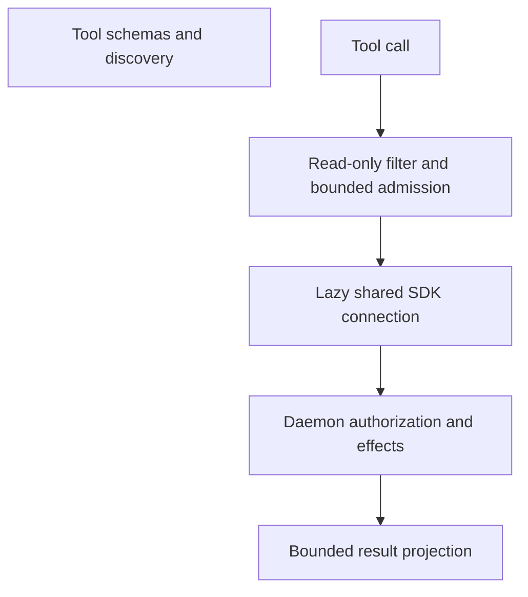

# Maintain the MCP adapter

Use this index to trace and change the `uc-mcp` stdio server in the development
workspace at 0.1.0-beta. The adapter owns tool discovery, admission, argument
translation, finite observations, and result projection. The Rust SDK owns
local IPC and connection recovery. The daemon owns authorization, durable
state, and process effects.

The [MCP consumer guide](../../../docs/agent/mcp.md) is the starting point
for setup and tool contracts. The adapter's Rust library supports the binary
and its tests. For external Rust integration, the supported library packages
are `aixand-undercurrent` and `aixand-undercurrent-protocol`. See the
[SDK boundary](../../undercurrent-sdk/docs/reference/public-api.md).

## Package and reader scope

The adapter uses one lazily connected SDK client. It leaves daemon startup and
runtime storage access to their owners and performs no automatic finite mutation
retry. Tools work independently of the optional skills, which own higher-level
process and worker workflows.

[Parameter schemas](../src/params.rs) define the assistant-facing inputs.
[Server dispatch](../src/server.rs) owns admission limits,
[operations](../src/operations.rs) translate requests and manage watch lifetimes,
and [client setup](../src/client.rs) owns the connection.

| Task | Start here |
| --- | --- |
| Find the code that handles a tool from discovery to response | [Tool flow and source map](development/tools.md#trace-a-tool-call) |
| Check a limit or understand what cancellation does | [Admission and cancellation](development/tools.md#admission-and-cancellation) |
| Add or change a tool | [Extend the adapter](development/tools.md#extend-the-adapter) |
| Choose unit or native evidence | [Verify a change](development/tools.md#verify-a-change) |

[Crate overview](../README.md) · [Workspace dependency map](../../../docs/architecture/dependencies.md)
