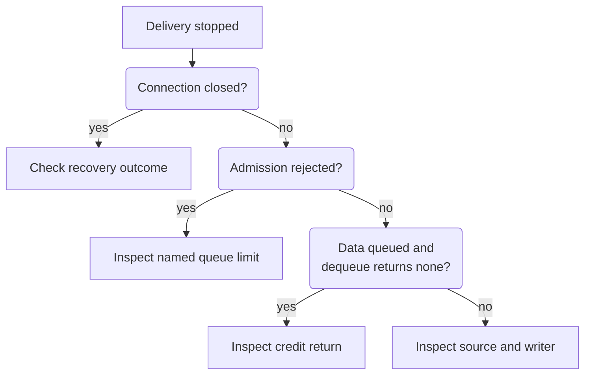

# Diagnose a stalled or disconnected stream

Locate the stopped stage before changing limits or reconnect behavior. This guide
is for maintainers inspecting the Rust SDK or server adapter. It uses existing
connection diagnostics and source-level pressure methods; multiplex has no
standalone logging service or CLI configuration.

## Capture the connection state

1. Record whether the physical connection is open, the structured error category,
   and the affected stream's last **consumed** sequence. Keep payloads and
   credentials out of diagnostic output. Use the redacted overload projection
   described in the [failure reference](../reference/diagnostics.md#typed-failure-reference).
2. Capture scheduler `pressure` and `stream_pressure`, plus client mailbox
   occupancy and deferred credit where the owning adapter exposes them. See
   [snapshot meanings and limits](../reference/diagnostics.md#pressure-and-telemetry-ownership).
3. Follow the decision below, then use the matching check in the table.

The diagram separates a connection failure from local admission and credit stalls.

*The stopped stage determines the next check.* Increasing queue capacity does
not repair a missing credit update or a failed physical connection.

## Check and verify the affected stage

| Check the affected stage | Evidence of progress |
| --- | --- |
| **Recovery.** After connection close, for a stream, inspect resume from the consumed checkpoint and handle any typed gap. Follow [SDK baseline recovery](../../../../docs/sdk/recovery.md#restore-a-stream-baseline). For a finite mutation with a lost response, use [operation-specific reconciliation](../../../../docs/sdk/recovery.md#reconcile-the-mutation) before retrying. | A returned stream item or successful product snapshot/restart. Reconnection alone does not resolve a lost finite result. |
| **Queue.** Compare encoded frame size with the named empty queue's byte cap, then check byte **and message** occupancy. An item that cannot fit needs compatible limits or a smaller supported payload; otherwise observe drain before retrying local admission. | Admission succeeds and queue pressure changes as expected. This is still before delivery. |
| **Credit.** Confirm the consumer receives items. Inspect connection and stream credit, then the SDK's deferred `WindowUpdate` path. Do not invent credit or return bytes twice. | A previously blocked frame becomes writable; the eventual receive returns its full byte charge. |
| **Source or writer.** Inspect source availability, writer wakeups, and physical send results. Queue pressure drops at selection, so an empty scheduler can coexist with a blocked write. | A new writable frame or returned item, with the expected pressure change. |

The low-level [SDK `ClientSubscription::flush_credit`](../../../undercurrent-sdk/src/client.rs)
retries deferred credit admission. Failed admission retains the byte count for
a later retry. A successful flush only queues the update; verify the server
received it. The typed SDK wrapper has no independent periodic flush; see
[Rust stream recovery](../../../../docs/sdk/rust/streams-and-recovery.md) when
investigating a caller that cannot reach the low-level subscription.

If a client mailbox fills, the current SDK fails the shared connection, affecting
peer work. Use the [router pressure rules](../internals/routing.md#sequence-and-mailbox-pressure)
to distinguish that policy from the router's local rejection. After a gap,
verify product-level snapshot or restart success: `reported_gaps` records
selection, and does not prove that the client received or recovered the gap.

## Reproduce and finish

For an isolated reproduction, run the
[bounded delivery exercise and contract tests](contributing.md#run-the-local-exercise)
from the repository root with the declared Rust toolchain. They create no daemon
or persistent runtime state and include expected results.

Close any subscriptions and client that you created for the investigation through
their owners. A diagnostic client does not require stopping the user's daemon.
If progress still fails, retain the structured error and pressure observations
and trace the responsible layer using the [ownership map](../internals/ownership.md).

[Crate documentation](../README.md)
