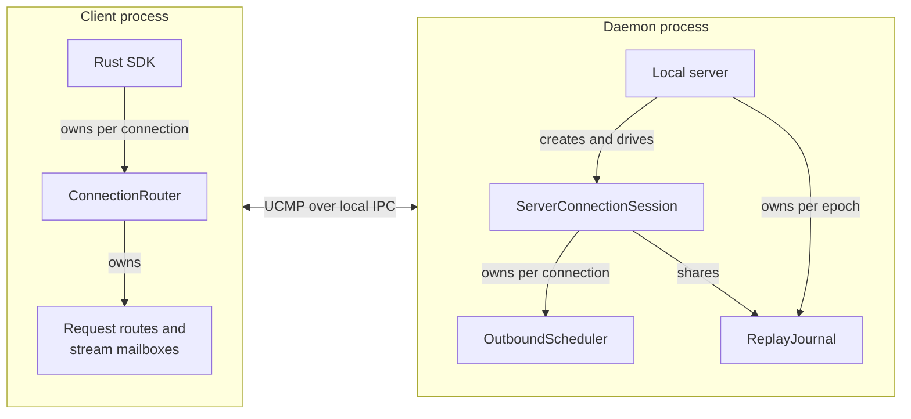

# Follow multiplex ownership and delivery

Use this explanation to locate a transport change and trace it across the
multiplex boundary. It describes the current `aixand-undercurrent-multiplex` package,
version `0.1.0-beta`, for maintainers familiar with Rust. No running daemon is needed
to read the source or run the [local exercise](../development/contributing.md).

A **physical connection** carries encoded UCMP messages. A **request** has one
finite response correlated by request ID. A **logical stream** has its own ID,
sequence checkpoint, queue, and cancellation lifetime on that connection.
The [wire types](../../../undercurrent-wire/src/message.rs) own message and gap
definitions. Multiplex treats product payload bytes as opaque.

## Runtime ownership

This diagram shows in-process ownership and the communication boundary. The
router, scheduler, and journal are objects, not additional processes.

*Takeaway: connection-local queues disappear on teardown; a shared server journal
can outlive the connection within its reconnect window.* The outer adapters own
negotiation, transport reads/writes, heartbeats, writer wakeups, and shutdown.
The journal stores encoded stream frames in memory; it is not a durable log.

The [SDK reader](../../../undercurrent-sdk/src/client.rs) routes decoded responses
and stream items. The [server engine](../../../undercurrent-transport-core/src/engine/session.rs)
owns the scheduler and coordinates replay. The
[local adapter](../../../undercurrent-transport-local/src/server.rs) shares a journal
across sessions and supplies expiration sweeps and physical writes. Private
session-host IPC, PTY ownership, authorization, and agent bridges belong outside
this crate.

## Dependency direction

Multiplex depends only on wire among first-party crates. Product DTOs, native IO,
and session execution stay outside this mechanism layer. The
[workspace dependency map](../../../../docs/architecture/dependencies.md#dependency-direction)
shows its callers; [Cargo.toml](../../Cargo.toml) owns exact edges. For the supported
consumer boundary and language differences, use [SDK choices](../../../../docs/sdk/README.md).

## Code map

| Owning source | Responsibility and investigation entry points |
| --- | --- |
| [lib.rs](../../src/lib.rs) | Crate boundary; re-exports local components and selected wire message types. No composition loop. |
| [frame.rs](../../src/frame.rs) | Size-checked shared encoded bytes, traffic and stream-kind registries, route identity, delivery and replay disposition. |
| [scheduler.rs](../../src/scheduler.rs) | `enqueue`, `dequeue`, class/route queues, credit grants, source gaps, and release accounting. See [scheduling](scheduling.md). |
| [router.rs](../../src/router.rs) | Pending response channels, stream mailboxes, routed versus consumed checkpoints, explicit connection close. See [routing](routing.md). |
| [replay.rs](../../src/replay.rs) | Client-scoped retained bytes, eviction order, expiration index, atomic resume activation. See [replay](replay.md). |
| [error.rs](../../src/error.rs) | Categories and redacted overload context; does not classify application effects. |
| [registry.rs](../../src/registry.rs) | Stable diagnostic/metric names and telemetry callback, described in [diagnostics](../reference/diagnostics.md). |

## Finite requests, including session creation

A product `StartSession` request uses the same finite correlation route as a
query. The [product DTO](../../../undercurrent-protocol/src/dto.rs) defines its meaning;
[daemon dispatch](../../../undercurrent-daemon/src/dispatch.rs) performs application
work and handles request idempotency. Multiplex neither creates the session nor
determines whether the returned result means an attempt finished.

Follow [request correlation](routing.md#request-correlation) for registration,
response routing, and local cancellation. Multiplex request IDs only select the
waiting caller; [request idempotency](../../../undercurrent-transport-core/src/engine/idempotency.rs)
is an outer concern. The shared [session creation walkthrough](../../../../docs/architecture/flows.md#start-a-session)
shows the application commits and effects. If its response is lost, use the
[mutation recovery contract](../../../../docs/sdk/recovery.md#reconcile-the-mutation).

## Terminal output path

The daemon [stream policy and publisher](../../../undercurrent-daemon/src/stream.rs)
select scheduling and serialize sequence allocation. Its current terminal-output
policy is `Bulk` plus `Reliable`, retained for resume. A rejected overloaded
publication does not advance the publisher sequence; the
[stream pump](../../../undercurrent-daemon/src/stream/pump.rs) handles producer
backpressure. Scheduler tests using `Droppable` terminal frames exercise a
mechanism, not the current product default.

The [write/replay sequence](replay.md#the-write-boundary) follows an encoded frame
through selection and transport confirmation. The
[client consumption boundary](routing.md#stream-mailboxes-and-checkpoints) explains
when a checkpoint advances and the SDK can return credit. Terminal source retention is a separate boundary: when source data has
already disappeared, `publish_source_gap` records that loss even for a reliable
stream. A screen-seeded terminal requires `RequestSnapshot`; other terminal
representations use `RestartFromAvailableOffset`. The product policy owns this
choice, not `StreamKind` alone.

All multiplex state is volatile. There are no database transactions or external
side effects in this crate. Its mutexes serialize local state changes; they do
not make a transport write and replay record atomic. For tests connecting these
layers, use the [verification map](../development/contributing.md#choose-verification-for-the-change).

[Crate documentation](../README.md)
