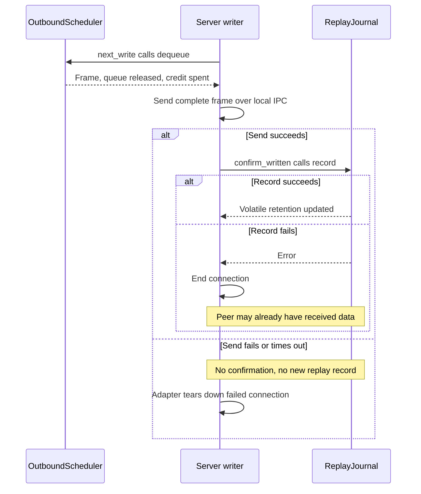
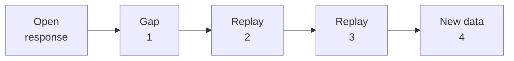

# Understand replay, reconnect, and missing data

Use this explanation to maintain reconnect behavior without confusing retained
transport bytes with durable session truth. [replay.rs](../../src/replay.rs) owns the
journal algorithms. The [server engine](../../../undercurrent-transport-core/src/engine/session.rs)
owns activation and write confirmation; the [SDK](../../../undercurrent-sdk/src/resilient.rs)
owns reconnect orchestration. Multiplex itself performs no reconnect or I/O.

## The write boundary

This sequence follows a newly produced retained data frame in a non-control
class after admission.
It shows the server's ordering only. Client routing, consumption, and credit
return happen independently; see the
[consumed checkpoint diagram](routing.md#stream-mailboxes-and-checkpoints).

*Queue acceptance, write success, replay retention, and consumer receipt are
separate facts.* There is no peer acknowledgement or durable commit in this flow.

### Which writes enter replay

`PendingServerWrite::confirm_written` records only newly produced retained stream
frames (`RecordAfterWrite`), including encoded live gaps. Their wire kind is
retained alongside exact bytes so replayed gaps keep their zero data-credit
charge in the same class as neighboring replay data. Replayed frames are
marked `AlreadyRetained` and are not recorded again. The server also uses that
marker for a synthesized resume gap against an existing journal; it does not
prove the exact gap bytes were previously retained. A resume gap for a newly
created journal uses `RecordAfterWrite`. Finite responses have no stream replay
record.

Dropping an unconfirmed write leaves the journal unchanged. If transport success
is followed by confirmation failure, the peer might already have seen the data;
the [local server writer](../../../undercurrent-transport-local/src/server.rs) ends
the connection on that failure. A process crash can also occur between sending
and recording. There is no atomic transport/journal commit or durability claim.
The [connection contract tests](../../../undercurrent-transport-core/tests/connection_contract.rs)
cover successful confirmation and dropping unconfirmed writes.

## Retention and identity

`ReplayStreamKey` pairs stable client ID with stream ID. Equal stream text from
different clients identifies different journals. A `ServerEpoch` scopes one
process journal and invalidates resume from a different epoch. Identity validation
and client authorization belong to wire/transport and the application; a replay
key itself is not authentication.

`ReplayLimits::new` requires all four limits nonzero and
`max_item_bytes <= per_stream_bytes <= total_bytes`. `max_streams` covers active
and retained inactive journals. The local server checks compatibility with its
transport policy. Journal `record` checks item length against `max_item_bytes`,
not the scheduler frame maximum; standalone callers must align those bounds.

### Record and evict under one lock

`record` performs these operations under the journal mutex:

1. Check registration and strictly increasing sequence, then reserve a checked
   global insertion ordinal.
2. Evict the target stream's oldest items until its byte budget fits.
3. Evict globally oldest items until the total byte budget fits.
4. Insert shared exact bytes, update `latest`, and return evicted item/byte counts.

Sequences may jump. The journal does not deduplicate payloads, prove every
numeric predecessor was produced, or parse retained gaps and product offsets.

Each eviction removes its global index entry. The byte budget plus nonempty
items bounds item/index count, and the stream-count limit bounds empty journals.
The expiration index has at most one deadline per inactive stream. Small frames
can still incur metadata overhead beyond the encoded-byte budget. Returned
`ReplayedFrame` values clone `Arc`s: eviction releases journal ownership, while
callers retaining those clones can keep memory alive outside journal accounting.

## Journal ownership lifetime

This diagram describes ownership within one server epoch, not network connection
states. An entry's deadline expires inclusively at `deadline <= now`.

```mermaid
stateDiagram-v2
    accTitle: Replay ownership during a server epoch
    accDescr: An absent key can acquire an active journal. Deactivation retains it with a deadline. Reactivation is allowed before that deadline; expiration removes it. Explicit removal works for active or inactive entries. Dropping the journal ends all of this volatile state.
    direction TB
    [*] --> Absent
    Absent --> Active: create key
    Active --> Inactive: deactivate
    Inactive --> Inactive: replace deadline
    Inactive --> Active: reactivate before deadline
    Inactive --> Absent: expire at deadline or later
    Active --> Absent: remove
    Inactive --> Absent: remove
    state "Journal exists" as Present {
        Active
        Inactive
    }
    Present --> [*]: journal dropped
```

*Takeaway: replay can survive a connection but cannot survive removal of its
in-memory server journal.* `register_stream` rejects any existing key, including
an inactive one. `ensure_stream` preserves an inactive entry's data and original
recovery action, returning `false`; a newly created active entry returns `true`.
Both `ensure_stream` and `activate_resume` reject an already active owner.

### Activate and roll back a reconnect

`resume` selects items, a gap, or a gap followed by items; it does not claim ownership. Prefer
`activate_resume` when installing a reconnecting stream: expiration, replay
selection, and activation occur under one lock, avoiding a sweep between lookup
and activation. The returned `created` and `previous_expiration` support outer
rollback. The server closes the scheduler stream and removes its queued response
if activation fails; it removes a new journal or restores an old expiration.
The journal does not automatically roll back outer queue failures.

### Expire or remove retained state

`deactivate_stream` replaces an earlier deadline and returns false for an unknown
key. `remove_stream` is idempotent and returns released encoded bytes (zero can
also mean an empty existing journal). It may remove active entries too. `record`
does not require an active entry or expire deadlines itself: adapter coordination
must prevent stale writers from using inactive or removed ownership.

`expire_before(now)` uses the ordered deadline index to visit due journals, not
every stream. Admission, resume selection, and `pressure()` also prune due
inactive entries; pressure therefore has a cleanup side effect. The journal has
no timer thread. Server teardown deactivates retained streams, while explicit
unsubscribe removes their journals. The
[local server](../../../undercurrent-transport-local/src/server.rs) drives periodic
sweeps when callers are idle.

## Resume decision reference

The authoritative decision order is `replay_result` in `replay.rs`. `after` is
the last consumed sequence; results start strictly after it. `first_requested`
is `after.next()`, falling back to `after` if the counter cannot advance.

| Condition, in decision order | Result |
| --- | --- |
| Requested epoch differs | `Gap(ServerEpochChanged)`, even if the key is absent or `after` is ahead. Range ends at the greater of known latest and first requested. |
| Same epoch, key absent or expired | `Gap(ReplayUnavailable)` covering first requested; use caller's fallback recovery. |
| Existing key and `after > latest` | `FutureResumeSequence` error; no fabricated replay. |
| `after == latest` | Empty `Items`: nothing newer is retained. |
| `after` is before the eviction watermark | `GapWithItems` containing a `ReplayEvicted` gap through the eviction watermark and the retained suffix. If no frames remain, return `Gap(ReplayEvicted)`. Both use the registered recovery action. |
| Otherwise | `Items` containing retained frames with sequence greater than `after`, in retained stream order. |

Partial eviction selects the gap and retained suffix under the same journal lock.
The adapter queues the gap before the suffix and continues new publication after
the final retained sequence. This preserves transport sequence order but does not
recover the missing data. Returned frame references remain valid even if later
global byte pressure evicts their journal entries.

For example, after confirming frames 1–3 and evicting only frame 1, resuming from
zero produces this writer order:

*The publisher starts after retained frame 3, not after the gap's endpoint 1.*
The server admits the response, gap, and entire suffix before activating the
publisher. A queue failure rolls back that activation; it does not expose a
shortened successful replay. See
[core activation ordering](../../../undercurrent-transport-core/docs/internals/streams-and-recovery.md#activation-ordering-and-rollback).

Existing entries keep their registered recovery action, even when a resume call
supplies a different fallback. `activate_resume` can create/activate ownership
while returning a gap; callers must not equate successful activation with
successful replay. Epoch mismatch and unavailable-state ranges signal inability
to prove continuity; they are not measured counts of lost terminal bytes.

The wire [gap definitions](../../../undercurrent-wire/src/message.rs) own reasons and
actions. Scheduler loss adds `LiveQueueOverflow` and `SourceRetentionEvicted`;
the journal adds the three replay reasons above. `RequestSnapshot`,
`RestartQuery`, and `RestartFromAvailableOffset` describe the required application
recovery. Multiplex returns them but cannot execute them. Stream sequences are
not terminal byte offsets, query revisions, or attempt IDs.

## Recover without repeating unknown effects

The adapter must retain stable client identity, stream specification, server
epoch, and the **consumed** checkpoint across disconnect. The SDK resilient layer
uses these to reconnect and resume subscriptions. Activation can succeed with a
gap, so callers must handle the returned recovery action before accepting a
continuous stream. Expiry, global byte pressure, and epoch changes can all force
recovery even if the connection was healthy just before disconnect.

The shared [SDK recovery guide](../../../../docs/sdk/recovery.md) owns product
baseline recovery and reconciliation of finite mutations. Stream journals cannot
establish the outcome of a lost mutation response. Request cancellation,
subscription close, and runtime-attempt cancellation have different owners and
effects; use the guide's cancellation table before changing an adapter.

For a stalled mechanism, follow [delivery diagnosis](../development/diagnose-delivery.md).
For a behavior change, follow the [extension guide](../development/contributing.md#put-the-change-in-its-owning-layer).

[Crate documentation](../README.md)
