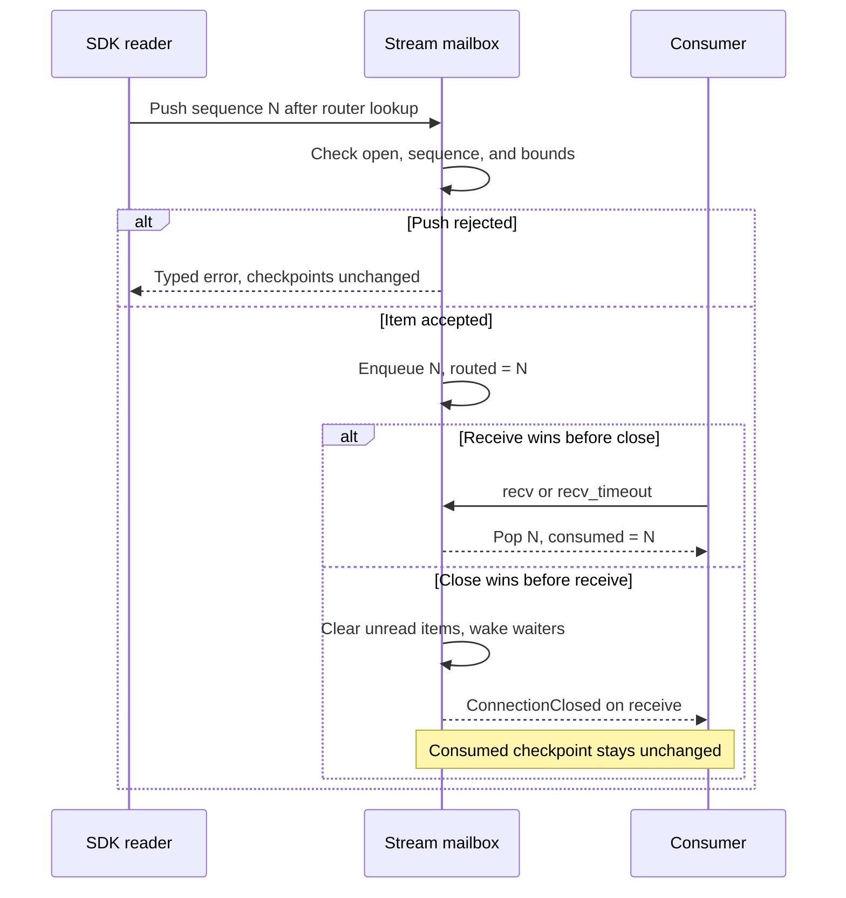

# Track request waits and stream consumption

Use this explanation to maintain the blocking client router and understand which
state survives a local wait or physical disconnect. [router.rs](../../src/router.rs)
owns these contracts; the [Rust SDK wrapper](../../../undercurrent-sdk/src/client.rs)
adds transport messages, telemetry, and connection failure policy. These are not
Python async handles.

## Request correlation

`ConnectionRouter` clones share an `Arc<Mutex<RouterState>>`. The request registry
holds one `sync_channel(1)` sender per active request, bounded by negotiated
`max_pending_requests`. Register the request **before** writing its frame so a
fast response cannot arrive before its destination exists. Duplicate active IDs
conflict. Request IDs and stream IDs occupy separate namespaces even when their
text matches.

`route_response` removes the matching sender under the router lock, releases the
lock, then sends exact opaque bytes. Responses may arrive out of request order;
only the ID selects the recipient. The router neither decodes a product error
nor records the response for later deduplication. If the receiver disappeared
after removal, notification failure is ignored. A response for a missing route
returns `UnknownRequest`; the SDK treats it as a late response and ignores it.

### Request waits and local cancellation

| Action | Route and handle result |
| --- | --- |
| `PendingResponse::recv` or `recv_timeout` | Consumes the handle. Timeout removes its route through `Drop`; the same handle cannot be polled again. |
| `cancel_request` | Removes one pending route and sends `Cancelled`, leaving peers alone. |
| Drop an unused pending handle | Removes its entry without sending a UCMP message. |

Local cancellation does not undo application work. The SDK request wrapper adds
best-effort `CancelRequest` on error/drop paths; no timeout proves that a mutation
had no effects. See [operation-specific reconciliation](../../../../docs/sdk/recovery.md#reconcile-the-mutation)
for a lost finite response.

Avoid reusing a lexical ID while an older handle for it remains alive: handle
cleanup removes by ID without a generation token. The router only rejects active
duplicates, while the [server connection](../../../undercurrent-transport-core/src/engine/session.rs)
also maintains a connection-epoch request-ID ledger. Generate fresh request IDs
through the owning client instead of treating local slot release as end-to-end
permission to reuse them.

## Stream mailboxes and checkpoints

`open_stream` creates one independent mailbox. `open_stream_after` also seeds
both the routed and consumed checkpoints from the supplied resume sequence.

| Bound | Enforced by the router | Adapter responsibility |
| --- | --- | --- |
| Active stream count | Negotiated maximum | Release unused registrations. |
| Mailbox bytes and messages | Caller-supplied, nonzero limits | Align these with negotiated queue sizes; the router does not clamp them. |
| Total mailbox bytes on the connection | No separate cap | Choose per-stream bounds and stream count together. |

This sequence separates data arrival from consumption, the distinction needed
for safe stream resume.

*Takeaway: reconnect starts after the last item delivered to the consumer, not
after the last item received from the socket.* Delivery here means return from
the mailbox receive; it is not an application-processing or durable checkpoint.
The SDK wrapper returns the full encoded byte charge after a successful data
receive by queueing `WindowUpdate`. Gaps return no credit. The router itself
performs no transport I/O; [deferred credit diagnosis](../development/diagnose-delivery.md#check-and-verify-the-affected-stage)
covers an update that cannot enter the writer.

### Sequence and mailbox pressure

Each push requires `item.sequence() > routed_sequence`. Contiguous increments
are not required, and there is no ordering across streams. A gap's sequence is
its `last_missing`. `InboundStreamItem::encoded_len`, owned by
[wire message definitions](../../../undercurrent-wire/src/message.rs), uses the full
`flow_controlled_bytes` for data and zero for gaps. The mailbox trusts that
metadata; it does not measure the payload `Arc` or revalidate encoded frames.
Gaps still consume a message slot, preventing unbounded zero-byte items.

If either mailbox bound would be exceeded, push returns `QueueSaturated` with
queue `client_stream_mailbox`; this is also the error for message-count overflow.
It preserves the queue and routed checkpoint. At this crate boundary, other
streams remain usable. **The current SDK escalates non-unknown stream-routing
errors, including mailbox saturation, to connection failure.** Mailbox saturation emits a
slow-consumer diagnostic; the resilient SDK layer owns reconnection. Do not claim
that SDK subscriptions remain connected after a peer mailbox overflows.

`route_stream_item_with_queued_bytes` returns occupancy from the push lock so
telemetry sees the enqueue value even if a consumer immediately drains it.
`stream_queued_bytes` uses a logarithmic registry lookup plus a mailbox lock.
For the consistency of aggregate observations, see
[pressure snapshots](../reference/diagnostics.md#pressure-and-telemetry-ownership).

## Waits, close, and ownership

Stream receives borrow the handle and may be repeated after a timeout. Waits use
a condition variable and elapsed `Instant` time, releasing the mailbox lock while
blocked. They hold no router lock and perform no transport I/O. An already queued
item is returned before testing timeout, including a zero timeout. No background
deadline task, heartbeat, or cancellation token is owned by multiplex.

| Event | Local result and lifetime |
| --- | --- |
| `close_stream(id)` | Remove one mailbox, clear unread items, wake all waiters with `Unsubscribed`. Unknown stream is an error. |
| Drop `InboundStream` | Remove its route if the router still exists and close it as `Cancelled`; no transport unsubscribe is sent here. |
| `ConnectionRouter::close()` | Mark router closed, remove registries, notify pending requests with `ConnectionClosed`, clear stream queues, preserve consumed checkpoints in handles. Repeated close reports zero release. |
| All router clones dropped without explicit close | Pending senders disappear, but stream handles still own their mailboxes. There is no router `Drop` that closes these mailboxes; a stream waiter can remain blocked. |

Adapters must call `close` during teardown. Handles hold only a weak router
reference and do not keep its registries alive. Do not reopen a stream ID while
an old handle can still drop and remove that ID's new registration. In-flight
routing can race close: a lookup clones the mailbox before releasing the router
lock, and the mailbox's own closed state rejects a subsequent push. Explicit
close discards unread items rather than draining them to consumers.

The implementation recovers poisoned mutex/condition-variable guards with
`into_inner`; this is a locking policy, not a guarantee that arbitrary panics
preserve semantic invariants. See [replay](replay.md) for server ownership and
[diagnostics](../reference/diagnostics.md) for typed wait failures and reconciliation.

[Crate documentation](../README.md)
