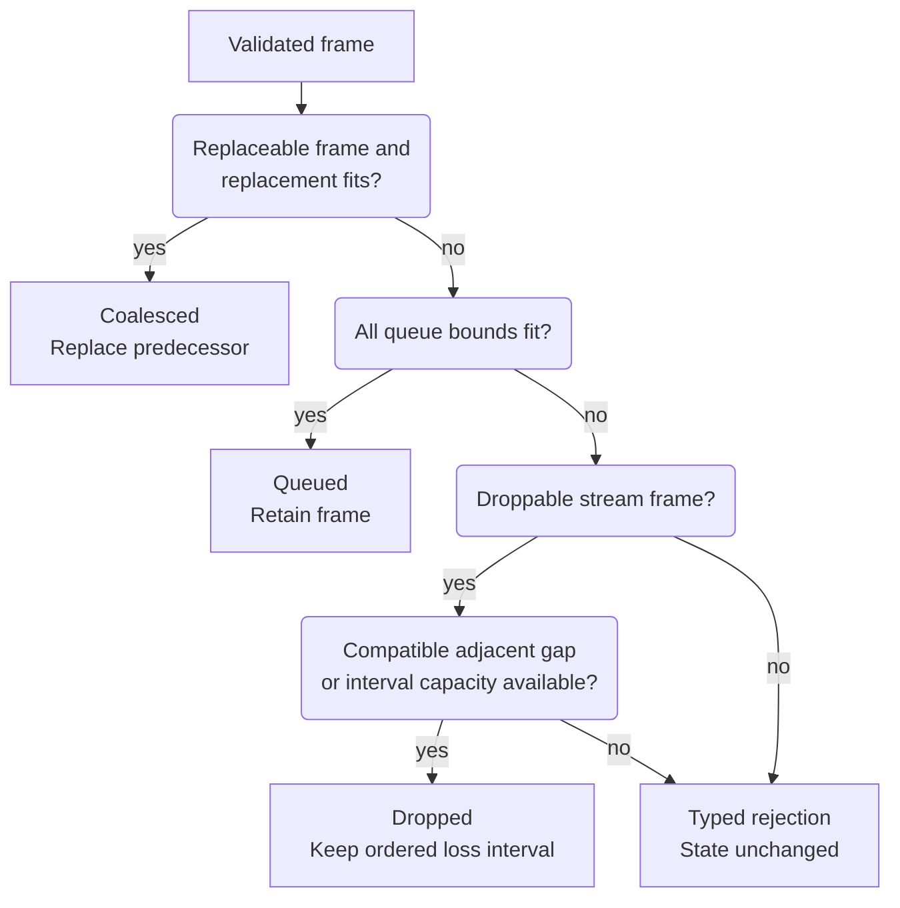

# Reason about queue admission and writable work

Use this explanation when changing an outbound policy or diagnosing stalled
delivery. The authoritative implementation is [scheduler.rs](../../src/scheduler.rs);
[frame.rs](../../src/frame.rs) owns the semantic frame types. This is internal Rust
machinery, independent of the transport OS and executor.

## Encoded frames and policy

`OutboundFrame` retains an `Arc<[u8]>` containing an already encoded frame. Its
constructors reject zero bytes and lengths above the supplied frame maximum.
`enqueue` checks again against the scheduler's negotiated maximum. It does not
parse those bytes or verify that their encoded ID, sequence, or class agrees with
the semantic metadata. The adapter must supply consistent metadata and full
encoded lengths. Cloning shares the bytes; accounting counts logical retained
bytes, not allocator overhead or uniquely allocated physical memory.

| Constructor or metadata | Effect |
| --- | --- |
| `control` | Reliable, connection route, `Control`, no sequence or replay disposition. |
| `response` | Reliable, request route, `Control`, no stream registration required. |
| `stream` | Caller-selected class and semantics, registered stream route and sequence, `RecordAfterWrite`. |
| Replay data | `replayed_stream`: reliable stream frame, `AlreadyRetained`; outer writer skips recording. |
| Encoded gap | `gap`: reliable, credit-exempt stream frame with an explicit replay disposition. Retained gaps keep the surrounding replay class for FIFO order; adapter-supplied bytes and kind must agree. |

`TrafficClass::ALL` orders control, lifecycle, state, and bulk. Their stable names
are defined in `frame.rs`, as are the five internal stream kinds (`SessionQuery`,
`SessionEvents`, `TerminalOutput`, `Logs`, `Diagnostics`). Kind is descriptive
metadata in scheduler pressure; it does not choose the class, delivery policy,
or recovery action. The [daemon policy](../../../undercurrent-daemon/src/stream.rs)
makes those choices. In particular, an internal kind does not establish an
externally supported subscription operation.

## Limits are independent constraints

The [wire `ConnectionLimits`](../../../undercurrent-wire/src/connection.rs) owns
negotiated frame, stream-count, request-count, connection-byte, stream-byte, and
initial stream-credit limits. Each must be nonzero, with initial stream credit
at most the stream budget and the stream budget at most the connection budget.
There is no check there that a maximum-sized frame fits a queue or initial credit.

| Local limit | Validation and purpose |
| --- | --- |
| Four class byte budgets | Each nonzero; their saturating sum must fit connection bytes. Each is a hard class cap; unused capacity is not borrowed by another class. |
| Initial connection window | Nonzero and at most connection queue bytes. Distinct from per-stream initial credit. |
| Maximum consecutive stream bytes | Nonzero and at least the negotiated maximum frame length; cooperative fairness threshold. |
| Connection and stream message counts | Nonzero; stream count at most connection count. Bounds tiny frames independently of byte budgets, and separately bounds loss intervals at the same stream/connection counts. |
| Four class message counts | Nonzero; their saturating sum must fit connection count. Same order as `TrafficClass::ALL`. |

These are validated by `SchedulerLimits::new` and `SchedulerMessageLimits::new`.
They do not allocate queues to their full limits. Connections may deliberately
leave unused headroom when class budgets sum to less than connection capacity.
To support a frame size in practice, ensure the relevant class and stream byte
budgets and replenishable credit can accommodate it; raising only
`max_frame_bytes` is insufficient.

## Admission is not delivery

This diagram explains the main admission decisions after size, registration, and
strictly advancing sequence checks. It applies before any transport write.

*Takeaway: successful admission can mean retained data, coalesced state, or a
reported drop. None proves peer receipt.* `Queued`, `Coalesced`, and `Dropped`
advance the stream's accepted checkpoint; an error does not. A reliable local
admission rejection may be retried with the same sequence after capacity changes.
That permission does not authorize repeating an application mutation.

### Replacement and saturation

Admission charges both bytes and messages at connection, class, and (for stream
routes) stream scope. Reliable frames are never silently dropped by saturation,
but close, unsubscribe, response rollback, or write failure can still prevent
delivery. A replaceable frame eagerly removes the last queued replaceable frame
on the **same route and class** if the replacement fits after release, even if
the queue is not full. It appends the new frame at the tail, keeping retained
reliable items in their existing order. If replacement cannot fit, it tries
ordinary admission, then rejects; it never discards the predecessor on failure.
No gap is emitted for intentional coalescing.

Each nonempty route has one `ClassQueue::route_order` entry. Replacement can
temporarily empty its queue while the scheduler lock is held; reinsertion keeps
that route's existing position. Only creation of a new route appends a scheduling
entry. Repeated coalescing therefore does not grow the route index independently
of queued frames. Private [scheduler tests](../../src/scheduler/tests.rs) check
1,000 replacements with exhausted credit, peer service, reliable neighbors,
and cleanup after draining or closing a route.

### Pending loss intervals

Droppable overflow retains no payload. Each stream keeps ordered loss intervals;
`dropped_items` increments for every accepted loss. Explicit `record_source_gap`
uses `SourceRetentionEvicted`, while queue overflow uses `LiveQueueOverflow`.
Only adjacent intervals with the same reason and recovery action coalesce.
For example, source gaps 1 and 3 around retained reliable data 2 remain separate,
so selection and consumer checkpoints advance through gap 1, data 2, then gap 3.

Gap intervals have separate stream and connection count reserves, each bounded
by the corresponding configured message limit. This lets a full payload queue
report loss without allowing unbounded gap metadata. If a new interval cannot
fit, admission returns `QueueMessageSaturated` for `stream_gaps` or
`connection_gaps` before advancing the accepted sequence or drop counters.
An adjacent compatible loss can still extend an existing interval at capacity.
Dequeue, stream close, and scheduler close release the interval capacity.

## Selection, ordering, and fairness

`dequeue` first scans pending gaps. It returns a gap only when no queued frame on
that stream has a sequence below `first_missing`. Thus older retained data can
delay a gap, including while waiting for credit. An eligible gap precedes the
weighted class scan and bypasses credit. An ineligible gap does not stop unrelated
control traffic. Later frames on the same stream wait behind its first pending
gap, including control-class stream frames. Semantic pending gaps consume no
payload-byte or data-message budget; their separate count reserves bound them,
and stream lag includes every pending interval. Encoded replay gaps count toward
ordinary queue bytes/messages while retaining their zero flow-credit charge.

Data selection rotates through 15 slots: eight control, four lifecycle, two
state, one bulk. Within each class, routes are round-robin; within a route/class,
frames are FIFO. Empty or credit-blocked routes are skipped. The 8:4:2:1 ratio is
a frame-selection schedule when all classes are writable, not a byte throughput
or wall-clock latency guarantee. Gaps and unavailable classes change the observed
ratio, and one frame already being written cannot be preempted.

**Policy accepted 2026-10-05:** keep these weights as current heuristics, not
compatibility constants or calibrated latency guarantees. Prefer frequent
control/lifecycle opportunities while retaining service for every writable class
and peer. Evaluate queue capacity separately: large bulk frames can carry more
bytes despite fewer turns. The [repeatable workload probe](../development/contributing.md#measure-scheduler-policy)
checks these objectives under sustained load and returned-credit stalls before
any future tuning. Available history does not establish the original calibration.

The consecutive-byte threshold makes a busy stream yield selection opportunities
to other candidates. If fairness alone blocks the remaining work, `dequeue`
resets the burst and rescans once. A sole writable stream therefore continues;
the scheduler does not sleep or yield an OS thread. The writer owns blocking and
wakeup policy.

### Ordering boundaries

Sequence validation is per stream, but data queues are per class and route.
Arbitrarily moving ordinary data between classes can still select later data
before earlier data when no semantic gap separates it. `StreamKind` does not
prevent this. Product data uses a fixed class, and retained encoded gaps use
that same class with an explicit credit exemption. Pending semantic gaps wait
for older data and block later data, preserving separate loss intervals around
retained frames. This does not introduce a general cross-class ordered merge.

## Credit and resource release

Ordinary non-control data needs enough connection credit and, for stream routes, enough
stream credit for its entire encoded length. Credit is consumed **at dequeue**,
when queue accounting is released, before transport I/O. Control-class frames
and all gaps, including encoded replay gaps, bypass credit. Credit updates and
heartbeats can therefore progress independently of data windows.
Control still has queue admission limits. `Ok(None)` means no eligible data was
selected; with data queued, inspect credit before assuming the queue is empty.

### Return consumed credit

| Credit to update | Method and validation |
| --- | --- |
| Connection only | `grant_connection_credit` allows zero; checks and updates only connection credit. |
| Stream only | `grant_stream_credit` allows zero; checks and updates only that stream's credit. |
| Both windows | `grant_consumed_credit` rejects zero; checks both windows before changing either. Rejection leaves both unchanged. |

Window maxima are the connection and stream queue byte budgets. Initial windows
only set starting credit. There is no scheduler acknowledgement ledger: the
adapter must return each consumed byte once. Two individual grants do not form
an atomic pair. See the [client consumption boundary](routing.md#stream-mailboxes-and-checkpoints).

### Release queues and close the scheduler

`close_stream` discards that stream's queues in every class and its gap entry.
`remove_request_frames` removes queued responses for a request during outer
activation rollback; absent routes return an empty release. Neither can retract a
frame already dequeued. `close` clears all stream/queue state and makes future
mutations fail with `ConnectionClosed`; repeated close returns zero release.
Credit and cumulative counters need not reset in the final pressure snapshot.
No API refunds a failed physical write or requeues it automatically. The outer
connection handles failure and [recovery](replay.md).

Queue methods serialize through one mutex. The
[telemetry contract](../reference/diagnostics.md#pressure-and-telemetry-ownership)
explains callbacks after unlocking and how concurrent observations can interleave. Use
[pressure and error diagnostics](../reference/diagnostics.md) to investigate bounds, and the
[test map](../development/contributing.md#choose-verification-for-the-change) before changing them.

[Crate documentation](../README.md)
