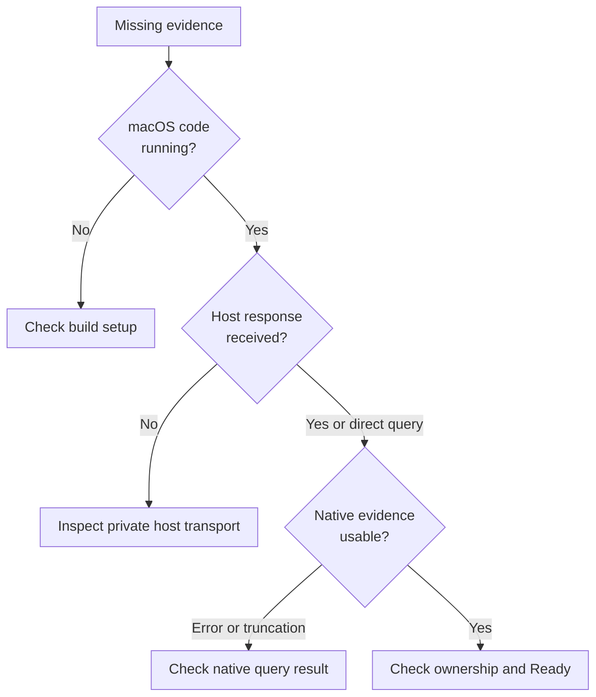

# Diagnose macOS process evidence

Use this guide when a native test fails or a foreground observation is missing,
incomplete, or rejected. Start with the failing query or observation category;
keep raw argument buffers and environment values out of diagnostics. Query
names, error kinds, completeness categories, and test names are enough to choose
the next check.

Native investigation requires the [macOS build prerequisites](contributing.md#run-the-focused-checks).
Run any linked test commands from the repository root. No daemon is needed for
the crate tests; host transport and live foreground behavior require their
separate runtime setup.

## 1. Locate the failing boundary

Use this decision tree to choose the layer to inspect without turning unknown
facts into negative facts.

*Build, response delivery, and evidence interpretation have different owners.
An incomplete read must remain unknown; it cannot certify absence.*

## 2. Check the symptom

### Build and native query failures

| Issue | Check and recovery |
| --- | --- |
| Zero tests or missing API | Check the whole-crate `cfg` in [lib.rs](../../src/lib.rs). Validate on macOS; keep the platform gating. |
| Missing SDK headers | For missing `libproc.h` or `sys/proc_info.h`, check the compiler/SDK and target in [build.rs](../../build.rs). Correct that environment; a Linux compiler cannot validate Darwin layouts. |
| Invalid ID | For `InvalidInput`, fix the supplied PID/PGID and signed conversion. Repeating zero or an out-of-range ID cannot help. |
| Query error | For an OS error or `InvalidData`, check [error interpretation](../reference/query-contracts.md#error-interpretation), short reads, paths, and identity before/after. Discard the sample; a future complete read may work if the intended process is still accessible. Neither process absence nor a need for elevated privileges follows from an error. |
| Socket error | For `Darwin socket observation unavailable`, investigate allocation, descriptor/socket churn, and final Rust identity checks using the C fixture or a debugger. The C result has lost the exact errno. |
| C fixture compile panic | Inspect compiler output and that test's temporary directory. Repair the compiler setup, then remove only that run's stale directory after its process exits. Rerun the focused test. |

### Incomplete or rejected runtime observations

| Issue | Check and recovery |
| --- | --- |
| Unexpected `Truncated` | Distinguish the all-descriptor cap, group count, and missing member/command facts. Preserve the incomplete category; a partial list cannot certify absence. Environment-name completeness is a separate member field: inspect it when profile matching lacks facts. |
| Listener `Absent` but application seems healthy | Check the queried PID, foreground membership, and socket lifetime. The query samples IPv4/IPv6 TCP listeners; it does not probe application health. |
| Native facts exist but `Ready` is missing | Follow the [foreground flow](../internals/runtime-integration.md#collect-one-foreground-observation): root incarnation, PTY group, fresh shell invocation, cooperative signal, complete membership. Keep the rechecks and fresh command reads required for Ready. |
| Host response lost | Inspect [host recovery](../../../undercurrent-runtime/docs/internals/host/recovery.md). A new observation is a fresh read. For an uncertain mutation, reconcile the exact attempt before considering replay; process-table facts cannot settle it. |

## 3. Verify the fix

Rerun the [focused check](contributing.md#2-run-the-self-query-test) for the
boundary you changed. A native test should pass with the expected test count.
For interpretation changes, run the [runtime caller tests](contributing.md#4-check-affected-runtime-callers)
and confirm that the failure case still preserves incomplete or unavailable
evidence. A passing read of your own process does not resolve a lost mutation
response; use the runtime's attempt reconciliation for that case.

Follow the [test cleanup instructions](contributing.md#resources-and-cleanup)
for temporary listeners, child processes, and C fixture files.

[Crate documentation](../README.md) · [Query contracts](../reference/query-contracts.md)
