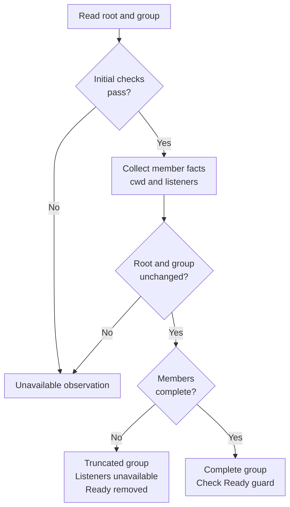

# Follow macOS process evidence into the runtime

This explanation is for maintainers tracing why a macOS foreground sample is
accepted, incomplete, or unavailable. It covers the current adapter and its
runtime callers. A process incarnation means a PID paired with its creation
time; a foreground group is the process group currently attached to the managed
PTY's foreground, not every descendant of the managed shell.

For process ownership, start with the shared
[system diagram](../../../../docs/architecture/README.md#process-boundaries).
The adapter runs in whichever process calls it; it is not a helper service. In
the hosted foreground path, `uc-daemon` asks `uc-session-host` for an observation,
and the host's native runtime performs synchronous OS queries. Agent ancestry
verification also uses the adapter from the hosted runtime code. The crate does
not connect to public client IPC or implement private UCHS (the session-host
protocol); it only supplies local evidence to those owners.

## Dependencies and source map

The [workspace code map](../../../../docs/architecture/dependencies.md) owns crate
dependencies. This adapter has no internal product dependencies: its
[manifest](../../Cargo.toml) selects `libc` on macOS and `cc` for the build;
[build.rs](../../build.rs) compiles the C helper against macOS SDK headers only
for that target. The [runtime manifest](../../../undercurrent-runtime/Cargo.toml)
selects the adapter on macOS, and the
[architecture policy](../../../../tests/architecture/allowed-graph.json) permits
only that product caller.

| Area | Owning source | Responsibility |
| --- | --- | --- |
| Safe query boundary | [lib.rs](../../src/lib.rs) | PID validation, bounded output storage, owned values, errors, listener identity checks, native Rust tests |
| Socket layout and inspection | [listeners.c](../../src/listeners.c) | SDK structures, bounded descriptor growth, socket/list consistency checks, array cleanup |
| Native build | [build.rs](../../build.rs), [Cargo.toml](../../Cargo.toml) | macOS-only C compilation, dependencies, local unsafe-code policy |
| Deterministic socket failures | [listeners_contract.c](../../tests/listeners_contract.c) | Compiles the production C helper against fixture OS calls |
| Foreground facts and cache | [macos_observation.rs](../../../undercurrent-runtime/src/process/macos_observation.rs) | Parse command facts, compare ownership, recheck membership, gate cooperative readiness |
| Runtime and private host dispatch | [process/mod.rs](../../../undercurrent-runtime/src/process/mod.rs), [host.rs](../../../undercurrent-runtime/src/process/host.rs), [hosted.rs](../../../undercurrent-runtime/src/process/hosted.rs) | Select the exact managed process, route private observation requests, encode/decode adapter-neutral evidence |
| Interpretation | [Evidence types](../../../undercurrent-application/src/process_observation.rs), [projections](../../../undercurrent-application/src/observation.rs) | Define completeness categories and select application projections from the facts |

The local query contract is in [Query contracts](../reference/query-contracts.md). Exact
adapter-neutral observation definitions belong to the linked application source;
public SDK types and wire schemas belong to the protocol/SDK owners.

## Collect one foreground observation

At native spawn, [spawn.rs](../../../undercurrent-runtime/src/process/spawn.rs)
obtains a PTY child PID, then calls
[platform::process_start_ticks](../../../undercurrent-runtime/src/process/platform.rs).
On macOS that function stores `identity(pid).start_micros` in the managed process.
Despite the shared field name `root_start_ticks`, Darwin uses creation-time
microseconds; it is not the Linux tick representation. Failure to read this
identity is propagated as a spawn `PortError` after child creation. The adapter
does not own the child's cleanup or establish a durable spawn outcome.

The foreground request selects a matching session and process-instance ID in
`NativeProcessRuntime::observe_foreground`. A missing or different process is
`NotFound`. Once selected, the runtime's
[macOS observer](../../../undercurrent-runtime/src/process/macos_observation.rs)
collects and validates the evidence. The diagram shows which failures discard
the observation and which retain partial member facts.

*A changed root or group invalidates ownership of the whole sample. Failed or
changed member facts under stable root/group ownership retain a partial sample.*
The calls are observations with no durable commit; rechecks reject observed
races without making collection atomic.

### Collection checks

**Establish ownership.** Root creation time must match the recorded value. The PTY foreground group must be positive, and enumeration must succeed with a nonempty list. Otherwise return `Unavailable`.

**Admit members.** Lock the cache, prune expired facts, then read each member's identity. Require the foreground group and root UID. Read or reuse command facts, then recheck the full identity. Failed members add no new cache entry and make the group incomplete.

**Read optional facts.** Read the root cwd and listeners for enumerated PIDs. Directory failure leaves an optional field missing. Listener errors and truncation keep their own categories.

**Recheck ownership.** Re-enumerate members and reread the PTY foreground group and root identity. A failed read or changed root, foreground group, or PID list returns `Unavailable`. An incomplete final enumeration or a failed/changed admitted member identity makes the group `Truncated`.

**Confirm Ready.** Require complete collection and exactly one admitted member: the original root with shell invocation basename `zsh`, `bash`, `fish`, or `sh`, after stripping leading `-`. Otherwise remove `Ready`. Other cooperative states pass through this guard.

### Cache, parser, and completeness limits

The member-cache mutex covers collection after initial membership enumeration,
including native reads and final rechecks. It serializes that portion of
sampling, without locking the observed OS processes. After locking, it prunes
facts older than 100 ms. The cache retains at most 128 parsed command facts, evicts the oldest when adding beyond that bound, and
does not refresh sample age on a hit. Membership, identities, cwd, and socket
state are queried afresh. A failed overall sample can leave previously admitted
command facts in the cache; future reads still require current matching identity
and freshness. The adapter itself has no cache.

Only command facts can come from the cache, and only when the full identity
matches and the incoming cooperative state is not `Ready`. Ready confirmation
always acquires fresh arguments, even for the same PID.

The runtime parser uses invocation `argv[0]` for profile matching and preserves
empty positional arguments. It retains command arguments as private matching
facts and only environment **names**, never their values. Its bounds differ
from the adapter's raw acquisition limit:

| Parsed input | Runtime bound | Failure effect |
| --- | --- | --- |
| Argument strings | 1–65 strings: invocation plus at most 64 arguments; combined bytes at most 16 KiB | Malformed command syntax, invalid UTF-8, or overflow rejects the member. |
| Kernel executable-path prefix | At most 4096 bytes | Reject the member if oversized or unterminated. |
| Environment entries | At most 64 entries and 64 KiB cumulative bytes, checked after each entry | Keep valid command facts but mark environment names incomplete on malformed names, overflow, or trailing nonzero data. |
| Environment names | `EnvironmentName` validation with a 256-byte bound | An invalid name makes the environment projection incomplete. |

The foreground cwd conversion separately requires UTF-8 and a `PathReference`
within 4096 bytes; a valid native path can therefore become `None`. The
[parser tests](../../../undercurrent-runtime/src/process/macos_observation.rs)
exercise empty positional arguments, environment-value omission, and malformed
or oversized inputs. These runtime bounds are distinct from acquisition bounds
in the [adapter](../reference/query-contracts.md#arguments-and-sensitive-storage).

The runtime uses `Truncated` for missing member/command facts as well as the
adapter's 32-member cap. The application enum's comment describes hard-limit
omission; on this path the category alone does not diagnose a limit being hit. Environment-name incompleteness is tracked
per member independently. Initial root/membership failure or a changed final
root/group yields `Unavailable`, rather than a partial authoritative group.

For listener aggregation, the observer starts at `Absent`, records `Present`
when found, and stops at the first `Unavailable` or `Truncated` in sorted PID
order. Either overrides previously found presence. If membership is incomplete,
the returned listener observation is forced to `Unavailable`. On this macOS
path, the separate managed-root and managed-tree listener fields remain at the
application constructor's `Unavailable` defaults; querying each foreground PID
does not implement whole-tree observation.

Cooperative readiness comes from an exact-process shell signal and freshly
verified shell command facts; it is not inferred from TCP sockets. Application
server-role selection may use listener evidence, but a listening socket or
observed process exit does not establish an application-level result.

## Other runtime callers

### Shell-environment capture

In [shell_environment.rs](../../../undercurrent-runtime/src/process/shell_environment.rs),
`valid_capture_peer` reads Unix-socket credentials and PID, requires the current
effective UID, walks at most eight ancestor identities to the shell, and
rechecks the shell and chain. Socket credentials come from the runtime's socket
API; `identity` alone does not authenticate a peer.

The same module's `process_identity` projects parent PID and creation time into
an optional identity. Errors become `None` by caller policy, not because the
adapter promises that a failed query means exit.

### Agent ancestry verification

In [hosted.rs](../../../undercurrent-runtime/src/process/hosted.rs),
`validated_agent_root` compares the peer's kernel executable path with the
canonical expected bridge path. It walks a bounded same-UID ancestry chain to
a recorded root incarnation, then rechecks chain, peer, root, and executable.
A claimed `argv[0]` cannot replace that path check. Unknown or mismatched
process-table evidence rejects verification; this crate makes no ownership
decision itself.

### Execution cleanup

In [execute_host.rs](../../../undercurrent-runtime/src/process/execute_host.rs),
`execution_process_start` supplies the creation time that `force_exact_job_cleanup`
compares before attempting workload group cleanup. Signal delivery, cleanup
races, supervisor handling, journaling, and execution outcome belong to the
caller. Reading identity and delivering a signal are separate operations.

The [real-child ancestry test](../../../undercurrent-runtime/src/process/hosted.rs)
checks exact executable and root incarnation, while the native and fake-source
tests listed in the [test guide](../development/contributing.md#what-the-tests-prove) cover this
crate's queries and the foreground observer's conservative behavior.

The private shell-environment capture path is separate from the foreground
argument parser's names-only projection. Capture can retain environment values
in its own protected runtime state; that does not make values part of foreground
observation facts or part of this adapter's cache (which does not exist).

## Session output, recovery, and shutdown stay with their owners

The spawn identity read above is the adapter's part of session creation.
[Native process ownership](../../../undercurrent-runtime/docs/internals/processes/native-processes.md)
explains child cleanup and output-reader ordering. Terminal output follows that
reader and [HostOutputRouter](../../../undercurrent-runtime/src/process/host.rs)
into private host frames; it does not pass through this adapter. Use the runtime
[terminal guide](../../../undercurrent-runtime/docs/internals/terminal.md) for
output offsets, gaps, replay, and reconnection.

A host observation response can be lost after collection; that leaves the
daemon without a usable response. A later read supplies a new sample, not the
previous snapshot. Private UCHS delivery is separate from public client IPC.

For a lost mutation response, [HostedOperationAttemptEffectObserver](../../../undercurrent-runtime/src/process/attempt_observer.rs)
routes reconciliation to the exact private host evidence owner; see
[host recovery](../../../undercurrent-runtime/docs/internals/host/recovery.md). A current PID,
cwd, command line, or listening socket cannot replace the retained receipt of
the specific attempt. Re-observe a failed read when appropriate; reconcile a
mutation through its operation-specific contract before considering a retry.

There is no adapter shutdown protocol. Native calls finish synchronously;
temporary C arrays are freed before return and Rust argument storage is cleared
when dropped, subject to the [documented limits](../reference/query-contracts.md#arguments-and-sensitive-storage).
Caller deadlines and runtime-attempt cancellation do not interrupt a kernel
query already executing here. The runtime owns termination, joining workers,
and durable shutdown outcomes.

[Crate documentation](../README.md) · [Diagnose evidence](../development/diagnosing-observations.md)
