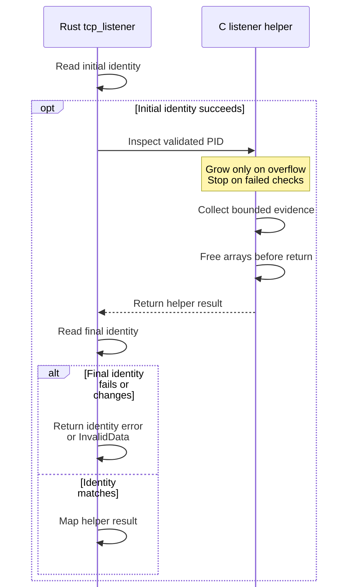

# Darwin query contracts

Use this reference when changing a macOS query or reviewing a caller's use of
its evidence. It describes package `0.1.0-beta` in this checkout, for internal runtime
maintainers. The owning implementation is [src/lib.rs](../../src/lib.rs), with
TCP descriptor inspection in [src/listeners.c](../../src/listeners.c). These are
local Rust/C contracts, not public protocol operations or schemas.

For ownership and application interpretation, read [runtime
integration](../internals/runtime-integration.md). For executable checks, read the
[maintainer guide](../development/contributing.md). Generated Rustdoc provides symbol lookup;
this page explains what a caller may conclude.

Jump to [identity and membership](#identity-and-bounded-membership),
[argument storage](#arguments-and-sensitive-storage), [paths](#paths),
[TCP listeners](#tcp-listener-sampling), [errors](#error-interpretation), or
[safety invariants](#safety-invariants-to-preserve).

## Common rules

Every process or group ID must be in `1..=i32::MAX`. Validation happens before
native access. The queries return owned Rust values or an owned argument buffer;
no raw pointer, descriptor, kernel address, process handle, or retained native
allocation crosses the public Rust boundary.

Calls block the calling thread until the OS returns. The adapter has no threads,
global cache, lock, timer, async executor, shutdown hook, or cancellation token.
Each call owns its buffers, so concurrent callers do not share adapter state.
That does **not** create a consistent snapshot between calls or prevent the
observed process from exiting, changing directory, executing a new image, or
reusing descriptors during collection. There is no wall-clock timeout guarantee.

All native calls read process state. There are no target-process mutations,
durable commits, transactions, request IDs, deduplication records, streams, or
reconnect state here. A fresh query cannot duplicate a mutation, but returns new
evidence rather than replaying the previous result. This does not authorize
retrying a runtime spawn, input, stop, or execute operation after response loss.
Those outcomes belong to the runtime's retained evidence and public contracts.

## Identity and bounded membership

### Accept a process identity

`identity` reads `PROC_PIDTBSDINFO` into an aligned `MaybeUninit<proc_bsdinfo>`.
All these checks must pass before a `ProcessIdentity` is returned:

| Native reply | Required check |
| --- | --- |
| Byte count | Positive and exactly `size_of::<proc_bsdinfo>()` before initializing the Rust value. |
| PID | Equals the requested PID. |
| Microsecond component | Below one million. |
| Creation time | Checked seconds-to-microseconds conversion plus the microsecond component is nonzero and does not overflow. |

`ProcessIdentity` retains PID, parent PID, process group, UID, creation time in
microseconds, and the 32 raw bytes of `pbi_name`. The adapter reports UID and
group; it does not authorize an owner or enforce membership. Callers perform
those comparisons. Equality compares every field. PID plus creation time helps
detect PID reuse; the image name adds an exec-sensitive discriminator, not a
unique executable identity. Equal values do not prove no exec or intervening
change occurred. Use the kernel executable path when the caller needs that
separate fact.

### Interpret the membership completeness flag

`group_members` asks `proc_listpids` for `PROC_PGRP_ONLY` (the selector is written
as `2` in the implementation). It uses 33 initialized `i32` slots: 32 retained
members and one overflow sentinel. It rejects nonpositive returns, oversized or
misaligned byte counts, and nonpositive returned PIDs. It takes the first at most
32 entries, sorts them, then rejects duplicates in that retained prefix. The
sentinel's positivity is checked, but it is not part of the duplicate comparison
or returned vector.

| Native entry count | Returned evidence |
| --- | --- |
| 1–32 | Sorted members and `true`: enumeration fit the buffer. |
| 33 | First 32 entries, sorted, and `false`: a partial list, not the globally smallest PIDs or the true group size. |
| Zero-byte reply | Error, not a successful empty group. |

For this zero-byte path, `group_members` constructs `last_os_error()` even though
zero can mean no matching processes and need not set errno. Treat the sample as
unavailable; the attached errno may be stale and is not a reliable cause.

Even `true` says nothing about later stability, UID consistency, or readable
command facts. The runtime re-enumerates and rechecks identities before use.

## Arguments and sensitive storage

`arguments` issues one read-only `sysctl` with the three-element MIB
`[CTL_KERN, KERN_PROCARGS2, pid]`. It allocates a zero-initialized 128 KiB vector
(`MAX_ARGUMENT_BUFFER`) once. It neither asks the kernel for an allocation size
nor retries with a larger buffer. A successful returned length must lie between
`size_of::<i32>()` and 128 KiB; the vector is then truncated to that length.

This validates storage bounds only. The bytes still contain the native argument
count, executable-path/padding region, argument strings, and potentially
environment values. They are not UTF-8 validated or parsed by this crate.
`as_bytes` borrows the returned bytes for the lifetime of the buffer. The type
has no `Debug` implementation: callers must not log the slice or turn it into
diagnostic payloads.

`ArgumentBuffer::drop` fills the vector's **current length** with zero. On an OS
error or invalid length, the full allocated vector is still live and is filled
before deallocation. On success, drop fills the truncated length. This is an
ordinary `Vec::fill`, not an optimizer-resistant erasure primitive, and it does
not erase copies made by callers or promise scrubbing of unused capacity.
Keep the borrow short, avoid raw-byte copies, and drop the buffer after parsing.

The runtime owns [parsing and privacy projection](../internals/runtime-integration.md#cache-parser-and-completeness-limits).
It can retain bounded parsed command facts, so clearing the raw buffer does not
erase those facts. Its parser limits are separate from the 128 KiB acquisition
limit here.

## Paths

### Working directory

`working_directory` requires an exact-size `PROC_PIDVNODEPATHINFO` reply, a NUL
inside `pvi_cdir.vip_path`, and an absolute resulting path. It reports the queried
process's current directory without canonicalizing, checking existence, opening
a directory handle, or rechecking identity.

### Executable path

`executable_path` reads `proc_pidpath` into a fixed zeroed 4096-byte array. The
return must be positive and below capacity; the first NUL must follow a nonempty
path exactly at that returned count, and the path must be absolute. This is the
kernel-reported image path, distinct from `argv[0]`. It does not pin the file or
recheck identity.

Both construct `OsString` from bytes and preserve non-UTF-8 paths. The
[runtime cwd conversion](../internals/runtime-integration.md#cache-parser-and-completeness-limits)
adds its own text and size checks. A path
string is not an authorization capability; [agent-peer
verification](../internals/runtime-integration.md#other-runtime-callers) rechecks identity and
path around its own decision.

## TCP listener sampling

`tcp_listener` first reads process identity, calls the C helper, then reads
identity again. The final identity check runs even when the helper reports
failure or truncation. An identity read error is returned directly; differing
identities become `InvalidData`. Only matching identity values permit mapping
the helper's integer result.

Successful results use `TcpListener`; unavailable inspection returns an error.

| Result (C value) | What the caller may conclude |
| --- | --- |
| `Present` (`1`) | The checked descriptor snapshot included an IPv4 or IPv6 TCP stream socket in `TSI_S_LISTEN`. |
| `Absent` (`0`) | The checked descriptor snapshot contained no qualifying listener. This is not a permanent negative. |
| `Truncated` (`2`) | The descriptor cap prevented complete inspection; neither absence nor presence was certified. |
| Error kind `Other` (any other value, currently `-1`) | Socket observation was unavailable. The C helper's errno and exact failure cause are not preserved. |

### Descriptor capacity and overflow

The C helper allocates two zeroed descriptor arrays, initially 257 slots each.
On overflow it frees both arrays and retries with limits 512, 1024, 2048, then
4096, always with one additional sentinel slot. There are at most five growth
attempts and at most two arrays live. Exact fits at 256 or 4096 are inspectable;
4097 entries yield truncation without inspecting sockets at that size. The cap
counts **all descriptors**, not just sockets. Zero, oversized, or non-multiple
descriptor-list byte counts mean unavailable; zero descriptors are not certified
as `Absent` by this implementation.

### Socket and descriptor consistency

Within a fitting snapshot, negative descriptor numbers fail. Each socket
descriptor needs two exact-size `PROC_PIDFDSOCKETINFO` reads. Presence requires
all of `SOCKINFO_TCP`, `SOCK_STREAM`, `IPPROTO_TCP`, IPv4 or IPv6, and
`TSI_S_LISTEN` on the first read. The second read must have the same `soi_so`
identity and kind, and, for TCP, the same state. The helper uses the kernel socket
identity internally without returning it. It does not compare every field of
the two socket structures.

Finding a listener does not short-circuit inspection. Every remaining socket
must pass, and a final `PROC_PIDLISTFDS` read must match the original byte count
and descriptor array byte-for-byte, including order. A socket disappearing,
permission loss, or a changed descriptor list invalidates the whole result even
after a candidate listener was found. Conservative rejection can reduce evidence
availability under churn; it prevents known partial reads from certifying a
result. Matching rechecks still do not constitute an atomic OS snapshot.

### Resource lifetime and result precedence

An initial identity error returns before C is called. This sequence isolates
the Rust/C acceptance boundary. The capacity and socket
checks above run inside C; the final Rust identity read decides whether *any*
helper result may be used. There is no durable commit or target-process mutation.

*The final identity check also runs after truncation or helper failure. Failed
socket checks stop inspection immediately; a found listener cannot override them.*

No connect probe is sent and no port, address, or application response is
returned. `Present` establishes observed ownership of a listening TCP socket,
not service health, application completion, or readiness for a particular
request. The [runtime aggregation](../internals/runtime-integration.md#collect-one-foreground-observation)
applies additional foreground-ownership checks.

## Error interpretation

| Error route | Owning check | Caller response |
| --- | --- | --- |
| `InvalidInput`, `invalid process ID` | Shared positive signed-PID conversion | Fix the caller's identifier; repeating the same invalid input cannot help. |
| `last_os_error()` | Nonpositive libproc return or nonzero `sysctl` result; identity reads surrounding C inspection | Preserve the OS error for diagnosis; access denial, process exit, or unavailable data is not evidence of absence. The adapter does not normalize errno into a product error taxonomy. |
| `InvalidData`, `incomplete Darwin process information` | Rust size, contents, path, timestamp, or identity-consistency checks | Discard this sample. Reacquire identity and the whole dependent observation if sampling again. |
| `Other`, `Darwin socket observation unavailable` | Unavailable C result after successful final identity check | Preserve unknown evidence. Use fixtures or a debugger to locate the native failure; do not assume a specific errno. |

Queries do not emit logs, metrics, or spans themselves. Prefer error kind,
query name, and completeness status when diagnosing them; raw argv/environment
bytes are not suitable diagnostic evidence. The foreground runtime intentionally
maps socket errors to `Unavailable`, while other callers may propagate a
`PortError` or reject a peer. There is no general error-to-retry policy in this
crate.

## Safety invariants to preserve

The [manifest](../../Cargo.toml) uses `unsafe_code = "deny"` with six
function-local allowances; the runtime retains workspace
`unsafe_code = "forbid"`. Eight unsafe call/initialization blocks and a
function-local C declaration form this boundary. Keep their safety arguments
adjacent to the operations; `undocumented_unsafe_blocks` is denied.

`MaybeUninit` is used only for fixed SDK structures, read only after exact-size
initialization. Input/output slices have checked byte capacities and remain
valid for the synchronous call; native code retains no pointers. The C helper
uses SDK-owned socket layouts rather than duplicating those structures in Rust.
[build.rs](../../build.rs) compiles it through `cc` only for a macOS target and
tracks changes to `src/listeners.c`. There is no separate query executable or
`ps`/`lsof` subprocess in production.

The adapter reads `KERN_PROCARGS2` directly to preserve empty positional
arguments and bound acquisition independently of parsing. A replacement wrapper
must preserve both properties. Acquisition stays separate from the [runtime parser](../../../undercurrent-runtime/src/process/macos_observation.rs),
whose `arguments_keep_invocation_empty_arguments_and_only_environment_names`
test protects empty arguments. A replacement must also preserve fixed bounds,
sensitive-buffer lifetime, and incomplete-evidence semantics.

Fixed limits trade completeness for predictable storage and work. Read/recheck
cycles trade availability for rejection of observed races. Neither should be
weakened by treating unavailable data as an empty group or absent listener.
See the [extension checklist](../development/contributing.md#extend-the-boundary) for the
corresponding tests and integration responsibilities.

[Crate documentation](../README.md)
