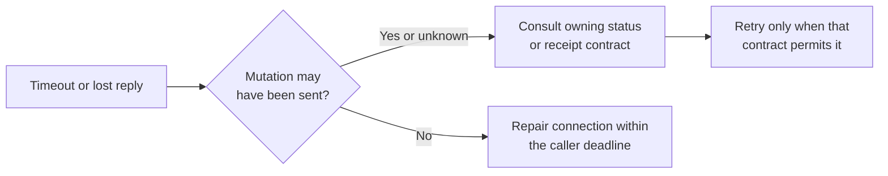

# Develop and verify Windows primitives

Use this guide to run a safe maintainer example, select focused Windows checks,
and diagnose native failures. Commands run from the **repository root**, not
this crate's directory. These are development commands; users seeking daemon
installation or CLI tasks should start at the [product README](../../../../README.md).

For a first run, [prepare the checkout](#prepare-a-native-checkout),
[run the example](#run-the-private-record-example), then
[select checks](#choose-checks-for-a-change). If a check fails, jump to
[diagnosis](#diagnose-a-windows-failure).

## Prepare a native checkout

Use a native Windows x86_64 MSVC development shell with the linker already set up.
The repository pins Rust **1.95.0** in
[rust-toolchain.toml](../../../../rust-toolchain.toml), with rustfmt and Clippy;
[Cargo.toml](../../../../Cargo.toml) sets edition 2024 and MSRV 1.95. Dependencies
must be available to Cargo under the unchanged lockfile. This crate has no
optional feature flags. Its `#![cfg(windows)]` removes the entire implementation
on other platforms, including its unit tests.

The Windows job in [Native platform CI](../../../../.github/workflows/platform-contracts.yml) uses
`windows-2022`, PowerShell, the pinned toolchain, native workspace tests, and
real-daemon smoke checks. That describes the checked-in validation lane, not
proof that an arbitrary Windows version or target has passed. ConPTY
qualification belongs to the runtime, not this library's unit tests.

For the crate tests, allow temporary local filesystem access, named pipes,
IPv4/IPv6 loopback binding, and creation of test-owned `cmd.exe` children. The
junction test calls `powershell.exe`. Keep `TEMP` on a local writable disk with
Windows ACL support; network shares and reparse-point ancestors do not satisfy
the private-path contract. The tests require no running Undercurrent daemon and
do not use your normal runtime home.

1. Open PowerShell in the repository root (the directory containing the workspace
   `Cargo.toml` and `rust-toolchain.toml`).
2. Inspect the selected environment:

   ```powershell
   rustup show active-toolchain
   rustc --version
   rustc --print cfg
   ```

3. Confirm toolchain 1.95.0 and `windows`, `target_arch="x86_64"`, and
   `target_env="msvc"` in the configuration output. Resolve a mismatch before
   continuing.

A Linux test reporting zero tests is not Windows qualification. Cross-compilation
can check types when the target/linker exists, but cannot establish ACL, job, or
pipe behavior.

## Run the private-record example

The maintained [private_record.rs](../../examples/private_record.rs) verifies a
complete private-file lifecycle with the existing `tempfile` development
dependency. It needs no daemon or workload. Use the native setup above and keep
its temporary directory separate from runtime state.

1. From the repository root in PowerShell, run:

   ```powershell
   cargo run --locked -p aixand-undercurrent-platform-windows --example private_record
   if ($LASTEXITCODE -ne 0) { throw 'Private-record example failed' }
   ```

2. Check for both lines below and a zero exit status. This is **expected output**,
   excluding Cargo messages:

   ```text
   published and verified: new private record
   removed record and temporary directory
   ```

   The example prints its temporary directory to stderr. Before reporting
   success, it prepares a private child directory, exclusively creates staging,
   writes and syncs the contents, closes the file, and publishes it. It reopens
   the record to verify bytes and the disappearance of staging, then removes
   the exact file, drops the directory pin, and closes the temporary directory.

3. Confirm cleanup from the second line. On failure, keep the `io::Error` and
   printed directory path for [diagnosis](#diagnose-a-windows-failure).
   `TempDir` attempts cleanup on normal error return and unwind. If the example
   was forcibly terminated, confirm that it has exited, then remove only its
   printed temporary directory if it remains.

The non-Windows entry point reports that native Windows is required and exits
unsuccessfully. The example has one writer; when adapting the pattern, retain
caller coordination through [staged publication](../internals/filesystem-security.md#publish-a-staged-record).
Use the checks below after making a change.

## Choose checks for a change

1. Run the local crate suite:

   ```powershell
   cargo test --locked -p aixand-undercurrent-platform-windows --lib
   if ($LASTEXITCODE -ne 0) { throw 'Native crate tests failed' }
   ```

2. Confirm that native tests ran and passed, then check lints:

   ```powershell
   cargo clippy --locked -p aixand-undercurrent-platform-windows --all-targets -- -D warnings
   if ($LASTEXITCODE -ne 0) { throw 'Clippy failed' }
   ```

3. Select an affected caller below. For a regression within one module, use a
   test filter during iteration:

   ```powershell
   cargo test --locked -p aixand-undercurrent-platform-windows --lib filesystem::tests
   cargo test --locked -p aixand-undercurrent-platform-windows --lib listeners::tests
   ```

A filtered run must report matching tests. A zero-test result does not establish
coverage. See [test coverage and limits](test-coverage.md) to find regression
cases for the changed mechanism.

### Check the affected caller

Choose the relevant command; each checks behavior above the OS wrapper:

```powershell
cargo test --locked -p undercurrent-runtime --test windows_native_runtime
cargo test --locked -p undercurrent-runtime --lib process::execute_host::windows_tests -- --test-threads=1
cargo test --locked -p undercurrent-store-sqlite --test durability windows_database_sidecars_and_backups_are_owned_by_the_account
cargo test --locked -p undercurrent-daemon --lib process_instance::tests
```

The [native runtime tests](../../../undercurrent-runtime/tests/windows_native_runtime.rs)
cover launch, batch argument handling, input/resize/stop, rejected sealed
launches, changed directories, listener attribution without foreground
membership, environment casing, and native restart updates. The
[execution tests](../../../undercurrent-runtime/src/process/windows_execution_tests.rs)
cover host death, descendant cleanup, unknown effects, persisted output/status
replay, cancellation, deadlines, and output bounds. The
[SQLite test](../../../undercurrent-store-sqlite/tests/durability.rs) checks database,
WAL/SHM, backup, and restored-file compatibility with exact-user owner checks.
The [instance test](../../../undercurrent-daemon/src/process_instance_windows.rs)
checks exclusive daemon ownership and scope pinning. These tests create and
retire their own resources; do not replace fixture paths/PIDs with real state.

### Check documentation comments and examples

For documentation comments and examples, run these native scoped checks. The
`finally` block restores your previous Rustdoc flags even after a failure:

```powershell
$previousRustdocFlags = $env:RUSTDOCFLAGS
try {
    $env:RUSTDOCFLAGS = '-D warnings'
    cargo doc --locked -p aixand-undercurrent-platform-windows --no-deps
    if ($LASTEXITCODE -ne 0) { throw 'Rustdoc failed' }
    cargo test --locked -p aixand-undercurrent-platform-windows --doc
    if ($LASTEXITCODE -ne 0) { throw 'Doctests failed' }
    cargo check --locked -p aixand-undercurrent-platform-windows --examples
    if ($LASTEXITCODE -ne 0) { throw 'Example compilation failed' }
} finally {
    $env:RUSTDOCFLAGS = $previousRustdocFlags
}
```

Generated documentation starts at
`target/doc/undercurrent_platform_windows/index.html` with the default Cargo
target directory. The shared [validation runner](../../../../scripts/validate.py)
also provides `python3 scripts/validate.py --stage rustdoc`, using
warning-denied workspace Rustdoc, Bash, Python 3, and cached dependencies with
Cargo offline. That is the integration gate, not a replacement for native
Windows coverage.

### Qualify the platform

For full end-to-end platform qualification, the Windows job in
[Native platform CI](../../../../.github/workflows/platform-contracts.yml) and
[smoke script](../../../../tests/e2e/platform/windows-native-smoke.py) are the maintained
entry points. The script builds or uses explicit artifacts, selects a unique
temporary `UNDERCURRENT_HOME`, and tests daemon crash recovery, ConPTY output,
one-shot execution, TCP attribution, PowerShell context, and reset. It requires
PowerShell 7 and intentionally controls test processes. Its result and artifacts
must be inspected separately from this crate's unit results.

### Qualify peer logon contexts

For changes to pipe account verification, also run the opt-in
[peer-context qualification](../../../../tests/e2e/platform/windows-peer-contexts.py).
Sign in to the Windows desktop, then run the following from an elevated SSH
session **as that same account**. Task Scheduler must be available. The native
Python installation must include `pythonw.exe` next to `python.exe`.

```powershell
cargo build --locked --release -p aixand-undercurrent-platform-windows --example pipe_peer_probe
cargo build --locked --release -p undercurrent-cli -p undercurrent-daemon -p undercurrent-python-bridge
python tests/e2e/platform/windows-peer-contexts.py --probe target/release/examples/pipe_peer_probe.exe --uc target/release/uc.exe --work target/peer-contexts-new-run
```

Adjust artifact paths if Cargo uses an explicit target triple or target directory.
Supply a new work directory for every run. It retains JSON results and disposable
state for inspection. The coordinator creates uniquely named interactive tasks,
verifies that they actually ran under limited or elevated desktop tokens, and
unregisters them afterward. It never targets an installed daemon or saved CLI
profile. Its separate daemon home is stopped in the desktop owner task.

Required pipe cases are regular-to-regular, elevated-client-to-regular-server,
regular-client-to-elevated-server, and SSH-client-to-regular-server. An anonymous
SSH client must fail identification. The CLI and matching Python bridge must
both see the same real session from regular, elevated, and SSH client contexts.
Inspect `report.json`, including `daemonCleanup`; an incomplete run or a
different token/session context is a failure. This does not test a different
account or enable regular clients to trust inaccessible SSH-owned servers.

## Run the Windows workflow before pushing

With Python 3.13, PowerShell 7, Git and the MSVC/Rust prerequisites above installed,
run every Windows CI stage from a normal PowerShell:

```powershell
python scripts/ci/windows-native.py
```

If Python is managed by `uv`, use `uv run --python 3.13 --no-project
python scripts/ci/windows-native.py` instead. The runner builds debug and release
binaries, runs native and installer tests, exercises the installed product and
release bundle, and uninstalls its test installation. Its install prefix is
`target/windows-development-install`; smoke tests use isolated runtime homes.
It installs the pinned `pywinpty` fixture dependency into an isolated virtual
environment at `target/windows-ci-python`.
Logs and a JSON report are saved under `target/windows-ci/run-*/` even when a
stage fails. The report records the source fingerprint, OS, token elevation,
commands and exit codes. `--list` shows the stages; `--stage smoke` reruns one.
A selected-stage report is not a full-workflow pass.

The GitHub Windows job calls this same runner. Local Windows 11 success establishes
behavior on Windows 11. To reproduce the hosted runner's Windows Server 2022
ACL and ConPTY behavior, repeat the workflow in a disposable Server 2022 VM with
an elevated guest account. Match the OS build and tool versions shown in the
failed run's setup log; the default VM check expects build `20348.5622`.
Host elevation is unnecessary for the test commands or SSH driver.

For a prepared VM with a verified SSH host key and the required tools:

```powershell
./scripts/ci/test-windows-vm.ps1 -Target Administrator@ci-vm -Identity C:/vm/id_ed25519
```

The driver snapshots tracked edits and untracked source files, excludes ignored
build output, and copies the snapshot into a new directory in the VM. It checks
the guest's actual Windows build and Administrator token before running tests.
Reports return to `target/windows-vm/<run>/`. Use a separate Cargo target directory
for each checkout when comparing the old code with a fix.

To prepare a new local guest, obtain a Microsoft Server 2022 evaluation ISO and
QEMU for Windows, then run:

```powershell
uv run scripts/ci/prepare-windows-vm.py --directory D:/UndercurrentCI --installer D:/images/server-2022.iso --qemu D:/tools/qemu
$launch = Get-Content D:/UndercurrentCI/launch.json -Raw | ConvertFrom-Json
& $launch[0] @($launch[1..($launch.Count - 1)])
```

The unattended setup formats the VM's new virtual disk and bootstraps its tools.
The launcher uses `-no-reboot` to avoid QEMU firmware hangs on guest resets.
When setup requests its first reboot and QEMU exits successfully, change the
value after `-boot` in `launch.json` from `order=c,once=d` to `order=c`, then
run the launch command again. Relaunch after each subsequent guest reboot.
The VM directory contains private SSH keys and its generated Administrator
password and is restricted to your account and SYSTEM. QEMU uses Windows
Hypervisor Platform by default; installing that Windows feature needs an
Administrator and may need a reboot. `--accelerator tcg` runs without that
feature using slower CPU emulation. The installer ISO's patch level can differ
from CI: install the matching Microsoft cumulative update inside the guest,
reboot the guest, and wait for `C:/undercurrent-ci/bootstrap-status.json` to
report `ready`/`passed` before testing. Then, in another host PowerShell:

```powershell
./scripts/ci/test-windows-vm.ps1 -Target Administrator@127.0.0.1 -Port 2222 -Identity D:/UndercurrentCI/id_ed25519 -KnownHosts D:/UndercurrentCI/known_hosts
```

The VM run validates the uploaded working tree before a push. A successful
GitHub job additionally verifies GitHub's checkout, setup actions and runner
image. Once the commit is on `main`, push a new `ci/windows-*` tag at that commit
to run the Windows job in **Native platform CI** for that final check.

## Diagnose a Windows failure

Keep the original error kind and raw OS code, the failing helper, target, and
whether the caller held a pin/lock or sent a request. These wrappers do not
emit tracing records, maintain metrics, or retain operation history. Callers
must add context without logging private file contents, tokens, or pipe payloads.
Use the table for local resource failures. For a timeout or lost response,
first establish whether the request may have been sent:



*A usable connection does not settle a mutation's outcome. Reconciliation belongs
to the host or product operation that sent it.*

| Symptom | Investigation and recovery |
| --- | --- |
| `InvalidInput` | Check the helper’s path grammar, PID, or timeout value. Pipe endpoint paths and private filesystem paths have different rules. |
| `unsafe private path identity or ownership` | Inspect the requested local path, exact owner, reparse attributes, hardlink count, and requested kind. For other `PermissionDenied` errors, also inspect the requested handle/ACL rights. A same-account readable file can still fail strict owner/ACL rules. Fix fixture/configuration through its owner; do not skip checks or recursively rewrite an unrelated tree's ACLs. |
| Launch pin fails only under a traversal-only ancestor | Check the exact normalized leaf spelling and case. The fallback deliberately rejects aliases; investigate in `launch_leaf` and the runtime preflight rather than broadening private-state rules. |
| Sharing violation at rename or cleanup | Close the caller's staged/reader handles before replacement or exact removal. Drop directory pins before deleting temporary directories. Verify intentional locks before treating contention as stale state. |
| Lock file exists after exit | Probe the advisory lock as the caller does; existence is not liveness. Never infer ownership from the filename alone. |
| Pipe busy, missing, or account mismatch | Compare exact endpoint spelling/account and listener lifecycle. Blocking connect does not retry error 231. Do not delete a pathname expecting to remove a kernel pipe. |
| Read blocks during shutdown | Verify `shutdown(Both)` reached the shared stream. For listeners, use a caller-owned nonblocking accept/stop loop; changing its flag does not interrupt an existing accept. |
| Pipe timeout or lost reply after sending | The stream may remain usable but the operation may have taken effect. Reconcile using the host or product receipt/status contract before another mutation. |
| `NotFound`, `Truncated`, or TCP query error | Preserve the distinction. Check root creation identity, liveness, job membership, capacity, and IPv4/IPv6 availability. Repeating a read-only observation yields a newer sample, not proof that the old observation was negative. |
| Root exited but output worker is waiting | Inspect surviving job members and stdio ownership; follow supervisor terminate-before-relay-join ordering. Root exit is not tree exit or output completion. |
| Token scope fails | Check access to the effective token and that creation is synchronous on the calling thread. Setup errors skip the callback; restoration failure intentionally aborts. |

## Review a change

Identify the owning contract using the [source map](../internals/ownership.md),
preserve bounds and failure distinctions, then select local and caller checks.
Changes to handle rights or ACLs require native evidence.

For documentation changes, follow the shared [reader and rendering checks](../../../../docs/development/verification.md#review-the-reader-outcome).
Native tests, platform smoke results, and documentation checks establish different
facts; record which ran. For known native test gaps, use [test coverage and limits](test-coverage.md).

Return to [the crate entry point](../../README.md) or follow
[filesystem invariants](../internals/filesystem-security.md), [IPC ownership](../internals/private-ipc.md),
and [process evidence](../internals/processes.md) for the model behind a failing check.

[Crate documentation](../README.md)
