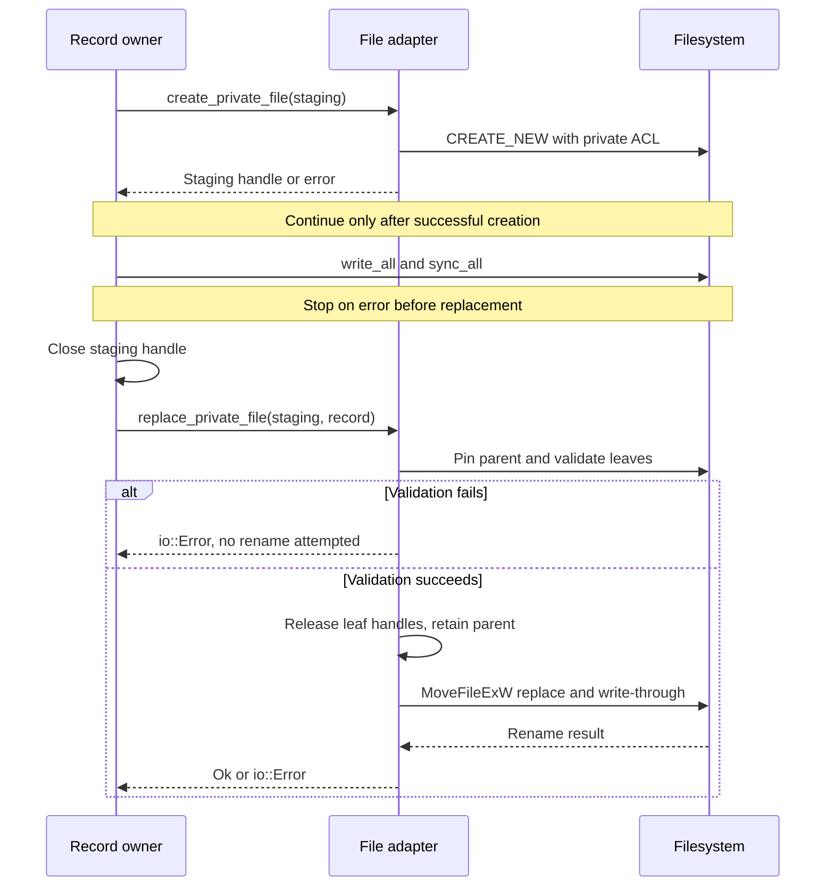

# Preserve private state and exact file identity

This explanation is for maintainers creating, locking, publishing, or removing
Windows state. The authoritative implementation is
[filesystem.rs](../../src/filesystem.rs), with account queries in
[security.rs](../../src/security.rs) and library-created file ownership in
[file_owner.rs](../../src/file_owner.rs). These helpers work with local Windows
paths and native ACLs; they are not a portable storage transaction API.
For a complete executable example, use
[the private-record walkthrough](../development/contributing.md#run-the-private-record-example).

Start with [pin selection](#choose-a-path-pin) for launch paths,
[private creation and locks](#create-and-restrict-private-objects) for state,
or [publication](#publish-a-staged-record) and [exact removal](#remove-an-exact-object)
for lifecycle changes. Library-created files use [default ownership](#account-identity-and-default-ownership).

## Choose a path pin

A `PinnedPath` retains the opened objects that justify later operations on a
validated pathname. Choose the check you need:

- **Pin a directory:** `PinnedPath::directory` checks an existing directory and
  its ancestors for their kinds and for reparse points. It requires no account
  ownership and changes no ACL. `owned_directory` also checks the leaf's owner
  against the current process account; it neither creates nor restricts it.
- **Pin an executable:** `PinnedPath::executable` checks an existing non-directory
  leaf and its ancestors, rejects reparse points, and pins bytes against writing.
  It checks no executable format, digest, owner, or single-link count.
  `launch_file` first tries that path, using the [launch fallback](#launch-fallback-for-traversal-only-ancestors)
  only after `PermissionDenied`.
- **Use a retained object:** `path()` returns the validated path, `file()` borrows
  the leaf handle, and `identity()` reads its `FileObjectIdentity`: volume serial,
  64-bit file index, and creation `FILETIME`. This identity is not a content digest.
- **Transfer the leaf:** `into_file()` drops ancestor handles and returns the leaf
  handle. Continue through that handle; the full pathname is no longer pinned.

### Handle lifetime and path grammar

Ordinary pins open the drive root and each directory ancestor before the leaf, checking
each opened object for reparse points and the expected directory/file kind.
Retained handles omit delete sharing; directory pins also request data-read
(directory-list) access because metadata-only handles would not prevent rename.
Ordinary executable and private-file pins omit write sharing as well;
[lock files](#lock-a-stable-file) have a separate sharing rule. This makes the lifetime of the pin part
of the correctness argument for later pathname operations.

Paths must have a disk or verbatim-disk prefix followed by a root and normal
components: for example `C:\state\record` or `\\?\C:\state\record`. UNC and
device prefixes, parent traversal, and colons in leaf/ancestor names (including
alternate data stream syntax) are rejected. NUL is rejected when converting to
Win32 strings. Validation uses Rust `Path::components`, not a separate lexical
canonicalizer; do not infer strict rejection of every redundant separator or
dot spelling. Ordinary directory pins can represent the drive root; private
root restriction and root-as-file operations are refused.

### Launch fallback for traversal-only ancestors

Launch pinning has a special case for traversal-only ancestors such as Microsoft
Store package directories. The fallback retains the drive root and leaf, asks
`GetFinalPathNameByHandleW` for the normalized DOS name, and compares components
exactly, allowing drive-letter case and disk/verbatim-disk prefix equivalence.
It rejects case aliases in other components, short names, and paths through
ancestor junctions rather than guessing their equivalence. The leaf is opened
without write/delete sharing and cannot be a reparse point. The implementation
relies on the open leaf to prevent ancestor rename; the tests exercise ordinary
rename and `FileRenameInfoEx` with replacement/POSIX flags. Do not generalize
this launch-specific fallback to private state or silently canonicalize an
untrusted path to bypass rejection.

## Create and restrict private objects

An owner security descriptor explicitly sets the current process account as
owner and grants it full access through a protected discretionary access-control list
(DACL). Protected means
parent ACL inheritance cannot add grants to that object. Directory entries use
object/container inheritance flags for newly created descendants. Handles
created with this descriptor are noninheritable.

`prepare_private_directory` recursively creates missing directories with the
private descriptor supplied **at creation**, before visibility. Existing
ancestors are pinned but not restricted. The requested existing directory must
already have the correct owner; the helper does not take ownership of another
account's directory. Missing ancestors created by this helper are private too.
An error can leave already-created directories behind; there is no rollback.

### Restrict an existing directory without changing its children

The directory must already belong to the current process account. Restriction
follows this order:

1. Check the expected owner, protected bit, and exact ACL bytes. If all match,
   return the ordinary directory pin.
2. Otherwise, open a temporary `MAXIMUM_ALLOWED` handle, verify owner, and tighten
   the DACL. This access choice avoids propagating ACL changes into existing
   descendants, which might include untrusted junctions or hardlinks.
3. Drop that handle, reopen a narrower directory pin, and recheck object identity
   and the private descriptor. A race or mismatch fails closed.

**Earlier ACL changes are not rolled back if revalidation fails.** A private
directory also does not certify its old children: check each private file.

### Select a file helper

**Open state with `open_private_file(path, write, create)`.** `create` chooses
`OPEN_ALWAYS`; otherwise the helper uses `OPEN_EXISTING`. It always permits
reading and optionally writing. It verifies a non-directory, non-reparse,
single-link leaf and its owner, then tightens its ACL. It does not truncate or
seek to the end.

**Stage exclusively with `create_private_file`.** This uses `CREATE_NEW` with
read/write access and fails if the path already exists.

**Open a lock with `open_private_lock_file(path, create)`.** Owner and single-link
checks still apply, but read/write sharing lets contenders open the same stable
object. Delete sharing is denied. Opening does not acquire a lock: use
`File::try_lock` or the caller's locking routine.

**Prepare removal with `PrivateRemovalFile::open`.** This requires an existing
owned parent and a private single-link file. It adds delete access, denies
write/delete sharing, and may tighten the leaf ACL. It retains the exact file
and ancestors for [removal](#remove-an-exact-object).

Even `open_private_file(..., false, false)` may change the DACL and requires
permission to do so; it is not a metadata-only or permission-preserving read.
Private file checks reject hardlinks before tightening the DACL, so an alias
cannot be used to change permissions on some other pathname's object.
Concurrent normal writers are blocked by sharing rules; this is separate from
the advisory lock protocol used for lock files.

### Lock a stable file

The [daemon instance owner](../../../undercurrent-daemon/src/process_instance_windows.rs)
opens a stable lock and maps `TryLockError::WouldBlock` to an owned instance.
File existence alone does not prove a daemon is alive. Keep the lock handle
alive while owning the scope; releasing it releases the OS lock. Do not delete
the lock to evade contention. The [group store](../../../undercurrent-cli/src/group/store.rs)
likewise owns its coordination and publication order above these helpers.

## Publish a staged record

**The caller must serialize writers, flush contents, and close the staging
handle before replacement.** `replace_private_file` requires the same parent
path on both inputs and a filename on each. For example, `record.staging` and
`record` in one directory satisfy that check; their filenames need not match.

The helper pins the parent, validates the staged file and any existing
destination, then releases those leaf handles before
`MoveFileExW(REPLACE_EXISTING | WRITE_THROUGH)`. Leaf handles would block the
rename. Only the parent pin spans publication; validation and rename are not
atomic against competing same-account writers. There is no copy/delete or
delayed-reboot fallback.

This sequence shows the content flush and the point at which the destination
name is published. It starts after private-directory preparation:

*The caller supplies the content flush. The helper publishes the destination
name only after validation succeeds.* Stop on staging, write, or sync failure;
the [example](../../examples/private_record.rs) propagates each error. A successful
replacement cannot prove the input was flushed, flush other records, or commit
a multi-file/SQLite transaction. Keep the coordination lock or equivalent
serialization through the whole operation, and reconcile owned state after
an error or interruption before retrying or cleaning up.

The [host file adapter](../../../undercurrent-runtime/src/process/host_files.rs)
uses this operation for journals. Its Windows `sync_directory` checks/pins a
directory rather than claiming a POSIX directory fsync. Journal deletion can
leave stale files after power loss; the runtime owns validation and recovery of
those receipts. Do not derive stronger crash guarantees from the helper's
`Ok(())` than the caller's journal contract establishes.

## Remove an exact object

`PrivateRemovalFile::remove(self)` calls `SetFileInformationByHandle` with
`FileDispositionInfo` on its retained delete-capable file handle, then drops
the wrapper. It targets that object rather than reopening its pathname.
Dropping a prepared wrapper without calling `remove` leaves the file intact,
although any ACL tightening done while opening remains. Removal consumes the
wrapper even when it returns an error; the caller must revalidate before another
attempt. This is an OS deletion operation, not a durable application transaction.

The [Windows reset adapter](../../../undercurrent-cli/src/reset/windows.rs)
prepares multiple exact objects and can abandon preparation by dropping their
handles. Before removal it separately checks the daemon lock and session-host
activity at higher layers. Removal of several artifacts is not all-or-nothing,
and its Windows directory sync is a no-op; stale artifacts after power loss are
not proof of a live process. These primitives do not implement an end-user
recursive deletion policy.

## Account identity and default ownership

[security.rs](../../src/security.rs) queries `TokenUser` on a process token and
converts its security identifier (SID) to a string. Peer queries open processes
with limited query rights; token handles and SID conversion allocations are released. Failures
propagate as `io::Error`; malformed UTF-16 from conversion is `InvalidData`.
The helpers do not expose tokens or SID pointers. This process-token account is
the basis for pipe names, peer account comparison, and explicit private ACLs.

### Scope default ownership to synchronous creation

Some libraries create their own files without allowing explicit security
attributes. Elevated tokens can default to an Administrators owner, which would
fail a later exact-user owner check. `with_current_user_file_owner` addresses
this for synchronous code such as the
[SQLite wrapper](../../../undercurrent-store-sqlite/src/sqlite/mod.rs):

1. Open the current thread token if present; otherwise use the process token.
2. Duplicate that effective token as an impersonation token and set only its
   default owner to its `TokenUser` SID. Preserve identity, restrictions, groups,
   and privileges.
3. Install it on the calling thread, invoke the closure synchronously, then
   restore the previous thread token or remove impersonation.

**The closure must do all creation on that thread before returning.** Spawning a
worker or returning an unpolled future does not carry this scope into later
work. This helper uses the **effective** token, unlike `current_user_sid`'s
process-token query; if a caller impersonates a different account, it must not
assume the resulting owner matches process-account private checks. It does not
set a DACL or retrofit permissions on existing files.

Nested calls restore their immediate predecessor, including during panic
unwinding. Setup failure returns before invoking the closure. Failure to restore
the original token aborts the process rather than continue with a wrong security
context. `io::Result<T>` reports setup errors; a closure returning `io::Result<U>`
produces two result layers that callers must handle (as in the ownership tests).
Neither ownership adjustment nor a successful closure implies a database commit.

## Evidence and extension points

The [test coverage reference](../development/test-coverage.md#files-paths-and-account-ownership)
maps ACL isolation, junctions, hardlinks, pin lifetimes, staging, locks, exact
removal, and token restoration to their native tests. The [caller checks](../development/contributing.md#check-the-affected-caller)
cover SQLite sidecars and backups. Those tests do not prove power-loss durability or all race schedules.

When extending a helper, preserve checks before reading private contents or
changing permissions, explain the sharing flags and handle lifetime, and add a
focused Windows test for any new path or ACL exception. Keep journal formats,
transaction rules, cleanup policy, and operation reconciliation with their
callers. Use [failure diagnosis](../development/contributing.md#diagnose-a-windows-failure) for
permissions and sharing errors without weakening the boundary.

[Crate documentation](../README.md)
