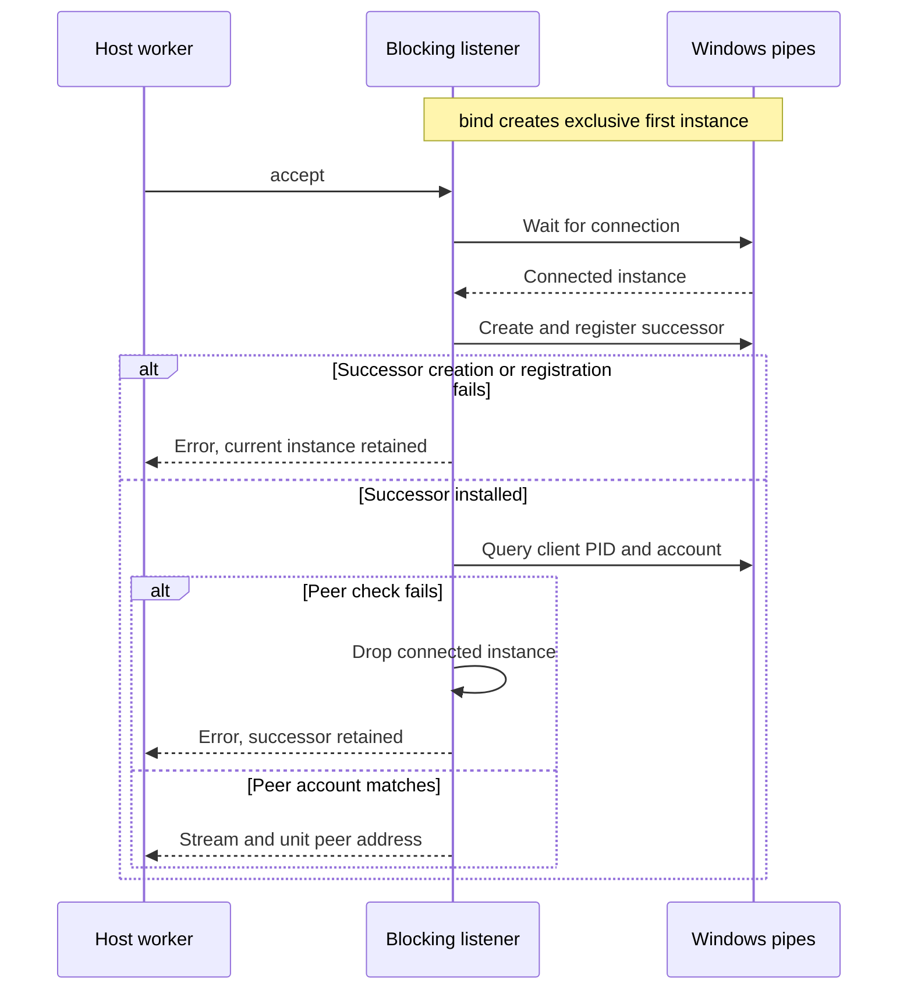

# Understand private named pipes and console workers

Use this explanation when changing Windows host IPC, diagnosing a blocked worker,
or reviewing peer verification and shutdown. These are internal Windows-only
primitives, not an SDK transport API. Read the
[ownership map](ownership.md) first; run focused checks using the
[development guide](../development/contributing.md).

- For connection failures, check the [endpoint and account boundary](#endpoint-and-peer-boundary).
- For an accepted connection that still fails, inspect [accept ordering](#accept-ordering-and-protocol-ownership).
- For a blocked worker, inspect [timeouts and shared shutdown](#blocking-calls-and-shared-state)
  or [console closure](#console-workers-and-detached-launches).

## Endpoint and peer boundary

[pipe.rs](../../src/pipe.rs) owns the OS pipe contract. `pipe_name` requires an
absolute endpoint path with a filename, no parent-directory components, and no
NUL UTF-16 code unit.

### Derive the same kernel name

It hashes, in order:

1. The domain separator `undercurrent.local-pipe.v0.1.0-beta\0`.
2. The current process-token user security identifier (SID) string as bytes, then a zero byte.
3. Each code unit of the supplied path spelling as little-endian UTF-16.

The result is `\\.\pipe\undercurrent-` followed by a hexadecimal SHA-256 digest.
The path is an address input; this function neither creates a socket file nor
canonicalizes, case-folds, checks existence, or applies the stricter
[filesystem path grammar](filesystem-security.md#choose-a-path-pin). Different
spellings can produce different pipe names for the same filesystem location.
Callers must agree on the configured spelling. The hash namespace's `0.1.0-beta` is not
a protocol negotiation version.

### Create and verify a pipe

`PipeListenerHandle::create(name, first)` validates the prefix and absence of
NUL, creates a noninheritable duplex overlapped byte pipe, and requests a
protected discretionary access-control list (DACL) granting generic-all access
only to the current process account. Remote clients are rejected. The requested
input/output buffers are 65,536 bytes each; these are OS buffers, not protocol
frame limits. `first = true` requests first-instance exclusivity. Later accepted
instances use `false` while retaining the name through an existing instance.

The handle can be created outside Tokio. `into_async` transfers it exactly once
to Tokio's `NamedPipeServer`; call it in the intended Tokio I/O runtime context.
Dropping the unconverted wrapper closes its owned handle. Reactor registration
and connection failures are not authorization bypasses.

Peer checks ask Windows for the connected endpoint's PID and query that process
token's user SID. `verify_pipe_client` and `verify_pipe_server` reject an account
mismatch with `PermissionDenied`. A failed PID query always returns its OS error.
Client-side server verification also requires successful process/token inspection.

Server-side client verification has one fallback: if process/token inspection
returns `ERROR_ACCESS_DENIED`, it queries the connected pipe's kernel-authenticated
client identification token and compares its user SID with the server's process
account. This covers a regular desktop daemon accepting a same-account SSH client
whose process cannot be inspected. Other process errors propagate. The fallback
rejects anonymous identification and failed token queries; it never substitutes
a username, an environment value, or an unverified PID for account evidence.

The identification scope in [security.rs](../../src/security.rs) is synchronous.
It saves any preceding thread token and restores that exact token on success or
failure, including unwinding. Restoration failure aborts the process. No await,
protocol handling, or filesystem operation runs in the client's thread context.
The private pipe DACL and remote-client rejection stay in effect.

These checks do not verify an executable, creation timestamp, session, capability,
or application authentication token. `current_user_sid` means the **process** token
user, even when the calling thread is impersonating another token. The fallback
does not make a regular client able to inspect an SSH-owned server process; that
direction still fails closed when server process inspection is denied.

For stronger agent identity, the
[gateway](../../../undercurrent-daemon/src/agent_bridge_gateway.rs) obtains the peer
PID and calls [runtime ancestry validation](../../../undercurrent-runtime/src/process/hosted.rs),
which pins executable objects and retains a bounded process chain. That check
belongs above the account-scoped pipe primitive.

## Accept ordering and protocol ownership

`BlockingPipeStream::connect` opens once and verifies the server account before
returning a stream. Verification failure returns an error and drops the client
handle. A successful client connect can still precede server-side rejection:
client and server account checks run independently.

This sequence isolates the listener's ordering. The client may already be
connected when the worker calls `accept`:

*The successor keeps ownership of the name while the connected instance is
verified and handed off.* Connection-wait errors also return without replacing
the current instance. None of these steps commits a request or acknowledges an
application effect. Higher layers own framing and application authentication.

### Public transport uses a different I/O adapter

The [public local transport](../../../undercurrent-transport-local/src/windows.rs)
uses the same `PipeListenerHandle` directly with asynchronous Tokio I/O. Its
`AsyncLocalListener::accept` installs a successor but delegates peer verification
to `verify_local_peer` in the serving path; it does not use the blocking wrapper.
Its `connect_local` retries raw Windows error 231 (`ERROR_PIPE_BUSY`) every 10 ms,
with the overall deadline owned by its caller. **`BlockingPipeStream::connect`
opens once and returns that error immediately.** Do not copy the public
transport's retry policy into a private mutation protocol.

External consumers use the [SDK reading paths](../../../../docs/sdk/README.md):
Rust calls are blocking, while Python methods are asynchronous through its
bridge. Neither exposes these handles as a consumer API. Private session-host
frames and agent-bridge requests have different owners:
[host protocol](../../../undercurrent-runtime/src/process_host_protocol.rs) and
[agent gateway](../../../undercurrent-daemon/src/agent_bridge_gateway.rs).

## Blocking calls and shared state

[blocking_pipe.rs](../../src/blocking_pipe.rs) keeps one process-wide Tokio runtime
in a `OnceLock`, with two workers named `uc-private-ipc`. Initialization failure
is cached; later calls report the same error kind with `private IPC reactor
unavailable`. There is no per-read or per-write OS thread and no exposed reactor
shutdown. Console notifications use this reactor too.

The waiting helper polls a future on the calling thread and parks/unparks that
thread with a waker. It enters the shared reactor without `Runtime::block_on`,
so it can be called from another Tokio context, but **still blocks that caller**.
Use blocking workers; an async task calling this API does not become nonblocking.

### Clones and peer queries

`try_clone` and `Clone` share one connection, timeout configuration, and shutdown
state through `Arc`. `peer_process_id` queries the endpoint and rechecks its
account; it returns `BrokenPipe` after local closure. The returned PID is not a
retained `ProcessIdentity`.

### Read, write, and flush

Reads and writes wait for readiness and retry `WouldBlock`. Their outcomes differ:

| Outcome | `read` | `write` |
| --- | --- | --- |
| Ready | Returns bytes or EOF | May write fewer bytes than requested |
| Local shutdown | EOF (`Ok(0)`) | `BrokenPipe` |
| Configured deadline reached | `TimedOut` | `TimedOut` |

`read` converts `try_read`'s `BrokenPipe` to EOF. Other read/readiness errors and
write errors propagate.

Empty buffers return zero immediately for either call, including after shutdown.
`flush` returns success without an OS flush or peer acknowledgement.

### Concurrent I/O and request deadlines

Read and write timeout setters accept `None` for no deadline and reject zero
with `InvalidInput`. Durations are shared by all clones and copied at the start
of each call. A later change does not retime an already waiting call.

The state mutex is held only while copying the stream handle and timeout, not
through an I/O wait. This permits concurrent operations, but supplies no
application-frame serialization. Multiple readers compete for bytes; multiple
writers must serialize complete frames in their owning protocol. `read_exact`
and `write_all` can make several underlying calls, each with its own timeout.
The configured duration is not a total frame or request deadline.

### Stop streams and listeners

`shutdown(Both)` removes the shared pipe reference and wakes clone waits through
a watch channel. Repeated full shutdown succeeds; Read/Write half-close requests
return `Unsupported`. Dropping one clone releases only that reference and does
not perform shared shutdown.

Full shutdown is cancellation of local I/O waits. It cannot roll back bytes
already delivered or eliminate a race with a ready operation. Temporary `Arc`
references in in-flight calls may keep the native handle alive until those
calls return. EOF, a timeout, or a lost response must be reconciled against the
operation's receipt or status before issuing another mutation. The wrapper
contains no request IDs, typed product rejections, deduplication, or replay.
A timed-out read alone does not close the stream; the timeout-recovery test
demonstrates subsequent successful reads.

**Listener shutdown needs a caller-owned stop loop.**
`BlockingPipeListener::accept` serializes accepts with a mutex. The default
wait has no timeout or cancellation handle. In nonblocking mode it polls once
and returns `WouldBlock` if no connection is ready; mutex acquisition can still
wait behind another accept. `set_nonblocking` changes future accepts and does
not wake an existing blocking accept. The gateway uses a nonblocking accept
loop and its own stop flag so that it can join its accept worker.

## Console workers and detached launches

[console.rs](../../src/console.rs) registers Tokio Ctrl-C and Ctrl-Break receivers
on the [shared reactor](#blocking-calls-and-shared-state). `ConsoleSignals` is a
blocking iterator whose two signal kinds both yield `()`.

| Event or operation | Result |
| --- | --- |
| `forever()` | Returns `&mut self` for iterator compatibility; closure can still end iteration. |
| Cloned `ConsoleSignalHandle::close()` | Sets the shared terminal flag, wakes idle `next()`, and makes later `next()` calls return `None`. |
| Several branches ready | Selection favors close, then Ctrl-C, then Ctrl-Break. A signal already selected can race with close; delivered events remain delivered. |
| Registration failure | Constructor returns the error. |
| Reactor wait failure | Iteration collapses the error into `None`. |

This closes a notification worker, not a runtime attempt, subscription, or
process. The [CLI signal worker](../../../undercurrent-cli/src/signals.rs) and
[daemon main](../../../undercurrent-daemon/src/main.rs) decide what signals mean.

### Keep detached children from retaining CLI streams

`prevent_standard_handle_inheritance` clears `HANDLE_FLAG_INHERIT` on valid
process stdin/stdout/stderr handles without closing or replacing them. The
[CLI lifecycle launcher](../../../undercurrent-cli/src/daemon_lifecycle.rs) uses it
to keep detached children from retaining redirected CLI streams. Null and
invalid standard handles are skipped. Errors stop the loop; earlier changes
are not rolled back. This is a process-wide flag change, not a synchronization
primitive for competing launches. Explicit `std::process` stdio selection
still uses duplicated selected handles.

## Evidence and next tasks

Use [test coverage and limits](../development/test-coverage.md) for pipe ACL,
peer-PID, timeout recovery, clone shutdown, and console-worker checks. That
reference distinguishes tested cases from cross-account or real-signal tests.
For a live failure, follow [diagnosis](../development/contributing.md#diagnose-a-windows-failure).

[Crate documentation](../README.md)
